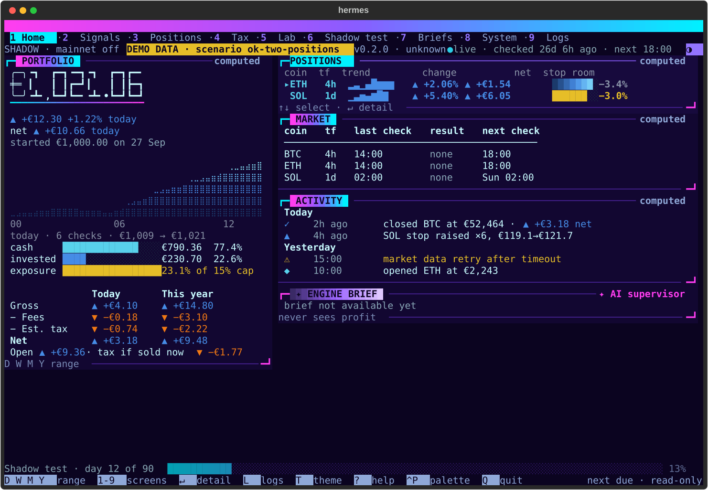

# Hermes

[](https://github.com/ricardoafo/hermes/actions/workflows/ci.yml)
[](LICENSE)
[](https://docs.python.org/3.14/)
[](https://mypy-lang.org/)

Hermes is a crypto trading engine written in Python. It runs rule-based strategies on
live public market data in paper-trading mode. Every fill is recorded in an
event-sourced FIFO ledger, and the ledger produces EUR valuations and Spanish tax
figures (Modelo 100 and 721). Strategies reach it only through a research pipeline that
is pre-registered and tested out of sample.

The aim is to answer one question honestly: does a strategy still work on data it has
never seen, after fees, slippage and tax? Everything else, from the sealed test window
to the hash-chained trial log, exists so that the answer can't be fooled.

**Status:** paper trading only. No exchange key is installed and no order is sent.
Versions stay at `0.y.z` until real capital is involved
([ADR-027](docs/architecture/adr-027-zero-major-versions-until-real-capital.md)).
Nothing here is financial advice.



## What it does

- **Paper-trading engine.** It fetches 4-hour bars from public exchange endpoints,
  evaluates the active strategy, sizes positions under fixed risk limits and simulates
  fills with slippage and fees
  ([ADR-011](docs/architecture/adr-011-paper-trading-engine.md)).
- **Ledger.** It is append-only and event-sourced, with FIFO lots, schema migrations
  that keep a rollback path, and an integrity check (`hermes ledger verify`).
- **Tax.** Each trade is valued in EUR from cached ECB rates. The ledger then gives
  yearly gain estimates and the figures for Modelo 100 and 721. Hermes submits nothing
  ([ADR-002](docs/architecture/adr-002-tax-posture.md),
  [ADR-016](docs/architecture/adr-016-tax-estimate-rules.md)).
- **Research funnel.** Batches of candidate strategies are pre-registered before any
  backtest. They run on a fixed Train window, then a Validation window, and the final
  out-of-sample window stays sealed. Every trial is written to a hash-chained trial log
  and counted in the deflated Sharpe ratio, so later choices can't hide earlier tries
  ([ADR-014](docs/architecture/adr-014-pre-registration-binds-real-capital.md),
  [ADR-026](docs/architecture/adr-026-research-batch-and-signed-champion-rule.md),
  [ADR-031](docs/architecture/adr-031-research-sweep-for-a-strong-champion.md)).
- **Shadow test.** A winning strategy runs in shadow for 90 counted days before it can
  be considered for anything more
  ([ADR-021](docs/architecture/adr-021-strategy-lifecycle-ready-and-done.md)).
- **Operator tools.** There is a read-only terminal console (`hermes tui`), status,
  money, positions and activity commands, and a read-only Telegram bot. Monthly
  reconciliation and a read-only supervisor complete the set
  ([ADR-012](docs/architecture/adr-012-continuous-ai-evaluation.md)).

## Architecture

Hexagonal (ports and adapters), with import rules enforced by import-linter
([ADR-003](docs/architecture/adr-003-solution-architecture/)):

| Package | Holds |
| ------- | ----- |
| `src/hermes/domain/` | Pure types and rules: events, lots, fees, risk. No I/O. |
| `src/hermes/application/` | Use cases: execution, ledger, tax, backtest, calibration, reconciliation. |
| `src/hermes/ports/` | Interfaces the application depends on. |
| `src/hermes/adapters/` | Exchanges, market data, FX rates, SQLite ledger, notifier, console. |
| `src/hermes/infrastructure/` | Config, logging, wiring. |
| `src/hermes/entrypoints/` | The `hermes` CLI and the services it starts. |

Configuration lives in [`config/`](config/) as YAML. Secrets come from the environment,
never from the repository.

## Quick start

You need Python 3.14 and [uv](https://docs.astral.sh/uv/).

```bash
git clone https://github.com/ricardoafo/hermes.git
cd hermes
uv sync --frozen
uv run hermes --help
```

Try the console on demo data, without a ledger or network:

```bash
uv run hermes --demo ok-two-positions tui
```

Run the unit tests:

```bash
uv run pytest tests/unit
```

The full setup, including the git hooks, is in
[`docs/guides/local-setup.md`](docs/guides/local-setup.md).

## Main commands

| Command | Does |
| ------- | ---- |
| `hermes serve` | Runs the paper-trading engine until stopped. |
| `hermes tui` | Opens the read-only console: portfolio, positions, activity, shadow test. |
| `hermes status` | Shows the verdict and the last and next bar for each stream. |
| `hermes money` | Shows the portfolio total in EUR and the gross-to-net breakdown. |
| `hermes ledger verify` | Checks ledger integrity, schema and event gaps. |
| `hermes funnel` | Evaluates the backtest funnel against a signed pre-registration. |
| `hermes tax-filing` | Gives the Modelo 100 and 721 figures for a tax year, as an estimate. |

`hermes --help` lists every command, and `hermes <command> --help` gives its options and
exit codes. Most commands accept `--json`.

## Roadmap

| Stage | State |
| ----- | ----- |
| Engine, ledger, tax figures and console | Done |
| Research funnel and strategy sweep | In progress |
| 90-day shadow test of the winning strategy | Next |
| Live trading with small real capital | Only after the shadow test and the other gates in [ADR-021](docs/architecture/adr-021-strategy-lifecycle-ready-and-done.md) pass |

Open work is tracked in the [milestones](https://github.com/ricardoafo/hermes/milestones).

## Quality bar

- mypy in strict mode, ruff, and zero warnings from every linter
  ([ADR-009](docs/architecture/adr-009-documentation-strategy.md)).
- Test tiers: unit, property (Hypothesis), contract, integration, end-to-end and
  mutation ([ADR-007](docs/architecture/adr-007-testing-strategy.md),
  [ADR-017](docs/architecture/adr-017-test-tiers-as-enforced.md)).
- Supply chain: a locked `uv.lock`, pip-audit, a licence allowlist, pinned Actions,
  gitleaks, Semgrep, actionlint and zizmor
  ([ADR-010](docs/architecture/adr-010-dependency-management-and-supply-chain.md),
  [ADR-019](docs/architecture/adr-019-security-baseline-and-threat-model.md)).

## Documentation

| Where | What |
| ----- | ---- |
| [`docs/`](docs/README.md) | Index of all documentation. |
| [`docs/architecture/`](docs/architecture/) | Architecture decision records, numbered in order. |
| [`docs/guides/`](docs/guides/) | How-to guides: development workflow, tests, releases. |
| [`docs/decisions/`](docs/decisions/) | Smaller choices that don't need an ADR. |
| [`docs/research/`](docs/research/) | Notes on the external material behind decisions. |
| [`CHANGELOG.md`](CHANGELOG.md) | Release notes, in Keep a Changelog format. |

## Contributing

Read [`CONTRIBUTING.md`](CONTRIBUTING.md) before opening an issue or a pull request.
Report security issues privately, as described in [`SECURITY.md`](SECURITY.md).
This project follows a [code of conduct](CODE_OF_CONDUCT.md).

## Getting help

Open an issue with one of the [templates](https://github.com/ricardoafo/hermes/issues/new/choose).
This is a single-maintainer project, so replies can take a few days.

## License

Apache License 2.0. See [`LICENSE`](LICENSE) and [`NOTICE`](NOTICE).
