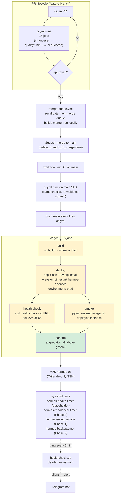

# deploy/ — VPS Provisioning + Systemd Units

**Type**: Deploy assets (living scaffolding)
**Owners**: Ricardo Afonso
**Description**: VPS bootstrap script, systemd units, and reference material for the CD pipeline defined in `.github/workflows/cd.yml`.

## Status

Skeleton — every asset here is a placeholder that pins the SHAPE of
the deploy target while Phase 0 fills in the payload. See ADR-003 §09
(`docs/architecture/adr-003-solution-architecture/09-deployment.md`)
for the target design.

## End-to-end flow



Yellow = placeholder body (fill in Phase 0). Green = real logic today.

## Trigger order

1. PR opens → CI runs (all 15 jobs, gated on changeset)
2. Human approves → `merge-queue.yml` picks it up
3. Queue builds merge tree locally, runs tree gates on it, calls `pulls.merge`
4. Squash lands on `main` → GH fires `push:main` + `workflow_run:CI:completed`
5. `cd.yml` triggers on `push:main` — builds wheel, deploys, verifies
6. `confirm` aggregator marks the deployment complete
7. Systemd services on VPS pick up the new wheel on their next unit start

Cross-references:

- Queue: `.github/workflows/merge-queue.yml`, `tools/merge/decisions.cjs`, `docs/decisions/2026-08-21-revalidate-then-merge.md`
- CI: `.github/workflows/ci.yml`
- CD: `.github/workflows/cd.yml` (this dir)
- Runtime: `docs/architecture/adr-003-solution-architecture/09-deployment.md`

## Contents

| File                                     | Purpose                                                                                             | Status                                    |
| ---------------------------------------- | --------------------------------------------------------------------------------------------------- | ----------------------------------------- |
| `bootstrap-vps.sh`                       | Idempotent VPS provisioning (user, dirs, uv, systemd-creds, Tailscale)                              | skeleton — safe to re-run when filled in  |
| `systemd/hermes-health.service`          | Pings healthchecks.io via `hermes-health-ping.sh`, only while `hermes.service` is active            | template — copy-and-install, not auto-set |
| `systemd/hermes-health.timer`            | Fires the ping every 5 min                                                                          | template — copy-and-install, not auto-set |
| `systemd/hermes-notify-failure@.service` | Started by `hermes.service`'s `OnFailure=`; sends one Telegram message                              | template — copy-and-install, not auto-set |
| `hermes-health-ping.sh`                  | The conditional ping (`systemctl is-active --quiet hermes.service`, then curl)                      | shipped in each release                   |
| `hermes-notify-failure.sh`               | Builds and sends the Telegram failure message; needs only bash and curl                             | shipped in each release                   |
| `systemd/hermes.service`                 | Template unit for the main hermes process (reads `/etc/hermes/env.production`, runs `hermes serve`) | template — copy-and-install, not auto-set |
| `systemd/hermes.env.example`             | Shape of `/etc/hermes/env.production` — the EnvironmentFile prod systemd loads. Documentation only  | template — never installed automatically  |

## First-time VPS setup

Run once as root on `hermes-01` (via `ssh -i ~/.ssh/hermes_vps_ed25519 root@hermes-01`):

```bash
curl -fsSL https://raw.githubusercontent.com/ricardoafo/hermes/main/deploy/bootstrap-vps.sh | sudo bash
```

Or clone the repo and run locally:

```bash
git clone https://github.com/ricardoafo/hermes.git
cd hermes
sudo bash deploy/bootstrap-vps.sh
```

The script is idempotent — re-running is safe and only reconciles
missing state.

## Post-bootstrap: install systemd units

```bash
sudo cp deploy/systemd/hermes-health.service /etc/systemd/system/
sudo cp deploy/systemd/hermes-health.timer /etc/systemd/system/
sudo cp 'deploy/systemd/hermes-notify-failure@.service' /etc/systemd/system/
sudo systemctl daemon-reload
sudo systemctl enable --now hermes-health.timer
```

Both units read `/etc/hermes/env.production` and run scripts from
`/opt/hermes/current/deploy/`, so a release must be deployed first. The
health timer needs `HERMES_HEALTHCHECKS__PING_URL` in that file.

Verify:

```bash
systemctl status hermes-health.timer
journalctl -u hermes-health.service --since "5 minutes ago"
```

### Alerting when hermes is down

Two independent paths reach the operator on Telegram:

| Path                    | Fires when                                                                                      | Needs                                                     |
| ----------------------- | ----------------------------------------------------------------------------------------------- | --------------------------------------------------------- |
| `OnFailure=` notifier   | `hermes.service` enters `failed`: start limit tripped (5 starts in 10 min) or exit code 2 or 3  | `HERMES_TELEGRAM__BOT_TOKEN`, `HERMES_TELEGRAM__CHAT_ID`  |
| healthchecks.io ping    | `hermes-health-ping.sh` stops pinging: service stopped, crash-looping, or the whole VPS is down | `HERMES_HEALTHCHECKS__PING_URL` and the integration below |

The notifier sends one message per failure, with the last five journal
lines (values of secret-looking variables are masked). A crash that is
about to be restarted does not alert: the unit is `activating
(auto-restart)`, not `failed`. A stopped service sends no message of its
own; the missed ping covers it.

`hermes-health-ping.sh` pings only while `systemctl is-active --quiet
hermes.service` succeeds, and a rejected ping fails the unit instead of
being swallowed. The one-time operator step (healthchecks.io, no code):

1. Open the hermes check on healthchecks.io: period 5 minutes, grace
   10 minutes.
2. Integrations: add Telegram and tick it for this check.

An alert then arrives after about 15 minutes of silence (period plus
grace), so a single missed ping never pages.

Check the notifier end to end (sends a real message):

```bash
sudo systemctl start hermes-notify-failure@hermes.service
journalctl -u hermes-notify-failure@hermes.service --since "1 minute ago"
```

## Post-bootstrap: install the main hermes service + env file

Prod credentials live in `/etc/hermes/env.production` (read by systemd via
`EnvironmentFile=`) — NOT in a dotenv file inside `/opt/hermes`. The
target is root-owned and 0600 so `hermes` (or any other user) cannot
read the secrets directly; systemd expands the env into the service
process at start time only. See
`docs/decisions/2026-08-23-credential-storage-layered-by-env.md` for
the three-tier rationale (dotenv for dev / GH Secrets for CI / systemd
EnvironmentFile for prod).

The unit assumes a versioned-release layout: `/opt/hermes/current` is a
symlink to `/opt/hermes/versions/<version>`, and each release holds its own
`.venv`, `config/` and `deploy/`. The unit runs
`/opt/hermes/current/.venv/bin/hermes serve` from `/var/lib/hermes`, the
only writable path (the SQLite ledger lives there). The deploy creates the
layout and installs the unit.

Do not copy `hermes.env.example` to the VPS. The `vps-bootstrap` workflow
(`.github/workflows/vps-bootstrap.yml`) renders the real file from the
GitHub `prod` environment; the example documents its shape and a unit test
checks that it loads. Then install the unit:

```bash
sudo cp /opt/hermes/current/deploy/systemd/hermes.service /etc/systemd/system/
sudo cp '/opt/hermes/current/deploy/systemd/hermes-notify-failure@.service' /etc/systemd/system/
sudo systemctl daemon-reload
sudo systemctl enable --now hermes.service
```

`hermes.service` stops restarting after 5 failed starts in 10 minutes and
stays `failed`; its `OnFailure=` then sends a Telegram message (see
[Alerting when hermes is down](#alerting-when-hermes-is-down)). Exit codes
2 (bad arguments) and 3 (config load failed) never restart. Clear a
tripped limit before the next start:

```bash
sudo systemctl reset-failed hermes.service
sudo systemctl restart hermes.service
```

Reload after the env file changes (systemd caches the file into each
running unit — restart is required):

```bash
sudo systemctl daemon-reload         # picks up EnvironmentFile changes
sudo systemctl restart hermes.service
journalctl -u hermes.service --since "1 minute ago"
```

Verify:

```bash
systemctl status hermes.service
journalctl -u hermes.service --since "5 minutes ago"
```

## GH Actions secrets required (populate on `prod` Environment)

The `cd.yml` workflow references these secrets. Provision them under
Repo Settings → Environments → `prod`:

| Secret                | Purpose                                                                    |
| --------------------- | -------------------------------------------------------------------------- |
| `VPS_SSH_KEY`         | Private SSH key for the deploy user (ed25519)                              |
| `VPS_SSH_HOST`        | Tailscale hostname (`hermes-01`) — port 22 is CLOSED to public internet    |
| `VPS_SSH_USER`        | Deploy user (`hermes-deploy` — different from `hermes` service user)       |
| `VPS_HEALTHCHECK_URL` | Healthchecks.io ping URL for post-deploy verification                      |

Environment branch restriction: `main` only — no fork-PR workflows can
resolve these.

## Related

- `.github/workflows/cd.yml` — CD pipeline
- `docs/architecture/adr-003-solution-architecture/09-deployment.md` — full deploy design
- `docs/guides/vps-operations.md` — VPS ops runbook
