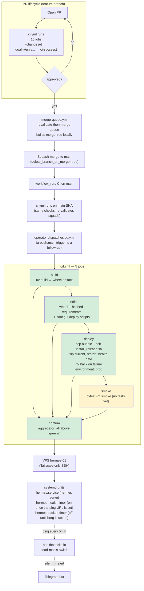

# deploy/ — VPS Provisioning + Systemd Units

**Type**: Deploy assets (living scaffolding)
**Owners**: Ricardo Afonso
**Description**: Systemd units and reference material for the VPS bootstrap workflow and the CD pipeline defined in `.github/workflows/cd.yml`.

## Status

The bootstrap and the deploy path are implemented
(`openspec/changes/179-cd-first-real-deploy/change.md`). The health timer,
the backup timer and the smoke suite are still placeholders. See ADR-003 §09
(`docs/architecture/adr-003-solution-architecture/09-deployment.md`)
for the target design.

## End-to-end flow



Yellow = placeholder body. Green = real logic today.

## Trigger order

1. PR opens → CI runs (all 15 jobs, gated on changeset)
2. Human approves → `merge-queue.yml` picks it up
3. Queue builds merge tree locally, runs tree gates on it, calls `pulls.merge`
4. Squash lands on `main` → GH fires `push:main` + `workflow_run:CI:completed`
5. The operator dispatches `cd.yml` (`workflow_dispatch` only; a `push:main`
   trigger is a follow-up)
6. `cd.yml` builds the wheel and the release bundle, installs the release
   on the VPS and runs the health gate; `confirm` marks the deployment
   complete
7. `hermes.service` runs the new release from `/opt/hermes/current`

Cross-references:

- Queue: `.github/workflows/merge-queue.yml`, `tools/merge/decisions.cjs`, `docs/decisions/2026-08-21-revalidate-then-merge.md`
- CI: `.github/workflows/ci.yml`
- CD: `.github/workflows/cd.yml`
- Runtime: `docs/architecture/adr-003-solution-architecture/09-deployment.md`

## Contents

| File                                     | Purpose                                                                                            | Status                                                            |
| ---------------------------------------- | -------------------------------------------------------------------------------------------------- | ----------------------------------------------------------------- |
| `systemd/hermes.service`                 | Main hermes process unit (reads `/etc/hermes/env.production`, runs `hermes serve`)                 | installed and enabled by `vps-bootstrap`; first deploy starts it  |
| `systemd/hermes.env.example`             | Shape of `/etc/hermes/env.production` — the EnvironmentFile prod systemd loads. Documentation only | template — never installed automatically                          |
| `systemd/hermes-health.service`          | Pings healthchecks.io via `hermes-health-ping.sh`, only while `hermes.service` is active           | installed by `vps-bootstrap`                                      |
| `systemd/hermes-health.timer`            | Fires the ping every 5 min                                                                         | installed by `vps-bootstrap`; enabled once the ping URL is set    |
| `systemd/hermes-backup.service`          | Nightly borg backup of L2 Parquet and SQLite                                                       | installed by `vps-bootstrap`                                      |
| `systemd/hermes-backup.timer`            | Fires the backup daily at 03:00 UTC                                                                | installed by `vps-bootstrap`; stays disabled until borg is set up |
| `systemd/hermes-notify-failure@.service` | Started by `hermes.service`'s `OnFailure=`; sends one Telegram message                             | installed by `vps-bootstrap`                                      |
| `hermes-health-ping.sh`                  | The progress ping: `hermes status --json` decides success or `/fail` while the unit is active      | shipped in each release                                           |
| `hermes-notify-failure.sh`               | Builds and sends the Telegram failure message; needs only bash and curl                            | `/opt/hermes/bin`: `vps-bootstrap`, then each good deploy         |
| `hermes-notify-crash.sh`                 | `hermes.service`'s `ExecStopPost=`: one Slack line after a stop that was not clean                 | `/opt/hermes/bin`: `vps-bootstrap`, then each good deploy         |

The scripts the workflows run live in `scripts/deploy/`:

| Script               | Runs on                                   | Purpose                                                                            |
| -------------------- | ----------------------------------------- | ---------------------------------------------------------------------------------- |
| `vps_bootstrap.sh`   | VPS, from `vps-bootstrap.yml`             | Idempotent provisioning: user, dirs, uv, Python 3.14, units, env file, storage box |
| `install_release.sh` | VPS, from `cd.yml`                        | Installs one release, flips `current`, restarts the unit, runs the gate            |
| `health_gate.sh`     | VPS, from the two scripts here            | Unit active for 30 s, same `MainPID`, `serve.run.started` in the journal           |
| `rollback.sh`        | VPS, by hand or from `install_release.sh` | Flips `current` back to `previous` and re-runs the gate                            |

## First-time VPS setup

Dispatch the `vps-bootstrap` workflow (it runs on the `prod` environment,
over the tailnet):

```bash
gh workflow run vps-bootstrap.yml --repo ricardoafo/hermes --ref main
gh run watch --repo ricardoafo/hermes
```

The workflow ships `deploy/systemd/` to the VPS and runs
`scripts/deploy/vps_bootstrap.sh`. Every step is idempotent, so a second
dispatch is safe. The script:

1. creates the `hermes` system user (nologin);
2. creates `/opt/hermes/{versions,bin,python}` (root-owned),
   `/var/lib/hermes` and `/var/log/hermes` (`hermes`-owned),
   and `/etc/hermes` (root-owned);
3. installs the uv version pinned in `cd.yml` and Python 3.14.7 under
   `/opt/hermes/python`, then checks that user `hermes` can run it;
4. installs the unit files, enables `hermes.service`, installs the failure
   alert script to `/opt/hermes/bin` and resets a failed alert unit;
5. writes `/etc/hermes/env.production` (`root:root`, `0600`) when it does not
   exist; an existing file only has its owner and mode repaired; then
   enables `hermes-health.timer` when that file has
   `HERMES_HEALTHCHECKS__PING_URL` (the backup timer stays off);
6. mounts the Hetzner Storage Box when its credentials are set;
7. writes `/etc/sudoers.d/hermes-deploy` (`0440`, checked with `visudo -cf`)
   only when the repo variable `VPS_DEPLOY_USER` names a non-root CD account.
   CD runs as `root` today, so nothing is written.

The health and backup units read `/etc/hermes/env.production` and run
scripts from `/opt/hermes/current/deploy/`, so a release must be deployed
first. The failure alert runs from `/opt/hermes/bin` instead: a missing or
broken release is the likeliest reason `hermes.service` fails, and the
alert has to survive it.

Verify:

```bash
ssh hermes-01 'id hermes; stat -c "%a %U:%G" /etc/hermes/env.production; systemctl is-enabled hermes.service'
```

### Alerting when hermes is down

Two independent paths reach the operator on Telegram, and a third posts
same-day notices to Slack:

| Path                  | Fires when                                                                                      | Needs                                                     |
| --------------------- | ----------------------------------------------------------------------------------------------- | --------------------------------------------------------- |
| `OnFailure=` notifier | `hermes.service` enters `failed`: start limit tripped (5 starts in 10 min) or exit code 2 or 3  | `HERMES_TELEGRAM__BOT_TOKEN`, `HERMES_TELEGRAM__CHAT_ID`  |
| healthchecks.io ping  | the ping stops (service stopped, crash-looping, VPS down) or `hermes status` says late or down  | `HERMES_HEALTHCHECKS__PING_URL` and the integration below |
| Slack crash notice    | any stop that is not clean (crash, signal, timeout), including the ones `Restart=` recovers     | `HERMES_SLACK__BOT_TOKEN` and `__DEFAULT_CHANNEL`         |

The notifier sends one message per failure, with the last five journal
lines (values of secret-looking variables are masked). A crash that is
about to be restarted does not alert: the unit is `activating
(auto-restart)`, not `failed`; the Slack crash notice covers that case with
one line per crash (unit, result, exit code or signal, and the last
`serve.run.failed` line, secrets masked). A clean stop (deploy, SIGTERM)
sends nothing. A stopped service sends no Telegram message of its own; the
missed ping covers it.

`hermes-health-ping.sh` pings only while `systemctl is-active --quiet
hermes.service` succeeds. It then runs `hermes status --json`: all good sends
a success ping, a late or down verdict (or no ledger) sends a `/fail` ping, so
a running process that stopped processing bars alerts within one tick. The
status JSON goes in the ping body and shows in the check's log. A rejected
ping fails the unit instead of being swallowed. The one-time operator step (healthchecks.io, no code):

1. Open the hermes check on healthchecks.io: period 5 minutes, grace
   10 minutes.
2. Integrations: add Telegram and tick it for this check.

An alert then arrives after about 15 minutes of silence (period plus
grace), so a single missed ping never pages.

Check the notifier end to end (sends a real message):

```bash
sudo systemctl start hermes-notify-failure@hermes.service
journalctl -u hermes-notify-failure@hermes.service --since "1 minute ago"
```

### Sentry in prod

`hermes serve` reports every runtime failure to Sentry when
`HERMES_SENTRY__DSN` is set in `/etc/hermes/env.production`; with an empty
DSN, errors reach the journal only. vps-diagnose prints one line on which it
is: `Sentry: CONFIGURED`, `Sentry: NOT_CONFIGURED` or `Sentry: FAIL` (a DSN
that does not parse). The check parses the DSN and sends no event.

Sentry's own alerts must reach a channel the operator reads. The rule to
create in the hermes Sentry project:

- **When**: a new issue is created, or an issue changes from resolved to
  unresolved (a regression).
- **If**: the event's `environment` equals `prod`.
- **Then**: send a Slack notification to `#hermes-reports`.

Creating that rule and setting `HERMES_SENTRY__DSN` on the VPS are the Code
Owner's steps; neither is automated. After setting the DSN, restart the
service (`sudo systemctl restart hermes.service`) and re-run vps-diagnose to
see `Sentry: CONFIGURED`.

## The env file

Prod credentials live in `/etc/hermes/env.production` (read by systemd via
`EnvironmentFile=`) — NOT in a dotenv file inside `/opt/hermes`. The
file is root-owned and `0600` so `hermes` (or any other user) cannot
read the secrets directly; systemd expands the env into the service
process at start time only. See
`docs/decisions/2026-08-23-credential-storage-layered-by-env.md` for
the three-tier rationale (dotenv for dev / GH Secrets for CI / systemd
EnvironmentFile for prod) and
`docs/decisions/2026-10-02-env-file-path-etc-hermes-env-production.md` for
the path.

Do not copy `hermes.env.example` to the VPS. The `vps-bootstrap` workflow
renders the real file from the GitHub `prod` environment, once. A
re-dispatch leaves an existing file alone. To rotate a secret, edit the
file on the VPS, or delete it and re-dispatch. A deploy refuses to run
when the file is not `600 root:root` or when it enables
`HERMES_ALLOW_MAINNET`.

`hermes.service` stops restarting after 5 failed starts in 10 minutes and
stays `failed`; its `OnFailure=` then sends a Telegram message (see
[Alerting when hermes is down](#alerting-when-hermes-is-down)). Exit codes
2 (bad arguments) and 3 (config load failed) never restart. Clear a
tripped limit before the next start:

```bash
sudo systemctl reset-failed hermes.service
sudo systemctl restart hermes.service
```

Reload after the env file changes (systemd caches the file into each
running unit — restart is required):

```bash
sudo systemctl daemon-reload         # picks up EnvironmentFile changes
sudo systemctl restart hermes.service
journalctl -u hermes.service --since "1 minute ago"
```

## Deploy and rollback

Dispatch `cd.yml` with `dry_run=true` first: it builds the wheel and the
release bundle and touches nothing else. Then deploy for real:

```bash
gh workflow run cd.yml --repo ricardoafo/hermes --ref main -f dry_run=false
gh run watch --repo ricardoafo/hermes
```

The deploy ships `hermes-release-<sha12>.tar.gz` to the VPS and runs
`install_release.sh`. The VPS layout:

```text
/opt/hermes/
  versions/<sha12>/   .venv, config/, deploy/, .installed    (3 newest kept)
  current  -> versions/<sha12>                      (what systemd runs)
  previous -> versions/<older>                      (rollback target)
  bin/                health_gate.sh, rollback.sh
  python/             uv-managed Python 3.14.7
/etc/hermes/env.production                          (secrets, root:root 0600)
/var/lib/hermes/hermes.sqlite3                      (state, hermes:hermes)
```

The release installs from the hash-pinned requirements plus the CI-built
wheel (`docs/decisions/2026-10-02-vps-install-from-hashed-requirements.md`),
flips `previous` and `current` atomically, restarts the unit and runs the
health gate. When the gate fails the script rolls back to `previous` (or
stops the unit on a first deploy) and the job fails. To roll back by hand:

```bash
ssh hermes-01 /opt/hermes/bin/rollback.sh
```

It exits 1 when `current` already equals `previous`. Rollback does not roll
back `/var/lib/hermes`: the SQLite ledger is shared across versions.

`hermes.service` stops restarting after 5 failed starts in 10 minutes and
stays `failed`. Exit codes 2 (bad arguments) and 3 (config load failed)
never restart. A deploy and a rollback both run `reset-failed` before the
restart. To clear a tripped limit by hand:

```bash
sudo systemctl reset-failed hermes.service
sudo systemctl restart hermes.service
```

Verify:

```bash
readlink /opt/hermes/current
systemctl status hermes.service
journalctl -u hermes.service --since "5 minutes ago"
```

## GH Actions secrets required (populate on `prod` Environment)

The `cd.yml` and `vps-bootstrap.yml` workflows reference these secrets.
Provision them under Repo Settings → Environments → `prod`:

| Secret              | Purpose                                                                           |
| ------------------- | --------------------------------------------------------------------------------- |
| `TAILSCALE_AUTHKEY` | Tagged (`tag:ci-runner`) auth key the runner uses to join the tailnet             |
| `VPS_SSH_KEY`       | Private SSH key for the deploy user (ed25519)                                     |
| `VPS_SSH_HOST`      | Tailscale hostname (`hermes-01`) — port 22 is CLOSED to public internet           |
| `VPS_SSH_USER`      | Deploy user. `root` today; the scripts need root (least privilege is a follow-up) |

Environment branch restriction: `main` only — no fork-PR workflows can
resolve these. No secret or variable named `HERMES_ALLOW_MAINNET` may be
set to `yes`.

## Related

- `.github/workflows/cd.yml` — CD pipeline
- `.github/workflows/vps-bootstrap.yml` — VPS bootstrap
- `docs/architecture/adr-003-solution-architecture/09-deployment.md` — full deploy design
- `docs/guides/vps-operations.md` — VPS ops runbook
