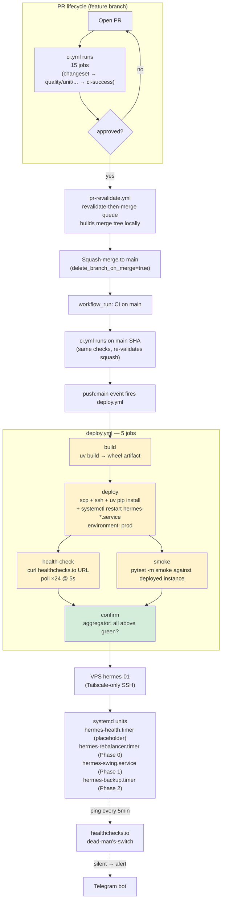

# deploy/ — VPS Provisioning + Systemd Units

**Type**: Deploy assets (living scaffolding)
**Owners**: Ricardo Afonso
**Description**: VPS bootstrap script, systemd units, and reference material for the CD pipeline defined in `.github/workflows/deploy.yml`.

## Status

Skeleton — every asset here is a placeholder that pins the SHAPE of
the deploy target while Phase 0 fills in the payload. See ADR-003 §09
(`docs/architecture/adr-003-solution-architecture/09-deployment.md`)
for the target design.

## End-to-end flow



Yellow = placeholder body (fill in Phase 0). Green = real logic today.

## Trigger order

1. PR opens → CI runs (all 15 jobs, gated on changeset)
2. Human approves → `pr-revalidate.yml` picks it up
3. Queue builds merge tree locally, runs tree gates on it, calls `pulls.merge`
4. Squash lands on `main` → GH fires `push:main` + `workflow_run:CI:completed`
5. `deploy.yml` triggers on `push:main` — builds wheel, deploys, verifies
6. `confirm` aggregator marks the deployment complete
7. Systemd services on VPS pick up the new wheel on their next unit start

Cross-references:

- Queue: `.github/workflows/pr-revalidate.yml`, `tools/merge/decisions.cjs`, `docs/decisions/2026-08-21-revalidate-then-merge.md`
- CI: `.github/workflows/ci.yml`
- CD: `.github/workflows/deploy.yml` (this dir)
- Runtime: `docs/architecture/adr-003-solution-architecture/09-deployment.md`

## Contents

| File                            | Purpose                                                                                                | Status                                     |
| ------------------------------- | ------------------------------------------------------------------------------------------------------ | ------------------------------------------ |
| `bootstrap-vps.sh`              | Idempotent VPS provisioning (user, dirs, uv, systemd-creds, Tailscale)                                 | skeleton — safe to re-run when filled in   |
| `systemd/hermes-health.service` | Minimal placeholder service — exists so the deploy pipeline has something to restart before Phase 0    | placeholder                                |
| `systemd/hermes-health.timer`   | Fires the placeholder every 5 min so we can validate the health-check job end-to-end                   | placeholder                                |

## First-time VPS setup

Run once as root on `hermes-01` (via `ssh -i ~/.ssh/hermes_vps_ed25519 root@hermes-01`):

```bash
curl -fsSL https://raw.githubusercontent.com/ricardoafo/hermes/main/deploy/bootstrap-vps.sh | sudo bash
```

Or clone the repo and run locally:

```bash
git clone https://github.com/ricardoafo/hermes.git
cd hermes
sudo bash deploy/bootstrap-vps.sh
```

The script is idempotent — re-running is safe and only reconciles
missing state.

## Post-bootstrap: install systemd units

```bash
sudo cp deploy/systemd/hermes-health.service /etc/systemd/system/
sudo cp deploy/systemd/hermes-health.timer /etc/systemd/system/
sudo systemctl daemon-reload
sudo systemctl enable --now hermes-health.timer
```

Verify:

```bash
systemctl status hermes-health.timer
journalctl -u hermes-health.service --since "5 minutes ago"
```

## GH Actions secrets required (populate on `prod` Environment)

The `deploy.yml` workflow references these secrets. Provision them under
Repo Settings → Environments → `prod`:

| Secret                | Purpose                                                                    |
| --------------------- | -------------------------------------------------------------------------- |
| `VPS_SSH_KEY`         | Private SSH key for the deploy user (ed25519)                              |
| `VPS_SSH_HOST`        | Tailscale hostname (`hermes-01`) — port 22 is CLOSED to public internet    |
| `VPS_SSH_USER`        | Deploy user (`hermes-deploy` — different from `hermes` service user)       |
| `VPS_HEALTHCHECK_URL` | Healthchecks.io ping URL for post-deploy verification                      |

Environment branch restriction: `main` only — no fork-PR workflows can
resolve these.

## Related

- `.github/workflows/deploy.yml` — CD pipeline
- `docs/architecture/adr-003-solution-architecture/09-deployment.md` — full deploy design
- `docs/guides/vps-operations.md` — VPS ops runbook
