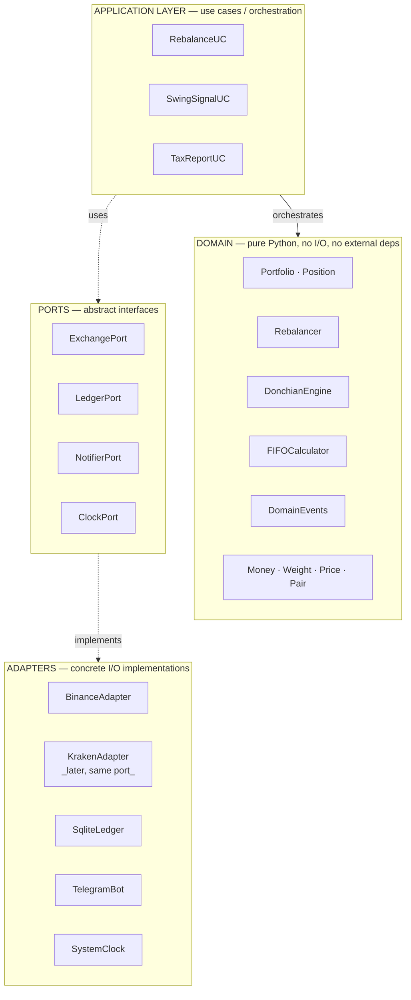

# 01 — Code Organization (Hexagonal / Ports & Adapters)

**Parent ADR**: [README.md](./README.md)
**Status**: Accepted
**Accepted**: 2026-08-21

## Question this section answers

How is the code laid out? Why hexagonal? Why does the mental model matter for hermes?

## Shape



## Why this shape (three reasons that matter for hermes)

### 1. Domain is pure — testable without any I/O

`Rebalancer.compute_trades(portfolio, target_weights, band) → list[TradeCommand]` is a pure function. No network, no clock, no DB. Testing = give inputs, assert outputs. No mocks, no fixtures, no timing hacks.

This is where 90% of the money-critical logic lives, and it's the easiest 90% to test.

### 2. Adapters swap freely — the exchange-agnostic promise, delivered

Binance today, Kraken tomorrow — both implement `ExchangePort`. Domain never knows which one runs. Same principle for `LedgerPort` (SQLite → Postgres later if we ever need concurrency), `NotifierPort` (Telegram → ntfy → email), `ClockPort` (system clock in prod, frozen clock in tests).

### 3. Domain events cross layers cleanly

When domain decides a rebalance should happen, it emits `TradeExecuted(asset, ticket_eur, price_eur, timestamp)`. Application layer catches, calls Notifier + Ledger. Domain doesn't know what happens after emission — it just says "this happened".

Clean audit trail. Structured events for the LLM supervisor to consume in Phase 3+.

## Concrete file layout

```text
src/hermes/
├── domain/                    # PURE — zero external deps
│   ├── portfolio.py           # Portfolio, Position aggregates
│   ├── weights.py             # Weight value object (immutable %)
│   ├── money.py               # Money value object (Decimal + Currency)
│   ├── price.py               # Price value object (Decimal + Pair + timestamp)
│   ├── rebalancer.py          # threshold band logic
│   ├── donchian.py            # breakout signal math
│   ├── fifo.py                # FIFO tax lot calculator (EUR-priced)
│   ├── events.py              # DomainEvent base + concrete events
│   └── errors.py              # domain-specific exceptions
│
├── application/               # USE CASES — orchestration
│   ├── rebalance_uc.py
│   ├── swing_signal_uc.py
│   ├── tax_report_uc.py
│   └── event_bus.py           # in-process pub/sub for domain events
│
├── ports/                     # INTERFACES — abstract, in-domain
│   ├── exchange.py            # ExchangePort (Protocol or ABC)
│   ├── ledger.py              # LedgerPort
│   ├── notifier.py            # NotifierPort
│   └── clock.py               # ClockPort
│
├── adapters/                  # IMPLEMENTATIONS — real I/O
│   ├── exchanges/
│   │   ├── binance.py         # BinanceAdapter implements ExchangePort
│   │   └── kraken.py          # later, same port
│   ├── ledger/
│   │   └── sqlite.py          # SqliteLedger implements LedgerPort
│   ├── notifier/
│   │   └── telegram.py        # TelegramNotifier implements NotifierPort
│   └── clock/
│       └── system.py          # SystemClock implements ClockPort
│
├── infrastructure/            # CROSS-CUTTING — no domain logic
│   ├── config.py              # pydantic-settings
│   ├── logging.py             # structlog setup
│   └── secrets.py             # systemd credential loader
│
├── entrypoints/               # SYSTEMD ENTRYPOINTS
│   ├── rebalancer_cli.py      # invoked by hermes-rebalancer.timer
│   ├── swing_daemon.py        # long-running, hermes-swing.service
│   ├── dashboard.py           # Streamlit, hermes-dashboard.service
│   └── report_cli.py          # invoked by hermes-report.timer
│
└── main.py                    # thin dispatch by entrypoint name
```

## Import direction rule (enforced)

```text
entrypoints → application → domain ← ports ← adapters
```

**Domain imports NOTHING from adapters or infrastructure.** Adapters import ports, not the other way around.

If PyCharm shows an import from `domain/` to `adapters/`, that's a bug. To be enforced via:

- **Linter rule** (e.g., `import-linter` config in `pyproject.toml`)
- **Code review** during PR approval

## Test layout mirrors src

```text
tests/
├── domain/         # pure unit tests — fast, no I/O
├── application/    # use-case tests with fake adapters
├── adapters/       # integration tests — real DB, mocked exchange
└── e2e/            # optional end-to-end against Binance testnet
```

## Alternatives considered

### Flat module layout (per original brief)

**Rejected**: brief proposed flat `fetch.py / store.py / engine.py / ...`. Works at trivial scale but leaks I/O throughout the codebase. When we introduce the swing engine + WebSocket + LLM supervisor, the flat layout becomes tangled fast. Hexagonal costs a bit more ceremony upfront and scales cleanly.

### Full DDD tactical patterns (Aggregate roots, Factories, Domain Services)

**Rejected**: overkill at hermes scale. We take the STRATEGIC patterns from DDD (bounded contexts, domain events, value objects) without the tactical ceremony.

### Microservices (separate rebalancer / swing / dashboard processes with RPC)

**Rejected**: single-VPS, single-user, shared state. Splitting into services would be pretending we're bigger than we are.

## Cross-references

- [02-data-flow.md](./02-data-flow.md) — how data actually moves through this structure at runtime
- [03-persistence-schema.md](./03-persistence-schema.md) — how the SQLite ledger backs LedgerPort
- [04-exchange-adapters.md](./04-exchange-adapters.md) — how ExchangePort abstracts Binance/Kraken
