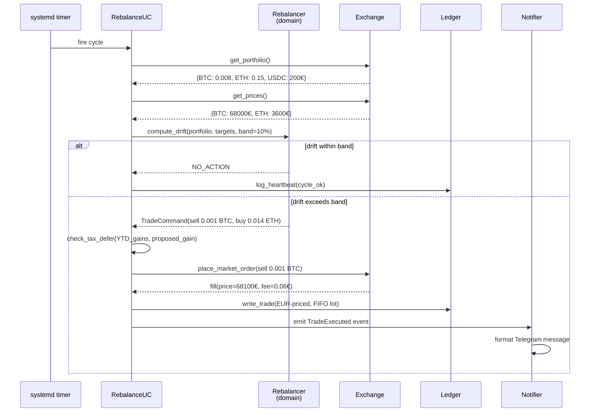
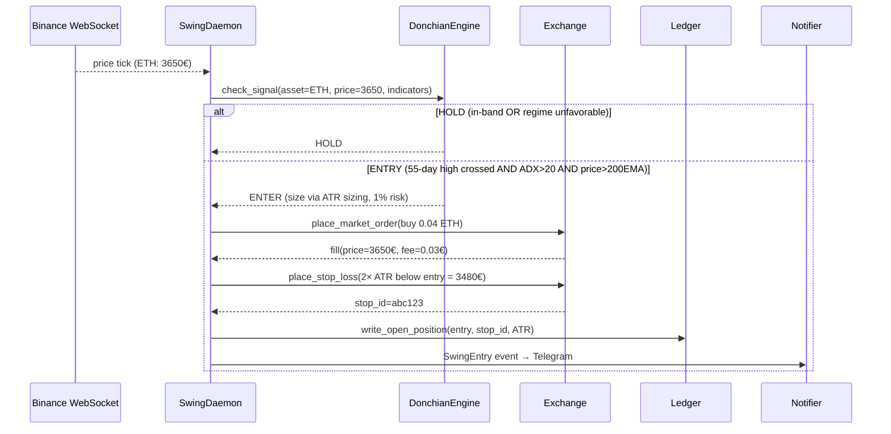
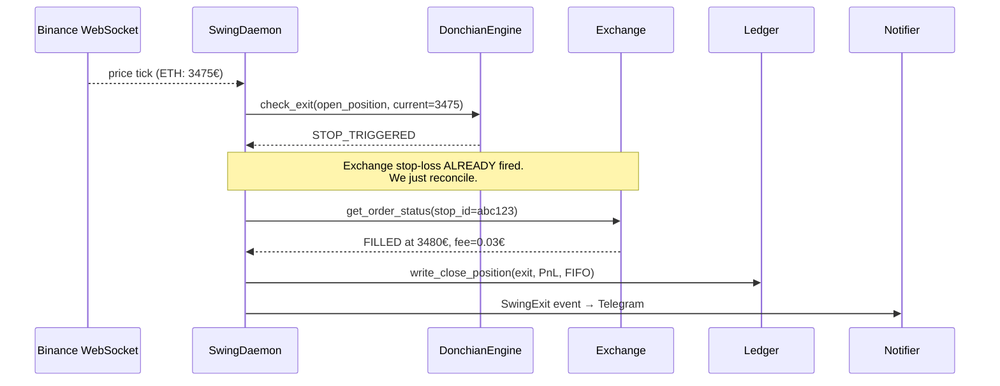

# 02 — Data Flow

**Parent ADR**: [README.md](./README.md)
**Status**: Accepted
**Accepted**: 2026-08-21

## Question this section answers

How does data actually move through hermes at runtime? What happens when the rebalancer fires? What happens when the swing engine sees a breakout? How are orders opened and closed?

## Autonomy model (foundational context)

Both engines execute AND close orders **autonomously** within their rulebook. No human confirmation per trade. But autonomous ≠ unsupervised.

| Layer                    | Mechanism                                                                                                                               |
| ------------------------ | --------------------------------------------------------------------------------------------------------------------------------------- |
| **Autonomous execution** | Engines fire on schedule/signal, place orders, manage lifecycle per rules                                                               |
| **Supervised operation** | Every trade → Telegram alert + ledger entry + optional LLM anomaly review                                                               |
| **Circuit breakers**     | Satellite 30% drawdown → auto-pause swing engine (requires user re-enable). Max 3 concurrent positions. Max 40% of budget per position. |
| **Kill switches**        | `systemctl stop hermes-swing` immediately halts. Rebalancer next cycle = noop.                                                          |
| **Exchange-side stops**  | Stop-losses live ON THE EXCHANGE, not in daemon memory. If daemon crashes at 2am, exchange still enforces the stop.                     |

Claude (LLM) **NEVER executes trades**. See ADR-001. The engines' rules ARE the confirmation.

## Flow 1: Rebalancer cycle

**Trigger**: `hermes-rebalancer.timer` fires hourly via systemd (`OnCalendar=*-*-* *:00:00 Europe/Madrid`).

**Duration**: seconds. Fire → check → maybe trade → done.



## Flow 2: Swing engine cycle — entry phase

**Trigger**: WebSocket price tick (real-time from Binance).

**Runtime**: persistent daemon (`hermes-swing.service`) with `Restart=on-failure`.



## Flow 3: Swing engine cycle — exit phase

**Trigger**: WebSocket price tick OR trailing-stop update.

Two exit paths:

1. **STOP HIT** (exchange-side, primary path) — trailing stop crossed
2. **REGIME EXIT** (opposite Donchian signal — bought on 55-day high, exits on 20-day low)



## Trade lifecycle differences

| Aspect                     | Rebalancer                   | Swing (Donchian)                                   |
| -------------------------- | ---------------------------- | -------------------------------------------------- |
| Trigger                    | systemd timer (hourly)       | WebSocket price tick (real-time)                   |
| Order type                 | MARKET (or IOC LIMIT)        | MARKET entry + STOP-LOSS on exchange               |
| Duration open              | Seconds (fill and done)      | Days to weeks (position held)                      |
| Managed orders on exchange | None between trades          | 1 stop-loss per open position                      |
| Exit trigger               | Same as entry (drift-based)  | STOP HIT (exchange-side) OR opposite signal        |
| Auto-close mechanism       | Fire-and-forget market order | **Exchange enforces the stop even if daemon dies** |

## Stop mechanics

Three exit mechanisms, all mechanical:

1. **Initial stop** (2× ATR below entry) — protects capital on immediate reversals
2. **Trailing stop** (raised as price rises, never lowered) — locks in profit as the trend runs. This IS a "dynamic take-profit" — captures gains without capping upside.
3. **Regime exit** (opposite Donchian signal fires — bought on 55-day high, exits on 20-day low) — cuts the position when trend reverses

**Fixed take-profit (X% target) is intentionally NOT used** — Donchian expectancy depends on a few outsized winners; capping them destroys the strategy.

Example of the trailing stop in action:

```text
Entry at 3650€, initial stop at 3480€ (2× ATR below)

Day 1:  ETH 3650  →  stop 3480    (initial, protects capital)
Day 5:  ETH 3800  →  stop 3620    (trails up, worst case: break-even)
Day 12: ETH 4000  →  stop 3820    (trails up, worst case: +€170/unit locked)
Day 25: ETH 4200  →  stop 4020    (trails up, +€370/unit locked)
Day 30: ETH drops to 4020  →  STOP HITS  →  exit +€370/unit
```

## Stop-loss lifecycle — three important questions

### Q: What if the daemon crashes while positions are open?

**Stops live ON THE EXCHANGE**, not in daemon memory. Daemon crash at 2am → exchange still enforces stops.

On restart, daemon reconciles: fetch open orders from exchange, cross-check against ledger, resume. This is why we place the stop IMMEDIATELY after entry fill.

### Q: What if WebSocket disconnects?

python-binance's `ThreadedWebsocketManager` auto-reconnects with exponential backoff. On reconnect, we fetch latest prices via REST to catch up on missed ticks. Stop on exchange is unaffected by our disconnect.

### Q: What if our ledger loses the stop-loss ID (SQLite corruption etc.)?

Startup reconciliation: `fetch all open orders from exchange` vs `ledger.get_open_positions()`. Any mismatch → immediate Telegram alert + refuse to start until you review. **Fail loud, not silent.**

## Cross-references

- [01-code-organization.md](./01-code-organization.md) — where each component lives in the code
- [03-persistence-schema.md](./03-persistence-schema.md) — how trades and positions persist
- [05-signal-engines.md](./05-signal-engines.md) — the Donchian math inside `check_signal`
- [10-failure-recovery.md](./10-failure-recovery.md) — deeper failure scenarios and recovery patterns
