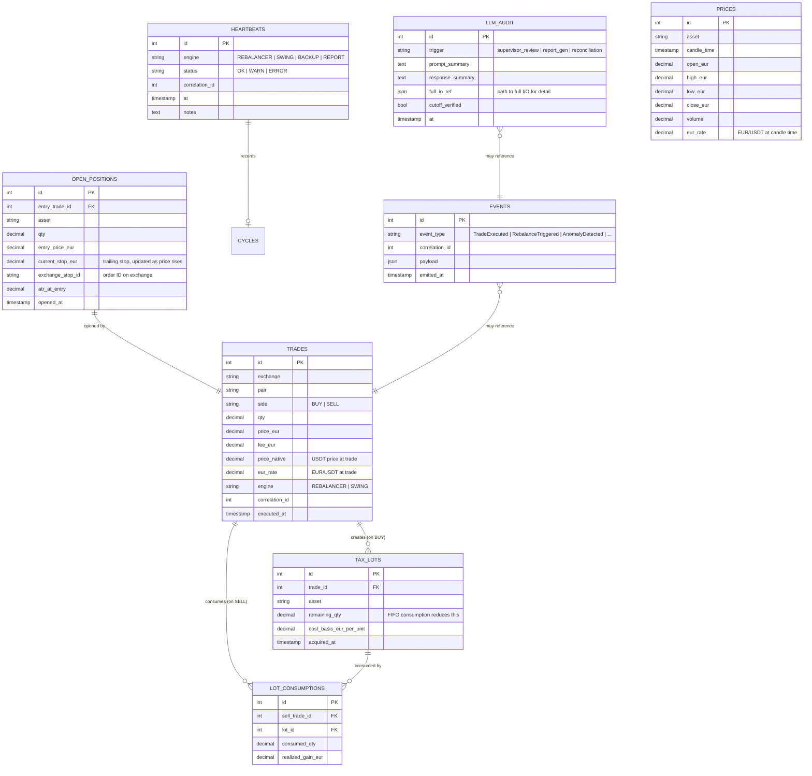

# 03 — Persistence & SQLite Schema

**Parent ADR**: [README.md](./README.md)
**Status**: Accepted
**Accepted**: 2026-08-21

## Question this section answers

Where does state live? Why SQLite (not Postgres)? What tables exist, what do they hold, and how does FIFO tax accounting work on top?

## Why SQLite (not Postgres, not MongoDB, not anything else)

- **Zero admin, zero deployment complexity** — a file. No daemon. No `pg_hba.conf`.
- **ACID with WAL mode** — concurrent reads + one writer. Fits our workload exactly.
- **Handles our concurrency** — 1 rebalancer write/hour, few swing writes/week, dashboard reads. No contention.
- **Backup = copy the file** (with `.backup` Online Backup API for WAL safety).
- **Portable, testable in-memory** (`:memory:`) — unit tests need no fixtures.
- **Production-grade** — Google, Meta, Apple, Airbus all use SQLite in production. Most-deployed database in the world.

Not Postgres because: overkill at our data volume (<1 GB over years), adds a daemon, adds backup complexity, adds a network attack surface.

**Trigger to reconsider**: >100 concurrent writers, or dataset >100 GB. Neither happens at hermes scale.

## Schema — logical model



## Table purposes

| Table              | Role                                                                     | Write frequency                            |
| ------------------ | ------------------------------------------------------------------------ | ------------------------------------------ |
| `trades`           | Every executed order, EUR-priced from row 1                              | ~1-15/month total                          |
| `tax_lots`         | FIFO tax lot creation (on BUY)                                           | append on BUY                              |
| `lot_consumptions` | Which lots got consumed by which SELL, realized gain per consumption     | append on SELL                             |
| `open_positions`   | Currently-held swing satellite positions with stop ID                    | 3-5 rows at any time                       |
| `prices`           | EUR-priced candle cache (historical for backtest, current for decisions) | populated on demand                        |
| `heartbeats`       | Every engine cycle logs alive-ness for monitoring/deadman                | ~24/day (hourly rebalancer + 5-min health) |
| `events`           | Domain event audit trail                                                 | every trade + every anomaly                |
| `llm_audit`        | Every LLM I/O for post-hoc review + memorization detection               | Phase 3+ only                              |
| `migrations`       | Schema version tracking                                                  | rare                                       |
| `config_history`   | Versioned parameter values (band, weights)                               | rare, immutable                            |

## FIFO tax lots — worked example

FIFO says: consume oldest lots first on SELL.

### Step 1 — Three buys (three tax lots created)

```text
2026-11-05: BUY 0.001 BTC @ 65,000€
  → Trade #1
  → tax_lots row: {id=1, trade_id=1, asset='BTC', remaining_qty=0.001,
                   cost_basis_eur_per_unit=65000, acquired_at='2026-11-05'}

2026-12-10: BUY 0.001 BTC @ 68,000€
  → Trade #2
  → tax_lots row: {id=2, trade_id=2, asset='BTC', remaining_qty=0.001,
                   cost_basis_eur_per_unit=68000, acquired_at='2026-12-10'}

2027-02-15: BUY 0.001 BTC @ 72,000€
  → Trade #3
  → tax_lots row: {id=3, trade_id=3, asset='BTC', remaining_qty=0.001,
                   cost_basis_eur_per_unit=72000, acquired_at='2027-02-15'}
```

### Step 2 — SELL 0.0015 BTC @ 75,000€ on 2027-03-20 (Trade #4)

FIFO consumes oldest first:

```text
Consume 0.001 from lot #1 (oldest):
  realized_gain = (75000 - 65000) × 0.001 = 10€
  lot #1 remaining_qty → 0.000
  lot_consumptions row: {sell_trade_id=4, lot_id=1, consumed_qty=0.001,
                         realized_gain_eur=10}

Still need 0.0005 more → consume from lot #2:
  realized_gain = (75000 - 68000) × 0.0005 = 3.50€
  lot #2 remaining_qty → 0.0005
  lot_consumptions row: {sell_trade_id=4, lot_id=2, consumed_qty=0.0005,
                         realized_gain_eur=3.50}
```

**Total realized gain from Trade #4: 13.50€** — declared on Modelo 100, savings base, 19% = **€2.57 owed**.

Lot #3 (72,000€) untouched. Lot #2 has 0.0005 BTC remaining for future FIFO. Lot #1 fully consumed.

## EUR pricing — from row 1, no exceptions

**Every trade row has `price_eur` and `eur_rate` at trade time.** Not "add it later" — from the first insert on day one.

**Why**: Spanish law requires FIFO in EUR. If we store only USDT prices and try to reconstruct EUR later, we hit:

- ECB reference rate mismatches
- Weekend/holiday gaps
- Historical rate revisions
- Timing uncertainty for weekend trades

Storing EUR at trade time makes FIFO calculation trivial and audit-defensible.

**EUR conversion source** — design decision deferred to section [04-exchange-adapters.md](./04-exchange-adapters.md):

- Option A: Binance BTC/EUR pair (native) — thin liquidity but zero-hop
- Option B: BTC/USDT × EUR/USDT reference rate (two-hop) — ECB daily rate for USDT→EUR
- Option C: Coingecko's aggregated EUR rate — third-party dependency

Trade-off to resolve in section 04.

## Concurrency model — WAL mode, single writer at a time

SQLite WAL mode gives us:

- Multiple concurrent **READERS** (dashboard, report jobs, LLM supervisor reads)
- **ONE writer** at any moment (rebalancer OR swing OR backup, never simultaneous)

In practice, our writers don't overlap:

- **Rebalancer** writes once per hour, takes <1s
- **Swing daemon** writes on entry/exit, few times per week, takes <1s
- **Backup** uses `.backup` API which is WAL-safe, non-blocking readers, brief writer pause

If two writers ever collided, SQLite serializes them with `SQLITE_BUSY` → retry with backoff. Simple, robust.

## Migrations — plain SQL, numbered, applied on startup

```text
src/hermes/adapters/ledger/migrations/
├── 001_initial.sql
├── 002_add_llm_audit.sql
└── 003_add_config_history.sql
```

On startup, ledger checks `migrations` table, applies missing files in order. **Alembic is overkill** — a 30-line Python function does this.

## Backup story

- **Daily** `restic → Backblaze B2` (encrypted, deduplicated)
- **SQLite `.backup` first** — never rsync a live WAL file (inconsistent state)
- **Retention** 7 daily / 4 weekly / 12 monthly
- **Monthly restore-test timer** verifies backups actually restore (checksum verification)
- **VPS-wipe recovery**: also back up `/var/lib/systemd/credential.secret` — without it, encrypted systemd credentials are bricks

## Alternatives considered

| Option                               | Why rejected                                                                                                                                 |
| ------------------------------------ | -------------------------------------------------------------------------------------------------------------------------------------------- |
| **PostgreSQL**                       | Overkill at our data volume (<1 GB over years). Adds daemon + backup complexity + network surface.                                           |
| **Event sourcing**                   | SQLite append-only tables (`trades`, `events`) already give us audit properties. Full event-sourcing adds replay complexity without benefit. |
| **In-memory + JSON snapshots**       | Loses ACID. Loses SQL query power for reports. Bad idea for money-critical state.                                                            |
| **Cloud DB (Neon, Turso, Supabase)** | Adds network dependency to a VPS-local system. Cost > €0.                                                                                    |

## Cross-references

- [02-data-flow.md](./02-data-flow.md) — how each write here happens in the flow
- [04-exchange-adapters.md](./04-exchange-adapters.md) — how EUR pricing source is picked
- [08-llm-supervisor.md](./08-llm-supervisor.md) — how `llm_audit` and `events` feed the supervisor
- [10-failure-recovery.md](./10-failure-recovery.md) — SQLite corruption recovery, reconciliation
