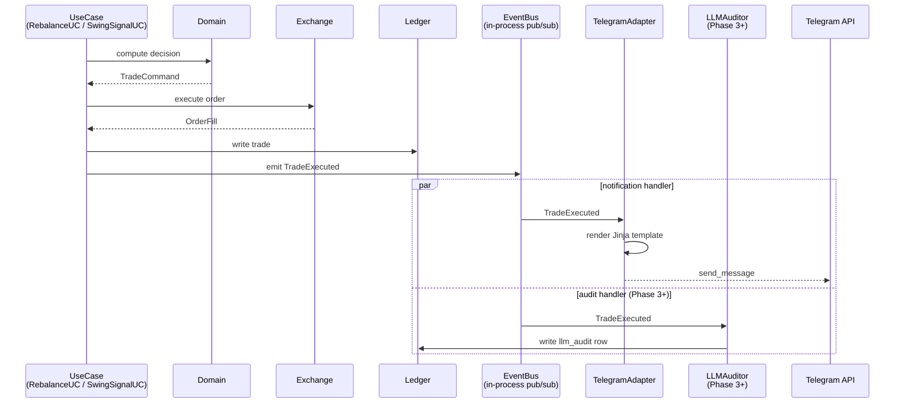

# 06 — Notification Pipeline

**Parent ADR**: [README.md](./README.md)
**Status**: Accepted — read-only inbound commands proposed in [ADR-015](../adr-015-read-only-telegram-commands.md), which supersedes the outbound-only rule in part once accepted
**Accepted**: 2026-08-21

## Question this section answers

How does a domain event (like `TradeExecuted`) turn into a Telegram message on the user's phone? How do we handle Telegram outages without blocking trades? How does the weekly digest get built?

## Event flow



**Trade is committed to ledger BEFORE the event fires.** If Telegram then dies, the trade record is safe. Notification is best-effort.

## Events → notification tier

| Event                                                  | Tier                 | Delivery                        |
| ------------------------------------------------------ | -------------------- | ------------------------------- |
| `TradeExecuted` (rebalance / swing entry / swing exit) | **P0 Immediate**     | Direct Telegram send, per trade |
| `AnomalyDetected` (fee off, reconciliation mismatch)   | **P0 Immediate**     | Direct Telegram send            |
| `DeadmanSwitchFailed`                                  | **P0 Immediate**     | Direct Telegram send            |
| `EngineCrashed`                                        | **P0 Immediate**     | Direct Telegram send            |
| `AuthenticationFailed` (API key expired)               | **P0 Immediate**     | Direct Telegram send            |
| `ExchangeUnavailable` (after retries exhausted)        | **P0 Immediate**     | Direct Telegram send            |
| `RebalanceHeartbeat` (cycle completed, no action)      | **P1 Weekly digest** | Summed into weekly report       |
| `TaxBracketApproaching` (>75% of €6k YTD)              | **P1 Weekly digest** | Included in weekly report       |
| P&L snapshot, trade summary, warnings summary          | **P1 Weekly digest** | Weekly report                   |
| Monthly summary, Yearly summary                        | **P2 Deferred**      | Later phase                     |

## Notifier port

```python
class NotifierPort(Protocol):
    def send_immediate(self, message: NotificationMessage) -> None: ...
    def queue_for_digest(self, item: DigestItem, kind: DigestKind) -> None: ...
```

## Telegram adapter — outbound-only, no polling

```python
class TelegramAdapter:
    """Outbound-only. Never polls for incoming messages."""

    def __init__(self, bot_token: SecretStr, chat_id: str, template_dir: Path):
        self.bot = Bot(token=bot_token.get_secret_value())
        self.chat_id = chat_id
        self.jinja_env = Environment(loader=FileSystemLoader(template_dir))
        self.limiter = TokenBucket(capacity=20, refill_per_second=1)  # defensive

    def send_immediate(self, message: NotificationMessage) -> None:
        template = self.jinja_env.get_template(message.template_name)
        text = template.render(**message.context)
        self.limiter.acquire(1)
        try:
            self.bot.send_message(
                chat_id=self.chat_id,
                text=text,
                parse_mode="MarkdownV2",
            )
        except TelegramError as e:
            # Log + queue for retry — never raise (would block caller)
            logger.error("telegram_send_failed", error=str(e), template=message.template_name)
            self._queue_retry(message)
```

**Uses** `python-telegram-bot` `Bot(token=...)` directly. No `Application`, no polling, no webhook. Simplest possible outbound-only pattern.

## Message templating — Jinja2

```text
templates/telegram/
├── trade_rebalance.j2
├── trade_swing_entry.j2
├── trade_swing_exit_stop.j2
├── trade_swing_exit_regime.j2
├── anomaly_detected.j2
├── deadman_failed.j2
├── engine_crashed.j2
├── auth_failed.j2
└── weekly_digest.j2
```

Sample `trade_rebalance.j2`:

```jinja
🔄 *Rebalance executed*
`{{asset}}`: {{side}} {{qty}}
Price: {{price_eur}}€
Fee: {{fee_eur}}€

Drift resolved: {{drift_before}}% → {{drift_after}}%
Cycle: `{{correlation_id}}`
```

**MarkdownV2 gotcha**: Telegram's MarkdownV2 has strict escape rules — `_`, `*`, `[`, `]`, `(`, `)`, `~`, backtick, `>`, `#`, `+`, `-`, `=`, `|`, `{`, `}`, `.`, `!` must be escaped with `\`. Use a Jinja filter (`escape_md_v2`) applied to dynamic values.

## Weekly report generation

```python
# src/hermes/application/report_uc.py


class WeeklyReportUseCase:
    def __init__(self, ledger: LedgerPort, notifier: NotifierPort, clock: ClockPort): ...

    def generate_and_send(self) -> None:
        end = self.clock.now()
        start = end - timedelta(days=7)

        trades = self.ledger.trades_between(start, end)
        pnl = self.ledger.pnl_between(start, end)
        tax_state = self.ledger.current_tax_state()
        heartbeats = self.ledger.heartbeat_summary(start, end)
        anomalies = self.ledger.anomalies_between(start, end)

        message = NotificationMessage(
            template_name="weekly_digest.j2",
            context={
                "period_start": start,
                "period_end": end,
                "portfolio_value_eur": ...,
                "portfolio_change_pct": ...,
                "trades": trades,
                "pnl_eur": pnl,
                "ytd_realized_gain_eur": tax_state.ytd_gain,
                "current_bracket": tax_state.bracket,
                "heartbeat_count": heartbeats.total,
                "anomaly_count": len(anomalies),
                "engines_health": self.ledger.engine_health(),
            },
        )
        self.notifier.send_immediate(message)
```

Fires via `hermes-report.timer` every Sunday at 09:00 Europe/Madrid (systemd `OnCalendar=Sun 09:00`).

## The critical rule — notification failure NEVER blocks trades

```text
Trade success path:
  1. ExchangePort.place_order()          ← fills or fails
  2. Ledger.write_trade()                 ← authoritative record
  3. EventBus.emit(TradeExecuted)         ← fire-and-forget
     ↓
     TelegramAdapter.send_immediate()     ← may fail silently
```

If step 3's notification fails:

- Trade is already committed (step 2)
- Failure logged to journald
- Message queued for retry (next cycle attempts)
- User sees the trade in the weekly digest even if immediate push failed

**Ledger is source of truth. Telegram is convenience.**

## Failure handling

| Failure                                 | Response                                                                                  |
| --------------------------------------- | ----------------------------------------------------------------------------------------- |
| Telegram API 5xx                        | Retry 3× with backoff, log to journal, queue for next cycle                               |
| Rate limit hit (unlikely at our volume) | Exponential backoff                                                                       |
| Bot token invalid                       | `AuthenticationFailed` → escalate via alt channel (email fallback for auth failures ONLY) |
| Network partition                       | Same as 5xx — retry later                                                                 |
| Template render error                   | Log ERROR + skip that message (never crash the calling engine)                            |

## Testing strategy

- **Unit tests**: mock `NotifierPort` in domain/application tests
- **Adapter tests**: mock `python-telegram-bot`, verify message format via Jinja render output
- **Snapshot tests**: for Jinja templates — freeze known-good output, alert on unexpected changes
- **Integration test**: send to a test Telegram bot/chat with dummy data — verify actually delivered

## Alternatives considered

| Option                                       | Why rejected                                                                           |
| -------------------------------------------- | -------------------------------------------------------------------------------------- |
| **Email as primary**                         | Slower delivery, spam filter risk, less real-time. Kept as auth-failure fallback only. |
| **SMS via Twilio**                           | Costs money, overkill for our volume                                                   |
| **Push notifications via custom mobile app** | Absurd over-engineering                                                                |
| **Both Telegram + email as primary**         | User's Telegram-only preference is intentional (signal-channel discipline)             |
| **Slack**                                    | User doesn't use it; Telegram-only signal discipline                                   |
| **Webhook / polling for inbound commands**   | Not needed at MVP. Phase 3+ uses MCP for commands, not Telegram.                       |

## Cross-references

- [02-data-flow.md](./02-data-flow.md) — where `TradeExecuted` gets emitted
- [03-persistence-schema.md](./03-persistence-schema.md) — where `events` table and weekly-digest queries live
- [08-llm-supervisor.md](./08-llm-supervisor.md) — how audit handler consumes the same events (Phase 3+)
- [09-deployment.md](./09-deployment.md) — systemd unit for `hermes-report.timer`
