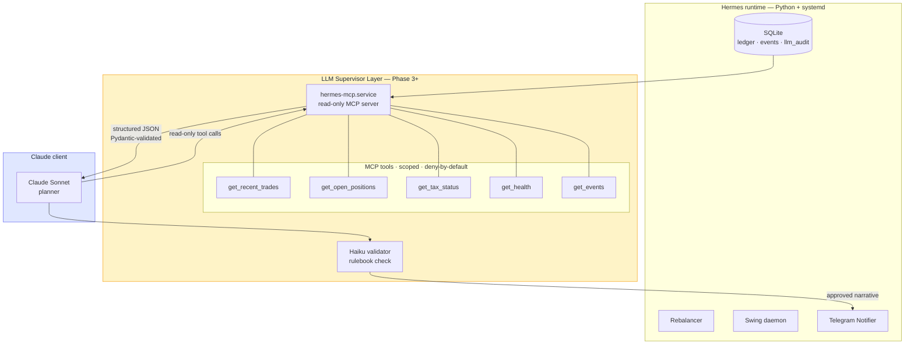
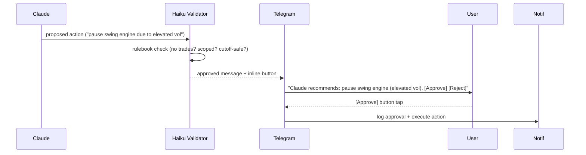

# 08 — LLM Supervisor Layer (Phase 3+)

**Parent ADR**: [README.md](./README.md)
**Status**: Accepted
**Accepted**: 2026-08-21

## Question this section answers

What does Claude actually see? What can Claude do (and NOT do)? How does the MCP boundary work? How do we defend against prompt injection and memorization? Why is this all Phase 3+ rather than day one?

## Boundary diagram — where the LLM lives



## What Claude sees vs what Claude does

**Sees (via MCP read-only tools)**:

- Recent trades — EUR-priced, timestamps, correlation IDs
- Open positions with stop levels + current unrealized P&L
- Tax status — YTD gains, current bracket, projected annual
- Engine health — heartbeats, last cycle status per engine
- Recent events — anomalies, warnings, engine crashes

**Does**:

- Generate the weekly report narrative (from data)
- Detect anomalies in trade patterns (fee outliers, unexpected drift, engine crashes)
- Reconcile ledger vs exchange (via read-only exchange tools)
- Answer user questions about system state ("why did we trade ETH yesterday?" — reads ledger, explains)
- Flag concerns to user via Telegram (validated output only)

**Does NOT**:

- Place, cancel, or modify orders — ever
- Adjust engine parameters (all config changes go through user + decision journal)
- Access live news / sentiment feeds — prompt injection risk (arXiv:2512.02261)
- Evaluate hypothetical historical trades on pre-Jan-2026 dates — Memorization Problem

## MCP boundary — per-tool scoped, deny-by-default

```python
# hermes-mcp.service exposes tools via MCP protocol
# NO wildcard permissions. Each tool explicit scope.

@mcp_tool(
    name="get_recent_trades",
    scope="hermes:read:trades",
    input_schema=GetRecentTradesInput,
    output_schema=RecentTradesOutput,
)
def get_recent_trades(input: GetRecentTradesInput) -> RecentTradesOutput:
    # Memorization guard — enforced at tool level
    if input.start < date(2026, 2, 1):
        raise MemorizationGuardViolation(...)
    ledger = SqliteLedger(read_only=True)
    trades = ledger.trades_between(input.start, input.end)
    return RecentTradesOutput(trades=trades[:input.limit])
```

**`hermes:trade:place` tool DOES NOT EXIST in the codebase.** Not "exists but disabled" — literally not in the source. Impossible for Claude to call something that doesn't exist.

## Prompt injection defenses

**Input side (LLM ← data)**:

- All MCP tool inputs validated by Pydantic before touching domain
- Data flowing INTO Claude is structured JSON — no free text from untrusted sources
- User messages to Claude are the ONLY untrusted text stream — sanitized, logged, marked as untrusted context in the system prompt

**Output side (data ← LLM)**:

- Claude's responses parsed into structured Pydantic types
- **Refusals detected + logged** (refusals don't match schemas → naive retry loops would spin forever; explicit refusal-marker check first)
- Any output that would trigger an action requires human acknowledgment via Telegram button
- No implicit trust — every field validated

## Dual-LLM pattern (2026 production standard)

Two models for high-stakes outputs:

- **Sonnet (planner)** — generates the narrative: "Noticed 3 rebalances this week, all within band. Swing engine took no action — regime was ranging (ADX 15). YTD tax at 47.20€."
- **Haiku (validator)** — checks the narrative against a rulebook:
  - Does it recommend placing a trade? → REJECT
  - Does it recommend changing a parameter? → REJECT
  - Does it reference pre-Jan-2026 data? → REJECT
  - Does it match the expected schema? → REJECT if not

Only planner output that passes validator reaches Telegram. Cheaper (Haiku validator) + structurally safer than single-model.

## Audit trail — every LLM I/O logged

`llm_audit` table (see section 03):

- Trigger (`supervisor_review` / `report_gen` / `reconciliation` / `user_question`)
- Prompt summary + response summary
- Full I/O reference (path to full transcript, if we retain them)
- **Cutoff-verified flag** — was this a post-Jan-2026 query?
- Timestamp

Enables post-hoc review. If Claude ever generates something weird, we have the receipt.

## Memorization guard — enforced at tool level

Every MCP tool that could return historical data enforces the guard:

- `get_recent_trades(start, end)` — `start` MUST be `>= 2026-02-01` (post-Claude-training-cutoff buffer month)
- Attempts to query earlier data → rejected at tool level, never reaches Claude
- If Claude asks "what happened in 2023?", tool returns `MemorizationGuardViolation` error
- Backtest data (which IS pre-cutoff, for Python backtester) **NEVER passes through MCP tools** to Claude

Rationale: Lopez-Lira et al. (arXiv:2504.14765) proved that GPT-4o recalls S&P 500 daily levels with 0.61% MAPE pre-cutoff vs 16.87% MAPE post-cutoff. Every LLM post-2023 is affected. **Prompt masking and "respect boundary" instructions all fail.** The only mitigation is post-cutoff data.

## Phased rollout — Phase 3+, not day one

- **Phase 0-2**: NO LLM layer in runtime. Pure deterministic engine + ledger + Telegram. Claude is only the BUILD partner (not this conversation).
- **Phase 3**: MCP server introduced. Claude connected as read-only supervisor. First tools: read trades, positions, health.
- **Phase 4+**: expand supervisor scope only if it demonstrably adds value. Never expand beyond read-only.

**Full LLM layer is Phase 3+.** Everything before that runs without Claude in the loop. The system works standalone. If Phase 3 turns out to add zero value, we skip it entirely without losing anything.

## Command approval flow (Phase 3+ optional)

If we ever want Claude to send "recommended actions" (never auto-executed):



**User acknowledges via Telegram inline button.** Claude never self-approves. This is future work — Phase 3+ optional feature.

## Alternatives considered

| Option                                            | Why rejected                                                                                     |
| ------------------------------------------------- | ------------------------------------------------------------------------------------------------ |
| **Claude generates trade decisions**              | ADR-001 forbids — Nof1 Alpha Arena live-money evidence                                           |
| **Claude has write access via MCP**               | Even "small" writes risk compounding. Read-only is the only safe boundary.                       |
| **User asks Claude directly via chat, no MCP**    | No audit trail, no scope control, no structured I/O                                              |
| **Fine-tuned model on trading data**              | Overkill + fine-tuning doesn't fix memorization                                                  |
| **Open-source LLM local on VPS (Llama, Mistral)** | Adds GPU requirement, doesn't improve safety, adds ops burden                                    |
| **Multi-agent debate for higher confidence**      | Interesting research; scope creep at MVP. Revisit later.                                         |

## Cross-references

- ADR-001 — foundational LLM-as-supervisor decision
- [02-data-flow.md](./02-data-flow.md) — same events feed both Notifier and LLM audit handler
- [03-persistence-schema.md](./03-persistence-schema.md) — `llm_audit` and `events` tables
- [06-notifications.md](./06-notifications.md) — Telegram is where LLM-generated narratives land
- [09-deployment.md](./09-deployment.md) — `hermes-mcp.service` systemd unit
- [10-failure-recovery.md](./10-failure-recovery.md) — what happens if LLM layer is unavailable (spoiler: everything else keeps working)
