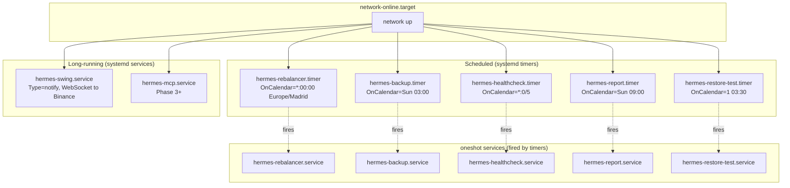
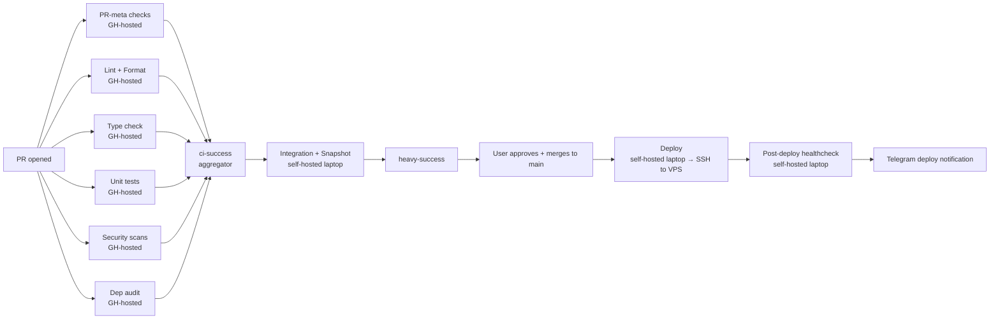

# 09 — Deployment Topology (VPS + CI/CD)

**Parent ADR**: [README.md](./README.md)
**Status**: Accepted
**Accepted**: 2026-08-21

## Question this section answers

How does hermes actually run on the VPS? What processes exist? How do they start/restart/stop? What owns what directory? How do secrets reach the processes without leaking? How does CI/CD work with a hybrid GH-hosted + self-hosted runner setup?

## VPS filesystem layout

hermes is the only app on the VPS. Any prior services on the VPS are decommissioned before hermes install (steps are captured in operational notes, not in this ADR).

```text
/opt/hermes/                        # code + venv (managed by uv)
├── .venv/
├── src/hermes/
├── config/
└── ...

/var/lib/hermes/                    # STATE (owned by hermes user)
├── ledger.db                       # SQLite (WAL mode)
├── ledger.db-wal
├── ledger.db-shm
├── templates/telegram/             # Jinja2 message templates
└── backups/                        # local pre-restic staging (ephemeral)

/etc/credstore.encrypted/           # encrypted secrets (systemd-creds)
├── binance_api_key
├── binance_api_secret
├── telegram_bot_token
├── healthchecks_uuid
├── restic_password
├── b2_account_id
└── b2_account_key

/var/lib/systemd/credential.secret  # HOST KEY — MUST BE BACKED UP OFF-VPS

/etc/systemd/system/                # systemd units
├── hermes-rebalancer.service + .timer
├── hermes-swing.service
├── hermes-backup.service + .timer
├── hermes-healthcheck.service + .timer
├── hermes-report.service + .timer
├── hermes-restore-test.service + .timer
└── hermes-mcp.service              # Phase 3+
```

## User + permissions

Single `hermes` system user, no shell login:

```bash
useradd -r -m -d /opt/hermes -s /usr/sbin/nologin hermes
```

- Owns `/opt/hermes` and `/var/lib/hermes`
- CANNOT SSH in (nologin shell)
- All hermes systemd units run as `User=hermes` for blast-radius isolation

`root` and one sudoer (user's admin account) are the only interactive users.

## systemd unit relationships



## Service unit template (rebalancer example)

```ini
# /etc/systemd/system/hermes-rebalancer.service
[Unit]
Description=Hermes deterministic rebalancer
After=network-online.target
Wants=network-online.target

[Service]
Type=notify
User=hermes
Group=hermes
WorkingDirectory=/opt/hermes
ExecStart=/opt/hermes/.venv/bin/python -m hermes.entrypoints.rebalancer
Restart=on-failure
RestartSec=5s
StartLimitBurst=5
StartLimitIntervalSec=300
TimeoutStopSec=30
KillSignal=SIGTERM

# Encrypted credentials (mounted read-only in tmpfs during run)
LoadCredentialEncrypted=binance_api_key:/etc/credstore.encrypted/binance_api_key
LoadCredentialEncrypted=binance_api_secret:/etc/credstore.encrypted/binance_api_secret
LoadCredentialEncrypted=telegram_bot_token:/etc/credstore.encrypted/telegram_bot_token

# Hardening
NoNewPrivileges=true
ProtectSystem=strict
ProtectHome=true
PrivateTmp=true
ReadWritePaths=/var/lib/hermes
CapabilityBoundingSet=

[Install]
WantedBy=multi-user.target
```

## Timer unit template

```ini
# /etc/systemd/system/hermes-rebalancer.timer
[Unit]
Description=Fire hermes-rebalancer hourly

[Timer]
OnCalendar=*-*-* *:00:00 Europe/Madrid
Persistent=true              # runs missed on reboot
RandomizedDelaySec=180       # spread load, avoid thundering herd
Unit=hermes-rebalancer.service

[Install]
WantedBy=timers.target
```

## Secrets — systemd-creds encrypted

**Bootstrap** (one-time on VPS):

```bash
# Generate host key if not present
systemd-creds --with-key=tpm2 setup

# Encrypt each secret
echo "binance_api_key_value" | systemd-creds encrypt --name=binance_api_key - \
  /etc/credstore.encrypted/binance_api_key

# ... repeat for each credential

# CRITICAL: back up host key OFF-VPS
cp /var/lib/systemd/credential.secret ~/hermes-credential-key-backup
# → move to encrypted USB, 1Password, etc.
```

Without `/var/lib/systemd/credential.secret`, encrypted credentials are unrecoverable. This backup is the difference between "VPS died, restore in 20 min" and "VPS died, all secrets lost forever".

**Rotation**:

```bash
echo "new_key" | systemd-creds encrypt --name=binance_api_key - \
  /etc/credstore.encrypted/binance_api_key
systemctl restart hermes-*.service
```

## Tailscale + ufw

```bash
# Tailscale
curl -fsSL https://tailscale.com/install.sh | sh
tailscale up --ssh --advertise-tags=tag:hermes-vps

# ufw — SSH only over Tailscale, no public ports
ufw default deny incoming
ufw allow from 100.64.0.0/10 to any port 22
ufw --force enable
```

**Result**: zero-trust — port 22 CLOSED to public internet. Optional Phase 5 dashboard (port 8501) will also be tailnet-only.

## Backups — restic → Backblaze B2 (€0/mo at our volume)

```ini
# /etc/systemd/system/hermes-backup.service
[Unit]
Description=Encrypted SQLite backup to Backblaze B2

[Service]
Type=oneshot
User=hermes

# SQLite Online Backup API — WAL-safe, never rsync a live WAL file
ExecStartPre=/opt/hermes/.venv/bin/python -m hermes.scripts.sqlite_backup \
  --source /var/lib/hermes/ledger.db \
  --dest /var/lib/hermes/backups/snapshot.db

ExecStart=/usr/bin/restic backup /var/lib/hermes/backups/snapshot.db \
  --tag hermes-daily --repo b2:hermes-backups:/

ExecStartPost=/usr/bin/restic forget \
  --keep-daily 7 --keep-weekly 4 --keep-monthly 12 --prune

ExecStopPost=/bin/rm -f /var/lib/hermes/backups/snapshot.db

LoadCredentialEncrypted=restic_password:/etc/credstore.encrypted/restic_password
LoadCredentialEncrypted=b2_account_id:/etc/credstore.encrypted/b2_account_id
LoadCredentialEncrypted=b2_account_key:/etc/credstore.encrypted/b2_account_key
Environment=RESTIC_PASSWORD_FILE=%d/restic_password
Environment=B2_ACCOUNT_ID_FILE=%d/b2_account_id
Environment=B2_ACCOUNT_KEY_FILE=%d/b2_account_key
```

**Monthly restore-test timer** verifies backups actually restore:

```text
hermes-restore-test.timer   OnCalendar=1 03:30
  → restores latest to /tmp, checksums, sends Telegram OK/FAIL
```

## Healthchecks (dead-man's-switch)

healthchecks.io free tier: 20 checks, unlimited pings.

| Check          | Ping frequency                    | Alert threshold |
| -------------- | --------------------------------- | --------------- |
| `rebalancer`   | after each hourly cycle           | silent >90 min  |
| `swing`        | 5-min heartbeat from swing daemon | silent >15 min  |
| `backup`       | after successful daily backup     | silent >36 hrs  |
| `restore-test` | after monthly test                | silent >40 days |

Notifications route to Telegram (via healthchecks.io native integration or email→bot bridge).

## Boot ordering

All services + timers `After=network-online.target Wants=network-online.target`. Timers with `Persistent=true` catch missed runs after reboot. `RandomizedDelaySec` prevents thundering herd if multiple timers fire at the same wall-clock time.

## Bootstrap script (idempotent, no Docker)

```bash
#!/bin/bash
# deploy/bootstrap-vps.sh
set -euo pipefail

# 1. hermes user
id hermes &>/dev/null || useradd -r -m -d /opt/hermes -s /usr/sbin/nologin hermes

# 2. Directories
mkdir -p /opt/hermes /var/lib/hermes /var/lib/hermes/backups /etc/credstore.encrypted
chown -R hermes:hermes /opt/hermes /var/lib/hermes

# 3. uv (if not present)
which uv || (curl -LsSf https://astral.sh/uv/install.sh | sh)

# 4. systemd-creds host key (if not present)
[ -f /var/lib/systemd/credential.secret ] || systemd-creds --with-key=tpm2 setup

# 5. Tailscale
which tailscale || (curl -fsSL https://tailscale.com/install.sh | sh)
# operator runs `tailscale up` manually (needs interactive auth)

# 6. restic (if not present)
which restic || apt-get install -y restic

# 7. ufw
ufw default deny incoming
ufw allow from 100.64.0.0/10 to any port 22
ufw --force enable

echo "Bootstrap complete. Next: (1) tailscale up, (2) encrypt credentials, (3) deploy hermes code."
```

## Deploy script

```bash
#!/bin/bash
# deploy/deploy-hermes.sh
set -euo pipefail

cd /opt/hermes
git fetch origin
git checkout ${COMMIT_SHA:-main}
uv sync --frozen

# Restart services (only if unit files exist)
systemctl daemon-reload
systemctl restart hermes-swing.service 2>/dev/null || true

# Report deploy to Telegram (fire-and-forget)
/opt/hermes/.venv/bin/python -m hermes.scripts.notify_deploy || true

echo "Deploy successful: $(git rev-parse --short HEAD)"
```

---

## CI/CD — Hybrid GH-hosted + Self-hosted (laptop) runners

### Runner topology

| Runner                                                            | Location                                             | Cost                                         | Blast radius                                                                       | Used for                                                                                     |
| ----------------------------------------------------------------- | ---------------------------------------------------- | -------------------------------------------- | ---------------------------------------------------------------------------------- | -------------------------------------------------------------------------------------------- |
| **GitHub-hosted** (`ubuntu-latest`)                               | Ephemeral GH VMs                                     | Pro tier: 3,000 min/mo free, then $0.008/min | **Zero** — isolated per-job VM                                                     | Lint, typecheck, unit tests, security scans, PR meta                                         |
| **Self-hosted on USER'S LAPTOP** (`[self-hosted, hermes-laptop]`) | User's Windows/PyCharm machine (registered manually) | €0                                           | Zero — user's own machine, physically isolated from prod VPS                       | Integration tests (testnet), TUI snapshot tests, heavy backtest verification, deploy trigger |
| ~~Self-hosted on prod VPS~~                                       | **REJECTED**                                         | Free                                         | **HIGH** — CI could read `/var/lib/hermes/`, contend for CPU/RAM with hermes-swing | Never                                                                                        |

**Load-balancer pattern** via job `runs-on:` labels. Cheap/parallel/isolated work → GH. Expensive/stateful/deploy work → laptop.

### Job matrix



### Comprehensive CI stack (catches "smelly things")

**MANDATORY project rule**: no delivered file may have any warning or error from any linter. Silencing is forbidden — resolve the underlying problem. Suppressions (`# noqa: RULE_ID`, etc.) require narrow scope + inline reason + explicit PR reviewer approval. Blanket suppressions auto-reject.

**Static analysis** (GH-hosted, fast, no secrets needed):

| Tool                          | Purpose                                                              | Blocks on                                                          |
| ----------------------------- | -------------------------------------------------------------------- | ------------------------------------------------------------------ |
| `ruff check`                  | Lint (replaces flake8/isort)                                         | any violation                                                      |
| `ruff format --check`         | Format enforcement (replaces black)                                  | unformatted code                                                   |
| `mypy --strict`               | Type check with strict mode                                          | any error                                                          |
| `import-linter`               | Enforce hexagonal — domain never imports adapters/infrastructure     | any violation                                                      |
| `radon cc --min B`            | Cyclomatic complexity — flag functions above B (moderate)            | complexity >10                                                     |
| `vulture`                     | Dead code detection                                                  | high-confidence unused code                                        |
| `bandit -r src/ -ll -ii`      | Security anti-patterns                                               | **any severity** (mandatory zero-tolerance rule)                   |
| `safety check` + `pip-audit`  | Known-vulnerable dependencies                                        | **any CVE regardless of CVSS** (mandatory zero-tolerance)          |
| `gitleaks detect`             | Secret scanning in git history                                       | any credential                                                     |

**Testing** (GH-hosted for unit, self-hosted for integration/snapshot):

| Tool                            | Purpose                                                                | Runs on                          |
| ------------------------------- | ---------------------------------------------------------------------- | -------------------------------- |
| `pytest` + `coverage.py`        | Unit tests, target ≥90% coverage                                       | GH-hosted                        |
| `hypothesis`                    | Property-based tests on FIFO calculator, rebalancer math               | GH-hosted                        |
| `pytest-textual-snapshot`       | TUI visual regression                                                  | Self-hosted (SVG rendering)      |
| `pytest-benchmark`              | Perf regression on Donchian/backtest hot paths                         | Self-hosted                      |
| Integration (Binance testnet)   | Real API contract validation                                           | Self-hosted                      |
| `mutmut`                        | Mutation testing — catches tests that don't actually test              | Self-hosted (slow, run weekly)   |

**PR meta** (GH-hosted, trivial):

| Check                              | Enforces                                                                              |
| ---------------------------------- | ------------------------------------------------------------------------------------- |
| PR title check                     | Conventional commits format                                                           |
| `commitlint`                       | Commit message format                                                                 |
| PR template compliance             | Sections filled                                                                       |
| **Assignee enforced**              | Defaults to author if empty; deadlock detection (author != sole CODEOWNER)            |
| **PR size bucketing**              | Auto-label `size:s/m/l/xl`; sticky comment on xl with split suggestion                |
| **Changeset classification**       | docs-only PRs skip expensive code gates (~40s savings per run)                        |
| **Log hygiene scan**               | Inspects CI logs post-run, blocks merge on ANY warning (enforces zero-tolerance rule) |
| **Base branch enforcement**        | PR must target `main`; force-push blocked by branch protection                        |
| Test-touches-source                | If `src/hermes/` changed, `tests/` must also change                                   |
| CHANGELOG entry (optional)         | For significant changes                                                               |

### Log hygiene scan — enforces zero-warnings rule at CI level

After every CI job completes, a dedicated step downloads the raw logs and scans for warning markers:

```yaml
# Runs after all lint/test jobs, before merge
log-hygiene:
  needs: [lint, typecheck, tests, security]
  runs-on: ubuntu-latest
  steps:
    - name: Download CI logs
      uses: actions/download-artifact@v4
      with:
        name: ci-logs
    - name: Scan for warnings
      run: |
        # Fail on any warning marker from linters/tools
        if grep -Ei "^(warning|W [0-9]|WARN\b|deprecated|DeprecationWarning)" ci-*.log; then
          echo "::error::CI logs contain warnings — mandatory zero-tolerance rule violated"
          exit 1
        fi
```

Any suppression must be:

1. Narrow (`# noqa: E501`, not blanket `# noqa`)
2. With inline reason comment
3. Explicitly approved by PR reviewer

**This is how "no delivery leaves warnings" gets ENFORCED, not hoped for.**

### Merge queue

A **merge queue** pattern re-tests the exact merge tree at the exact approved SHA before landing, solving the "approval → new push → approval invalidated" treadmill.

For hermes: adopted early despite solo-contributor + claude-bot scale. Reason: PRs can queue up when the bot ships work in parallel batches, and rebase-on-latest-main invalidates prior approvals under our `require_last_push_approval` protection. Pattern is a custom workflow (`.github/workflows/merge-queue.yml`) since GitHub's native merge queue is not available on private repos on the current plan tier.

### Aggregator pattern

Single required check on branch protection:

```yaml
# .github/workflows/ci.yml
jobs:
  lint: ...
  typecheck: ...
  unit-tests: ...
  security: ...
  deps: ...
  pr-meta: ...

  ci-success:
    needs: [lint, typecheck, unit-tests, security, deps, pr-meta]
    if: always()
    runs-on: ubuntu-latest
    steps:
      - run: |
          if [[ "${{ contains(needs.*.result, 'failure') }}" == "true" ]]; then
            echo "One or more required jobs failed"
            exit 1
          fi
```

Branch protection requires ONLY `ci-success`. Add/remove gates without touching branch protection JSON.

### Heavy job on self-hosted laptop

```yaml
# .github/workflows/heavy.yml
name: Heavy tests + deploy prep

on:
  push:
    branches: [main]
  workflow_run:
    workflows: [CI]
    types: [completed]
  workflow_dispatch:

jobs:
  heavy:
    runs-on: [self-hosted, hermes-laptop]
    if: github.event.workflow_run.conclusion == 'success' || github.event_name != 'workflow_run'
    steps:
      - uses: actions/checkout@v4
      - name: Install uv
        run: curl -LsSf https://astral.sh/uv/install.sh | sh
      - name: Sync
        run: uv sync --frozen
      - name: Integration tests
        run: uv run pytest tests/adapters/ -m "integration" -v
        env:
          BINANCE_TESTNET_KEY: ${{ secrets.BINANCE_TESTNET_KEY }}
      - name: TUI snapshot tests
        run: uv run pytest tests/tui/ --snapshot-update=false
      - name: Backtest sanity
        run: uv run python -m hermes.scripts.backtest_smoke
```

**Runner registration on laptop** (one-time):

```bash
# On laptop
mkdir actions-runner && cd actions-runner
curl -o actions-runner-linux-x64.tar.gz -L https://github.com/actions/runner/releases/latest/download/actions-runner-linux-x64.tar.gz
tar xzf actions-runner-linux-x64.tar.gz
./config.sh --url https://github.com/ricardoafo-org/hermes --token <TOKEN> --labels hermes-laptop
./run.sh
# Optional: install as service: sudo ./svc.sh install && sudo ./svc.sh start
```

### Deploy strategy — two options

#### Option A: `git pull` cron on VPS (simplest, zero secrets in GH)

```bash
# /etc/cron.d/hermes-deploy
*/5 * * * * hermes cd /opt/hermes && git pull --ff-only && /opt/hermes/deploy/post-pull.sh
```

`post-pull.sh` checks if HEAD changed, if yes: `uv sync --frozen && systemctl restart hermes-*`.

- **Pro**: no secrets in GH, no attack surface
- **Pro**: works with git pull cron OR systemd `.path` unit watching `/opt/hermes/.git/HEAD`
- **Con**: up to 5-min delay between merge and deploy

#### Option B: self-hosted runner (laptop) triggers deploy via SSH

```yaml
# .github/workflows/deploy.yml
name: Deploy

on:
  push:
    branches: [main]

jobs:
  deploy:
    runs-on: [self-hosted, hermes-laptop]
    steps:
      - uses: actions/checkout@v4
      - name: SSH deploy
        run: |
          ssh -o StrictHostKeyChecking=yes hermes-deploy@vps \
            "cd /opt/hermes && git pull --ff-only && ./deploy/post-pull.sh"
      - name: Verify commit SHA (poll healthcheck endpoint)
        run: ./deploy/verify-deploy.sh ${{ github.sha }}
      - name: Notify Telegram
        run: curl -X POST "$TG_URL" -d "text=Deploy $GITHUB_SHA succeeded"
```

Requires narrow-scope deploy key (`hermes-deploy` user on VPS, sudoers only for `systemctl restart hermes-*`).

- **Pro**: instant deploy on merge
- **Pro**: self-validating (SHA polling)
- **Con**: SSH key managed on laptop runner

**Recommendation for MVP**: Option A (`git pull` cron). Simpler, zero secrets, 5-min delay is fine at hermes cadence. Upgrade to Option B if push-based instant deploy becomes valuable.

### Cost planning

Estimated GH-hosted CI usage per month:

- ~20 commits/week, ~5 min average CI runtime (lint + typecheck + unit tests parallel) = **~400 min/mo**
- Well within Pro tier's 3,000 min/mo
- Above-tier cost hypothetical: $0.008/min × 500 excess min = $4/mo worst case

Self-hosted laptop cost: €0 (uses laptop, only runs when laptop is online). If laptop offline, heavy job queues and runs later. Not blocking (unit CI still runs on GH-hosted).

**Total additional monthly cost**: **€0** at current usage projections.

## Log aggregation

structlog JSON → stdout → journald → `journalctl -u hermes-* -o json-pretty | jq`. Rotation via journald (`SystemMaxUse=1G` in `/etc/systemd/journald.conf`).

No Loki/ELK/Datadog — overkill at our scale. journalctl is the query interface.

## Alternatives considered

| Option                                                              | Why rejected                                                                                            |
| ------------------------------------------------------------------- | ------------------------------------------------------------------------------------------------------- |
| **Docker for hermes**                                               | Not needed — systemd + uv is simpler for single-Python-process at our scale                             |
| **Kubernetes**                                                      | Absurd at solo scale                                                                                    |
| **Ansible**                                                         | Overkill for single VPS; bootstrap script is 100 lines                                                  |
| **PostgreSQL for shared state**                                     | No shared state; single-VPS + SQLite is fine                                                            |
| **`.env` files for secrets**                                        | systemd-creds superior (encrypted at rest, invisible to `ps`)                                           |
| **rsync for backups**                                               | Never rsync a live WAL file — use SQLite `.backup` + restic                                             |
| **Self-hosted runner on prod VPS**                                  | HIGH blast radius — workflow could read `/var/lib/hermes/`, contend with hermes-swing for resources     |
| **Push-based deploy via GitHub Deployments API + agent on VPS**     | Overkill for solo project; `git pull` cron achieves same outcome with zero moving parts                 |

## Cross-references

- [01-code-organization.md](./01-code-organization.md) — entrypoints that systemd units invoke
- [03-persistence-schema.md](./03-persistence-schema.md) — SQLite location `/var/lib/hermes/ledger.db`
- [04-exchange-adapters.md](./04-exchange-adapters.md) — Binance credentials flow via LoadCredentialEncrypted
- [06-notifications.md](./06-notifications.md) — Telegram bot token flow
- [07-user-interface.md](./07-user-interface.md) — how CLI/TUI accesses same VPS state
- [08-llm-supervisor.md](./08-llm-supervisor.md) — hermes-mcp.service is Phase 3+
- [10-failure-recovery.md](./10-failure-recovery.md) — restart policies, deadman, disaster recovery
