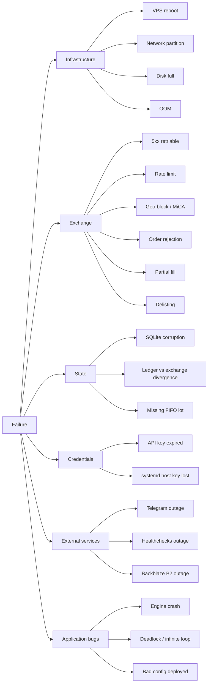
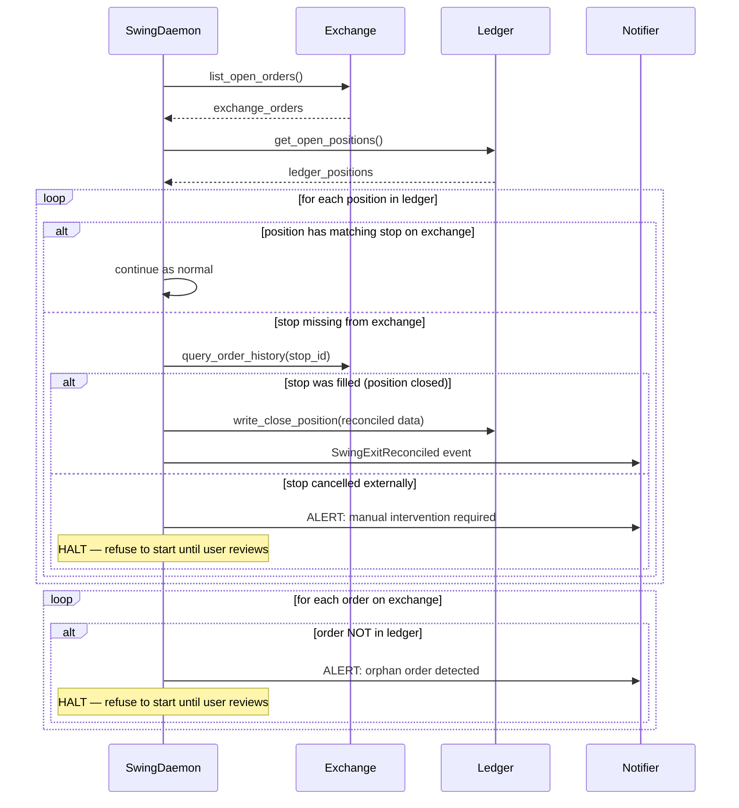

# 10 — Failure & Recovery

**Parent ADR**: [README.md](./README.md)
**Status**: Accepted
**Accepted**: 2026-08-21

## Question this section answers

What happens when things go wrong? VPS reboot mid-trade, exchange 500s, WebSocket drops, partial fills, SQLite corruption, credential loss, Telegram outage, network partition. **How does hermes recover, and how do we know it did?**

Non-goal: preventing every failure. Goal: fail safely, detect fast, recover deterministically.

## Failure taxonomy



## Golden rules

1. **The ledger is source of truth. The exchange is source of reality.** Any divergence between them is an incident.
2. **Fail loud, not silent.** Every unrecoverable error → Telegram alert + engine halt.
3. **Reconcile on startup.** Never assume post-crash state matches pre-crash state.
4. **Retries are asymmetric.** Reads retry. Non-idempotent writes NEVER retry (double-fill risk).
5. **The exchange enforces stops.** Daemon crash != position risk (stop-loss is exchange-side).

## Restart policies (revisited from section 09)

| Unit                              | Restart      | Backoff | Cap        | On cap-exceeded                                     |
| --------------------------------- | ------------ | ------- | ---------- | --------------------------------------------------- |
| `hermes-swing.service`            | on-failure   | 5s      | 5 in 5min  | Alert + stop trying                                 |
| `hermes-rebalancer.service`       | on-failure   | —       | —          | Alert; next timer fires normally                    |
| `hermes-backup.service`           | on-failure   | 60s     | 3          | Alert; skip until next daily                        |
| `hermes-healthcheck.service`      | on-failure   | 10s     | 3          | Alert (healthchecks.io will also alarm externally)  |
| `hermes-report.service`           | on-failure   | 60s     | 3          | Alert; skip until next weekly                       |

**`Restart=on-failure` (not `always`)** — permanent failures shouldn't hammer the system.

## Exchange failures

### Partial fills

Binance may partially fill a market order in low-liquidity moments:

```text
Requested: SELL 0.001 BTC
Filled:    0.0008 BTC (80%)
Remaining: 0.0002 BTC (unfilled, cancelled by exchange)
```

Handling in `OrderFill` value object:

```python
@dataclass(frozen=True)
class OrderFill:
    ...
    requested_qty: Decimal
    filled_qty: Decimal
    is_partial: bool  # filled_qty < requested_qty
```

Domain policy:

- Rebalancer: **accept partial fill**, log ledger with actual filled_qty (drift will re-trigger next cycle if still out of band)
- Swing: **accept partial fill**, place stop-loss on the actually-filled qty (not requested)

Never retry to complete a partial fill — could double-fill after fill notification is delayed.

### Exchange 5xx / temporary unavailability

Retry policy (from section 04):

- Reads: 3x exponential backoff (100 → 200 → 400 ms)
- Writes: NEVER auto-retry

After retries exhausted → `ExchangeTemporarilyUnavailable` raised → Telegram alert + engine cycle aborts (rebalancer waits for next timer; swing daemon pauses reading, keeps existing positions).

### Rate limit hit

Should never happen at our volume (4 orders of magnitude below Binance limits), but defensive:

```python
# Token-bucket limiter with wait
if not self.limiter.try_acquire(weight):
    logger.warning("rate_limit_wait", weight=weight)
    time.sleep(self.limiter.time_until_available(weight))
    self.limiter.acquire(weight)
```

If we ever DO hit real rate limits, that's a bug (or Binance changed something) → investigate immediately.

### Geo-block / MiCA-style access changes

Per ADR-004 (exchange decision), we have Kraken as documented backup + exchange-agnostic code layer. If Binance blocks the account:

1. Automated detection: `AuthenticationFailed` on next API call → Telegram alert (immediate)
2. Manual response: user swaps `HERMES__EXCHANGE=kraken` in config, restarts services
3. Open positions: Binance-side stops still enforce on old positions; Kraken starts fresh

Documented as recovery playbook below.

### Order rejection (MIN_NOTIONAL, lot step)

Trade computation should never produce a MIN_NOTIONAL violation (exchange rules cached via `get_trading_rules()`). If it does → bug. Handling:

- Log ERROR with details
- Skip the trade (don't retry with adjusted qty — that's masking a bug)
- Telegram alert with details for user review

### Delisting

Rare but real (2022 crypto winter had many delistings). If a swing satellite asset is delisted:

- Positions cannot be closed via that pair — must be handled manually
- Detected: `InvalidPair` error on next tick
- Engine halts swing operations on that asset, alerts user

## Infrastructure failures

### VPS reboot mid-trade

Scenario: hermes-swing has an open ETH position. VPS reboots for kernel update at 3am.

Sequence:

1. VPS reboots → all systemd services stop
2. Exchange still has the stop-loss order active (placed IMMEDIATELY after entry)
3. If ETH crashes during reboot, stop fires on exchange, position closes
4. VPS boots back up → services restart
5. **hermes-swing startup reconciliation** (see below) matches exchange orders vs ledger:
   - Stop fired during reboot → position closed on exchange but ledger still shows open
   - Reconciler updates ledger with actual close data, emits `SwingExit` event
   - Telegram alert: "Position ETH closed during downtime — reconciled OK"

Zero data loss. This is why we place stops IMMEDIATELY after entry, not later.

### Network partition

Hermes can't reach Binance for N minutes.

- Rebalancer cycle skips, waits next timer
- Swing daemon: WebSocket reconnect logic (`ThreadedWebsocketManager`) auto-retries with exponential backoff
- After reconnect: catch up latest prices via REST, resume normal
- Healthchecks.io deadman: fires if silence >15 min → user alerted independently

Existing exchange-side stops continue enforcing during our partition.

### Disk full

Detected by monitoring: `hermes-healthcheck.service` also runs `df -h /var/lib/hermes` and alerts if >85% full.

Mitigations before it happens:

- journald `SystemMaxUse=1G` prevents log growth
- restic prune keeps backups bounded
- SQLite grows slowly (~1 GB over years at our trade volume)

If it happens anyway: engine services pause, user cleans up manually.

### OOM

Also monitored. hermes footprint is small (~500 MB total). OOM likely means:

- A bug (memory leak) — investigate
- Another tenant on shared vCPU — Hetzner CX23 shared vCPU can be noisy

## State failures

### SQLite corruption

Rare on modern kernels with WAL mode. Signs:

- `SQLITE_CORRUPT` error on startup
- `PRAGMA integrity_check;` fails

Recovery:

1. Stop all hermes services
2. Move corrupt DB aside: `mv ledger.db ledger.db.corrupt`
3. Restore latest good backup: `restic restore latest --target /var/lib/hermes/`
4. Startup reconciliation runs (see below) — will detect ledger-exchange divergence for any trades that happened after last backup
5. User manually reconciles missing trades from exchange history if any

### Ledger vs exchange divergence

**Ledger says one thing, exchange says another.** Sources:

- Backup restore (see above)
- Manual manipulation of exchange (user cancelled a stop-loss manually)
- Rare: an API bug where we thought a trade succeeded but it didn't

Startup reconciliation flow (runs every time swing daemon starts):



**Fail loud on divergence.** Never auto-heal ambiguous state.

### Missing FIFO lot

If a SELL trade references a lot ID that doesn't exist:

- Should NEVER happen (foreign key + append-only writes)
- If it does: data corruption. Same recovery as SQLite corruption (restore backup).

## Credential failures

### Binance API key expired / revoked

Detected: `AuthenticationFailed` on any API call.

- Immediate Telegram alert
- All engines halt (rebalancer + swing)
- Positions remain safe (exchange-side stops enforced independently)
- User rotates key: `systemd-creds encrypt --name=binance_api_key - /etc/credstore.encrypted/binance_api_key`, restart services

### systemd host key lost

**The disaster scenario.** `/var/lib/systemd/credential.secret` gone → all encrypted credentials unrecoverable.

Prevention:

- Off-VPS backup of `credential.secret` from day 1 (documented in section 09)
- Encrypted USB / password manager storage

If it happens:

1. Regenerate credentials from source (Binance, Telegram, etc. — need original access)
2. New `systemd-creds --with-key=tpm2 setup`
3. Re-encrypt each credential
4. Restart services

This is why the credential.secret backup is emphasized non-negotiably.

## WebSocket / real-time failures

Handled entirely by `python-binance` `ThreadedWebsocketManager`:

- Auto-reconnect with exponential backoff on drop
- Heartbeat monitoring (24-hour Binance server-initiated close)
- Missed-tick reconciliation via REST catch-up on reconnect

Our code observes reconnect events and logs:

```python
def on_reconnect(self):
    logger.warning("websocket_reconnected", downtime_ms=self.last_disconnect_ms())
    self.catch_up_prices_via_rest()
```

If reconnect fails >5 attempts: Telegram alert, swing daemon pauses (existing positions protected by exchange-side stops).

## External service failures

### Telegram outage

- Notifications queue for retry (see section 06)
- Trades continue normally (notification is best-effort)
- Weekly digest catches missed events

### Healthchecks.io outage

- Deadman would fire externally, but if healthchecks.io itself is down, user won't get the "silent hermes" alert
- Fallback: user has weekly Telegram digest — if that stops arriving, investigate
- Mitigation: healthchecks.io has 99.9% SLA + status page

### Backblaze B2 outage

- Daily backup skipped, retried tomorrow
- Existing backups on B2 still accessible when service returns
- Not urgent unless SQLite corruption happens during outage (double failure)

## Application bugs

### Engine crash

- systemd `Restart=on-failure` catches transient crashes
- 5 failures in 5 min → cap exceeded → alert + stop trying
- User investigates via `journalctl -u hermes-swing -n 200`

### Deadlock / infinite loop

- systemd `WatchdogSec` (optional) can detect
- We could add: `WatchdogSec=300` → kill service if no `sd_notify(WATCHDOG=1)` for 5 min
- Requires engine to periodically ping watchdog — trivial addition

### Bad config deployed

- `ci-success` gate should catch most config errors (pytest with real config load)
- If a bad config still lands: engine startup fails → Telegram alert → user rolls back via `git revert`

## Manual recovery playbook

**Scenario: VPS destroyed, need to rebuild from scratch on new Hetzner instance.**

```text
1. Provision new Hetzner CX23, Ubuntu 22.04
2. SSH in, install Tailscale, connect to tailnet
3. Run bootstrap-vps.sh (creates hermes user, dirs, uv, ufw)
4. Restore systemd credential.secret from off-VPS backup:
   sudo cp ~/backup/credential.secret /var/lib/systemd/
   sudo chmod 400 /var/lib/systemd/credential.secret
5. Restore encrypted credentials from off-VPS backup:
   sudo tar xzf ~/backup/credstore.tar.gz -C /etc/
6. Deploy hermes code:
   git clone git@github.com:ricardoafo/hermes /opt/hermes
   cd /opt/hermes && uv sync --frozen
   sudo chown -R hermes:hermes /opt/hermes
7. Restore latest ledger from restic:
   sudo -u hermes restic restore latest --target /var/lib/hermes/ --repo b2:hermes-backups
8. Install + enable systemd units:
   sudo cp deploy/systemd/*.service deploy/systemd/*.timer /etc/systemd/system/
   sudo systemctl daemon-reload
   sudo systemctl enable --now hermes-*.timer hermes-swing.service
9. Verify startup reconciliation completes cleanly (check journalctl for HALT-on-divergence alerts)
10. Confirm Telegram receives startup notification
```

Estimated recovery time: **~30 min** from VPS provisioning to running system.

## Kill switches — manual + automatic

**Automatic**:

- Satellite drawdown circuit-breaker (30% off peak → pause swing engine, per section 05)
- Reconciliation divergence (halt on startup mismatch)
- Auth failure (halt on API key expired)

**Manual**:

- CLI: `hermes kill` (typed CONFIRM)
- TUI: `Ctrl+K` (double-confirm modal)
- systemd: `sudo systemctl stop hermes-swing hermes-rebalancer.timer`
- Nuclear: `ssh vps 'sudo systemctl stop hermes-*'`

## Alternatives considered

| Option                                                | Why rejected                                                                             |
| ----------------------------------------------------- | ---------------------------------------------------------------------------------------- |
| **Auto-reconcile on all divergence**                  | Silent auto-heal masks bugs. Fail loud is safer.                                         |
| **Retry non-idempotent writes**                       | Double-fill risk. Never worth the "convenience".                                         |
| **Hot-standby VPS with failover**                     | Overkill at our scale + adds sync complexity. Manual recovery in 30 min is fine.         |
| **Multi-region backup**                               | B2 is already multi-region internally. Additional geography not needed.                  |
| **Stop-losses in daemon (not exchange)**              | Daemon crash = unprotected position. Exchange-side is safer.                             |
| **In-memory position tracking (no SQLite persist)**   | Crash = state loss. Non-starter for money-critical state.                                |

## Cross-references

- [02-data-flow.md](./02-data-flow.md) — normal flows this section reasons about failure of
- [03-persistence-schema.md](./03-persistence-schema.md) — SQLite backup + restore + reconciliation queries
- [04-exchange-adapters.md](./04-exchange-adapters.md) — retry policy + error taxonomy
- [05-signal-engines.md](./05-signal-engines.md) — circuit breakers in engine logic
- [09-deployment.md](./09-deployment.md) — systemd restart policies, healthchecks, backup infrastructure
