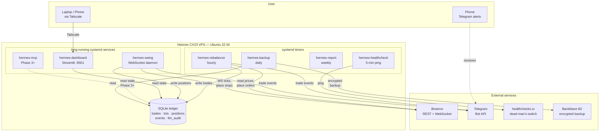

# ADR-003: Solution Architecture

**Status**: Accepted (all 10 sections approved by Ricardo Afonso on 2026-08-20)
**Accepted**: 2026-08-21
**Date**: 2026-08-20
**Deciders**: Ricardo Afonso (product owner), Claude (proposer)
**Supersedes**: —

## System at a glance

**Reading this diagram**:

- Solid arrows = active data flow
- Dashed arrows = Phase 3+ or read-only receipt
- Everything inside the VPS box is one Python codebase, five systemd units
- User NEVER accesses via public internet — dashboard reachable only via Tailscale, Telegram is outbound-only

## Context

Hermes is a Python 3.11+ crypto trading system for a solo Spanish retail investor. It runs two engines on a single Hetzner VPS:

- **Core**: deterministic threshold rebalancer holding 60/30/10 BTC/ETH/stablecoin
- **Satellite**: Donchian breakout swing trader on BTC + ETH + SOL + AVAX + LINK + DOT

This ADR captures the runtime architecture, module boundaries, communication patterns, and deployment topology.

Foundational context:

- **ADR-001** — LLM as supervisor (Claude never generates trade decisions)
- **ADR-002** — Tax posture (DGT V2232-25, savings base, dynamic FIFO calculator) *(pending)*
- **ADR-004** — Exchange decision (Binance primary, exchange-agnostic architecture, Kraken as documented backup) *(pending)*

## Decision

Hexagonal (Ports & Adapters) architecture with:

- **Pure domain layer** (rebalancing rules, Donchian math, FIFO tax) with zero external dependencies
- **Application layer** orchestrating use cases via ports
- **Adapters at the edges** (exchange, ledger, notifier, clock)
- **Scheduled entrypoints** via systemd units (timers + services)
- **Cross-service communication** via SQLite (state) + domain events (in-process)
- **No REST API, no microservices, no message bus** at MVP scale

## Design principle (project-wide)

> "We build software with scalable and agnostic view. We base ourselves on design patterns that allow us to build production-level software with the highest quality."
>
> — Product owner, 2026-08-20

Applied via:

- Strategy pattern (Exchange interface, signal engines, notification channels)
- Ports & Adapters (this ADR)
- Value objects (Money, Weight, Price, Pair — immutable, type-safe)
- Repository pattern (ledger access abstracted)
- Domain events (TradeExecuted, RebalanceTriggered, AnomalyDetected)
- Configuration as code (pydantic-settings, layered)

Rule of thumb: **every abstraction must earn its keep at OUR scale**. No pattern-orgy.

## Sections

| #   | Section                           | File                                                                           | Status   |
| --- | --------------------------------- | ------------------------------------------------------------------------------ | -------- |
| 00  | Overview & Design Principles      | [00-overview-and-design-principles.md](./00-overview-and-design-principles.md) | Accepted |
| 01  | Code Organization (Hexagonal)     | [01-code-organization.md](./01-code-organization.md)                           | Accepted |
| 02  | Data Flow                         | [02-data-flow.md](./02-data-flow.md)                                           | Accepted |
| 03  | Persistence & Schema              | [03-persistence-schema.md](./03-persistence-schema.md)                         | Accepted |
| 04  | Exchange Adapters                 | [04-exchange-adapters.md](./04-exchange-adapters.md)                           | Accepted |
| 05  | Signal Engines                    | [05-signal-engines.md](./05-signal-engines.md)                                 | Accepted |
| 06  | Notification Pipeline             | [06-notifications.md](./06-notifications.md)                                   | Accepted |
| 07  | User Interface (CLI + TUI)        | [07-user-interface.md](./07-user-interface.md)                                 | Accepted |
| 08  | LLM Supervisor Layer              | [08-llm-supervisor.md](./08-llm-supervisor.md)                                 | Accepted |
| 09  | Deployment Topology (VPS + CI/CD) | [09-deployment.md](./09-deployment.md)                                         | Accepted |
| 10  | Failure & Recovery                | [10-failure-recovery.md](./10-failure-recovery.md)                             | Accepted |

## Consequences

### Positive

- Domain layer is trivially testable (no I/O, no mocks, no fixtures)
- Adapters swap freely (exchange, ledger, notifier) — future-proof
- Single-VPS simplicity, systemd-native deployment
- Zero attack surface (no incoming HTTP for trading)
- Exchange-agnostic delivered as a first-class property, not an afterthought

### Negative

- Requires discipline: import direction must be enforced (linter rule)
- Some initial ceremony (ports + adapters) that pays off later
- Contributors need to understand hexagonal before touching code

### Neutral

- SDD process artifacts live at `openspec/changes/` (tooling convention)
- ADRs live at `docs/architecture/` (this file)
- Small parameter decisions at `docs/decisions/` (dated journal entries)
- Research reports at `docs/research/`
- All architecture docs use mermaid diagrams as first-class content

## Approval history

| Section                           | Approved by    | Date       |
| --------------------------------- | -------------- | ---------- |
| Code Organization (Hexagonal)     | Ricardo Afonso | 2026-08-20 |
| Data Flow                         | Ricardo Afonso | 2026-08-20 |
| Persistence & Schema              | Ricardo Afonso | 2026-08-20 |
| Exchange Adapters                 | Ricardo Afonso | 2026-08-20 |
| Signal Engines                    | Ricardo Afonso | 2026-08-20 |
| Notification Pipeline             | Ricardo Afonso | 2026-08-20 |
| User Interface (CLI + TUI)        | Ricardo Afonso | 2026-08-20 |
| LLM Supervisor Layer              | Ricardo Afonso | 2026-08-20 |
| Deployment Topology (VPS + CI/CD) | Ricardo Afonso | 2026-08-20 |
| Failure & Recovery                | Ricardo Afonso | 2026-08-20 |

## What would change this decision

- Scale beyond a single VPS (multi-user, multi-region, >1000 trades/day) — reconsider deployment topology
- Regulatory requirement for real-time reporting to third parties — may require an incoming HTTP surface
- Team growth beyond solo operator — may require CQRS or workflow orchestrator for coordination
