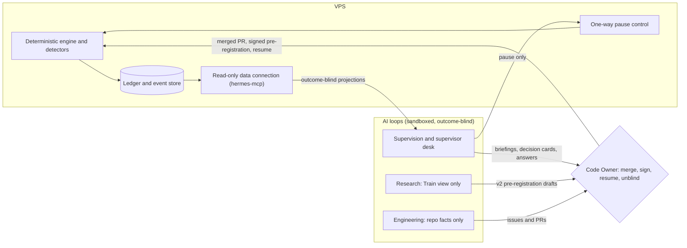

# ADR-012: Continuous AI evaluation: three loops and a supervisor desk in MVP1; deterministic code trades, AI proposes, the Code Owner decides

**Date**: 2026-10-03
**Status**: Accepted (merged in PR #367)
**Deciders**: Maintainer
**Supersedes**: two parts of [ADR-003 §08](adr-003-solution-architecture/08-llm-supervisor.md), and nothing else in it: (1) the "Sees" item "open positions with stop levels + current unrealized P&L", and the P&L half of `get_tax_status`, until v1 OOS certification (D-06); (2) the "Phased rollout" rule that no LLM layer runs in the runtime before Phase 3 (D-07). ADR-003 §08 is otherwise unchanged and still binds the supervisor.
**Tracking issue**: #310

---

## TL;DR

- Hermes runs three AI loops in MVP1: **engineering** (keeps the codebase and tracker honest), **supervision** (watches the running system) and **research** (proposes better strategies for a future v2).
- The trader stays deterministic and rule-based. No deep learning or any learned model generates signals; ADR-005 Category D stays rejected.
- AI goes into the Code Owner's supervisor role instead: the **supervisor desk** gives briefings, decision cards with a second-model dissent, ask-anything answers with sources, and a decision journal, over a read-only data connection on the VPS.
- Loops may open issues and PRs, pause trading and draft v2 pre-registrations on their own. Changing what trades, resuming trading and revealing P&L need the Code Owner.
- AI stays blind to strategy outcomes (P&L, equity, Sharpe, drawdown) until v1 OOS certification, not before 2027-01-01.
- Loop spend has a hard monthly cap of USD 50 at the model provider (D-09). The figure is the Code Owner's call.

## Context

### Why now

The Code Owner asked how hermes can use AI to evaluate and improve itself continuously without breaking its scientific and safety rules (#310). The MVP1 scope review on 2026-10-03 settled the shape:

1. **All three loops land in MVP1.** The out-of-sample test cannot run before 2027-01-01 and needs a 90-day certified shadow before it, so MVP1 has until about January 2027 to be complete. A larger MVP1 does not delay real money as long as it lands by then.
2. **No deep learning in the trader.** The trader stays rule-based. AI goes into the supervisor role.
3. **Loop autonomy** is limited to the list in D-02.
4. **The supervisor desk** (D-05) was proposed and agreed.

Two Accepted documents stand in the way as written. ADR-003 §08 lets the supervisor see unrealized P&L, which ruling 1 of the experiment (aggregate blind, #319) forbids before certification: an AI that sees shadow P&L lets the Code Owner see it too, and its advice would start steering the strategy. That is the OOS peek integrity rule 1.8 calls unrecoverable. ADR-003 §08 also keeps any LLM out of the runtime before Phase 3, and the supervision loop needs a read-only data connection on the VPS in MVP1. ADR-003 is immutable (ADR-009), so the change is this ADR.

### What breaks if we get it wrong

1. **A second trader through the back door.** "The supervisor noticed ETH entries do badly, let's tweak the filter" is exactly what the D-8 forward-testing guardrail forbids.
2. **OOS peek through the AI.** Shadow runs inside the OOS window. An AI narrating shadow P&L contaminates the theorist irreversibly.
3. **Trial inflation.** An AI hypothesis factory multiplies Train and Validation backtests, each a DSR trial under pre-registration §8.1.
4. **Injection.** Logs, error strings, issue text and dependency release notes are attacker-writable, and prompt-level defenses fall to adaptive attacks.
5. **Credential reach.** An agent beside exchange keys, the runner or an admin-scoped token could do far more than its job.
6. **Review fatigue and cost creep.** A solo operator's review time and budget are the binding limits.

## Decision

Hermes runs three bounded AI loops and a supervisor desk in MVP1. Deterministic code trades, detects and decides. AI reads, proposes, explains and argues. The Code Owner approves, merges, signs and resumes. Every boundary is enforced in code, permissions or the provider console, not in prompts.

### Decision register

| ID | Decision | Loop | ADR-005 category | Milestone |
| --- | --- | --- | --- | --- |
| D-01 | Three loops, all in MVP1 | all | B, C | MVP1 |
| D-02 | Autonomy limits | all | n/a | MVP1 |
| D-03 | The trader stays rule-based; no deep learning | trader | D stays rejected | MVP1 |
| D-04 | Supervision loop | supervision | B | MVP1 |
| D-05 | The supervisor desk | supervision | B | MVP1 |
| D-06 | Blind to outcomes until certification | all | n/a | MVP1 |
| D-07 | Read-only data connection on the VPS in MVP1 | supervision | B | MVP1 |
| D-08 | Enforcement lives in code, not prompts | all | n/a | MVP1 |
| D-09 | LLM cost cap and kill switch | all | n/a | MVP1 |
| D-10 | Engineering loop | engineering | C | MVP1 |
| D-11 | Research loop | research | C | MVP1 |

### D-01: Three loops, all in MVP1

- **Engineering loop**: scheduled agents that find ADR and issue drift, tracker hygiene gaps, mutation survivors and deploy-path risks, and propose fixes. Category C.
- **Supervision loop**: deterministic detectors watch the running system; AI ranks and explains what they find and runs the supervisor desk (D-05). Category B.
- **Research loop**: the challenger lab. AI proposes hypotheses for strategies other than v1, which the deterministic harness tests on Train and Validation, so that a v2 can be pre-registered and in shadow before the 2027 OOS test. Category C.

Every new loop agent starts in report-only mode and is promoted to proposing only after a run of accepted reports the Code Owner signs off in the decisions journal. Each loop is evaluated on a small labelled set before it runs on real data, and switched off when its acceptance rate stops paying for its review time.

### D-02: Autonomy limits

What a loop may do alone, and what waits for the Code Owner. "Loop" covers every agent in D-01 and the supervisor desk.

| A loop may, on its own | Needs the Code Owner | Never |
| --- | --- | --- |
| Open issues, through `scripts/dev/create-issue.sh` | Change what trades: strategy code, `config/strategy.yaml`, any parameter of a running experiment, any pause or kill rule | Place, cancel or modify an order; hold any exchange key |
| Open PRs as ai-bot, for review | Merge, approve or close a PR, or close an issue | Merge, approve, dismiss reviews or force-push |
| Pause trading (D-04) | Resume trading after any pause | Clear a pause |
| Draft v2 pre-registrations in a drafts path | Sign a pre-registration, certify, or make any lifecycle transition | Edit pre-registration v1 or any signed pre-registration |
| Post briefings, decision cards and answers | Reveal P&L or any strategy outcome before certification (unblinding) | See OOS data before certification, or Validation and OOS results in any prompt or memory |
| Report spend | Raise a cost cap or a loop's autonomy level | Change its own permissions, policy, model or budget |

Pausing is allowed because it is the safe direction: it stops trading and can only cost opportunity. Resuming is not, because it restarts risk.

### D-03: The trader stays rule-based

The deterministic engine owns every strategy and execution decision (ADR-001). No learned model, deep or otherwise, generates signals, and no parameter updates itself. ADR-005 Category D stays rejected in full, including direct signal generation, reinforcement-learning strategy discovery and online learning. ADR-005 Categories A to C keep their scale-based unlock schedules unchanged, so learned anomaly detectors still wait for six months of clean production data.

"AI" in this ADR means language models plus statistics code. The AI supervises, proposes and argues; it never sits in the trade path.

### D-04: Supervision loop

Detection is deterministic code first: per-fill implementation shortfall against the pre-registered fill assumptions, fill-price divergence, experiment-integrity checks (pre-registration, config, wheel and data hashes), event hash-chain verification, the daily live-versus-backtest parity check, the daily check of live data against the exchange's archive files, and `AnomalyDetected` emitters (#136). Control charts on fees, slippage and latency follow ADR-005 Category B.

The AI layer explains and ranks what the detectors flag, in plain words, with the evidence IDs. It does not act as the detector and does not set thresholds.

**Pausing.** A loop pauses trading through a one-way pause control: a single-purpose command, separate from the read-only data connection, that sets the engine's pause flag and can do nothing else. It cannot clear the flag, touch orders or change configuration. Every pause records its reason and evidence IDs and notifies the Code Owner at once. Only the Code Owner resumes. During v1, a loop pause is an operational halt, not a new pause or kill rule: it adds nothing to pre-registration v1, and the Code Owner's resume decision records the pre-registration §11 deviation assessment in the lab notebook.

### D-05: The supervisor desk

AI for the Code Owner's supervisor role, built on ADR-001's original design: the supervisor reconciles, reports, detects anomalies and analyses.

| Capability | What the Code Owner gets |
| --- | --- |
| Briefings | A daily line and a weekly brief: health, signals fired, fill drift, kill-trigger state, open risks and the decisions waiting, each with links to evidence. |
| Decision cards | Every call that reaches the Code Owner (a PR, a v2 proposal, a pause) arrives with options, a recommendation, the evidence, and a dissent: a second model, separate from the one that wrote the recommendation, argues against it. |
| Ask anything | Questions such as "why did we enter ETH on Tuesday?" answered from the ledger, events, logs, docs and issues, with every claim citing its source (event ID, ledger row, `file:line`, issue number). |
| Decision journal | Each Code Owner decision is logged with its reasoning and the expected outcome. Later the AI scores how the calls turned out, so the Code Owner learns where their judgement is strong. Calls whose outcome is a strategy result are scored only after certification. |
| Pre-mortems | Before the 2027 OOS test and before going live, a structured "assume this failed, why?" review. |

Limits on the desk:

- It stays blind to outcomes (D-06), so its briefings, cards and answers carry no P&L.
- Its suggestions about the strategy go to the research loop's challenger lab, never into v1.
- It does not judge the strategy on history from memory. Models recall pre-cutoff prices almost exactly (ADR-001, ADR-003 §08 memorization guard), so it reports what the statistics code computes and does not eyeball backtests. The guard date is the later of 2026-02-01 and the model's training cutoff plus one month, recorded with the model id.
- It reads no news or social-media feeds. Market context comes from price and volume data only (ADR-003 §08).
- Its output goes to Slack and GitHub. Telegram stays signal-only (ADR-008). The ADR-003 §08 Telegram approve button is not built.
- It recommends and argues; D-02 still applies to everything it does.

### D-06: Blind to outcomes until certification

Until v1 OOS certification, and not before 2027-01-01, no AI input, output or memory contains strategy outcomes: P&L (realized or unrealized), equity, position values, Sharpe, drawdown, win rate or per-trade returns. This applies to every loop and to the desk, and matches ruling 1 (#319) for the non-AI surfaces.

The data connection serves outcome-blind projections built by code from an allowlist of event types and fields. Fills appear as basis-point deviation from the decision price. Calibration metrics M-09 and M-10 and the shadow Sharpe kill rule appear only as pass or fail; kill-trigger state appears only as yes or no. A unit test on the projection builder enforces the allowlist and ships with the first AI call that reads runtime data. The engine still computes every pre-registered metric; only what reaches the AI is limited.

**Supersedes** the ADR-003 §08 "Sees" item "open positions with stop levels + current unrealized P&L" and the gains half of "tax status" until certification. Positions and stop levels stay visible without values. Unblinding is an explicit Code Owner step at certification.

### D-07: Read-only data connection on the VPS in MVP1

The `hermes-mcp` read-only server from ADR-003 §08 (#34) runs on the VPS in MVP1, not Phase 3. **Supersedes** the ADR-003 §08 "Phased rollout" rule that no LLM layer runs in the runtime before Phase 3. Everything else in ADR-003 §08 still binds it: per-tool scopes, deny-by-default, Pydantic-validated typed output, no order-placing tool in the codebase, the memorization guard and the `llm_audit` trail.

Stricter conditions than ADR-003 §08:

- It runs as its own unix user with read-only access to the ledger and event store, no read access to the env file, and no exchange key, Telegram token or runner credential.
- Its tools return D-06 projections only.
- It is reachable only over the private network, never the public internet.
- The language model runs off the VPS. The server only answers typed read calls.
- The one-way pause control (D-04) is a separate command with its own scope, not a tool on this server.

### D-08: Enforcement lives in code, not prompts

- **Policy in tracked files.** Agent definitions, prompts, output schemas and permission policies live in tracked paths. A CI check fails on any order-placing tool, exchange write scope or wildcard permission. Only the Code Owner applies settings changes (`AGENTS.md` rule 9).
- **Import contract.** An import-linter contract stops AI modules importing exchange ports, adapters and the composition root. They import only read-only ports and projection types.
- **Protected paths.** Loop-authored PRs carry an `agent:*` label. A required CI check fails a labelled PR that touches Accepted ADRs, pre-registration files, `config/`, `.github/workflows/`, `AGENTS.md` or `.claude/`, unless the Code Owner overrides it.
- **Sandbox.** Loop agents run in an OS-level sandbox with a fresh clone of `main`, no `.env`, no Docker socket, no SSH keys and no runner directory, holding only the model API key. No loop agent runs on the self-hosted CI runner.
- **Output gate.** Model output is written to a file, then a deterministic step checks schema and length, rejects links, code fences and secret patterns, and requires every cited number and ID to exist in the input before anything is posted. On failure the deterministic digest goes out instead. The gate is the security boundary; the ADR-003 §08 validator model stays but is not.
- **No raw untrusted text in prompts.** Logs, tracebacks, exchange error strings, bot and third-party PR bodies and release notes reach a model only as typed fields: error class, `module:line`, numeric codes and counts.
- **Audit.** Every model call is logged with model id, prompt-template hash, input hash, output, gate verdict, tokens and cost, in `llm_audit` on the VPS and an equivalent log for off-VPS loops.

### D-09: LLM cost cap and kill switch

The plan does not set a figure, so this ADR proposes one for the Code Owner to confirm or change.

| Parameter | Initial value |
| --- | --- |
| Hard cap | USD 50 a month across all loops and the desk, set as a spend limit on a dedicated provider workspace and API key used only by loops |
| Per-loop ceilings | supervision and desk USD 25, engineering USD 15, research USD 10, monthly |
| Soft breaker | at 80% of the hard cap, every loop falls back to deterministic-only mode for the rest of the month and the weekly brief says so |

Interactive sessions the Code Owner directs are outside this cap. Each loop agent pins an exact model id, uses the cheapest model tier that passes its evaluation set, runs a deterministic prefilter before any model call, has a turn cap, and never retries on a refusal or schema failure. A clean deterministic bundle gets a canned all-clear at zero tokens.

**Kill switch**: disable the loop API key in the provider console and the scheduler entries. It needs no PR, gets a runbook entry, and is drilled quarterly. The engine runs unchanged with every loop off (ADR-003 §10).

The figures are parameters: they change through the decisions journal, not a new ADR.

### D-10: Engineering loop

Scheduled, report-first agents for process integrity and drift: zombie issues, missing milestone, assignee or labels, PRs missing their change spec, doc-versus-code drift (paths, scripts, thresholds, dated controls), mutation survivors with a drafted test for each, and a narrow rubric review of deploy-path changes. Deterministic checks run first; linters block merges, the model does not. Findings arrive as one weekly report issue; fixes arrive as ai-bot PRs for review. AI-drafted tests follow `docs/guides/ai-authored-tests.md` and ADR-007. Two existing routines already do part of this work and fold into this loop.

### D-11: Research loop

The challenger lab proposes and tests strategies other than v1. Before any AI-proposed search runs:

1. The DSR specification takes the published form.
2. A hash-chained trial ledger records every Train and Validation run, written only by the harness before metrics are released.
3. Trial counting follows ruling 2: v1 counts per pre-registration §8.1 as written; from v2, every trial on a dataset counts cumulatively across versions.
4. CI leakage tests refuse OOS reads outside certification and assert proposer input holds no Validation-window or OOS-window fields.

The AI proposer sees Train diagnostics only. Each hypothesis card names a mechanism, expected sign, a free-parameter cap and a falsification test, and its hash is committed before any run. Validation and OOS outcomes go to the Code Owner and a deterministic scorecard, never back into a prompt or agent memory. The loop drafts v2 pre-registrations outside the protected paths; the Code Owner adds figures and signs. A challenger never touches v1, and no strategy trades real money without its own signed pre-registration and OOS certification. The loop is switched off if its cards do not beat random and parameter-search-only baselines.

## What this ADR does NOT allow

1. No AI-generated trade decision, signal or order, and no AI output into sizing or eligibility (ADR-001, ADR-005).
2. No deep learning or any learned model in the trade path, and no self-updating parameters (ADR-005 Category D).
3. No AI write to `config/strategy.yaml`, a running experiment's parameters, pre-registration v1 or any signed pre-registration.
4. No AI resume, certify, restore, unblind or lifecycle transition. Pause is the only engine action a loop may take.
5. No AI access to strategy outcomes before v1 OOS certification, and no AI access to OOS data at all before certification.
6. No exchange key, write scope or order-placing tool in any AI environment.
7. No agent merges, approves, dismisses reviews or force-pushes.
8. No secrets in prompts or in the repo; a loop's model step holds only the model API key.

## Why

Language models are weak traders and weak open-ended detectors, but useful at reading collected evidence, explaining it and arguing both sides (ADR-001). Putting them on the supervisor's side of the desk, where the Code Owner decides, uses that strength without touching the trade path. Capability limits beat prompt rules, because injection defenses expressed as instructions keep failing. Blinding the AI keeps the 2027 OOS test credible, and a trial ledger keeps an AI hypothesis factory from silently inflating the trial count.

### Alternatives considered

| Alternative | Argument for | Why we passed |
| --- | --- | --- |
| Engineering loop only in MVP1, others in MVP2 | Smaller MVP1 | The protocol calendar, not build speed, sets the go-live date, so MVP1 can carry all three. Without the research loop, nothing replaces v1 if it fails in 2027. |
| Deep learning in the trader | "Full AI" | ADR-005 Category D: no credible evidence that learned signal models beat simple rules out of sample after costs at retail scale. |
| Supervisor sees P&L, as ADR-003 §08 allowed | Richer briefings | An AI that sees shadow P&L leaks it to the Code Owner and steers the strategy, the unrecoverable OOS peek. |
| Loops may resume trading | Less manual work | Resuming restarts risk; only the Code Owner takes that direction. |
| LLM validator as the security boundary | Catches semantic attacks | Adaptive attacks bypass model-based defenses; a deterministic gate is the boundary. |
| News or social feeds for market context | More context | Prompt injection (ADR-003 §08). |

## Consequences

### Positive

- The Code Owner gets briefings, argued decisions and sourced answers in MVP1, not 2027.
- If v1 fails its OOS test, a v2 can already be pre-registered and in shadow.
- Every boundary is a test, a lint contract, a sandbox, a CI check or a provider limit.
- Spend has a hard cap and review time has a weekly budget.

### Negative

- Outcome-blind supervision gives up AI commentary on performance until 2027.
- The data connection on the VPS widens the runtime's attack surface, mitigated by D-07.
- A loop can pause trading on a false alarm, and every such pause costs Code Owner time to review and resume.
- More MVP1 work: the data connection, projection builder, pause control, trial ledger, sandbox and evaluation sets.

### Neutral

- Interactive sessions keep the `AGENTS.md` roles; D-02 applies to loops.
- Cost figures, cadences and model choices live in the decisions journal.
- #34 (LLM supervisor) moves from MVP2 to MVP1.

## Consistency with existing decisions

| Document | Status | How ADR-012 relates |
| --- | --- | --- |
| ADR-001 | Accepted | Parent. The AI supervises and never trades; the desk is ADR-001's supervisor pointed at the Code Owner's decisions. |
| ADR-003 §08 | Accepted | Partly superseded: unrealized P&L access until certification (D-06) and the Phase 3 gate (D-07). Everything else binds. |
| ADR-003 §10 | Accepted | The engine runs unchanged with every loop off. |
| ADR-005 | Accepted | Supervision is Category B, engineering and research are Category C, Category D stays rejected. |
| ADR-007 | Accepted | Binds every AI-drafted test. |
| ADR-008 | Accepted | Telegram stays signal-only; AI output goes to Slack and GitHub. |
| ADR-011 | Accepted | Challengers run through the shared fill kernel with their own `strategy_id`. |
| Pre-registration v1 | Signed | Untouched and wins any conflict. Loop pauses add no rule to it (D-04). |
| `AGENTS.md` | Living | Roles unchanged. |

## Rollout

Shadow launch comes first: no ADR-012 item may delay it. Within MVP1:

1. Kill switch, provider cap, sandbox, import contract and protected-path check.
2. Engineering loop, extending the routines that already run.
3. Read-only data connection, projection builder with its blindness test, and the one-way pause control.
4. Supervisor desk: briefings first, then decision cards with dissent, ask-anything and the decision journal.
5. Trial ledger, DSR fix and leakage tests, then the research loop's proposer.

Follow-up issues are filed against #310, which is the live tracker.

## What would change this decision

- **v1 reaches OOS certification or a terminal state**: D-06 lifts through the Code Owner's unblind step.
- **A loop's acceptance rate stays low or review time overruns its budget for three months**: that loop is switched off first.
- **Credible out-of-sample evidence that learned signal models beat simple rules after costs at this scale**: a new ADR could revisit D-03.
- **The personal-use status changes** (any ADR-002 trigger): the governance of these loops is reviewed with professional advice.

## Pending

- **Code Owner's call**: the USD 50 monthly hard cap and its split in D-09.

## Cross-references

- ADRs: [ADR-001](./adr-001-llm-as-supervisor.md), [ADR-003 §08](./adr-003-solution-architecture/08-llm-supervisor.md), [ADR-005](./adr-005-ai-ml-support-boundary.md), [ADR-007](./adr-007-testing-strategy.md), [ADR-008](./adr-008-observability-strategy.md), [ADR-009](./adr-009-documentation-strategy.md), [ADR-011](./adr-011-paper-trading-engine.md), [ADR-013](./adr-013-shadow-composition-root.md)
- Experiment: [pre-registration v1](../experiments/swing-mvp1/pre-registration-v1.md)
- Guides: [AI-authored tests](../guides/ai-authored-tests.md), [`AGENTS.md`](../../AGENTS.md)
- Issues: #310, #34, #136, #319
