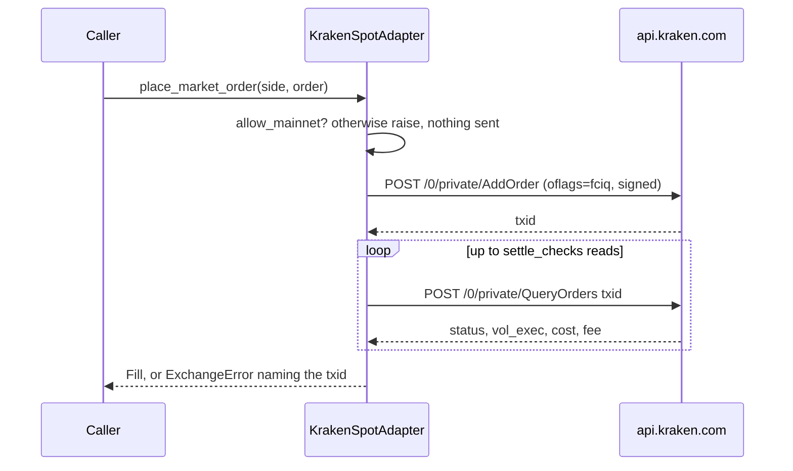
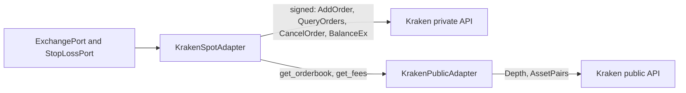

# Kraken spot trading adapter: read-only until live approval

**Date**: 2026-10-04
**Author**: AI Bot on behalf of the Code Owner
**Related**: ADR-004 (Kraken cold backup), ADR-014 (live approval),
[2026-08-24 Kraken public adapter](2026-08-24-kraken-public-adapter.md),
`openspec/changes/32-kraken-spot-adapter/change.md`, #32, #148

## Decision

`KrakenSpotAdapter` implements `ExchangePort` and `StopLossPort` against
Kraken's private REST API. It is a separate class that composes
`KrakenPublicAdapter` for the order book and fee schedule, rather than signed
methods added to the public class, so the public adapter keeps needing no
credentials. Kraken has no spot testnet, so the adapter is **read-only
unless `allow_mainnet` is set**: placing or cancelling raises before any
request is built. Nothing wires it into `hermes serve`.

## Context

The 2026-08-24 entry deferred signed Kraken calls to MVP2. ADR-004 wants a
cold-but-ready Kraken path behind the same port as Binance. Binance's adapter
can default to its testnet; Kraken's cannot, so the safety line moves from
"which host" to "may this adapter write at all".

Kraken's `AddOrder` returns only an order id, so the adapter reads the order
back with `QueryOrders` until it is closed, cancelled or expired:

Alternatives: signed methods on `KrakenPublicAdapter` (mixes a
credential-free reader with a trader); a host-based gate like Binance's (no
Kraken host is safe); validate-only orders (`validate=true` returns no
execution, so it cannot produce a `Fill`).

## Consequences

- Fees are asked for in the quote currency (`oflags=fciq`), so a fill's fee
  is quote money and a buy is not reduced by a fee in the base asset.
- An order still live after `settle_checks` reads raises with its txid; the
  operator reconciles it before trading again.
- Prices and volumes go out as given. Kraken rejects more decimals than a
  pair allows; per-pair precision is a follow-up before live use.
- No live contract test: any signed call would touch a real account.
