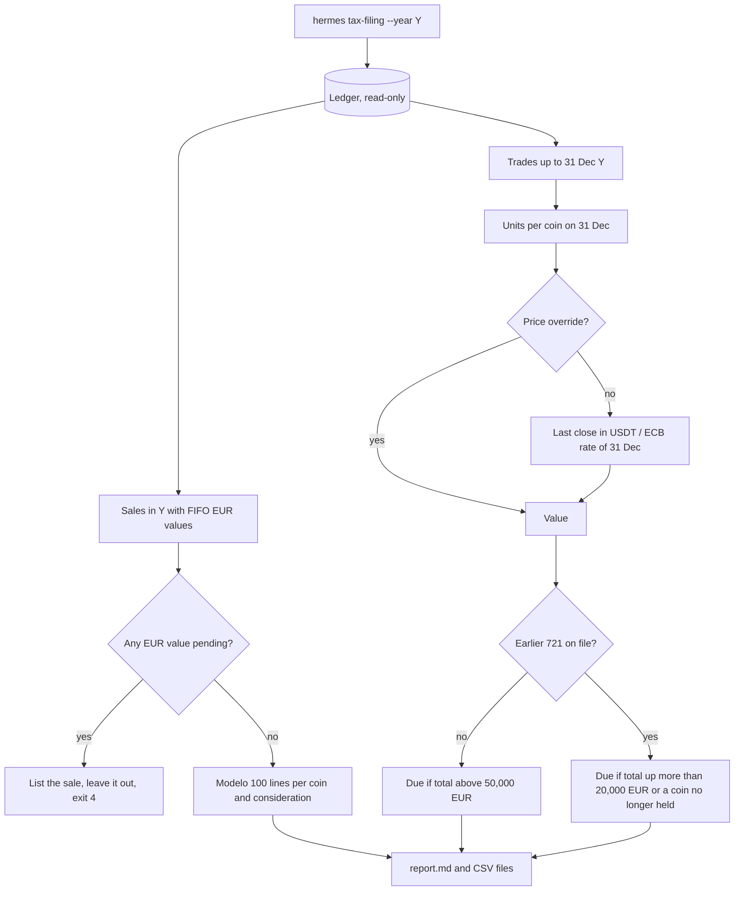

# Tax-filing report defaults (Modelo 100 and Modelo 721)

**Date**: 2026-10-04
**Author**: AI Bot on behalf of the Code Owner
**Related**: [ADR-002](../architecture/adr-002-tax-posture.md),
[ADR-016](../architecture/adr-016-tax-estimate-rules.md),
`openspec/changes/36-modelo-100-721/change.md`, GitHub issues #36, #395, #405

## Decision

`hermes tax-filing --year YYYY` prints the figures for Modelo 100 and Modelo
721 from the ledger, with the working defaults below. The gestor confirms them
before the first real filing; each is one config value or one function to
change.

## Context

ADR-002 says the engine emits both drafts at year end and the operator files.
Several form details are not settled by any ADR, so the report picks a default
for each and prints it under "Defaults to confirm with the gestor":

- **Modelo 100 lines**: one line per coin and kind of consideration ("fiat
  currency" or "other virtual currency"), with every sale in an annex. No box
  numbers or letter keys are printed; they change between campaigns.
- **Values**: transmission value = proceeds minus the sell fee; acquisition
  value = the FIFO lots' EUR cost with buy fees (ADR-016 item 3). The report
  reads the stored FIFO projection; it never recomputes it.
- **Pending EUR values**: a sale whose EUR rate is still pending is listed and
  left out of the totals, and the command exits 4 (incomplete).
- **Two-month rule**: loss sales with a same-coin purchase within two calendar
  months either side are flagged, not deferred (ADR-016 item 8).
- **Modelo 721 obligation**: on the total of all coins. The first time, due
  above €50,000 on 31 December. After a 721 is on file, due when the total rose
  more than €20,000 over the last declared total or a declared coin is no
  longer held. Origin keys: A first declared, M declared before, C no longer
  held. Amounts live in `config/filing.yaml`.
- **721 valuation**: last stored bar close in USDT at or before 31 December
  24:00 Madrid, at the ECB rate of 31 December (USDT read as USD). An operator
  `--price COIN=EUR` wins.
- **Custodian country**: left unset in `config/filing.yaml` until the gestor
  confirms it for the account's KYC (ADR-002 Pending).
- **Personal data**: the command never reads `taxpayer.yaml`. Earlier 721
  values live in a local file outside the repo
  (`~/.config/hermes/modelo721.yaml`); name and NIF are left for the form.

## Consequences

- The operator gets figures to type into Renta Web and the 721 form, and an
  annex for the gestor. Nothing is submitted, and there is no PDF or BOE-format
  file; either is a follow-up if wanted.
- Until #405 makes USDT its own FIFO asset, USDT disposals and USDT balances are
  missing from both reports. The report says so under "Known gaps".
- Shadow figures carry "shadow (simulated fills, no real tax due)"; `--live`
  drops that label once real fills exist.
