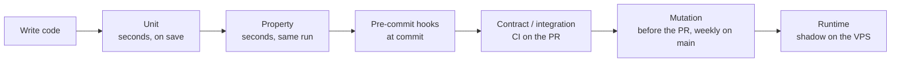

# AI-Authored Tests — Discipline & Enforcement

**Type**: Guide (living document — PR any change)
**Owners**: Code Owner
**Applies to**: every test file in this repo, whether authored by a human or an AI agent (`ai-bot`).
**Description**: What makes a unit test meaningful, how AI typically fails at writing tests, the unit-test standard every test in this repo follows, and the tooling that enforces it.

This guide exists because AI-authored tests have a specific failure mode: they *look* like tests, they satisfy line-coverage gates, and they pass — but they don't catch bugs. This guide is the discipline that prevents that from happening in hermes.

## The core problem

Coverage-driven testing tells you which lines executed. It tells you nothing about whether those executions asserted anything meaningful. An AI (or a hurried human) can hit 100% line coverage with tests that:

- Call the function.
- Assert `is not None` on the result.
- Never exercise a boundary, a failure, or an invariant.

That test suite is worse than none: it looks like a safety net while catching nothing.

## What makes a unit test *meaningful*

A meaningful test satisfies **all** of the following:

1. **Tests behavior, not implementation.** The test asserts what the code should *do*, not *how* it does it. A refactor that preserves behavior must not break the test. A behavior change (bug or intentional) must break exactly one test.
2. **Would fail if the code had a real bug.** Not "if we deleted the whole function", but "if we broke the invariant". Mutation testing is the objective measure of this.
3. **Names describe what CANNOT happen.** `test_fifo_never_consumes_from_future_lot` is meaningful. `test_fifo_works` is not. The name is a spec fragment.
4. **Asserts against the output, not internal state.** If the test needs to peek at private state to know if it passed, the code has a design gap or the test is coupled to implementation.
5. **One test = one behavior claim.** Multi-assertion tests that check "everything is right after this call" mask *which* thing broke.
6. **Inputs represent real scenarios**, not just what the code will accept. Include boundary values, empty collections, single-element collections, degenerate cases, and the failure modes documented in the type contract.

## Failure modes specific to AI-authored tests

Cataloged from observed patterns (mine and others'). If a test you wrote or reviewed fits one of these, it is not doing its job.

### 1. Assertion inflation

Many trivial `assert result is not None`, `assert len(x) > 0`, `assert x == x` — none of which would fail if the function did the wrong thing.

**Symptom**: high assertion count, high line coverage, zero mutation kill on the tested branch.

**Fix**: replace with one specific behavior assertion. `assert order.total == Decimal("42.13")` beats ten `is not None` checks.

### 2. Testing the mock

The test mocks the collaborator, then asserts the mock was called with certain args, then reports pass. The real code is never exercised.

**Symptom**: test passes when the tested function's body is deleted (only mock setup remains).

**Fix**: mock only external boundaries (network, filesystem, time). Integration-test the seams. If a mock is the ONLY assertion, the test is testing itself.

### 3. Coverage-driven writing

"Add tests until pytest-cov shows ≥ 90%." The tests are drawn to code paths, not to invariants. Uncovered lines get a single execution and no assertion.

**Symptom**: coverage green, mutation kill rate mediocre, PRs still ship bugs.

**Fix**: start from the *spec* (what invariants the code must satisfy), write tests for those, THEN check coverage as a sanity floor.

### 4. Snapshot abuse

Snapshot testing that locks in current output for functions that have no canonical output. The first snapshot captures whatever the code produces (bugs included). Every subsequent PR that changes the output "just updates the snapshot" — the test asserts nothing beyond "the output hasn't changed unexpectedly".

**Symptom**: snapshot files updated without any human review of the diff.

**Fix**: snapshots only for outputs that are genuinely canonical (JSON schema, generated code, config-file rendering). Everything else uses behavior assertions.

### 5. Happy-path only

Tests exercise the common case. Never the empty input, the malformed input, the boundary, the concurrent access, the failure recovery.

**Symptom**: production bugs are all "unexpected input" or "timing issue".

**Fix**: for pure-logic modules, add property-based tests (hypothesis) — the framework will find edge cases you didn't think of. For stateful code, list failure modes explicitly and test each.

### 6. Over-mocking

Mocking so much of the surface that the test only exercises the glue code. The domain logic is never actually run.

**Symptom**: mutation testing kills few mutants in the domain logic; refactoring the domain doesn't break tests.

**Fix**: separate pure logic from I/O. Test pure logic without any mocks. Mock only at the I/O boundary.

### 7. Frozen-time obsession

Every test freezes time to a specific timestamp. The code's behavior around real time (DST, month boundaries, leap seconds, timezone conversions) is never tested.

**Symptom**: production bug on Jan 1 or during DST transition.

**Fix**: frozen time for reproducibility, but ALSO parametrize tests over meaningful time boundaries (year-end, month-end, DST transitions in Europe/Madrid).

## The unit-test standard

These rules apply to every test in the repo, written by a person or an AI agent. A reviewer can check each one,
and the AI review applies them on every PR. Rules 3, 6, 7, 10 and 11 are also enforced by
`scripts/dev/no-vague-test-assertions.py` (see [Enforcement](#enforcement-in-this-repo-phase-0)). Adopted under
issue #691 from the 2026-10-05 testing review.

1. **Name the rule.** Every test protects one rule from the pre-registration, an ADR, an issue or a documented
   behaviour, and its docstring cites it: `"""FIFO never draws from a lot dated after the sale (ADR-003)."""`,
   not "test fifo function". No rule, no test.
2. **Write the expected value by hand.** Use a worked example computed outside the code. Never compute it with
   the code under test, and never read it from the same table or config the code reads.
3. **Pin exact values.** Never use these as the only assertion: `is not None`, truthiness, `> 0`, a length,
   `isinstance`, `all()` or `any()` over a list that could be empty, or an absence check with no matching
   presence check. Never write `assert a or b`, a substring check joined with `or` for example: it passes when
   either side holds, so the guard rejects it whatever else the test asserts. For a function that returns a
   `bool`, assert `is True` or `is False`.
4. **Test every limit at the limit.** Every threshold gets a test exactly at it and one just past it, so `>`
   versus `>=` is pinned.
5. **Assert every claim in the name.** If the name says "per currency and day", the test changes the currency
   and the day. If it lists four exit codes, it checks four. One behaviour per test: an `and` in the docstring
   usually means two tests.
6. **Don't test Python, libraries or mypy.** No tests that a dataclass is frozen or slotted, that values compare
   by value, that an object satisfies a Protocol, a function's signature, enum literals, a default `repr`, or the
   system clock. mypy and the language already guarantee them.
7. **Don't restate constants.** The signed pre-registration parameters are pinned once, in one table test against
   the pre-registration text. Everywhere else, test the logic that uses them.
8. **Check both directions of a round trip.** A to/from pair gets a round-trip test plus one exact value each way.
9. **Parsers check real fields.** An adapter or parser test pins at least one parsed field value and the exact
   error reason, using recorded production payloads (what the exchange actually returns, not what its docs say).
10. **Mock only at the edge.** A test whose only assertion is that a mock was called does not count. Prefer
    fakes, and assert the resulting state. Every mock names the integration test at its seam in a comment:
    `# integration: tests/integration/.../test_x.py::test_y`.
11. **"Doesn't raise" checks the state afterwards**, for example that the open orders are unchanged after
    cancelling an unknown one. Every function that can raise has a test for the specific exception on the
    specific bad input. A test with no assertion at all fails the guard. A validator that accepts by
    returning `None` has no state to read: use `assert_accepted` from `tests/support/accepted.py`.
12. **Pure maths gets a property test** (indicators, sizing, tax, statistics). The gates run Hypothesis on the
    derandomized `ci` profile (issue #637), so a property test is as repeatable as an example test. Pin known
    regressions with `@example`. A test that needs more than the 60s `pytest-timeout` default says so with
    `@pytest.mark.timeout(N)` and a comment naming the reason.
13. **Prove it with a mutant.** A new or changed test must catch at least one planted bug the old suite missed
    (`scripts/dev/mutation-diff.sh`; a gate under issue #675), and the PR says which.
14. **Deleting a weak test is fine** when the PR gives the reason. A test that can't fail is debt, not safety.
15. **Cross-module behaviour belongs in a scenario** (issue #689), not in a unit test full of mocks.

**When a code change breaks a test: STOP.** If the change is a behaviour change, the test should have failed;
that's its job. Updating the test to make it pass silences the alarm. Ask whether the new behaviour is correct, or
whether the change broke the rule the test protects.

For other tiers the same rules apply. Which tiers exist, where each one runs and how often is in
[test-tiers.md](test-tiers.md); this guide does not restate it.

## Fakes, mocks and testnets

Use fakes (in-memory implementations of the port protocol) over mocks for adapter tests. Fakes validate real
behaviour; mocks only validate call signatures. Mock only at the I/O boundary where a fake is impractical. Any
test that reaches a real external service must be idempotent and use dedicated test-account credentials only.

Every adapter gets an integration suite covering: (a) happy path, (b) transient network failure with retry,
(c) permanent failure with correct error propagation, (d) rate-limit response, (e) data-shape mismatch (test what
the exchange actually returns, not what the docs claim it returns).

**Code Owner review**: a new function without a unit test, or a new adapter method without an integration test, is
REQUEST CHANGES.

## Enforcement in this repo (Phase 0+)

Rules enforced today (tiers and cadences: [test-tiers.md](test-tiers.md)):

| Rule | Tool | Gate | Status |
| ---- | ---- | ---- | ------ |
| Every test has a docstring | ruff `D103` (tests-only via `per-file-ignores`) | pre-commit + `ci.yml` ruff step | live |
| Coverage floor (global) | coverage.py `fail_under = 90`, branch coverage | `ci.yml` unit step — pytest exits non-zero | live |
| Coverage floor (per-package) | `scripts/dev/coverage-check.py --bootstrap` (flag is a no-op while every listed package has code) | `ci.yml` coverage step — per-package thresholds | live |
| Standard rules 3, 6, 7, 10 and 11 (vague-only or an `or` assertion, tests Python, restated constant, mock-only, no assertion) | `scripts/dev/no-vague-test-assertions.py` (AST walker) with `no-vague-test-assertions.baseline` (violations known on adoption; the list only shrinks) | pre-commit hook on staged tests; a full run also fails on stale baseline lines | live |
| No expected failure on main | `xfail_strict = true` plus `tests/plugins/xfail_guard.py` (any xfail outcome fails the session) | every pytest run, local and `ci.yml` | live |
| Every warning fails the run | `filterwarnings = ["error"]` in `pyproject.toml` | every pytest run | live |
| Mutation kill floor | cosmic-ray (see `docs/decisions/2026-08-22-mutation-testing-cosmic-ray.md`) | ≥ 80% kill rate on `src/hermes/domain/value_objects` and `src/hermes/domain/lots`, weekly in `scheduled.yml`; blocking since #406 | live |
| Property-based tests exist | manual review + `grep hypothesis` | reviewer checklist | manual |
| No snapshot without reviewer comment on the diff | syrupy `__snapshots__/` folders next to the tests | reviewer checklist | manual |
| Test files never deleted without justification | test-deletion guard | `ci.yml` step "Test-deletion guard" | live |
| New `src/hermes/` module ships with a `tests/unit/**/test_<name>.py` | `scripts/dev/test-file-adjacency.sh` (exempt: `__init__`, `_private`, `ports/`) | pre-commit hook + `pr-preflight.sh` (`--base origin/main`) | live |
| PR body names the test tiers touched | `scripts/dev/test-tiers-line-check.sh` | `create-pr.sh` refuses the PR (exit 6) | live |
| Mutants on changed domain + application lines are killed | `scripts/dev/mutation-diff.sh` + `cosmic-ray-diff.toml` | run by the author before the PR; kill rate reported in the PR body | manual |

The **mutation kill rate** is the load-bearing gate. Line coverage is table stakes — it
tells you the test EXECUTED the line. Mutation testing tells you the test would DETECT
if that line's logic were subtly wrong. Until the mutation floor is blocking (#406), the
combination of D103 (docstring names the invariant), no-vague-assertions (the assertion
tests it), and per-package coverage (every path exercised) is the interim substitute.

## Bug discovery timing

Each tier catches a different class of bug, at a different moment. The
cheaper the moment, the better: a bug the author's own unit test finds
costs a minute; the same bug found by a sub-agent that hangs mid-run
costs a rate-limited session and a misdiagnosis.

| Tier | Catches | When it runs |
| ---- | ------- | ------------ |
| Unit | A wrong branch, a wrong constant, a missing failure case | On every save and in CI's `unit` job |
| Property | Edge cases nobody listed: float drift, duplicates, empty inputs, loops that never terminate | Same run as unit; hypothesis shrinks the failing input |
| Pre-commit hooks | Process drift: a stale generated file, a module with no test, a vague assertion | At `git commit` |
| Contract | The wire shape of an external API changing under us | Against recorded fixtures in CI; live weekly |
| Integration | Two adapters disagreeing about a port's contract | CI on the PR |
| Mutation | Tests that run the code but would not notice it being wrong | `mutation-diff.sh` before the PR; weekly on main |

Real examples from the 2026-08-23 autonomous session, each found later
than it should have been:

- **Rate-limiter float drift.** Refilling the token bucket with float
  arithmetic could leave the balance a hair under the request weight, so
  the caller spun forever on tiny top-ups
  (`src/hermes/adapters/_shared/rate_limiter.py`). A hypothesis property test ("acquire always returns
  for any cost ≤ capacity") found it. The sub-agent first read the hang
  as a slow test and burned its session retrying. Lesson: write the
  property test first for any numeric loop, and treat a hang as a
  failing test, not as slowness.
- **Klines duplicate-row loop.** The exchange sometimes re-sends a row
  at or below the requested start time; yielding it put the pager back
  on the same cursor, so it never advanced
  (`src/hermes/adapters/exchanges/binance_klines.py`). The same style of property test ("paging terminates
  and yields each open time once") surfaced it once someone wrote it.
- **Frozen-dataclass exception.** A frozen dataclass used as an
  exception broke when Python set `__traceback__` on it. It showed up as
  test *errors* in the KlineStore suite, not as failures, so it was
  deferred. Lesson: an error in a test run is a bug report too.
- **Guides index drift.** A new guide shipped without regenerating
  `docs/guides/README.md`, and CI caught it twice. A pre-commit hook now
  regenerates the index at commit time. Lesson: drift that recurs gets a
  hook, not a reminder.

## Signs your tests aren't producing value

- **They never fail.** A suite that has not gone red in weeks of active
  change is not checking much. Run `mutation-diff.sh` on your change and
  read the survivors.
- **They all changed in the refactor.** Tests coupled to structure
  break when behaviour did not change. See §"What makes a unit test
  meaningful", point 1.
- **The bug was found by something else.** Every bug found in review,
  in CI's contract job or on the VPS is a missing unit or property test.
  Add it with the fix (see the post-incident row of the lifecycle
  matrix above).
- **Coverage went up, the kill rate did not.** New lines are executed
  but not asserted on.
- **Only examples, no properties, for numeric or looping code.** Hand
  picked examples miss the drift and termination bugs above.
- **The test needed the mock to be told the answer.** If the assertion
  only restates what the mock returns, the test checks the mock.

## Tooling summary

- **pytest** — test runner. Fixtures are code — review them like production code.
- **hypothesis** — property-based testing. Use for pure functions with data inputs (FIFO, tax calculations, price aggregation).
- **cosmic-ray** — mutation testing. Runs weekly (Sunday leg of `.github/workflows/scheduled.yml`) over the scope in `cosmic-ray.toml`; kill rate is the real correctness gate once #406 makes it blocking. See `docs/decisions/2026-08-22-mutation-testing-cosmic-ray.md` for the tool choice + spike evidence.
- **coverage.py** with `--branch` — coverage floor as sanity check, not a goal.
- **pytest-cov** — reporting in CI.
- **pytest-xdist** — parallel execution (`-n 4` in CI).
- **syrupy** — snapshot tests; snapshots live in `__snapshots__/` next to the test.
- **respx** — HTTP mocking for `httpx` adapters.
- Frozen time: pass the time in as an argument or use a fake clock rather than patching. `freezegun` is a dev dependency, but no test uses it today. Either way, parametrize over real time boundaries.
- **ruff** with test-focused rules (`D`, `PT`) — test hygiene.

## Start by asking how it breaks

Before writing a test for runtime code, list how the code could fail:
bad input from outside, a crash between two writes, a second process, a
clock that jumps, a service that is slow instead of down. Then check
each item against the failure-mode catalogue in
`tests/integration/scenarios/failure_modes.py` (issue #839).

- Every PR that changes runtime code adds the failure modes it finds to
  the catalogue, or says in the PR body that it found none.
- Every bug fixed adds its catalogue entry and the test that would have
  caught it.
- An entry is proved by tests, a gap naming its open issue, or accepted
  with Rick's dated approval. `test_failure_mode_list.py` fails on
  anything else, and on a proof that names a test that does not exist.

## The one question to ask before submitting

Before opening the PR, look at each test you wrote and ask:

> **"If I broke the invariant this test claims to protect, would this test fail?"**

If the answer is "not necessarily" — the test isn't doing its job. Rewrite it or delete it. A test that doesn't detect the bug it's supposed to detect is a liability, not an asset.

## Reading list (worth 30 min before writing tests)

- Kent Beck, *Test-Driven Development: By Example* — the canonical short book
- David Farley, *Modern Software Engineering*, chapter on testing
- GeePaw Hill's blog posts on "TDD as a design activity"
- Julian Berman on property-based testing (talks and hypothesis docs)
- Any recent post from Stripe, Cloudflare, or Google engineering blogs on mutation testing in practice

## Related

- `AGENTS.md` — pointer here from the "Writing code" section
- `docs/decisions/2026-08-21-revalidate-then-merge.md` — merge queue design (decisions module in `tools/merge/` is an example of the discipline applied)
- Phase 0 issues: mutation testing setup, hypothesis integration, coverage gates
