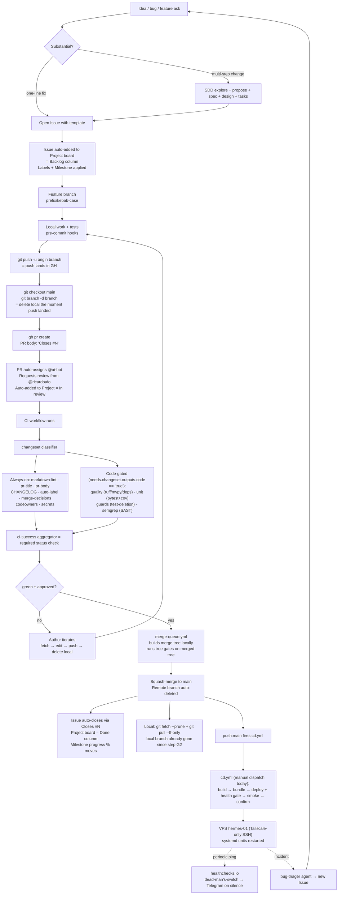
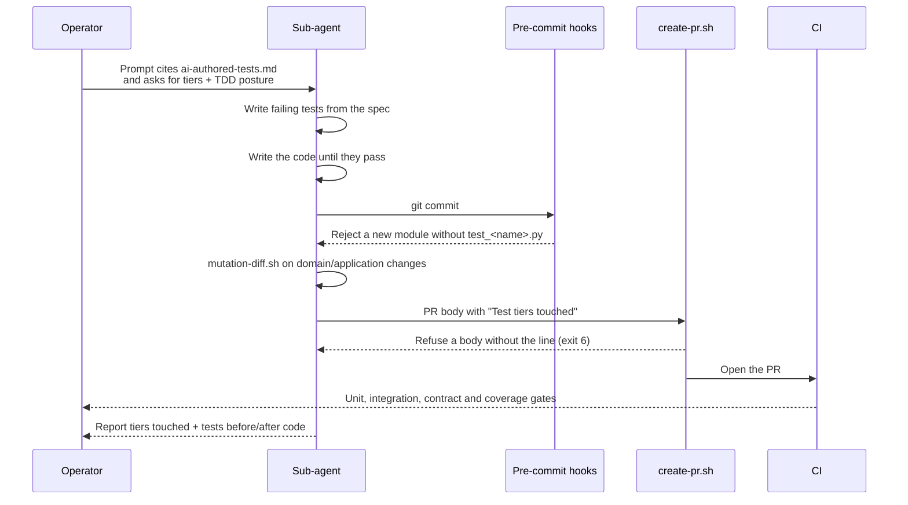

# AI Development Life Cycle

**Type**: Guide (living document — PR any change)
**Owners**: Code Owner (product owner, sole reviewer)
**Applies to**: everyone (and every AI agent) doing work that lands in
`github.com/ricardoafo/hermes`.
**Description**: End-to-end flow from idea to VPS runtime; how milestones, issues, and the project board fill in as work moves.

This document maps every step from "The maintainer has an idea" to "code runs on
the VPS and reports back". For each step it says WHO does it, WHAT gets
produced, WHERE it lives, and WHEN it moves to the next step. Progress
tracking lives in three surfaces: **Milestones** (long-lived phase buckets),
**Issues** (atomic work items), **Project board** (visual pipeline). This
guide explains how those surfaces get populated automatically as work moves.

## The full flow



## Where progress lives (three surfaces, one source of truth)

| Surface | What it holds | When items appear | When they close |
| ------- | -------------- | ------------------- | ---------------- |
| **Milestones** (MVP1 / MVP2) | Long-lived planning buckets. Every open issue and PR belongs to exactly one. | At issue-creation time (`--milestone` flag or GH UI dropdown). Assigned based on WHICH PHASE the work belongs to. | Automatic — when all issues in the milestone are closed. `open_issues=0` triggers the milestone's own closed state (manual close by the maintainer). |
| **Issues** | Atomic units of work. Every PR closes at least one. | User (or AI) files via `.github/ISSUE_TEMPLATE/{bug,feature,chore}.yml`. Labels applied by the template + by the `auto-label` CI job. | Automatic — PR merges with `Closes #N` in the body. Manual close is also allowed for wontfix / duplicate. |
| **Project board** ([Project Hermes](https://github.com/users/ricardoafo/projects/4)) | Visual pipeline: Backlog → In progress → In review → Done. | Automatic — `add-to-project` CI job (see `.github/workflows/ci.yml`) adds every new issue and PR. Existing items were bulk-added at project creation. | Automatic — GH Project workflow "Item closed → Done" (configured once in the project UI, not in CI). |

**Empty milestones are expected**: a milestone shows 0/0 until its work is
planned and filed. Milestone progress = closed / (closed + open).

## Phase-by-phase audit

For each phase: WHO does it, WHERE the artifact lives, and current STATE
in hermes.

### 1. Ideation

- **Who**: Maintainer (idea, bug report, feature ask)
- **Where**: informal — chat with Claude, a note, a Telegram alert
- **State**: ✅ Ready (no tooling needed)

### 2. Substance check + optional SDD

- **Who**: Agent (via Claude Code session)
- **What**: Is this a one-line fix or a multi-step change? Multi-step →
  start SDD (`/sdd-new <change-name>`). SDD produces
  proposal / spec / design / tasks — all stored in engram.
- **Where**: engram topic keys `sdd/{change-name}/{phase}`
- **State**: ✅ Ready

### 3. Issue creation

- **Who**: Maintainer or Agent (on the maintainer's direction)
- **What**: Open GitHub issue with the right template
  (`bug.yml` / `feature.yml` / `chore.yml`). Labels + milestone applied at
  creation time via `--label` and `--milestone` flags (or template defaults).
- **Where**: `github.com/ricardoafo/hermes/issues/N`
- **State**: ✅ Ready. Templates in `.github/ISSUE_TEMPLATE/`.
- **Automation**: On issue creation, `add-to-project` CI job places it on
  the Project board Backlog column.

### 4. Feature branch

- **Who**: Maintainer or bot (`ai-bot`)
- **What**: Branch off `main` with a Conventional Commits prefix
  (`feat/*`, `fix/*`, etc. — see [dev-workflow.md § Branching](dev-workflow.md#branching-model))
- **State**: ✅ Ready

### 5. Local implementation

- **Who**: Maintainer or bot
- **What**: Write code + tests. Every commit runs the pre-commit hook chain
  (markdownlint, ruff, mypy, conventional-commit validation, gitleaks, the
  weak-assertion guard, etc.).
- **Where**: local working tree
- **State**: ✅ Ready. The Python toolchain (ruff, mypy, pytest, hypothesis,
  syrupy, cosmic-ray, gitleaks, the `sev1_guard` plugin) is installed by
  `uv sync --frozen`; see [`local-setup.md`](local-setup.md).
- **Test tiers**: which tier runs where and how often is in [`test-tiers.md`](test-tiers.md). The
  test-writing discipline is in [`ai-authored-tests.md`](ai-authored-tests.md).

### 6. Push + delete local + open PR

- **Who**: bot (via Agent) or the maintainer
- **What**: four commands, in this order:

  ```bash
  git push -u origin <branch>        # push lands in GH (safety condition met)
  git checkout main
  git branch -d <branch>             # safe form — passes because upstream matches
  gh pr create --head <branch> ...   # --head refers to the REMOTE branch
  ```

  **For SDD-tracked changes**, replace `gh pr create --body "..."` with
  the auto-rendered body (Tier C, 2026-08-22):

  ```bash
  bash scripts/dev/pr-preflight.sh --render-body <change-name>
  # ↑ renders openspec/changes/<change-name>/change.md + issue.md into
  #   a mandatory-template-conformant body and runs pr-body-lint.sh on it.
  #   Outputs the temp file path on stdout.
  gh pr create --head <branch> --base main --title "..." --body-file <tmp>
  ```

  Removes hand-writing PR bodies from the SDD flow and guarantees
  `Closes #N` is present.

  The local branch is deleted **the moment the push has landed in GH**,
  before the PR is opened. Push completing is the definite trigger: the
  work is safe on remote, the local copy is now redundant. Deferring
  to post-merge would leave a leftover branch sitting in `git branch`
  for however long review takes, and "clean up later" reliably becomes
  "clean up never".
- **Where**: `github.com/ricardoafo/hermes/pull/N`
- **State**: ✅ Ready
- **Iteration flow** (when review comments arrive, need to change something):

  ```bash
  git fetch origin <branch>:<branch>
  git checkout <branch>
  # edit
  git push
  git checkout main
  git branch -d <branch>             # every push triggers a delete
  ```

  Same discipline applies to every iteration. Each push is followed by
  a local delete — never a shell state where a stale feature branch
  sits after its work is on remote.

### 7. CI pipeline

- **Who**: GH Actions
- **What**: `.github/workflows/ci.yml`. Every check is defined once in
  `scripts/dev/ci-checks.sh` (`bash scripts/dev/ci-checks.sh --list`), which CI and
  `scripts/dev/pr-preflight.sh` both call, so a local run and CI cannot drift. The
  `CI success` aggregator needs every job and is the single required status check.
  Where the jobs run and how the merge queue works:
  [`ci-runners-and-merge-queue.md`](ci-runners-and-merge-queue.md). Which test tier
  runs where: [`test-tiers.md`](test-tiers.md).
- **State**: ✅ Ready.

### 8. Human review

- **Who**: Maintainer
- **Where**: GitHub web / mobile app
- **What**: Auto-request comes via CODEOWNERS (`* @ricardoafo`) +
  `--reviewer` on PR create. Review is mandatory — branch protection blocks
  merge without approving review from a code owner. Bot cannot approve.
- **State**: ✅ Ready

### 9. Merge queue

- **Who**: `.github/workflows/merge-queue.yml`
- **What**: Serialized revalidate-then-merge queue. Picks each approved,
  mergeable PR, checks out `main` at the resolved SHA, fetches the PR
  head at the approved SHA, builds the merge locally, runs tree gates
  on the merged tree (skipped when it is a fast-forward and CI on the
  head is green), re-asserts freshness, then merges via GH squash-merge
  API. Never pushes to the PR branch, so `require_last_push_approval`
  cannot invalidate the approval. Decisions live in
  `tools/merge/decisions.cjs` (unit-tested).
- **State**: ✅ Ready (this PR)

### 10. Merge to main

- **Who**: `merge-queue.yml` (via GH API)
- **What**: Squash-merge → single commit on main, PR title becomes the
  commit message, remote branch auto-deletes.
- **Automation on merge**:
  - Issue auto-closes (via `Closes #N` keyword)
  - Project board moves item Backlog/In review → Done
  - Milestone progress % increments
  - Remote branch auto-deleted by GH (repo setting)
  - Local branch was already deleted in step 6 — nothing to clean up here
- **Local sync after merge** (fast-forward main, prune the tracking ref):

  ```bash
  git fetch --prune origin
  git pull --ff-only origin main
  ```

- **State**: ✅ Ready

### 11. Release

- **Who**: CD, on every merge the maintainer lets onto `main`
- **What**: `scripts/deploy/next_version.py` decides whether the push ships
  and computes its version from the changelog fragments and engine files since
  the last `v` tag (ADR-030; `0.y.z` until real capital, ADR-027). CD tags
  `v<version>` after a good deploy. See [`release.md`](release.md).
- **State**: ✅ Ready

### 12. Deploy (CD to VPS)

- **Who**: `.github/workflows/cd.yml` (5 jobs) → VPS `hermes-01` via SSH over Tailscale
- **What**: a manual `workflow_dispatch` fires the CD pipeline (a `push:main` trigger is a follow-up):
  - `build` — `uv build` produces a wheel artifact
  - `bundle` — one tarball: the wheel, hash-pinned `requirements.txt` from `uv export`, `config/`, and the deploy scripts
  - `deploy` — `scp` the bundle to the VPS, run `install_release.sh` over SSH: install into `/opt/hermes/versions/<sha12>`, flip `current`, restart `hermes.service`, then a health gate (unit active for 30 s, same `MainPID`, `serve.run.started` in the journal). A failed gate rolls back to `previous` and fails the job (environment: `prod`, secrets scoped there)
  - `smoke` — `pytest -m smoke` (no smoke tests exist yet; pytest exit 5 counts as a pass)
  - `confirm` — aggregator; deployment marker set only when all above pass
- **Serialized** via `concurrency: deploy-vps` (never two deploys racing)
- **Full flow**: see `deploy/README.md` — includes mermaid diagram of the whole pipeline
- **State**: Implemented by `openspec/archive/179-cd-first-real-deploy/change.md`. The `vps-bootstrap` workflow provisions the VPS layout idempotently (`scripts/deploy/vps_bootstrap.sh`); the smoke suite is still a placeholder.

### 13. Operate + incident

- **Who**: VPS runtime + healthchecks.io + Telegram + the maintainer
- **What**: Structlog → journald, healthchecks.io ping loop, Telegram
  alerts on failure. Incidents trigger `bug-triager` agent → new issue
  with severity per rubric → back to step 1.
- **State**: ✅ Running on hermes-01 (see [`operator-usage.md`](operator-usage.md)
  and [`vps-operations.md`](vps-operations.md)).

## How AI-authored code catches bugs before merge

Steps 5 and 6 above, zoomed in for a change written by a sub-agent. The
operator's prompt sets the bar, the sub-agent writes tests first, and
four gates check the result before a human reviews it.



### Test-first discipline

A sub-agent writes the tests before the production code: one test per
invariant in the spec, run red, then code until green. When that is not
possible (a spike, an exploratory adapter), it says so in its report:
"TDD posture: tests after". The claim is cheap to make honestly and
tells the reviewer how much to trust that the tests came from the spec
rather than from the code.

### Which tiers each kind of PR needs

| PR type | Unit | Property | Contract | Integration | Mutation |
| ------- | ---- | -------- | -------- | ----------- | -------- |
| Feature in `domain/` or `application/` | Required | When the rules below apply | — | When it composes adapters | `mutation-diff.sh` before the PR |
| Feature in an adapter | Required | When the rules below apply | Required for a new external wire | Required when it crosses a port | — |
| Bug fix | Required: the regression test, red before the fix | If the bug was an edge case | If the bug was a wire-shape mismatch | If the bug crossed a seam | Re-run on the fixed lines |
| Refactor | Existing tests stay green, unchanged | — | — | — | Kill rate must not drop |
| Docs, CI, tooling | `none (docs only)` or the script's self-test | — | — | — | — |

### When to add each tier

- **Property tests** (hypothesis): numeric invariants (money, quantity,
  FIFO lots, tax amounts), anything with a loop whose termination
  depends on data (pagers, rate limiters, retries), parsers, and state
  machines. Both infinite loops in
  [`ai-authored-tests.md` § Bug discovery timing](ai-authored-tests.md#bug-discovery-timing)
  were property-test finds.
- **Contract tests**: any external wire, meaning an exchange, an FX
  feed, a notifier or a webhook. Record the real response with `respx`
  and snapshot it with `syrupy`; test what the service actually
  returns, not what its docs say.
- **Integration tests**: when two or more adapters compose behind a
  use case (ledger + price lookup, bar feed + strategy), or when a
  stateful port needs its real SQLite schema.
- **Mutation**: any new or changed logic in `src/hermes/domain/` or
  `src/hermes/application/`. `bash scripts/dev/mutation-diff.sh`
  mutates only the changed lines (config `cosmic-ray-diff.toml`, whose
  scope is the two directories, so new modules are included
  automatically) and fails below an 80% kill rate.

The authoritative list of tiers, where each runs and its status is
[`test-tiers.md`](test-tiers.md).

## Where the current state lives

This guide describes the shape of the pipeline, not its progress. For the state
of each part, read the file that owns it:

- Test tiers, where each runs, their status: [`test-tiers.md`](test-tiers.md)
- Runners, required checks, the merge queue:
  [`ci-runners-and-merge-queue.md`](ci-runners-and-merge-queue.md)
- Releases: [`release.md`](release.md)
- Deploys and operating the host: [`operator-usage.md`](operator-usage.md),
  [`vps-operations.md`](vps-operations.md)

## One-time setup (the maintainer, in the browser)

Two settings live in GitHub's UI and can't be fully configured via CLI:

1. **Project board workflow** —
   <https://github.com/users/ricardoafo/projects/4/workflows>
   - Enable "Auto-add sub-issues" (if you file sub-issues in future)
   - Enable "Item closed → move to Done"
   - Enable "Pull request merged → move to Done" (may be same as above)

2. **Branch protection required status checks** — applied 2026-08-21 via
   `scripts/dev/setup-branch-protection.sh`. Current state:
   - Required check: `CI success` (the aggregator job in `ci.yml`)
   - `strict: false` — freshness is enforced by `merge-queue.yml`,
     which builds the merge tree at the resolved main SHA. Setting
     `strict: true` would recreate the approval treadmill the
     revalidate design was built to remove.
   - Full config lives in the setup script; re-run it after any change
     to reconcile.

## What each surface answers

- **"What phase are we in?"** → look at Milestones. Open milestone with
  active items = current phase.
- **"What's left in this phase?"** → open the current Milestone. Ratio of
  closed to total = progress. Open issues = what's next.
- **"What's actively in flight?"** → Project board, In progress + In review
  columns.
- **"Why did we ship X?"** → Issue that spawned it → PR that closed it →
  CHANGELOG entry.
- **"What broke in production?"** → runbook (`docs/runbook/`) →
  bug-triager output → new issue with `sev-*` label.

## Rationale — why this shape

- **Issue-first** — every PR references an issue; the issue captures WHY
  the change is being made. Skipping the issue means the WHY only lives in
  the commit message, which is harder to find, filter, and prioritize.
- **Squash-merge only** — one commit per PR on main. Bisecting is
  deterministic. `git log` is a readable changelog.
- **Merge queue (`merge-queue.yml`)** — revalidate-then-merge design.
  Builds the merge tree at the resolved main SHA in the runner, runs
  tree gates against it, then merges from the workflow. Never pushes
  to the PR branch, so `require_last_push_approval=true` cannot
  invalidate approvals. Decisions live in `tools/merge/decisions.cjs`
  (unit-tested). See `docs/decisions/2026-08-21-revalidate-then-merge.md`.
- **Auto-add to project** — CI job is idempotent; no manual dragging.
  Board reflects reality without extra work.
- **Milestones = phases** — long-lived buckets aligned with the ADR-driven
  roadmap. Empty future milestones are correct — items land when we plan
  that phase.

## Related

- [`docs/guides/dev-workflow.md`](dev-workflow.md) — git/gh discipline
- [`AGENTS.md`](../../AGENTS.md) — AI collaboration protocol
- [`.github/workflows/ci.yml`](../../.github/workflows/ci.yml) — the CI implementation
- [`.github/workflows/merge-queue.yml`](../../.github/workflows/merge-queue.yml) — the merge queue
- [ADR-003 § 09 Deployment](../architecture/adr-003-solution-architecture/09-deployment.md) — CD design
- [ADR-006](../architecture/adr-006-versioning-strategy.md) — SemVer + release
- [ADR-007](../architecture/adr-007-testing-strategy.md) — testing tiers
- [ADR-010](../architecture/adr-010-dependency-management-and-supply-chain.md) — deps (see also [decisions/2026-08-21-dependabot-over-renovate.md](../decisions/2026-08-21-dependabot-over-renovate.md))
