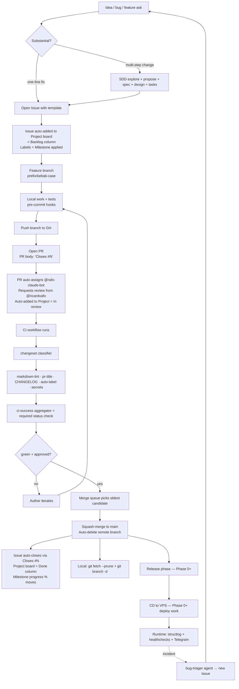

# AI Development Life Cycle

**Type**: Guide (living document — PR any change)
**Owners**: Ricardo Afonso (product owner, sole reviewer)
**Applies to**: everyone (and every AI agent) doing work that lands in
`github.com/ricardoafo/hermes`.

This document maps every step from "Ricardo has an idea" to "code runs on
the VPS and reports back". For each step it says WHO does it, WHAT gets
produced, WHERE it lives, and WHEN it moves to the next step. Progress
tracking lives in three surfaces: **Milestones** (long-lived phase buckets),
**Issues** (atomic work items), **Project board** (visual pipeline). This
guide explains how those surfaces get populated automatically as work moves.

## The full flow



## Where progress lives (three surfaces, one source of truth)

| Surface | What it holds | When items appear | When they close |
| ------- | -------------- | ------------------- | ---------------- |
| **Milestones** (Phase 0 / 1 / 2 / 3) | Long-lived planning buckets. Every open issue and PR belongs to exactly one. | At issue-creation time (`--milestone` flag or GH UI dropdown). Assigned based on WHICH PHASE the work belongs to. | Automatic — when all issues in the milestone are closed. `open_issues=0` triggers the milestone's own closed state (manual close by Ricardo). |
| **Issues** | Atomic units of work. Every PR closes at least one. | User (or AI) files via `.github/ISSUE_TEMPLATE/{bug,feature,chore}.yml`. Labels applied by the template + by the `auto-label` CI job. | Automatic — PR merges with `Closes #N` in the body. Manual close is also allowed for wontfix / duplicate. |
| **Project board** ([Project Hermes](https://github.com/users/ricardoafo/projects/4)) | Visual pipeline: Backlog → In progress → In review → Done. | Automatic — `add-to-project` CI job (see `.github/workflows/ci.yml`) adds every new issue and PR. Existing items were bulk-added at project creation. | Automatic — GH Project workflow "Item closed → Done" (configured once in the project UI, not in CI). |

**Empty milestones are expected**. Phase 1/2/3 will show 0/0 until we plan
that phase's work and file its issues. Phase 0 shows 10/11 (10 closed, 1
open) because that's the current active phase. Milestone progress = closed /
(closed + open).

## Phase-by-phase audit

For each phase: WHO does it, WHERE the artifact lives, and current STATE
in hermes.

### 1. Ideation

- **Who**: Ricardo (idea, bug report, feature ask)
- **Where**: informal — chat with Claude, a note, a Telegram alert
- **State**: ✅ Ready (no tooling needed)

### 2. Substance check + optional SDD

- **Who**: Agent (via Claude Code session)
- **What**: Is this a one-line fix or a multi-step change? Multi-step →
  start SDD (`/sdd-new <change-name>`). SDD produces
  proposal / spec / design / tasks — all stored in engram.
- **Where**: engram topic keys `sdd/{change-name}/{phase}`
- **State**: ✅ Ready

### 3. Issue creation

- **Who**: Ricardo or Agent (on Ricardo's direction)
- **What**: Open GitHub issue with the right template
  (`bug.yml` / `feature.yml` / `chore.yml`). Labels + milestone applied at
  creation time via `--label` and `--milestone` flags (or template defaults).
- **Where**: `github.com/ricardoafo/hermes/issues/N`
- **State**: ✅ Ready. Templates in `.github/ISSUE_TEMPLATE/`.
- **Automation**: On issue creation, `add-to-project` CI job places it on
  the Project board Backlog column.

### 4. Feature branch

- **Who**: Ricardo or bot (`rafo-claude-bot`)
- **What**: Branch off `main` with a Conventional Commits prefix
  (`feat/*`, `fix/*`, etc. — see [dev-workflow.md § Branching](dev-workflow.md#branching-model))
- **State**: ✅ Ready

### 5. Local implementation

- **Who**: Ricardo or bot
- **What**: Write code + tests. Every commit runs the pre-commit hook chain
  (markdownlint, conventional-commit validation, trailing-whitespace, etc.).
  Ruff / mypy / detect-secrets land in Phase 0.
- **Where**: local working tree
- **State**: 🚧 Partial. Full Python toolchain (ruff / mypy / pytest /
  hypothesis / syrupy / mutmut / detect-secrets / `sev1_guard` plugin) lands
  in Phase 0.

### 6. Push + PR open

- **Who**: bot (via Agent) or Ricardo
- **What**: `git push -u origin <branch>` then `gh pr create` with
  `--label`, `--milestone`, `--assignee`, `--reviewer`. PR body includes
  `Closes #N` to link the issue. Uses `.github/pull_request_template.md`.
- **Where**: `github.com/ricardoafo/hermes/pull/N`
- **State**: ✅ Ready

### 7. CI pipeline

- **Who**: GH Actions
- **What**: `.github/workflows/ci.yml` runs in parallel:
  - `changeset` classifier (docs-only vs code)
  - `markdown-lint` (markdownlint-cli2)
  - `pr-title` (Conventional Commits format)
  - `changelog` (blocks `feat/fix/refactor/perf/breaking` PRs without
    `[Unreleased]` update)
  - `auto-label` (path-based `area:*` labels + `size:*` from LOC)
  - `secrets` (gitleaks history scan)
  - `add-to-project` (idempotent — safe on already-added items)
  - `ci-success` (aggregator, single required status check)
- **State**: ✅ Ready (this PR)
- **Missing until Phase 0**: `quality` (ruff + mypy + dep audit) and `unit`
  (pytest with coverage). Both gated behind `pyproject.toml` existing.

### 8. Human review

- **Who**: Ricardo
- **Where**: GitHub web / mobile app
- **What**: Auto-request comes via CODEOWNERS (`* @ricardoafo`) +
  `--reviewer` on PR create. Review is mandatory — branch protection blocks
  merge without approving review from a code owner. Bot cannot approve.
- **State**: ✅ Ready

### 9. Merge queue

- **Who**: `.github/workflows/merge-queue.yml`
- **What**: Serialized queue picks the oldest approved + CI-green PR and
  merges via GH squash-merge API. Retries on network hiccup, on
  out-of-date-branch (waits for author to rebase), on head-SHA change
  (waits for CI to re-run).
- **State**: ✅ Ready (this PR)

### 10. Merge to main

- **Who**: `merge-queue.yml` (via GH API)
- **What**: Squash-merge → single commit on main, PR title becomes the
  commit message, remote branch auto-deletes.
- **Automation on merge**:
  - Issue auto-closes (via `Closes #N` keyword)
  - Project board moves item Backlog/In review → Done
  - Milestone progress % increments
  - Local branch stays until Ricardo runs
    `git fetch --prune && git branch -d <branch>` (see
    [dev-workflow.md § Delete the local branch AFTER confirming remote landing](dev-workflow.md#delete-the-local-branch-after-confirming-remote-landing))
- **State**: ✅ Ready

### 11. Release

- **Who**: Ricardo (manual SemVer bump per ADR-006 — no `semantic-release`)
- **What**: Tag `v0.x.y`, cut a release, move `[Unreleased]` CHANGELOG
  section to a dated version. Full release workflow lands in Phase 0.
- **State**: 📅 Phase 0 scope (deferred until first release-worthy change)

### 12. Deploy (CD to VPS)

- **Who**: GH Actions → VPS via SSH
- **What**: Build wheel via `uv`, push to VPS, run migrations, restart
  systemd services. Serialized via deploy queue (adapt merge-queue pattern
  for `main`-push events).
- **State**: 📅 Deferred. User confirmed: we develop first, deploy later.
  Full CD design in ADR-003 §09.

### 13. Operate + incident

- **Who**: VPS runtime + healthchecks.io + Telegram + Ricardo
- **What**: Structlog → journald, healthchecks.io ping loop, Telegram
  alerts on failure. Incidents trigger `bug-triager` agent → new issue
  with severity per rubric → back to step 1.
- **State**: 📅 Phase 0+ (structlog scaffold in Phase 0; full stack in
  Phase 2+)

## Gaps table

| # | Area | State | Gap |
| --- | --- | --- | --- |
| 5 | Local implementation | 🚧 Partial | ruff / mypy / detect-secrets / pytest / `sev1_guard` — Phase 0 |
| 7 | CI pipeline (Python) | 🚧 Partial | `quality` + `unit` jobs — Phase 0 (gated on `pyproject.toml`) |
| 7 | Required status checks | 🚧 Partial | Branch protection currently has `required_status_checks: null`. Update to require `ci-success` job after this PR merges. |
| 11 | Release | 📅 Phase 0 | Release workflow, tag automation, CHANGELOG date-cut. |
| 12 | CD to VPS | 📅 Deferred | Entire CD stack: SSH deploy, migration runner, systemd, rollback, deploy queue. User confirmed can wait. |
| 13 | Observability | 📅 Phase 0+ | Structlog scaffold Phase 0, full stack Phase 2. |

## One-time setup (Ricardo, in the browser)

Two settings live in GitHub's UI and can't be fully configured via CLI:

1. **Project board workflow** —
   <https://github.com/users/ricardoafo/projects/4/workflows>
   - Enable "Auto-add sub-issues" (if you file sub-issues in future)
   - Enable "Item closed → move to Done"
   - Enable "Pull request merged → move to Done" (may be same as above)

2. **Branch protection required status checks** — after this PR merges and
   the `ci.yml` workflow has run at least once on `main`, add `ci-success`
   as a required status check via:

   ```bash
   gh api -X PATCH repos/ricardoafo/hermes/branches/main/protection/required_status_checks \
     -F strict=true \
     -f 'contexts[]=CI success'
   ```

   Or via GitHub UI: Settings → Branches → main → Edit → Require status
   checks → search "CI success" → Save.

## What each surface answers

- **"What phase are we in?"** → look at Milestones. Open milestone with
  active items = current phase.
- **"What's left in this phase?"** → open the current Milestone. Ratio of
  closed to total = progress. Open issues = what's next.
- **"What's actively in flight?"** → Project board, In progress + In review
  columns.
- **"Why did we ship X?"** → Issue that spawned it → PR that closed it →
  CHANGELOG entry.
- **"What broke in production?"** → runbook (`docs/runbook/`) →
  bug-triager output → new issue with `sev-*` label.

## Rationale — why this shape

- **Issue-first** — every PR references an issue; the issue captures WHY
  the change is being made. Skipping the issue means the WHY only lives in
  the commit message, which is harder to find, filter, and prioritize.
- **Squash-merge only** — one commit per PR on main. Bisecting is
  deterministic. `git log` is a readable changelog.
- **Merge queue** — the bot ships work in parallel batches, but only one
  PR should touch main at a time. Queue prevents the "approval got
  invalidated by a rebase" treadmill under
  `require_last_push_approval=true`.
- **Auto-add to project** — CI job is idempotent; no manual dragging.
  Board reflects reality without extra work.
- **Milestones = phases** — long-lived buckets aligned with the ADR-driven
  roadmap. Empty future milestones are correct — items land when we plan
  that phase.

## Related

- [`docs/guides/dev-workflow.md`](dev-workflow.md) — git/gh discipline
- [`AGENTS.md`](../../AGENTS.md) — AI collaboration protocol
- [`.github/workflows/ci.yml`](../../.github/workflows/ci.yml) — the CI implementation
- [`.github/workflows/merge-queue.yml`](../../.github/workflows/merge-queue.yml) — the merge queue
- [ADR-003 § 09 Deployment](../architecture/adr-003-solution-architecture/09-deployment.md) — CD design (Phase 0+)
- [ADR-006](../architecture/adr-006-versioning-strategy.md) — SemVer + release
- [ADR-007](../architecture/adr-007-testing-strategy.md) — testing tiers
- [ADR-010](../architecture/adr-010-dependency-management-and-supply-chain.md) — deps + Renovate
