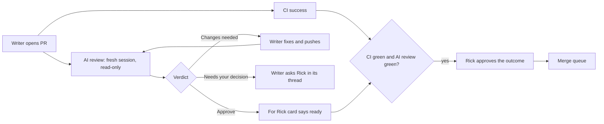

# AI Review — The Code Review on Every PR

**Type**: Guide (living document — PR any change)
**Owners**: Code Owner (product owner, sole approver)
**Applies to**: every PR on `github.com/ricardoafo/hermes` and every writer that opens one.
**Description**: How the independent AI review works on every PR, what the "For Rick" card means, how writers act on findings, and how the reviewer token is set up.

Hermes PRs are written by many AI writers, and Rick is the only human
approver. He approves outcomes as product owner; he does not read code.
The `AI review` job in [`ai-review.yml`](../../.github/workflows/ai-review.yml)
is the code review (#590).

## The flow

## What the reviewer does

- Runs on every non-draft PR and every push, in a session that never saw
  the writer's reasoning.
- Reads the diff, the PR body, the closed issue, the openspec change,
  [AGENTS.md](../../AGENTS.md) and the ADRs. It can read the repository
  and run `git diff`, `git log` and `git show`; it cannot edit, push,
  comment or browse.
- Returns structured JSON. A plain script, not the model, turns it into
  one sticky PR comment and the pass or fail of the `AI review` check.
- Uses the instructions in [`.github/ai-review/prompt.md`](../../.github/ai-review/prompt.md),
  read from `main`. A PR that edits the instructions is still reviewed by
  main's copy.

## The For Rick card

The comment opens with what Rick needs as product owner: what changes
for him or the running system, why now, the risk level and why, what
proves it works, and the verdict. Findings for the writer follow below
it, marked blocking or optional.

| Verdict | Check | Who acts |
| --- | --- | --- |
| Approve, no blocking finding | green | Rick, once CI is green too |
| Changes needed | red | The writer fixes every blocking finding and pushes |
| Needs your decision | red | The writer asks Rick in its thread; the PR body records the answer |

## Rules for writers

- Ask Rick to approve only when `CI success` and `AI review` are both
  green and no decision is open.
- Fix every blocking finding. Answer each optional one in the PR, either
  by fixing it or with one line on why it stays.
- If a finding is wrong, say why in the PR and push nothing for it; a
  re-run reviews the same head again.
- Never edit the review instructions, schema or renderer in the same PR
  as the code they would judge.

## Setup (Rick, once)

The reviewer runs on Rick's Claude plan.

1. On a machine with Claude Code signed in to that plan, run
   `claude setup-token` and copy the token it prints.
2. In the repository: Settings, Secrets and variables, Actions, New
   repository secret. Name `CLAUDE_CODE_OAUTH_TOKEN`, value the token.
3. Same page under Dependabot: add the same secret, so Dependabot PRs
   are reviewed too.
4. Optional: an Actions variable `AI_REVIEW_MODEL` picks the model.
5. When the reviews have earned trust, add `AI review` to the
   `main-protection` ruleset's required status checks.

Without the secret the job passes with a notice and posts nothing.

## Related

- [pr-flow.md](pr-flow.md): the full path from branch to main.
- [ai-authored-tests.md](ai-authored-tests.md): what the reviewer checks tests against.
