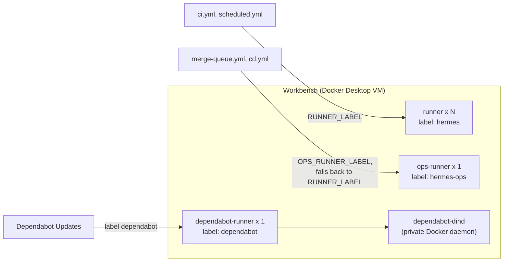
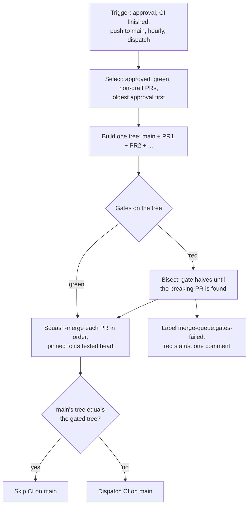

# CI Runners and the Merge Queue

**Type**: Guide (living document — PR any change)
**Owners**: Code Owner (product owner, sole reviewer)
**Applies to**: whoever operates the self-hosted runners on Workbench, and anyone
debugging why a PR has not merged.
**Description**: Where CI jobs run, how they are routed, and how the merge queue batches, gates and merges approved PRs.

The runners live in Docker on Workbench. Their stack is in
`scripts/dev/gh-runner/`. The merge queue is
`.github/workflows/merge-queue.yml`, and its decisions are in
`tools/merge/decisions.cjs`. This guide shows how the pieces fit. The
files are the source of truth.

## Runners and routing

- **CI runners** (`runner`, label `hermes`) run PR CI and the scheduled
  checks. Each PR's whole suite is one `CI success` job, so one runner
  serves one PR from start to finish. The pool size and limits are in
  `compose.yml`; sizing them to the VM is #523.
- **The ops runner** (`hermes-ops`) serves the merge queue and CD, so a
  merge or a deploy never waits behind PR CI. Workflows pick it through
  the repo variable `OPS_RUNNER_LABEL`. Until that is set, they fall back
  to the CI pool.
- **The Dependabot runner** has its own Docker-in-Docker sidecar on a
  private network. GitHub needs a runner that can run Docker for
  Dependabot updates, and this keeps the host's Docker socket out of
  reach.
- Every runner is ephemeral. It takes one job, exits and re-registers,
  so one runner showing offline between jobs is normal.
  `hermes runners` (#516) reports each group's health.

Runner commands, all run from `scripts/dev/gh-runner` on Workbench:

| Task | Command |
| --- | --- |
| Start or resize the CI pool | `./up.sh <N>` |
| Start the ops and Dependabot runners | `docker compose up -d --no-recreate ops-runner dependabot-dind dependabot-runner` |
| Tail a runner | `docker compose logs -f runner` |
| Stop everything | `./down.sh` |

## The merge queue

- **Select** skips a PR it can't merge itself, such as a workflow change
  without the App's Workflows permission, and labels it
  `merge-queue:hand-merge`. It also skips a head that already failed the
  gates, until a new push or the label's removal.
- **Gates** run once per batch tree from `scripts/dev/merge-gates.sh`:
  markdownlint, gitleaks, ruff, mypy, lint-imports, and unit plus
  integration tests. The queue copies its own tooling from main's tip
  before merging anything in, so a PR can't change the gates that judge
  it.
- **Merging** never pushes to a PR branch and never updates one. The
  ruleset doesn't require up-to-date branches, because the queue proves
  the merged tree instead.

## When a PR does not merge

| Symptom | Where to look |
| --- | --- |
| Approved, but the queue ignores it | The Select log: not approved, draft, conflicts, or `blocked` (a required check is red or pending) |
| `merge-queue:hand-merge` label | The PR comment says why; merge it by hand or fix the cause and remove the label |
| `merge-queue:gates-failed` label | The PR comment names the failing tests; push a fix |
| "Merges cleanly with main" is red | Merge main into the branch and resolve the conflict |
| CI slow or stuck | `python3 scripts/dev/ci-timing.py` (#521) and `python3 scripts/dev/ci-flakes.py` (#565) |
