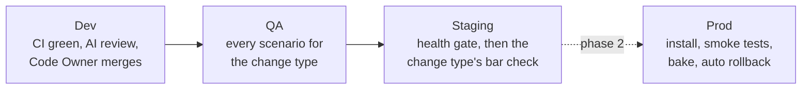

# The four environments

**Type**: Guide (living document, PR any change)
**Owners**: Code Owner (sole operator)
**Applies to**: `hermes-01`, `server-01`, `scripts/deploy/{install_release,rollback,health_gate}.sh`, `scripts/dev/change-type.py`, and the `staging` and `prod` GitHub environments.
**Description**: Where dev, QA, the staging lab and prod live, how a release moves between them, what each environment may touch, and every machine step the Code Owner runs, with what happens when either machine is down.

The decisions behind this guide are in
[ADR-024](../architecture/adr-024-four-environments-and-promotion.md). Where this guide and the ADR disagree,
the ADR wins. Build progress is tracked in issue #968.

## Where things live

There are two phases. Phase 1 is now: nothing trades real money, so prod does not exist, and hermes-01 is the
staging lab. Phase 2 starts at the cutover, when a champion's shadow is Done under ADR-021 and real money for it is
approved.

| Environment | `HERMES_ENV` | Phase 1 (now) | Phase 2 (after the cutover) | Lifetime |
| --- | --- | --- | --- | --- |
| Dev | `dev` | server-01's self-hosted CI runners | Same | One fresh runner per job |
| QA | `qa` | server-01, inside CI jobs | Same | Raised per run, torn down after |
| Staging (the lab) | `staging` | hermes-01 | server-01 | Always on |
| Prod | `prod` | None | hermes-01 | Always on |

- Dev proves each PR with in-process fakes. QA runs the installed wheel against a fake market and recording sinks.
- The staging lab runs the shadow line (up to 6 paper strategies, one per idea family) on live public data. It is
  the only place a shadow's days count.
- Prod is the champion with real money, alone on its machine. Trade-capable keys reach it last, under ADR-021's live
  stages.
- Backtests run on server-01 in both phases (ADR-023). Laptops run tests by hand before a push and nothing else. No
  CI job runs on a laptop or on a GitHub-hosted runner.

## How a release moves

A release is one wheel, built once and checked by sha256 everywhere after. It moves dev, then QA, then staging, and
after the cutover prod. A failure at a gate stops it there.



| Gate | Passes when |
| --- | --- |
| Dev to QA | CI is green on the merged tree, the AI review approves, the Code Owner merges, and the wheel tests clean |
| QA to staging | Every scenario for the release's change type passes, with no expected failures |
| Staging to prod (phase 2) | The change type's staging check passes |
| Prod (phase 2) | Install, smoke tests, bake on the next bar, automatic rollback on failure |

Until QA runs (issue #973), the wheel tests of issue #670 are the gate in front of staging. Only a cut version
deploys, because CD runs with `DEPLOY_ON=version`.

## Change types

`scripts/dev/change-type.py` sorts a diff into docs, surface, runtime or engine. A file the list does not name counts
as engine, and a diff takes its strictest type. A release's type is the strictest type among the changes since the
last deploy to the environment it is going to. The type decides how much of the path a release walks:

| Type | QA | Staging |
| --- | --- | --- |
| Docs | Skipped, nothing deploys | Skipped |
| Surface | Install, smoke, console and CLI scenarios | Health gate, no bar wait. Shadow clocks keep counting |
| Runtime | Every scenario, operations included | One clean bar on every stream |
| Engine | Every scenario | One clean bar. A changed decision waits for the Code Owner |

The dev-side checks per type are in [CI runners and the merge queue](ci-runners-and-merge-queue.md#change-types). To
see the type of your branch, run `python3 scripts/dev/change-type.py origin/main HEAD`.

## What each environment may touch

| Rule | Dev | QA | Staging | Prod (phase 2) |
| --- | --- | --- | --- | --- |
| Mainnet | Refused | Refused | Refused | Behind `HERMES_ALLOW_MAINNET` and typed confirmation |
| Exchange keys | None | None | None | Trade-capable, only after certification |
| Notifier, healthchecks, Sentry | None | Recording fakes | The lab's own | Prod's own |
| Outside network | None | Loopback only | Public market data only | Public market data, exchanges, notifiers |
| Clock | Wall, or a loopback test clock | The fake market's test clock | Wall | Wall |

- Hold no exchange key of any kind on hermes-01 while it is staging. A trade-capable key reaches hermes-01 only at
  the cutover, after the staging state has left the box.
- Secret and variable names are the same in every GitHub environment, and only the values differ. The `staging` and
  `prod` environments are both limited to `main`. QA has no environment because it holds no secrets. In phase 1,
  hermes-01's deploy secrets live in `staging`, and `prod` holds nothing.
- Runners that hold deploy secrets never run PR, QA or Dependabot code.
- The config loader and the deploy preflight refuse each tier's forbidden values (issue #970).
- `HERMES_TEST_CLOCK_URL` points `hermes serve` and `hermes bot` at a test clock, such as the fake market's
  `/_fake/clock`, so a scenario runs an installed release on scripted time (issue #972). Only dev and QA may set it, and
  only on loopback.

## Rick's steps

Each step names the machine and is one command or one setting. A step marked **later** is not needed in phase 1.

### hermes-01: retire the second unit

Phase 1 makes the lab itself staging, so `hermes-staging.service` (a second, isolated copy of hermes that runs
beside the main unit) is retired once QA runs (ADR-024 §1). Until then it can stay. Skip this step if you never set it
up. Run as root on hermes-01. Nothing here touches the main unit, `hermes.service`.

```bash
systemctl disable --now hermes-staging.service
```

Then remove what it created. `rm -rf /var/lib/hermes-staging` deletes that copy's ledger for good, so copy anything
you want to keep first.

```bash
rm -f /etc/systemd/system/hermes-staging.service && systemctl daemon-reload && systemctl reset-failed hermes-staging.service 2>/dev/null; rm -rf /opt/hermes-staging /var/lib/hermes-staging /etc/hermes/env.staging
```

```bash
userdel hermes-staging; getent group hermes-staging && groupdel hermes-staging
```

The unit file comes back on the next `vps-bootstrap` run, disabled and harmless without its user. Deleting
`deploy/systemd/hermes-staging.service` from the repo is a separate change.

### hermes-01: run as staging

hermes-01 changes to `HERMES_ENV=staging` and loses any exchange key in the PR that closes issue #970. That PR lists the
exact commands, and this step takes them over when it merges.

### GitHub: move the deploy secrets

In the repository settings, move hermes-01's deploy secrets into the `staging` environment and leave `prod` empty.
Both environments are limited to `main`.

### server-01: the lab's home (later, before the cutover)

The lab moves here at the cutover, so its home must exist by then. The layout is the one the release scripts already
build for `HERMES_TARGET=staging`. Run as root on server-01. Each step is safe to re-run.

```bash
id hermes-staging || useradd --system --user-group --home-dir /var/lib/hermes-staging --no-create-home --shell /usr/sbin/nologin hermes-staging
```

```bash
install -d -m 0755 -o root -g root /opt/hermes-staging /opt/hermes-staging/versions /opt/hermes-staging/bin && install -d -m 0750 -o hermes-staging -g hermes-staging /var/lib/hermes-staging
```

```bash
install -m 0600 -o root -g root /dev/null /etc/hermes/env.staging
```

Then edit `/etc/hermes/env.staging`. It needs `HERMES_ENV="staging"` and `HERMES_ALLOW_MAINNET="no"`. Add the lab's own
Telegram chat so notices never mix with prod's:

```bash
HERMES_ENV="staging"
HERMES_ALLOW_MAINNET="no"
HERMES_TELEGRAM__BOT_TOKEN="..."
HERMES_TELEGRAM__CHAT_ID="..."
```

Never copy prod's healthchecks ping URL or Sentry DSN into this file. A staging ping would hide a prod outage, and
staging errors would land in prod's Sentry environment. Check the result:

```bash
stat -c '%a %U:%G' /etc/hermes/env.staging && grep '^HERMES_ENV=' /etc/hermes/env.staging
```

Expected: `600 root:root` and `HERMES_ENV="staging"`.

The lab also needs outbound access to Binance and Frankfurter public data and to its notifier and healthchecks hosts,
with no inbound ports, and about 1 GB of memory. How the box provides these belongs to the infra project (ADR-024 §9).

### server-01: power (later, before the cutover)

- In the BIOS, set "power on after power loss" to on. It is a setting, not a command.
- A clean shutdown when the UPS battery runs low is the infra project's part of the same ask. This guide does not
  describe how the box does it.

## When a machine is down

Every service is a systemd unit enabled at boot with `Restart=on-failure`. It starts only after the system clock has
synced, and it resumes from its ledger, never from memory.

| Down | Phase 1 | Phase 2 |
| --- | --- | --- |
| server-01 | Releases wait, because QA cannot run. The shadows on hermes-01 keep counting | Releases wait, and the lab's shadow days pause with it |
| hermes-01 | The shadows stop and miss bars | Prod stops. Open positions are held by the exchange-side stops (issue #1080) |

- Nothing skips the lab on its way to prod. The only bypass is the emergency exception in
  [dev-workflow.md](dev-workflow.md#emergency-exceptions).
- No fill is back-dated. A bar that closed while a machine was down is recorded as missed. On return, open positions
  are checked against their exits at once, and an exit that triggered fills at the current price. New entries wait for
  the next fresh bar.
- The first message after a restart reports the downtime, the missed bars per strategy, and the exits checked. Read
  it for the missed bars: they count against ADR-021's 1% budget, which is about 5 four-hour bars per stream over 90
  days. The Lab screen shows each shadow's remaining budget.
- A Validation run that an outage interrupts counts as a touch.

## The cutover

The lab moves to server-01 and hermes-01 becomes prod only when a shadow keeps its day count across the move. ADR-024
§7a lists the six conditions: the same release, the same ledger with a checksum, one writer at a time, a clean point
between bars, the same data, and a rehearsal first. Issue #1085 turns them into a runbook of steps Rick runs. This
guide gets a section for it when that lands.

## Deploying to staging by hand

CD installs a release that passed the gates. To install one yourself on a machine that has the staging layout, use the
release scripts with `HERMES_TARGET=staging`. Without it the same scripts act on prod, and any other value is refused.
Preflight refuses to start when a path, the unit, the user or the env file would be prod's, or when the last
`HERMES_ENV=` line of the env file is not `staging`.

Get a bundle from a `cd.yml` run (every run builds one, including a `dry_run` dispatch, which deploys nothing). Stage it
in the private `/var/lib/hermes-deploy`, never in world-writable `/var/tmp`:

```bash
gh run download <run-id> --name hermes-release && ssh <machine> install -d -m 0700 /var/lib/hermes-deploy && scp hermes-release-<sha12>.tar.gz <machine>:/var/lib/hermes-deploy/
```

Then, as root on the machine:

```bash
sha12=<sha12>; stage=/var/lib/hermes-deploy/hermes-release-$sha12; rm -rf "$stage" && install -d -m 0700 "$stage" && tar -xzf "$stage.tar.gz" -C "$stage" && HERMES_TARGET=staging /usr/bin/bash "$stage/bin/install_release.sh" "$sha12" "$stage"; rm -rf "$stage" "$stage.tar.gz"
```

A good deploy ends with `gate OK: ... active 30s` and `release <sha12> is live`. If it prints `refusing`, it stopped
before changing anything: fix the path, unit, user or env file it names and run it again. A failed health gate rolls
back on its own. To roll back by hand:

```bash
HERMES_TARGET=staging /opt/hermes-staging/bin/rollback.sh
```

To also restore the ledger from before a deploy, for example after a migration:

```bash
HERMES_TARGET=staging HERMES_RESTORE_DB=/var/lib/hermes-staging/backups/pre-<sha12>.sqlite3 /opt/hermes-staging/bin/rollback.sh
```

Always pass `HERMES_TARGET=staging`. Without it the script is prod's rollback.

## Related

- [ADR-024](../architecture/adr-024-four-environments-and-promotion.md): the decisions and the cutover conditions.
- [ADR-025](../architecture/adr-025-train-decision-replay-on-engine-prs.md): the Train replay and `ENGINE_PATHS`.
- [Ledger migrations](ledger-migrations.md): snapshots and `hermes migrate`, the same in every environment.
- [VPS operations](vps-operations.md): SSH access, systemd services and troubleshooting on hermes-01.
