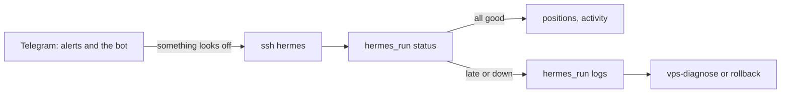
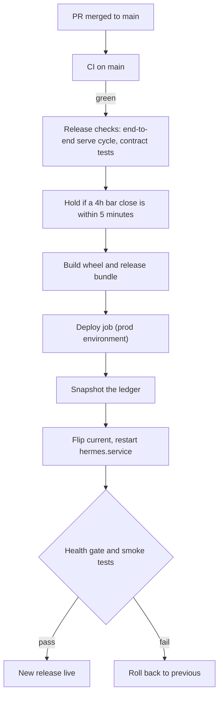

# Operator Usage — Checking On Hermes Day to Day

**Type**: Guide (living document — PR any change)
**Owners**: Code Owner (product owner, sole operator)
**Applies to**: the operator using hermes from a Windows PC (PowerShell in
the repo's `.venv`) and the VPS `hermes-01` (`hermes serve` in shadow mode).
**Description**: Day-to-day use: connect with `ssh hermes`, read the console commands, see the live release, how auto-deploy works, and where to look when something is wrong.

This is the page to open when you want to know "is hermes OK, and what did
it do?". It covers the commands that exist on `main` today. Setup and
recovery live in [vps-operations.md](vps-operations.md); the deploy
machinery lives in [`deploy/README.md`](../../deploy/README.md).

Commands in PowerShell blocks run on your PC, one per line. Commands in
`bash` blocks run on the VPS after you connect.

## The daily loop



Most days Telegram is enough: it stays quiet while hermes is healthy and
alerts when it is not (see [When something is wrong](#when-something-is-wrong)).
Connect to the VPS when you want to look closer.

## Connect to the VPS

The VPS is reachable only over Tailscale. With the `hermes` alias in your
SSH config, one word connects:

```powershell
ssh hermes
```

The alias lives in `$HOME\.ssh\config` on your PC:

```text
Host hermes
    HostName hermes-01
    User root
    IdentityFile ~/.ssh/hermes_vps_ed25519
```

The long form does the same without the alias:

```powershell
ssh -i $HOME\.ssh\hermes_vps_ed25519 root@hermes-01
```

The key has a passphrase; an SSH agent (Bitwarden's, or the Windows
OpenSSH agent) saves typing it each time. If the connection hangs, check
that Tailscale is running on your PC; see
[vps-operations.md § Access](vps-operations.md#access) for host key
warnings and the public-IP fallback.

### The `hermes_run` helper (one time)

The service runs as user `hermes` with its env file and ledger. The console
commands must run the same way to see the same data, so the VPS uses a
small shell function, `hermes_run`, from
[vps-operations.md § Check on hermes](vps-operations.md#check-on-hermes).
Add it to root's `.bashrc` once, so every `ssh hermes` session has it:

```bash
cat >> /root/.bashrc <<'EOF'
hermes_run() {
    sudo bash -c 'set -a; . /etc/hermes/env.production; set +a; cd /var/lib/hermes &&
        exec runuser -u hermes -- /opt/hermes/current/.venv/bin/hermes "$@"' _ "$@"
}
EOF
source /root/.bashrc
```

`hermes_run` always runs the live release (`/opt/hermes/current`) from
`/var/lib/hermes`, so commands that default to `./hermes.sqlite3` read the
service ledger. Every command below is read-only: none of them changes the
ledger, restarts anything or places an order.

## Is it OK? `status`

```bash
hermes_run status --config-dir /opt/hermes/current/config --db /var/lib/hermes/hermes.sqlite3
```

It prints the verdict (all good, late or down), then each stream's last
and next 4h bar. Bars close at 00, 04, 08, 12, 16 and 20 UTC.

| Exit code | Meaning |
| --- | --- |
| 0 | All good |
| 1 | Late or down |
| 2 | Bad arguments |
| 3 | Config error or no ledger |

`--json` prints the same as data; `--summary` prints the one-line daily
summary. The healthchecks.io ping runs this same check every 5 minutes.

## What does it hold and what did it do?

```bash
hermes_run positions
hermes_run positions BTC
hermes_run activity --db /var/lib/hermes/hermes.sqlite3
hermes_run activity --db /var/lib/hermes/hermes.sqlite3 --all --days 2
hermes_run money --range week
```

| Command | Shows | Useful options |
| --- | --- | --- |
| `positions` | Open shadow positions, net per row; `positions COIN` for one coin's detail | `--json`, `--utc`, `--db PATH` |
| `activity` | What changed, grouped by day (default: the last 7 days) | `--all` adds bar checks and signals, `--days N`, `--json`, `--utc` |
| `money` | Portfolio total in EUR and the gross-to-net waterfall | `--range today\|week\|month\|year`, `--json`, `--utc` |

Times show in Europe/Madrid unless you pass `--utc`. `money` reads demo
scenarios only for now: without `--demo` it answers "No live money yet".

## Logs: `logs`

```bash
hermes_run logs --level warning --since 1h
hermes_run logs --last 100
hermes_run logs --cycle K7Q2ZP
hermes_run logs -f
```

One readable line per journal entry of `hermes.service`. `--level`
filters from that level up (default `debug`), `--since` takes `30m`, `1h`,
`2d` and so on, `--cycle` keeps one bar cycle by the tail of its
correlation id, and `-f` follows until Ctrl-C. Each processed bar logs a
`serve.bar.processed` line:

```bash
hermes_run logs --since 4h | grep serve.bar.processed
```

`logs` reads the systemd journal, so it works on the VPS only.

## Which release is live? `version`

```bash
hermes_run version
```

It prints the package version, the live release (the 12-character commit
`/opt/hermes/current` points at), the Python version and the ledger's
latest migration with the pending count. Without the helper:

```bash
readlink /opt/hermes/current
```

The release name is the first 12 characters of the `main` commit, so you
can find it on GitHub as `https://github.com/ricardoafo/hermes/commit/<release>`.

## Tax estimates: `tax` and `tax-filing`

```bash
hermes_run tax --config-dir /opt/hermes/current/config
hermes_run tax --config-dir /opt/hermes/current/config --year 2026 --json
hermes_run tax-filing --year 2026 --config-dir /opt/hermes/current/config
```

`tax` prints the estimated tax on hermes gains for one Madrid tax year,
labelled shadow. It reads your taxpayer profile from
`~/.config/hermes/taxpayer.yaml` (or `HERMES_TAXPAYER_PROFILE`). Your
figures stay on your PC, so on the VPS there is no profile: it assumes no
other income and says so. `tax-filing` prints the
figures for Modelo 100 and Modelo 721 for your gestor; `--out DIR` also
writes `report.md` and CSV files. Neither submits anything.

## Try the console on your PC: demo mode

The console commands also run on packaged demo data, from the repo on your
PC, with no VPS and no ledger. Every screen is tagged DEMO DATA.

```powershell
uv run hermes --demo ok-two-positions tui
uv run hermes --demo late status
uv run hermes --demo losing-year money --range year
uv run hermes --demo ok-two-positions
```

| Scenario | What it shows |
| --- | --- |
| `ok-two-positions` | All good: two open positions, tax estimates available |
| `late` | A bar check 12 minutes late |
| `down-stale` | hermes stopped; every number is stale |
| `losing-year` | A losing year: losses show as a tax credit, not zero |
| `tax-pending` | Every tax figure shows as pending |
| `empty` | Nothing yet: no positions, no activity, shadow test not started |

`--demo` goes before the command and works with `tui`, `status`,
`positions`, `activity` and `money`. `hermes --demo SCENARIO` with no
command prints the home screen as static text. Setting
`$env:HERMES_CONSOLE_DEMO = "late"` picks a scenario for every command in
that PowerShell window.

`hermes tui` is the interactive home screen (portfolio, positions,
activity; `1` `7` `3` `Y` change the range, Enter opens a position, `L` shows logs, `?` help, `Q` quits). It runs on demo data only for now: without `--demo`
it exits with an error naming the scenarios. The live home screen and a
`--vps` option that reaches the VPS from your PC are coming in PR #629 and
issue #610; this guide covers them once they merge.

`uv run hermes --help` lists every command; `uv run hermes <command> --help`
gives its options and exit codes.

## How a change reaches the VPS

Every PR merged to `main` deploys itself once CI passes on `main`. You
approve the PR; nothing else is needed.



- **Bar-close hold**: a deploy never restarts hermes within 5 minutes of a
  4h bar close; it waits instead.
- **Ledger snapshot**: before the restart the deploy copies the ledger to
  `/var/lib/hermes/backups/pre-<release>.sqlite3`. When the health gate
  fails, the rollback restores it; see [ledger-migrations.md](ledger-migrations.md).
- **Health gate**: the unit must stay active for 30 seconds with the same
  process and log `serve.run.started`. Then smoke tests run over SSH.
- **Rollback**: a failed gate or smoke run switches back to the previous
  release and the CD run fails, so you see it red in Actions.
- **`prod` environment**: if it has required reviewers, the deploy waits
  in Actions under "Review deployments" until you approve.

To see a deploy, open the repository's Actions tab, workflow **CD**. A
manual run (`Run workflow`) defaults to `dry_run=true`, which builds the
bundle and touches nothing on the VPS.

Systemd units, timers and env files are not part of a release. A change to
them still needs the **vps-bootstrap** workflow run by hand until issue #626
lands; see [vps-operations.md § Hermes bootstrap](vps-operations.md#hermes-bootstrap-automated).

To roll back by hand from your PC:

```powershell
ssh hermes /opt/hermes/bin/rollback.sh
```

It exits 1 when `current` already equals `previous`. It does not roll back
the ledger.

## When something is wrong

### Where alerts come from

| Alert | Arrives on | Fires when |
| --- | --- | --- |
| healthchecks.io | Telegram | The 5-minute ping stops, or `status` says late or down (after about 15 minutes) |
| Failure notifier | Telegram | `hermes.service` enters `failed` (start limit hit, or exit code 2 or 3) |
| Crash notice | Slack | Any stop that was not clean, including ones systemd restarts |
| Telegram bot | Telegram | Change-only heartbeat alerts, once a minute |

The Telegram bot (`hermes-bot.service`) also answers `/status`, `/next`,
`/signals`, `/money`, `/pos` and `/logs` from your chat, read-only. It
runs when the Telegram secrets are set on the VPS. Details:
[`deploy/README.md` § Alerting when hermes is down](../../deploy/README.md#alerting-when-hermes-is-down).

### First checks on the VPS

```bash
hermes_run status --config-dir /opt/hermes/current/config --db /var/lib/hermes/hermes.sqlite3
systemctl status hermes.service
hermes_run logs --level warning --since 1h
hermes_run ledger verify --db /var/lib/hermes/hermes.sqlite3
hermes_run config check --config-dir /opt/hermes/current/config
```

`ledger verify` checks the ledger's integrity and event sequence;
`config check` loads the config and secrets the way `serve` does, without
starting anything. Both are safe while hermes runs.

| Symptom | Look at |
| --- | --- |
| `status` says late | `logs --since 4h`: is there a `serve.bar.processed` line for the last close? |
| `status` says down, unit `failed` | `systemctl status hermes.service`, then [vps-operations.md § Systemd unit failed](vps-operations.md#systemd-unit-failed) |
| CD run red | The CD run's "Deploy to VPS" job log; the VPS is already back on the previous release |
| A deploy you expected is missing | Actions: did CI on `main` pass, and is the deploy waiting for a review? |
| Can't connect | Tailscale on your PC; [vps-operations.md § If Tailscale is offline](vps-operations.md#if-tailscale-is-offline) |

### vps-diagnose: a snapshot without connecting

The **VPS diagnose** workflow reads the VPS state and prints it in the run
log: OS, the hermes units, the last hour of the journal, the health probes
and the newest processed bar per stream. It changes nothing. Run it from
the Actions tab (**VPS diagnose**, `Run workflow`), approve its `prod`
review when asked, and read the "Snapshot VPS state" job. Search the log
for `serve.bar.processed` to confirm recent bars.

For a full restart procedure see
[runbook/vps-restart-procedure.md](../runbook/vps-restart-procedure.md).

## Related

- [vps-operations.md](vps-operations.md): access, OS maintenance,
  Tailscale, systemd, the supervisor tools
- [`deploy/README.md`](../../deploy/README.md): units, env file, alerting,
  deploy and rollback internals
- [ledger-migrations.md](ledger-migrations.md): migrations and restoring a
  snapshot
- [pr-flow.md](pr-flow.md): how a PR gets from a branch to production
- [local-setup.md](local-setup.md): setting up the repo on a new PC
