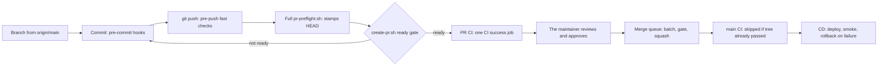
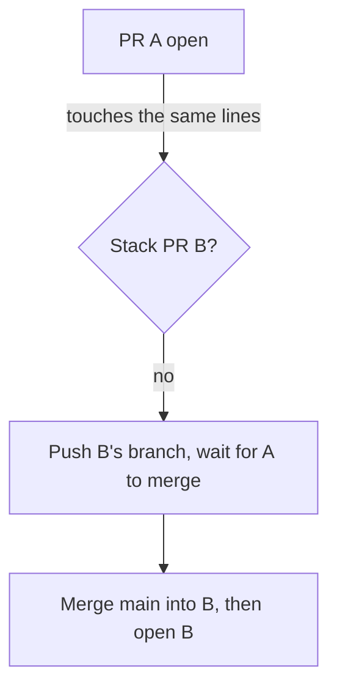

# PR Flow — From Branch to Main Without Surprises

**Type**: Guide (living document — PR any change)
**Owners**: Code Owner (product owner, sole reviewer)
**Applies to**: everyone who opens PRs on `github.com/ricardoafo/hermes`, including
the `ai-bot` and every agent session.
**Description**: How a PR travels from a branch to main and production, and the rules learned the hard way on 2026-10-03.

[dev-workflow.md](dev-workflow.md) holds the git and GitHub rules. This
guide shows the path a PR takes through the tooling, with the reason
behind each gate. Each reason comes from something that broke.

## The path

## Before the PR opens

`create-pr.sh` runs `scripts/dev/pr-ready-check.sh` and refuses to open
a PR unless all of these hold:

- The working tree is clean, and HEAD is pushed.
- HEAD contains the current `origin/main`, and `git merge-tree` against
  it is clean.
- A full `pr-preflight.sh` (without `--pre-push`) passed on that exact
  HEAD. The preflight writes a stamp in the git dir.
- The PR is not a draft. A PR opens only when it is finished.

Why: on 2026-10-03, four PRs were approved and then conflicted with
main, and others still had local commits. Each needed a push after
review, and a push dismisses the approval.

`bash scripts/dev/doctor.sh` (#549) checks that your tools match what CI
pins. Run it when a local pass and a CI result disagree.

## Stacking

- Never open a PR whose base is another open PR. Push the branch, and
  open it once the base has merged.
- If your PR conflicts with main, merge main in at once. Don't wait to
  be asked.
- After the maintainer approves, push only fixes for CI or for review comments.
  Merge main only for a real conflict.

## Approval and the merge queue

- The maintainer approves once they have reviewed and agree. CI should already be
  green and the PR conflict-free when they are asked.
- The queue takes every approved, green, non-draft PR, oldest approval
  first. It builds one tree, main plus each PR in order, and runs the
  gates once on it. Then it squash-merges the batch back to back.
- A red batch is bisected. The PR that breaks it gets the
  `merge-queue:gates-failed` label, a red status and one comment naming
  the failing tests. The queue skips that head until a new push or the
  label's removal.
- A PR the queue cannot merge itself, such as a workflow change without
  the App's Workflows permission, gets `merge-queue:hand-merge`.

## Lessons from 2026-10-03

| What broke | Rule now |
| --- | --- |
| Approved PRs conflicted with main | The ready gate and the "Merges cleanly with main" status |
| Auto-update merges restarted CI on every open PR | No branch updates; the queue gates the merged tree |
| The oldest approved PR never merged | Oldest approval first, batch per pass |
| A guides-index date changed when a squash landed on another day | Stop committing the index from PRs (#487, in review) |
| A self-test ran under a git hook and changed the real repo | Self-tests drop every inherited `GIT_*` variable |
| `--amend` after a rejected commit rewrote main's last commit locally | Re-run `git add -A && git commit`; never amend after a failure |
| setup-node downloaded Node on every job and hung | Toolchains come from the runner image, with step timeouts |
