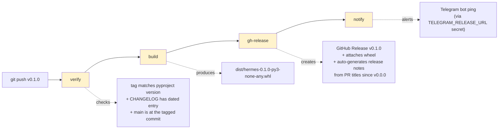

# Release Guide

**Type**: Guide (living document — PR any change)
**Owners**: Code Owner (product owner, sole reviewer)
**Applies to**: cutting a versioned release of hermes.
**Description**: How to tag a release, what the release workflow does, how to
verify the released wheel + CHANGELOG landed correctly.

## Status

The `release.yml` workflow is a scaffold. This guide documents the SHAPE of the
release process so it's clear what fills in during MVP1. Cross-references:
[issue #21](https://github.com/ricardoafo/hermes/issues/21).

## The release surface

Hermes releases are:

- **Semver-tagged**: `v0.1.0`, `v0.1.1`, `v0.2.0`, `v1.0.0`. `v` prefix
  is the industry standard for git tags (matches `astral-sh/uv`,
  `actions/checkout`, most Rust/Go/Python OSS).
- **Wheel-only**: `uv build --wheel` produces `hermes-<VERSION>-py3-none-any.whl`
  under `dist/`. No sdist, no signed artifacts (deferred per ADR-010
  § What we do NOT do).
- **Uploaded as GitHub Release assets** — not PyPI. Hermes is a private
  solo-operator tool, not a library.
- **CHANGELOG.md date-cut on release** — `## [Unreleased]` section gets
  renamed to `## [v0.1.0] — YYYY-MM-DD` and a fresh `## [Unreleased]`
  is prepended. Enforced by CI.

## Trigger

Releases fire on **git tag push matching `v[0-9]+.[0-9]+.[0-9]+`**.
Not on merge, not on schedule. Tagging is the deliberate act.

```bash
# From an up-to-date main
git checkout main
git pull --ff-only

# Bump the version in pyproject.toml (must match the tag)
sed -i 's/^version = ".*"/version = "0.1.0"/' pyproject.toml
git add pyproject.toml

# Update CHANGELOG.md — move [Unreleased] → [v0.1.0] — YYYY-MM-DD
# The release workflow verifies this happened before proceeding.
# See § CHANGELOG date-cut below.

git commit -m "chore(release): v0.1.0"
git push

# Tag
git tag -a v0.1.0 -m "release v0.1.0"
git push origin v0.1.0
```

The tag push triggers `.github/workflows/release.yml`.

## What `release.yml` does (planned)



Yellow = jobs whose bodies get filled in when we cut v0.1.0.

## CHANGELOG date-cut

Every release moves `[Unreleased]` into a dated section and prepends a
fresh empty `[Unreleased]`. The `scripts/dev/changelog-check.sh`
script gains an on-release check that:

1. On tag push: `## [Unreleased]` in `CHANGELOG.md` must be empty (all
   entries must have been moved into the tagged section by the human).
2. On regular PR merge: `## [Unreleased]` must have content for
   feat/fix/refactor/perf types (already enforced by CI today).

Example transformation for cutting v0.1.0:

Before:

```markdown
## [Unreleased]

### Added
- Rebalancer engine (#100)
- FIFO calculator (#101)

### Fixed
- Money rounding on partial fills (#102)
```

After:

```markdown
## [Unreleased]

## [v0.1.0] — 2026-09-15

### Added
- Rebalancer engine (#100)
- FIFO calculator (#101)

### Fixed
- Money rounding on partial fills (#102)
```

## Verification (post-release)

Within 5 minutes of tag push:

```bash
# 1. Workflow finished green
gh run list --workflow=release.yml --limit=1 --json conclusion,createdAt

# 2. GitHub Release exists
gh release view v0.1.0 --repo ricardoafo/hermes

# 3. Wheel is downloadable
gh release download v0.1.0 --repo ricardoafo/hermes --pattern '*.whl'
ls hermes-0.1.0-py3-none-any.whl

# 4. Sanity: the wheel installs into a fresh venv
python3 -m venv /tmp/hermes-verify
/tmp/hermes-verify/bin/pip install ./hermes-0.1.0-py3-none-any.whl
/tmp/hermes-verify/bin/hermes --version   # expects 0.1.0
```

If any of the above fails, DO NOT re-run the release workflow. Instead:

1. Delete the tag: `git push --delete origin v0.1.0` (requires
   authorization — Ricardo only)
2. Delete the failed GH Release via UI or `gh release delete v0.1.0`
3. Root-cause the failure, patch, re-tag with the SAME version

Do NOT bump the version to `v0.1.1` for a failed `v0.1.0` — nothing
downstream saw the failed release. Re-cut it.

## Cadence

Rough targets:

- **v0.1.0**: end of MVP1 (domain layer complete: Money, FIFO, Portfolio, ports, paper-trading engine)
- **v0.2.0**: shadow mode complete (adapters + CLI/TUI + 90-day observation gate)
- **v1.0.0**: real-capital cutover / MVP2 (see `docs/guides/shadow-mode-checklist.md`)

Releases before v1.0.0 are dry-run-only: the CD pipeline (`cd.yml`)
never enters `commit: true` mode. See ADR-003 §09.

## Related

- Issue #21 — `release.yml` workflow implementation
- ADR-006 — versioning strategy (semver, CHANGELOG conventions)
- ADR-010 — supply-chain hygiene (wheel hash pinning, SBOM generation)
- `scripts/dev/changelog-check.sh` — CI enforcement
- `docs/guides/dev-workflow.md` § Commit convention — feeds CHANGELOG grouping
