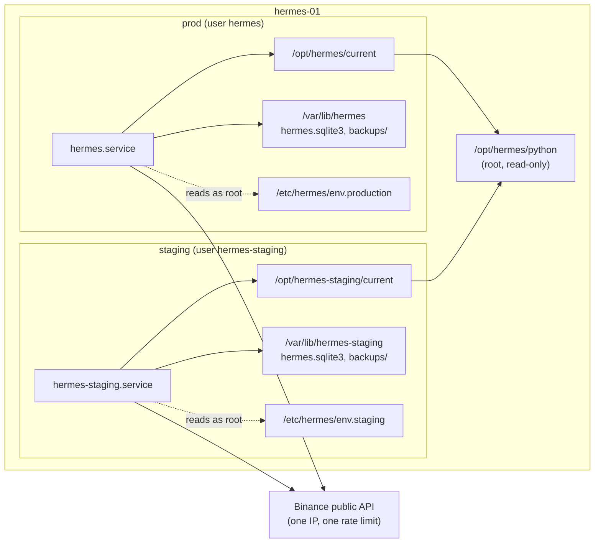

# Staging on hermes-01 — a second, isolated hermes next to prod

**Type**: Guide (living document — PR any change)
**Owners**: Code Owner (sole operator)
**Applies to**: `hermes-01`, `deploy/systemd/hermes-staging.service`, `scripts/deploy/{install_release,rollback,health_gate}.sh` with `HERMES_TARGET=staging`.
**Description**: How the staging tier runs beside prod on hermes-01 without sharing its user, paths, ledger or secrets, and every manual step to set it up, deploy to it, roll it back and remove it.

## What staging is

Staging is a second `hermes serve` on the same box as prod, with `HERMES_ENV="staging"`. It exists to run a
release against live market data before prod does. It is a full copy of prod's layout under `hermes-staging`
names, owned by its own system user, so the operating system keeps it out of prod's files
([change spec](../../openspec/changes/192-staging-env/change.md), D-1 and D-2).

Nothing in the repo creates or starts it. The unit file ships with every bootstrap run, but it stays inert until
the steps below create its user, directories and env file and enable it. CD never deploys to staging: a staging
deploy is always a manual run of `install_release.sh` with `HERMES_TARGET=staging`.

What staging does differently from prod:

- It never pages. `hermes-staging.service` has no `OnFailure=` and no `ExecStopPost=` alert.
- It talks only to the Slack channel or Telegram chat its own env file names, or to none. With no notifier
  credentials it runs silent; `hermes serve` does not require them outside prod.
- It never trades real capital. `HERMES_ALLOW_MAINNET` stays a prod-only setting: the config loader refuses it in
  staging, and `install_release.sh` refuses any env file that enables it.
- It has no backups timer, no health ping and no daily line. Ledger snapshots before each deploy are the only copies.

## Layout

| Item | Prod (unchanged) | Staging |
| ---- | ---------------- | ------- |
| System user | `hermes` | `hermes-staging` |
| Unit | `hermes.service` | `hermes-staging.service` |
| Code root | `/opt/hermes/{versions,current,previous,bin}` | `/opt/hermes-staging/{versions,current,previous,bin}` |
| State and ledger | `/var/lib/hermes/hermes.sqlite3` | `/var/lib/hermes-staging/hermes.sqlite3` |
| Snapshots | `/var/lib/hermes/backups/` | `/var/lib/hermes-staging/backups/` |
| Secrets | `/etc/hermes/env.production` | `/etc/hermes/env.staging` |
| Journal | `journalctl -u hermes.service` | `journalctl -u hermes-staging.service` |
| Python | `/opt/hermes/python` | the same, read-only |

The only thing staging shares with prod is the uv-managed Python under `/opt/hermes/python`. It is root-owned
`0755`, and staging venvs link into it the way prod's do. A staging deploy never writes there.



## What keeps staging away from prod

- **The OS.** `hermes-staging` cannot read `/var/lib/hermes` (`0750 hermes:hermes`) or either env file
  (`600 root:root`). Both units run with `ProtectSystem=strict`, so each can write only its own state directory.
- **The scripts.** `HERMES_TARGET` picks every path, the unit, the run-as user and the env file in one place. For
  `staging`, preflight refuses to run, before it touches anything, when:
  - the code root, ledger or snapshot directory resolves (symlinks and `..` included) to `/opt/hermes` or
    `/var/lib/hermes`, or anywhere inside them;
  - the env file is `/etc/hermes/env.production`;
  - the unit is `hermes.service` or the user is `hermes`;
  - the last `HERMES_ENV=` line of the env file is not exactly `staging`.
- **Unknown targets.** Any `HERMES_TARGET` other than `prod` or `staging` is refused by all three scripts, so a typo
  never falls back to prod. Without `HERMES_TARGET` the scripts behave exactly as they always have, for prod.

## Shared resources

Staging and prod share the box's CPU, memory and disk, and one public IP. Binance rate limits are per IP, so every
staging start (which re-fetches warm-up history) and every staging poll spends prod's budget. Both units keep the
same crash-loop guard (5 starts in 10 minutes), which bounds the damage of a staging crash loop. Stop staging when
you are not using it.

## Deploy flow

```mermaid
sequenceDiagram
    autonumber
    actor Rick
    participant GH as GitHub (cd.yml run)
    participant Box as hermes-01 (root)
    participant IR as install_release.sh
    participant Unit as hermes-staging.service
    Rick->>GH: download hermes-release-<sha12>.tar.gz
    Rick->>Box: scp the bundle to /var/lib/hermes-deploy
    Rick->>Box: untar into /var/lib/hermes-deploy/hermes-release-<sha12>
    Rick->>IR: HERMES_TARGET=staging install_release.sh <sha12> <stage>
    IR->>IR: guard: no prod path, unit, user or env file
    IR->>IR: preflight: env file 600 root:root, HERMES_ENV=staging, no mainnet
    IR->>IR: build /opt/hermes-staging/versions/<sha12>
    IR->>IR: snapshot the staging ledger as hermes-staging
    IR->>IR: flip previous and current
    IR->>Unit: daemon-reload, reset-failed, restart
    IR->>Unit: health gate (30 s active, steady MainPID, serve.run.started)
    alt gate passes
        IR->>IR: refresh /opt/hermes-staging/bin, prune old releases
    else gate fails
        IR->>Unit: rollback.sh restores the snapshot and restarts previous
    end
```

## Manual steps for Rick

Run everything as root on hermes-01 (`ssh hermes-01`, then `sudo -i` if you did not log in as root). Each step
is safe to re-run.

### 1. Create the `hermes-staging` system user

Same shape as prod's `hermes` user in `scripts/deploy/vps_bootstrap.sh`: a system account, no login shell, home in
its state directory, no home created.

```bash
id hermes-staging || useradd --system --user-group --home-dir /var/lib/hermes-staging \
    --no-create-home --shell /usr/sbin/nologin hermes-staging
```

### 2. Create the directories

Code is root-owned so the service cannot rewrite its own code; only the state directory belongs to
`hermes-staging`. Modes match prod's.

```bash
install -d -m 0755 -o root -g root /opt/hermes-staging /opt/hermes-staging/versions /opt/hermes-staging/bin
install -d -m 0750 -o hermes-staging -g hermes-staging /var/lib/hermes-staging
stat -c '%a %U:%G %n' /opt/hermes-staging /opt/hermes-staging/versions /opt/hermes-staging/bin \
    /var/lib/hermes-staging
```

Expected: `755 root:root` for the three `/opt` paths and `750 hermes-staging:hermes-staging` for the state
directory. systemd would also create the state directory at first start (`StateDirectory=`), but
`install_release.sh` writes snapshots there before the unit ever starts.

### 3. Write `/etc/hermes/env.staging`

`600 root:root`, like prod's. systemd reads it as root before it drops to `hermes-staging`. Write it with
`install` so it is never readable by anyone else, even for a moment:

```bash
install -m 0600 -o root -g root /dev/null /etc/hermes/env.staging
editor /etc/hermes/env.staging
```

Contents. `HERMES_ENV="staging"` is required; the deploy refuses any other value.

```bash
HERMES_ENV="staging"
HERMES_ALLOW_MAINNET="no"

# Optional. Use a staging-only channel, never prod's; leave both out to run silent.
HERMES_SLACK__BOT_TOKEN="xoxb-..."
HERMES_SLACK__DEFAULT_CHANNEL="#hermes-staging"

# Optional. A separate Telegram chat; prod's chat would mix staging alerts with real ones.
# HERMES_TELEGRAM__BOT_TOKEN="..."
# HERMES_TELEGRAM__CHAT_ID="..."
```

Do not copy prod's `HERMES_HEALTHCHECKS__PING_URL` or `HERMES_SENTRY__DSN`: a staging ping would hide a prod outage,
and staging errors would land in prod's Sentry environment. Check the result:

```bash
stat -c '%a %U:%G' /etc/hermes/env.staging    # 600 root:root
grep '^HERMES_ENV=' /etc/hermes/env.staging   # HERMES_ENV="staging"
```

### 4. Install the unit (enable it only when you want staging running)

The next `vps-bootstrap` run copies `hermes-staging.service` into `/etc/systemd/system` but never enables it. To
install it before that, copy it from any release bundle (it is in `deploy/systemd/` in the repo):

```bash
install -m 0644 -o root -g root hermes-staging.service /etc/systemd/system/hermes-staging.service
systemctl daemon-reload
systemctl cat hermes-staging.service >/dev/null && echo installed
```

`install_release.sh` checks that the unit is installed, not that it is enabled. Enable it only when you want
staging to start on boot and run now:

```bash
systemctl enable --now hermes-staging.service
```

On the very first deploy `current` does not exist yet, so the unit fails to start until step 5 has run. Either
deploy first and enable afterwards, or ignore that one failed start; the deploy restarts the unit anyway.

### 5. Deploy a release bundle to staging by hand

Get a bundle from a `cd.yml` run. Every run builds it, including a `dry_run` dispatch, which deploys nothing. Stage it in
the private `/var/lib/hermes-deploy` (0700), as CD does, never in world-writable `/var/tmp` (#782):

```bash
# On your machine
gh run download <run-id> --name hermes-release
ssh hermes-01 install -d -m 0700 /var/lib/hermes-deploy
scp hermes-release-<sha12>.tar.gz hermes-01:/var/lib/hermes-deploy/
```

Then, as root on hermes-01:

```bash
sha12=<sha12>
stage=/var/lib/hermes-deploy/hermes-release-$sha12
rm -rf "$stage" && install -d -m 0700 "$stage"
tar -xzf "/var/lib/hermes-deploy/hermes-release-$sha12.tar.gz" -C "$stage"
HERMES_TARGET=staging /usr/bin/bash "$stage/bin/install_release.sh" "$sha12" "$stage"
rm -rf "$stage" "/var/lib/hermes-deploy/hermes-release-$sha12.tar.gz"
```

The last lines of a good deploy are `gate OK: hermes-staging.service active 30s, ...` and
`release <sha12> is live`. Watch it with:

```bash
systemctl status hermes-staging.service
journalctl -u hermes-staging.service -f
```

If the deploy prints `refusing`, it stopped before changing anything; read the message, fix the path, unit, user
or env file it names, and run it again.

### 6. Roll staging back

`install_release.sh` rolls back on its own when the health gate fails. By hand, flip `current` back to `previous`
and re-gate:

```bash
HERMES_TARGET=staging /opt/hermes-staging/bin/rollback.sh
```

To also put the staging ledger back to its state before a deploy (for example after a migration):

```bash
HERMES_TARGET=staging HERMES_RESTORE_DB=/var/lib/hermes-staging/backups/pre-<sha12>.sqlite3 \
    /opt/hermes-staging/bin/rollback.sh
```

Always pass `HERMES_TARGET=staging`. Without it the script is prod's rollback; the staging copy of the script is the
same file.

### 7. Remove staging

Stop and disable the unit first, then remove what steps 1 to 4 created. Prod is untouched by every line below.

```bash
systemctl disable --now hermes-staging.service
rm -f /etc/systemd/system/hermes-staging.service
systemctl daemon-reload
systemctl reset-failed hermes-staging.service 2>/dev/null || true
rm -rf /opt/hermes-staging /var/lib/hermes-staging
rm -f /etc/hermes/env.staging
userdel hermes-staging
getent group hermes-staging && groupdel hermes-staging
```

`rm -rf /var/lib/hermes-staging` deletes the staging ledger and its snapshots for good; copy them out first if you
want them. The unit file comes back on the next `vps-bootstrap` run, still disabled and harmless without its user.
To keep it gone, delete `deploy/systemd/hermes-staging.service` from the repo.

## Related

- [`openspec/changes/192-staging-env/change.md`](../../openspec/changes/192-staging-env/change.md) — the decisions
  behind this layout.
- [`openspec/changes/179-cd-first-real-deploy/change.md`](../../openspec/changes/179-cd-first-real-deploy/change.md)
  — how the release scripts install, gate and roll back.
- [Ledger migrations](ledger-migrations.md) — snapshots and `hermes migrate`, the same for both tiers.
