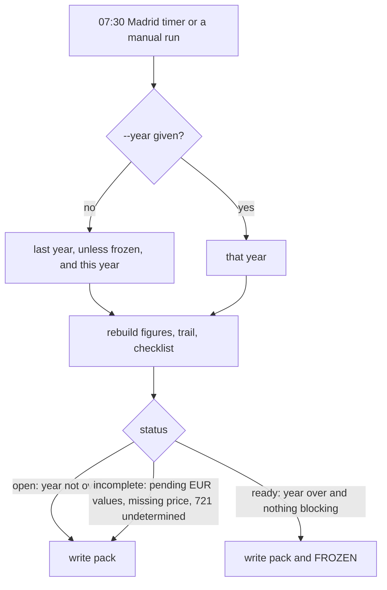

# Tax filing pack — keeping each year ready for the gestor

**Type**: Guide (living document — PR any change)
**Owners**: Code Owner (sole operator)
**Applies to**: `hermes tax-pack`, the `hermes-tax-pack.timer` on `hermes-01`, and local runs with your taxpayer profile.
**Description**: What the yearly tax filing pack holds, how it refreshes during the year, when it freezes, and how to reopen a frozen year.

## What it is

`hermes tax-pack` keeps one folder per tax year with everything your gestor needs for the
virtual-currency part of the Renta (Modelo 100) and the Modelo 721. It refreshes as hermes
trades, so when the campaign opens the figures and their evidence are already there.

Hermes submits nothing to the AEAT. Every figure is an estimate to check with the gestor, and
shadow figures say no real tax is due.

## What is in the folder

`<out>/<year>/`:

| File | Content |
|---|---|
| `README.md` | status, headline figures, readiness checklist, changes in the last refresh |
| `report.md` | the Modelo 100 and 721 figures per form field, with every sale (`hermes tax-filing`) |
| `modelo100-summary.csv`, `modelo100-sales.csv`, `modelo721.csv` | the same figures as CSV |
| `trail.csv` | each sale back to the lots it used, with EUR values, fees and both trades' ECB rates |
| `tax-estimate.txt` | the `hermes tax` estimate; only where your taxpayer profile exists |
| `figures.json` | the headline figures the next refresh compares against |
| `changes.md` | one dated entry per refresh that moved a figure |
| `manifest.json` | sha256 of every other file |
| `FROZEN` | present once the year is closed and ready |

## How it refreshes



On the server the timer is installed by `vps-bootstrap` and left off. To turn it on, paste into
the server shell:

```bash
sudo systemctl enable --now hermes-tax-pack.timer
```

The server packs live in `/var/lib/hermes-tax-pack/<year>/`. The server has no taxpayer
profile, so they hold the filing figures only.

## Running it locally with your profile

Your taxpayer profile stays on your machine. To get a pack that also carries the tax estimate,
run it where the profile and a copy of the ledger live:

```bash
uv run hermes tax-pack --year 2026 --db ./hermes.sqlite3
```

The default folder is `$HERMES_TAX_PACK_DIR`, else `~/.local/share/hermes/tax-packs`. Keep it
out of any checkout: it holds personal figures.

## When a closed year is incomplete

The checklist says what is missing:

- **Sales waiting for EUR values**: run `hermes fx backfill`, then the pack again.
- **No year-end price for a coin**: pass `--price COIN=EUR` with the 31 December value.
- **Modelo 721 undetermined**: follows from a missing price; fix the price.

## Reopening a frozen year

A frozen pack is the record of what you filed, so refreshes leave it alone. If a correction is
needed after freezing (a bug fix, a late backfill), delete `FROZEN` in that year's folder and run
`hermes tax-pack --year <year>`. `changes.md` records every figure that moved.
