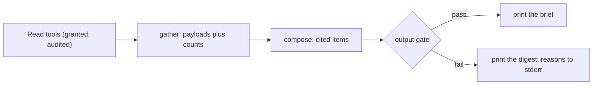

# VPS Operations — Access, Maintenance, Recovery

**Type**: Guide (living document — PR any change)
**Owners**: Code Owner (sole operator)
**Applies to**: the single Hetzner Cloud VPS that hosts hermes at
`hermes-01` (CX23, Ubuntu 24.04 LTS, Nuremberg).
**Description**: SSH access, OS maintenance, Docker + Tailscale + ufw ops, systemd services, troubleshooting.

Everything you need to reach the server, keep it healthy, and recover
it when it misbehaves. Copy-pasteable commands throughout. Actual
values (IP, tailnet name, systemd unit names) come from environment
variables so this doc stays portable if we ever reprovision or
migrate.

## Environment setup — put these in your shell profile

Add to `$PROFILE` (PowerShell) or `~/.bashrc` (bash) so every session
has them ready:

```bash
export HERMES_VPS_IP=178.104.237.14           # or the Tailscale IP once linked
export HERMES_VPS_USER=root                    # non-root user lands in a future update
export HERMES_SSH_KEY="$HOME/.ssh/hermes_vps_ed25519"
```

The IP + key path also live in Bitwarden under `Hermes VPS SSH key` for
recovery when the shell profile is unavailable.

## Initial provision — install order matters

When bringing up a fresh VPS (initial install or full reprovision),
install and verify components in this exact order. Skipping ahead
locks you out.

1. **apt update + upgrade + set timezone**
2. **Install Tailscale + register with your tailnet** (via `tailscale
   up --ssh`) — outbound-only, safe
3. **Reboot** if `apt upgrade` installed a new kernel (`ls
   /var/run/reboot-required` returns a file) — Tailscale must survive
   a reboot before you trust it
4. **After reboot, verify Tailscale came back up** via `ssh
   root@hermes-01` (tailnet name) from your laptop — if this fails,
   fix Tailscale first, still have public SSH as fallback
5. **Only now enable ufw + Hetzner Cloud Firewall** — public SSH
   becomes blocked; if Tailscale isn't working, you're locked out
   without console recovery
6. **Install Docker + any other services** — order doesn't matter here,
   ufw allows outbound freely
7. **Run the hermes bootstrap workflow** — see
   [Hermes bootstrap (automated)](#hermes-bootstrap-automated) below.
   Creates the `hermes` user and the `/opt/hermes`, `/var/lib/hermes`,
   `/var/log/hermes` and `/etc/hermes` dirs, installs uv, Python 3.14 and
   the systemd units, renders `/etc/hermes/env.production` from prod-env
   secrets (once), mounts the Hetzner Storage Box when its creds are
   present. Idempotent — safe to re-dispatch.

**Root cause of this rule**: enabling `ufw` before verifying Tailscale
persists through reboot has burned people before. `apt upgrade`
routinely installs new kernels; new kernels require reboot to activate;
Tailscale's systemd unit may or may not auto-start depending on install
method. Verify BEFORE closing the escape hatch.

If step 4 fails, recover via:

- SSH to the public IP: `ssh -i "$HERMES_SSH_KEY" root@$HERMES_VPS_IP`
- Or Hetzner console (Server → Console — browser terminal, works even
  with ufw active)
- Restart Tailscale: `systemctl restart tailscaled && tailscale up --ssh`

Then re-verify step 4, then proceed to step 5.

## Access

### First-time SSH from a new machine

Copy the SSH key from Bitwarden to `$HOME/.ssh/hermes_vps_ed25519` on
the new machine (`chmod 600` on Linux/macOS). Then:

```bash
ssh -i "$HERMES_SSH_KEY" -o StrictHostKeyChecking=accept-new \
    "$HERMES_VPS_USER@$HERMES_VPS_IP"
```

First connection prompts for the SSH key passphrase (from Bitwarden)
and adds the host key to `~/.ssh/known_hosts`.

### Routine SSH

```bash
ssh -i "$HERMES_SSH_KEY" "$HERMES_VPS_USER@$HERMES_VPS_IP"
```

Passphrase prompt every session unless you use `ssh-agent` or
Bitwarden's built-in SSH agent (recommended — unlock Bitwarden once,
passphrase served silently to SSH client).

### SSH via Tailscale (preferred once linked)

Once the VPS is on your tailnet (see [Tailscale operations](#tailscale-operations)):

```bash
ssh -i "$HERMES_SSH_KEY" root@hermes-01
```

Tailscale MagicDNS resolves `hermes-01` to the tailnet IP. No public
IP needed. `ufw` rules only permit SSH from Tailscale CGNAT
(`100.64.0.0/10`), so this becomes the ONLY working path once ufw is
enabled.

### SSH config alias

An entry in your SSH config shortens the Tailscale form to `ssh hermes`.
On Windows the file is `$HOME\.ssh\config`; on Linux and macOS
`~/.ssh/config`:

```text
Host hermes
    HostName hermes-01
    User root
    IdentityFile ~/.ssh/hermes_vps_ed25519
```

[operator-usage.md](operator-usage.md) covers what to run once connected.

### Host key changed warning

If SSH refuses to connect with `REMOTE HOST IDENTIFICATION HAS CHANGED`:

- **Expected**: after reprovisioning the VPS (fresh install = new host
  key). Purge the old entry:

    ```bash
    ssh-keygen -R "$HERMES_VPS_IP"
    ssh-keygen -R hermes-01
    ```

    Then reconnect. NEW host key is auto-added.

- **Unexpected**: could be MITM. Do NOT connect. Verify with Hetzner
  console (Server → Console) that the server hasn't been rebuilt
  without your knowledge.

## OS maintenance

### Weekly / on-demand

```bash
apt update && apt upgrade -y
apt autoremove -y
```

Renovate opens PRs for GitHub Actions + Python deps in the repo. OS
package updates are manual — run this every 1-2 weeks or when Ubuntu
Security notice arrives.

### Reboot after kernel updates

Ubuntu creates `/var/run/reboot-required` when a reboot is needed
(kernel, systemd, glibc):

```bash
[[ -f /var/run/reboot-required ]] && echo "reboot needed" || echo "no reboot needed"
```

Reboot procedure (2-3 min downtime):

```bash
systemctl stop hermes.service   # the timers are idle while it is stopped
sync
reboot
```

Wait ~90 seconds, then reconnect and verify services came back:

```bash
systemctl status hermes.service
systemctl list-timers 'hermes-*'
```

### Disk and memory checks

```bash
df -h                    # disk usage per mountpoint
du -sh /var/lib/hermes   # hermes state dir (SQLite + backups staging)
du -sh /var/log/journal  # journald log growth
free -h                  # RAM + swap
uptime                   # load average + boot time
```

Baseline expectations after a full hermes install:

- `/` disk usage: 5-10 GB (OS + Docker + hermes + venv)
- `/var/lib/hermes`: MB-scale for years (SQLite grows slowly)
- RAM: <1 GB idle, up to 2 GB during rebalance calculations
- Load: <0.5 idle; brief spikes at each bar close

### Journald log retention

`vps-bootstrap` writes `/etc/systemd/journald.conf.d/50-hermes.conf` with the ADR-008 §1 limits: at most 2G
(`SystemMaxUse=2G`) and at most 180 days (`MaxRetentionSec=180day`). It restarts `systemd-journald` only when the
file changed, and the limits apply once bootstrap has been re-run. Verify:

```bash
cat /etc/systemd/journald.conf.d/50-hermes.conf
journalctl --disk-usage
```

## Docker operations

Docker CE is installed; used for the local CI runner (when we move it
here from the operator's laptop) and any future containerized
services.

### Container state

```bash
docker ps                 # running containers
docker ps -a              # + stopped
docker images             # local images
docker stats --no-stream  # snapshot of CPU/RAM per container
```

### Logs

```bash
docker logs -f <container>              # tail
docker logs --tail 200 <container>      # last 200 lines
docker logs --since 1h <container>      # last hour
```

### Restart / recreate

```bash
docker restart <container>              # in-place restart
docker compose -f /path/to/compose.yml restart
docker compose -f /path/to/compose.yml down && docker compose -f /path/to/compose.yml up -d
```

### Cleanup

```bash
docker system prune              # unused images + networks
docker system prune --volumes    # + unused volumes (careful — data loss)
docker system df                 # disk usage by resource type
```

## Tailscale operations

Zero-trust access layer. All SSH traffic routes through Tailscale;
public SSH is blocked by `ufw`.

### Status

```bash
tailscale status                 # peers + connection quality
tailscale ip -4                  # this machine's tailnet IPv4
tailscale ping <peer-name>       # latency to a peer
```

### Bring up / down (rare)

```bash
tailscale up --ssh               # register or re-register
tailscale down                   # disconnect (breaks SSH — do only from Hetzner console)
```

`--ssh` enables Tailscale SSH (identity-based auth via tailnet, no
key exchange). Combined with SSH-key auth, gives you two orthogonal
paths in.

### If Tailscale is offline

If `tailscale status` shows `stopped` or `offline`:

```bash
systemctl status tailscaled
systemctl restart tailscaled
sleep 5
tailscale up --ssh
```

If that fails, re-authenticate:

```bash
tailscale up --ssh --force-reauth
```

Prints an auth URL. Open on your laptop's Tailscale-authenticated
browser session to reconnect.

### Emergency: locked out of Tailscale

If `ufw` denies SSH from public and Tailscale is broken:

- Use Hetzner console (Server → Console) to open a browser terminal
- Login as `root` (needs password — set one via `passwd` early after
  install, save to Bitwarden)
- `systemctl restart tailscaled && tailscale up --ssh`
- OR temporarily allow SSH from your public IP: `ufw allow from <your-public-ip> to any port 22`

Console access is your "always works" fallback. Do not delete the
password.

## ufw operations

Firewall at the OS level. Complements the Hetzner Cloud Firewall
(applied at the infrastructure edge — see [Hetzner Cloud Firewall](#hetzner-cloud-firewall)).

### Status and rules

```bash
ufw status verbose
ufw show added                   # rules waiting to activate
```

### Add / remove rules

```bash
ufw allow from 100.64.0.0/10 to any port 22   # SSH from Tailscale CGNAT
ufw allow out 443/tcp                           # HTTPS out (default)
ufw deny in from 1.2.3.4                        # block a specific abuser
ufw delete allow from 1.2.3.4                   # remove a rule
```

### Reload / disable

```bash
ufw reload            # re-read rules
ufw disable           # off (do NOT use unless recovering — leaves you exposed)
ufw enable            # on
```

## Hetzner Cloud Firewall

Additional packet filter applied at Hetzner's infrastructure edge
(before packets reach the VPS). Complements `ufw` — belt and
suspenders.

Configured via Hetzner console → Firewalls. Managed manually. Rules:

- **Inbound**: allow TCP 22 from `100.64.0.0/10` (Tailscale CGNAT)
  only; deny all else
- **Outbound**: allow all (default)

To modify: Hetzner console → Firewalls → hermes-firewall → Edit rules.
Changes apply within seconds.

## Hermes bootstrap (automated)

Provisioning the app-layer state on the VPS is fully automated by the
`vps-bootstrap` GitHub Actions workflow. It joins the tailnet, SSHes
in as `hermes-01`, and runs `scripts/deploy/vps_bootstrap.sh` on the
box.

### What it does

1. Creates the `hermes` system user (nologin) when it is missing.
2. Creates the FHS dirs with explicit owners: `/opt/hermes`
   (`versions`, `bin`, `python`) and `/etc/hermes` root-owned `0755`;
   `/var/lib/hermes` and `/var/log/hermes` owned `hermes:hermes`, `0750`.
3. Installs the uv version pinned in `cd.yml` to `/usr/local/bin` when
   `uv --version` differs, and Python 3.14 under `/opt/hermes/python`.
4. Installs the unit files from `deploy/systemd/` to
   `/etc/systemd/system` and enables `hermes.service` (not started: the
   first deploy starts it). The backup and health timers stay disabled.
5. Renders `/etc/hermes/env.production` from every `HERMES_*` secret in
   the `prod` GitHub Environment, only when the file does not exist yet.
   Written via a `0600` tmp file + atomic `mv`, owned `root:root`. Empty
   secret values are skipped (never written as `KEY=`, which systemd
   would interpret as unset). An existing file keeps its content; only
   its owner and mode are repaired.
6. Mounts the Hetzner Storage Box at `/mnt/storage-box` via SSHFS.
   Guarded — if `STORAGE_BOX_HOST` / `STORAGE_BOX_USER` /
   `STORAGE_BOX_KEY` are missing the step logs a WARN and exits 0.
   Installs a systemd auto-mount unit so it survives reboot. The mount
   point is prepared only while nothing is mounted on it: `chown` on a
   live SSHFS mount fails even as root.

Idempotent: every step checks state before it acts, so re-dispatch is
safe. A re-dispatch does not re-render the env file, so it does not
pick up a changed secret: edit `/etc/hermes/env.production` on the box,
or delete it and re-dispatch.

### How to dispatch

```bash
# From your laptop (needs gh CLI, no VPS access needed)
gh workflow run vps-bootstrap.yml --repo ricardoafo/hermes --ref main
gh run watch                                         # follow to completion
```

Or from the GitHub UI: Actions → VPS bootstrap → Run workflow.

### Verifying the result

```bash
ssh -i "$HERMES_SSH_KEY" root@hermes-01 '
    ls -la /var/log/hermes /etc/hermes
    stat -c "%a %U:%G" /etc/hermes/env.production
    mountpoint /mnt/storage-box
'
```

Expected: `/etc/hermes` is `root:root 755` and `/var/log/hermes` is
`hermes:hermes 750`; the env file is `600 root:root`; storage-box
mountpoint reports mounted (or the WARN case if creds are still absent).

### When to re-dispatch

- After adding a new `HERMES_*` secret and deleting
  `/etc/hermes/env.production` so it renders again. Updating a secret in
  the `prod` GH env alone changes nothing on the box.
- After adding storage-box credentials for the first time (unblocks
  the mount step that previously WARN-skipped).
- After a VPS reprovision — before enabling any hermes systemd unit.

A unit or timer whose file changed does not need a re-run: each deploy
installs the release's changed `deploy/systemd/` files before it restarts
the unit, and a failed health gate puts the old files back (#626). A
deploy never enables a new unit, so a new timer still needs this
workflow once. The env file and journald drop-in stay bootstrap-only.

### Deploys and the 4h bar

`install_release.sh` never stops or restarts `hermes.service` from 5
minutes before a 4h bar close (00/04/08/12/16/20 UTC) until 5 minutes
after it; it holds right before the restart (#626). A bar that closes
while the unit is down is evaluated on restart from the ledger cursor.

### Which version is live

Each good deploy publishes a GitHub release tagged `deploy-<sha12>`
listing the PRs and changelog lines since the previous deploy, and posts
the same summary to Telegram (#626). On the box,
`readlink /opt/hermes/current` names the live `versions/<sha12>`.

### Day 0: deploy only new versions

Until the shadow's day 0, every green `main` deploys. At day 0 (ADR-021,
issue #797), right after archiving the warm-up ledger, set the repository
variable that makes CD deploy only a cut version's first deploy
(ADR-022 §6):

```bash
gh variable set DEPLOY_ON --body version --repo ricardoafo/hermes
```

From then on, CD still gates and bundles every green `main`, but deploys
only a commit that carries a version with no `v<version>` tag and no
earlier deploy. Other runs show a notice and a skipped deploy job. To go
back, set it to `every-green` or delete it. Any other value fails CD on
purpose. Only the Code Owner changes this variable.

### Failure modes

- **Tailscale-join fails** — the workflow's `Join tailnet` step
  reports it. Check that `TS_OAUTH_CLIENT_ID` and `TS_OAUTH_SECRET`
  in the `prod` env belong to an OAuth client that still exists, has
  the `auth_keys` write scope and may use `tag:ci-runner`.
- **SSH host-key mismatch** — the workflow's keyscan step will pick up
  the new key. If it hangs, the VPS has been reprovisioned — verify
  fingerprint via Hetzner console before proceeding.
- **Storage-box mount fails mid-flight** — the script exits 1 with a
  pointer to `journalctl -xeu mnt-storage\x2dbox.mount` on the VPS.
  Check that the sub-account key hasn't been rotated.

### Related

- `.github/workflows/vps-bootstrap.yml`
- `scripts/deploy/vps_bootstrap.sh`
- `openspec/changes/chore-vps-bootstrap-workflow/change.md`

## Systemd services (populated as hermes services land)

Hermes runs as a set of systemd units under user `hermes` (created in
Phase 0). Common commands once services exist:

```bash
systemctl status hermes.service
systemctl restart hermes.service
systemctl stop hermes.service
systemctl start hermes.service
systemctl list-timers 'hermes-*'     # health, backup, daily, archive-check

# View logs (see "Check on hermes" below for the hermes_run helper)
hermes_run logs -f                              # tail
hermes_run logs --since 1h
hermes_run logs --level error --since 1h
journalctl -u hermes-backup.service --since '1 day ago'   # other units
```

## Check on hermes

The read-only console commands answer "is it OK, and what happened?"
without touching the ledger. Run them on the VPS as user `hermes` with the
service's env file loaded, so they see the same config and ledger:

```bash
hermes_run() {
    sudo bash -c 'set -a; . /etc/hermes/env.production; set +a; cd /var/lib/hermes &&
        exec runuser -u hermes -- /opt/hermes/current/.venv/bin/hermes "$@"' _ "$@"
}

hermes_run status --config-dir /opt/hermes/current/config --db /var/lib/hermes/hermes.sqlite3
hermes_run positions
hermes_run activity --db /var/lib/hermes/hermes.sqlite3
hermes_run logs --level warning --since 1h
hermes_run logs --cycle K7Q2ZP     # one bar cycle, by the tail of its correlation id
hermes_run logs -f                 # follow, Ctrl-C to stop
```

The env file sets `HERMES_ENV=prod`, and in prod any command that loads the
config needs an absolute `--config-dir` (here `/opt/hermes/current/config`).
Without it the command stops with `config dir 'config' is relative`, because
the working directory must never choose the production config (#783).

- `hermes status`: the verdict (all good, late, down), then each stream's
  last and next bar. Exit 0 only when all good.
- `hermes positions`: open shadow positions.
- `hermes activity`: what changed, grouped by day; `--all` adds bar checks
  and signals.
- `hermes logs`: the journal, one readable line per entry, times in Madrid
  (`--utc` for UTC). `--json` prints the same entries as data.

Every console command also runs on demo data from any machine:
`hermes --demo ok-two-positions activity` (see `hermes --demo` for the list).

[operator-usage.md](operator-usage.md) walks through these commands for
day-to-day use, with the demo scenarios, deploys and alerts.

### Use the console from your PC

With Tailscale connected, one local command runs a console command on the
VPS over `ssh -t` (same user, env and ledger as `hermes_run` above):

```powershell
uv run hermes --vps tui
uv run hermes --vps positions BTC
uv run hermes --vps activity --all
```

Only console commands go through (`tui`, `status`, `positions`, `activity`,
`money`); `serve`, `migrate` and the rest are
refused, and `--vps` cannot be combined with `--demo`. Defaults match the
setup above; override with environment variables:

| Variable | Default |
| --- | --- |
| `HERMES_VPS_HOST` | `hermes-01` |
| `HERMES_VPS_USER` | `root` |
| `HERMES_VPS_KEY` | `~/.ssh/hermes_vps_ed25519` |

Errors are one line: no ssh client (install OpenSSH), host unreachable
(Tailscale down), authentication failed (check the key), or the VPS has no
console yet (deploy a release that includes it). The ssh passphrase prompt
shows as usual; to type it once per session, load the key into the agent
(on Windows start it first with `Start-Service ssh-agent` from an
administrator PowerShell, then `ssh-add $HOME\.ssh\hermes_vps_ed25519`).
This is optional.

The session sends an ssh keepalive, so a dead link is noticed in about 30
seconds. If the connection drops, the console prints `connection lost ·
reconnecting in Ns (Ctrl+C to stop)` and reconnects with a 2 to 30 second
backoff; Ctrl+C stops it. Authentication failures never retry.

On the VPS itself, a deploy installs `/usr/local/bin/hermes`, a wrapper that
does what `hermes_run` does and allows only the same console commands (plus
`--help`); `hermes status` works bare there because the wrapper sets
`HERMES_DB_PATH` and `HERMES_CONFIG_DIR`, which every console command reads as
the default for `--db` and `--config-dir`. `--demo SCENARIO` works before or
after the command.

## Start a counted shadow run (day 0)

ADR-021 §2 and §3: a strategy's 90-day shadow clock starts at day 0, the
first bar after every Ready rule holds. The Code Owner runs this; agents
never do. With `hermes_run` defined as in "Check on hermes":

```bash
hermes_run shadow-start swing-donchian-4h --config-dir /opt/hermes/current/config --db /var/lib/hermes/hermes.sqlite3
systemctl stop hermes.service
hermes_run shadow-start swing-donchian-4h --config-dir /opt/hermes/current/config --db /var/lib/hermes/hermes.sqlite3 --confirm START
systemctl start hermes.service
```

- The first call is a dry run: it prints each Ready rule as `pass`, `fail`
  or `confirm by hand` and what it would do, and changes nothing. Rules 3,
  4 and 6 (defects fixed, kill and drift checks in serve, parity) are yours
  to confirm; `--confirm START` is that confirmation.
- The confirmed call refuses while `hermes.service` runs. It copies the
  ledger read-only to `/var/lib/hermes/archive/<run id>/`, checks the copy,
  removes the ledger (serve creates a fresh one on start), and writes
  `/var/lib/hermes/runs/<run id>.json` with the engine version, release and
  the config, pre-registration and data manifest hashes.
- It prints a lab notebook entry: commit it to
  `docs/experiments/swing-mvp1/lab-notebook.md`.

## Supervisor tools (read-only, outcome-blind)

`hermes supervisor` serves the supervisor's read tools (ADR-012 D-06, D-07).
They return times, states, pairs and counts, never a price, value or P&L,
and nothing in them can place, cancel or change anything. Access is
deny-by-default: grant each scope you want by name, and every call leaves
one audit line on stderr (journald) or in `--audit FILE`.

```bash
hermes_sup() {
    sudo bash -c 'cd /var/lib/hermes &&
        exec runuser -u hermes -- /opt/hermes/current/.venv/bin/hermes supervisor "$@" \
            --config-dir /opt/hermes/current/config --db /var/lib/hermes/hermes.sqlite3' _ "$@"
}

hermes_sup list --grant hermes:read:health --grant hermes:read:signals
hermes_sup call health --grant hermes:read:health
hermes_sup call signals --since 2026-10-01T00:00:00+00:00 --grant hermes:read:signals
```

Scopes: `hermes:read:health`, `hermes:read:signals`, `hermes:read:engine`,
`hermes:read:positions`, `hermes:read:decisions`,
`hermes:read:certification`. History before 2026-02-01 is refused
(memorization guard, ADR-003 §08); `--guard-date` can only move that later.

`hermes supervisor mcp` is the same set of tools as an MCP server over
stdio, so an MCP client reaches it by SSH over the tailnet, for example
`ssh hermes-01 '<the hermes_sup line> mcp --grant hermes:read:health'`. It
never loads `/etc/hermes/env.production` or `.env.local`; leave the env
file out when you run it.

### Desk briefings

`hermes supervisor brief` prints the supervisor desk's daily line, and
`brief --weekly` the weekly brief (#365). Both are built by code from the
same tools and grants, with no model call, and every line cites the tool it
came from, such as `[health]`. A tool you did not grant shows as
"Unavailable (not granted)".

Both briefs include "What the engine did": for each pair, the bars it
checked per interval, its entry and exit signals (with the exit rule that
fired), its fills by side and whether it holds a position. A quiet engine is
explained against the frozen entry rules. Which rules held on each check and
the fills the engine declined are not on the data connection yet.

```bash
grants=()
for s in health signals engine positions decisions certification; do
    grants+=(--grant "hermes:read:$s")
done
hermes_sup brief "${grants[@]}"
hermes_sup brief --weekly "${grants[@]}"
```

Before printing, the brief goes through the desk's output gate (ADR-012
D-08): no link, code fence, secret-shaped string or outcome word, and every
number and reference must exist in what the tools returned. If free text
such as a decision title fails the gate, the digest of states and counts is
printed instead and the gate's reasons go to stderr as one JSON line.



## Snapshots (Hetzner Backups + manual)

**Automatic backups** (Hetzner-managed): daily, 7-day retention.
Restore via console → Server → Backups → Restore. Full-server
restore, brief downtime.

**Manual snapshot** (before risky operations):

```bash
# On operator laptop, via hcloud CLI or console
# (Hetzner console → Server → Snapshots → Take Snapshot)
```

Recommended before:

- Major OS upgrades (`do-release-upgrade`)
- Large `apt upgrade` batches
- Non-reversible Docker cleanup
- Testing new hermes service configurations

## Troubleshooting

### Can't connect via Tailscale

See [If Tailscale is offline](#if-tailscale-is-offline) above.

### Disk full

```bash
df -h                            # confirm which mountpoint
du -sh /* 2>/dev/null | sort -h  # largest top-level dirs
docker system df                 # if it's docker
journalctl --disk-usage          # if it's logs
```

Common offenders: `/var/lib/docker`, `/var/log/journal`. Prune:

```bash
docker system prune              # docker cruft
journalctl --vacuum-size=1G      # cap logs to 1 GB
```

### High load / RAM

```bash
top -c                           # or htop if installed
ps auxf | sort -k4 -r | head     # highest RAM
```

Real-money guardrail: if load or RAM spikes correlate with
`hermes.service` timing out on Binance connections, check
`hermes_run logs --level warning --since 10m` for exchange
API rate-limit messages. Do not restart `hermes.service` while it holds
an open order.

### Systemd unit failed

```bash
systemctl status <unit>          # last error + start attempts
journalctl -u <unit> --since '1 hour ago' -p err   # hermes.service: hermes_run logs --level error --since 1h
systemctl reset-failed <unit>    # clear failed state
systemctl start <unit>           # retry
```

If a unit fails repeatedly (`start-limit-hit`):

```bash
systemctl reset-failed
systemctl daemon-reload
systemctl start <unit>
```

Consider: does the failure indicate a real problem (bad config,
missing secret, exchange API down) rather than a transient issue?
Never mask a repeated failure by increasing `StartLimitBurst`.

## Reference

- [ADR-003 §09 Deployment](../architecture/adr-003-solution-architecture/09-deployment.md)
  — the design this VPS implements
- [ADR-008 Observability](../architecture/adr-008-observability-strategy.md)
  — structlog + journald + healthchecks + Telegram
- [dev-workflow.md](dev-workflow.md) — git/gh discipline (governs
  changes to hermes code that runs here)
- [ai-development-lifecycle.md](ai-development-lifecycle.md) — where
  this fits end-to-end
- [prose-style.md](prose-style.md) — how to write additions to this
  guide
