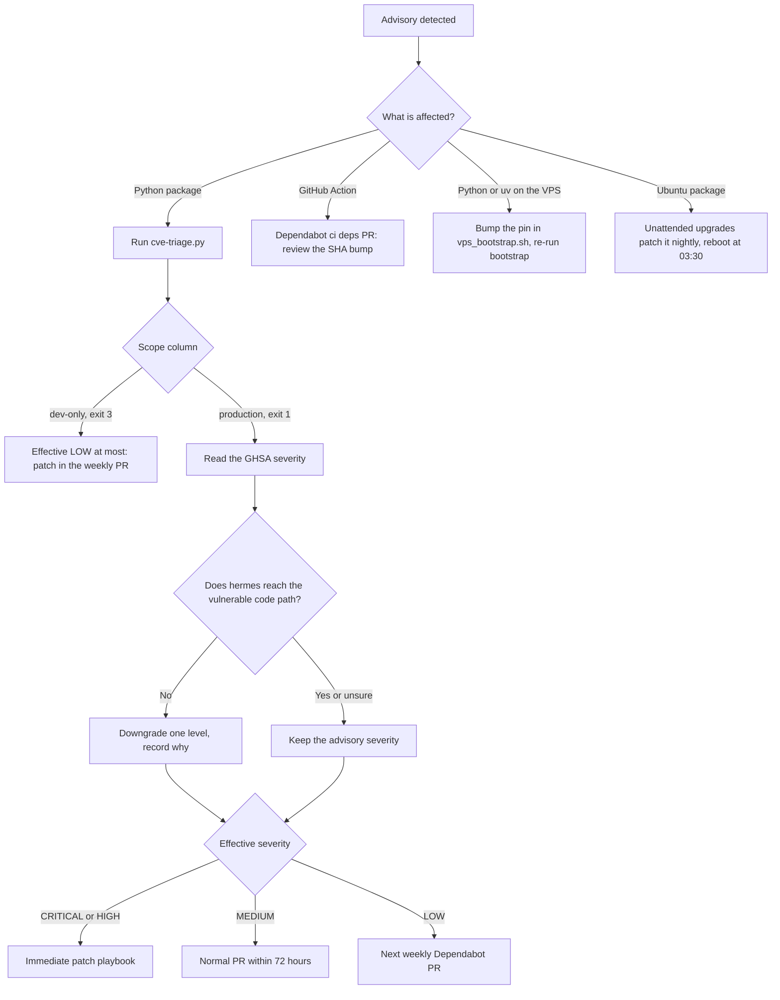
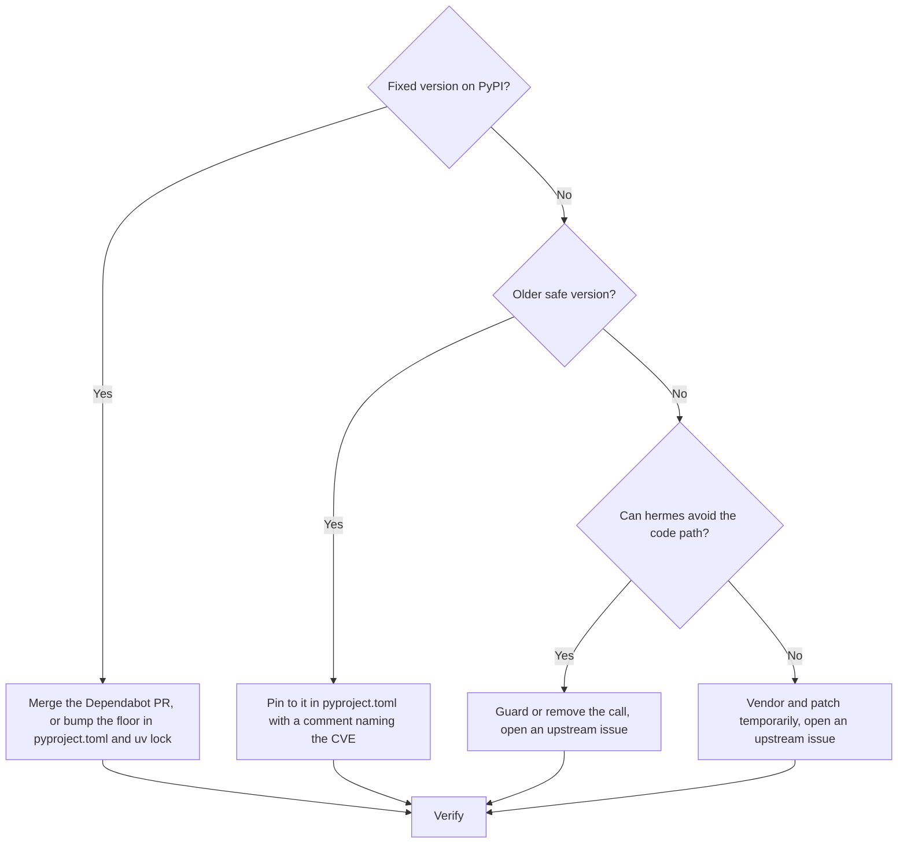
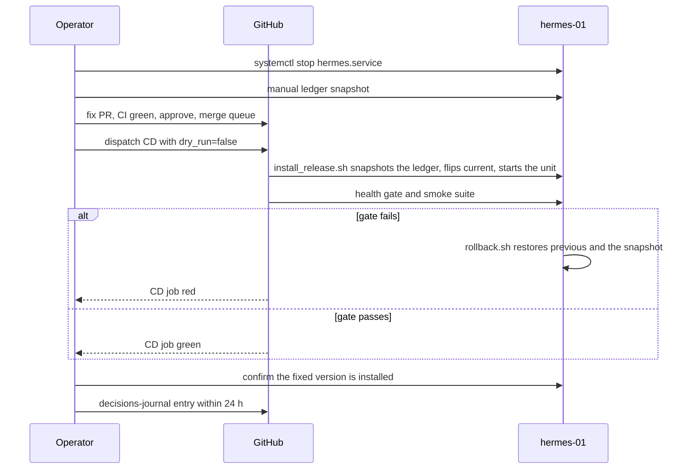

# Runbook: CVE response

**Type**: Runbook (incident-response entry per ADR-009 §4)
**Owners**: Code Owner
**Last exercised**: 2026-10-04 (tabletop drill against real advisories, see
[Drill log](#drill-log))
**Related**: [ADR-010](../architecture/adr-010-dependency-management-and-supply-chain.md)
§CVE-response process,
[Dependabot over Renovate](../decisions/2026-08-21-dependabot-over-renovate.md),
[Drop `safety`](../decisions/2026-08-22-drop-safety.md),
[Dependency-upgrade checklist](../decisions/2026-08-24-dependency-upgrade-checklist.md),
[VPS restart procedure](vps-restart-procedure.md), GH #37

ADR-010 sets the policy: detect, triage within 24 hours, assess
exploitability, patch, verify, communicate. This page is the procedure
with today's tooling. Two names in the ADR have moved since it was
accepted, and this page uses the current ones:

| ADR-010 says                | Today                                                                                   |
| --------------------------- | --------------------------------------------------------------------------------------- |
| Renovate `security` PR      | Dependabot security update PR (one PR per advisory, never grouped)                      |
| `safety` + `pip-audit` scan | `pip-audit` on every PR, plus `scripts/dev/cve-triage.py` for triage                    |
| `hermes engine pause`       | `systemctl stop hermes.service` (no pause command exists yet)                           |
| `hermes backup --snapshot`  | The pre-deploy ledger snapshot `install_release.sh` takes, or the manual snapshot below |
| "release workflow"          | The `CD` workflow (`.github/workflows/cd.yml`), dispatched by hand                      |

## Symptom

Any one of:

- A Dependabot security PR opens, titled `chore(deps): bump <pkg> from
  X to Y` (or `ci(deps): ...` for a GitHub Action), outside the Monday
  grouped PR. Security updates skip the weekly group and the 7-day
  cooldown.
- A Dependabot alert in **Security → Dependabot alerts**, or its email.
- The `deps` step (`uv run pip-audit --skip-editable`) goes red on a PR
  or on main, with `Found N known vulnerabilities in M packages`. The
  advisory is new, not something the PR added.
- The daily **Semgrep (SAST)** job in `scheduled.yml` fails on a rule
  in `p/security-audit`.
- An advisory reaches you from outside (mailing list, GitHub advisory
  database, a project's release notes) for a package, an Action, Python
  3.14, uv, or the VPS's Ubuntu.

## Triage flow



### 1. Split production from dev-only

```bash
uv sync --frozen
uv run python scripts/dev/cve-triage.py
```

Exit 0: nothing to do. Exit 1: at least one advisory in a package that
ships to the VPS. Exit 3: advisories only in dev tools (pytest, ruff,
mypy and the rest), which never leave CI or your laptop. The table it
prints goes straight into the incident issue.

"Production" means pinned in `uv export --no-dev`, the same list the CD
`bundle` job installs on `hermes-01`. A dev-only advisory can still hurt
CI (the runners hold the `GITHUB_TOKEN`), so it gets patched, but never
through the immediate playbook.

### 2. Assign severity

Open the advisory link from the table. GitHub states a severity on each
GHSA; use it as the starting point.

| Advisory severity | Starting severity | Deadline from detection      |
| ----------------- | ----------------- | ---------------------------- |
| Critical, High    | CRITICAL / HIGH   | Patched and deployed in 24 h |
| Moderate          | MEDIUM            | Merged in 72 h               |
| Low               | LOW               | Next Monday grouped PR       |

### 3. Assess exploitability

The advisory text often overstates reach. Answer these from the code,
with `rg` and the advisory's "affected functions", before downgrading:

1. Does `src/hermes` import the package directly, or only through a
   dependency? `uv tree --invert --package <pkg>` shows who pulls it in.
2. Does any hermes code path call the affected function or feature?
3. Does the input that triggers it come from outside? On `hermes-01`
   the outside inputs are exchange REST and WebSocket responses,
   Telegram updates, the FX rate feed and the env file.
4. Is the real-money path in reach? While `HERMES_ALLOW_MAINNET=no` it
   is not, but a CVE that leaks secrets (API keys, the Telegram token)
   is HIGH regardless.

Unreached path: downgrade one level and write the reason in the issue.
Unsure: keep the advisory's severity.

## Response

### Open the incident issue

```bash
bash scripts/dev/create-issue.sh \
  --title "security: CVE-YYYY-NNNNN in <pkg> <version>" \
  --label type:fix --label area:security --label p1 --label size:s \
  --milestone "<current milestone>" --assignee rafo-claude-bot \
  --body-file /tmp/cve-issue.md
```

The body holds the `cve-triage.py` table, the severity, the
exploitability answers and the plan (fix or mitigate). Add `sev-1`
for CRITICAL / HIGH in production, `sev-2` for MEDIUM.

### Fix or mitigate



A Dependabot security PR only moves `uv.lock`. If the fix needs a new
floor in `pyproject.toml` (so a later lock cannot pick the vulnerable
version again), push that to the same branch or open your own PR.

Every fix PR goes through the normal flow: green CI, conflict-free,
Code Owner approval, merge queue. There is no bypass, including for
CRITICAL. The changelog fragment type is `security`
(`changelog.d/<issue>-security.md`).

### Immediate patch playbook (CRITICAL / HIGH in production)



Stop the engine only when the vulnerable path is reachable from outside
input while it runs. If stopping buys nothing, skip the first two steps.

```bash
# 1. Stop the engine. Reason goes in the incident issue.
ssh hermes-01 'sudo systemctl stop hermes.service'

# 2. Manual ledger snapshot (the box has no sqlite3 CLI; this is the
#    same online backup install_release.sh takes).
ssh hermes-01 "sudo -u hermes /opt/hermes/current/.venv/bin/python -c \
  'import sqlite3; s=sqlite3.connect(\"/var/lib/hermes/hermes.sqlite3\"); \
   d=sqlite3.connect(\"/var/lib/hermes/backups/cve-YYYY-NNNNN.sqlite3\"); s.backup(d)'"

# 3. Merge the fix PR through the normal flow, then deploy main.
gh workflow run cd.yml --ref main -f dry_run=false
gh run watch "$(gh run list --workflow cd.yml --limit 1 --json databaseId -q '.[0].databaseId')"

# 4. Confirm the fixed version is what runs.
ssh hermes-01 '/opt/hermes/current/.venv/bin/python -m pip show <pkg> | head -2'
ssh hermes-01 'systemctl is-active hermes.service'
```

The deploy restarts the unit itself, so step 3 brings the engine back.
If the gate fails, `install_release.sh` rolls back to `previous` with
the pre-deploy snapshot and the job goes red; `previous` still carries
the vulnerable version, so stop the unit again and fix forward. A
by-hand rollback is
`ssh hermes-01 HERMES_RESTORE_DB=/var/lib/hermes/backups/pre-<sha12>.sqlite3 /opt/hermes/bin/rollback.sh`
(see [`scripts/deploy/rollback.sh`](../../scripts/deploy/rollback.sh)).

### Verify

```bash
uv sync --frozen
uv run python scripts/dev/cve-triage.py      # expect exit 0
uv run pytest -q                             # full suite
```

On the VPS: the `pip show` above reports the fixed version, the health
check is green, and the next 4h bar closes in the journal
(`journalctl -u hermes --since "4 hours ago"`).

ADR-010's bar: zero advisories on production packages. A dev-only
advisory with no upstream fix may stay open, recorded in the issue.

## Communicate

The stakeholders are the Code Owner and any collaborator with write
access. hermes has no external consumers, so there is no public
disclosure.

| When                        | Where                                         | What                                             |
| --------------------------- | --------------------------------------------- | ------------------------------------------------ |
| On triage                   | The incident issue                            | Triage table, severity, plan                     |
| Engine stopped or restarted | Telegram (the operator alert chat)            | One line: CVE id, stopped or back, issue link    |
| Fix merged and deployed     | The incident issue, then close it             | PR link, deployed sha, verify output             |
| Within 24 h of resume       | `docs/decisions/YYYY-MM-DD-cve-YYYY-NNNNN.md` | CVE id, fix, assessed exploitability, follow-ups |

The decisions-journal entry is required for CRITICAL / HIGH and
optional for the rest. Use the
[journal format](../decisions/README.md#entry-format).

## Post-incident review

Answer in the incident issue before closing it:

- Which signal caught it first, and how long after the advisory was
  published?
- Was the triage severity right, in hindsight?
- Did the deploy or the rollback do anything unexpected?
- Should a scanner, an alert or this runbook change?

## Prevention

- Dependabot security updates and alerts:
  [`.github/dependabot.yml`](../../.github/dependabot.yml).
- `pip-audit` on every PR: the `deps` step in
  [`.github/workflows/ci.yml`](../../.github/workflows/ci.yml).
- Actions pinned to commit SHAs, kept current by the `github-actions`
  Dependabot ecosystem (#481).
- Daily Semgrep SAST: [`.github/workflows/scheduled.yml`](../../.github/workflows/scheduled.yml).
- Secrets scan (gitleaks) in pre-commit and CI.
- Hash-pinned release bundle (`uv export` with `--hash`) and unattended
  Ubuntu security upgrades on `hermes-01`
  ([`scripts/deploy/vps_bootstrap.sh`](../../scripts/deploy/vps_bootstrap.sh)).

## Drill log

| Date       | Kind     | Scope                                       | Result |
| ---------- | -------- | ------------------------------------------- | ------ |
| 2026-10-04 | Tabletop | Detect, triage, severity on real advisories | Pass   |

**2026-10-04.** The live tree was clean (`pip-audit --skip-editable`
found no known vulnerabilities; `cve-triage.py` exit 0). To exercise
triage on real advisories, the drill audited a requirements file
pinning `idna==3.6` and `requests==2.31.0` with
`pip-audit -r <file> --no-deps -f json` and fed the output to
`cve-triage.py --audit-json` against the live `uv export --no-dev`.
It reported 5 unique advisories (pip-audit listed some twice) and
exited 1:

- `idna` came out **production** (it ships via `anyio` and `httpx`): CVE-2024-3651
  (GHSA-jjg7-2v4v-x38h, fixed in 3.7) and CVE-2026-45409
  (GHSA-65pc-fj4g-8rjx, fixed in 3.15). The lock already pins 3.19, so
  the real tree is not exposed.
- `requests` came out **dev-only**: CVE-2024-35195, CVE-2024-47081 and
  CVE-2026-25645. It is not in the production export, so the
  immediate playbook would not apply.

Not exercised: the stop, deploy and rollback legs on `hermes-01`. They
run the same `cd.yml` path as every deploy. Exercise them end to end
before Phase 3 sign-off, per GH #37.
