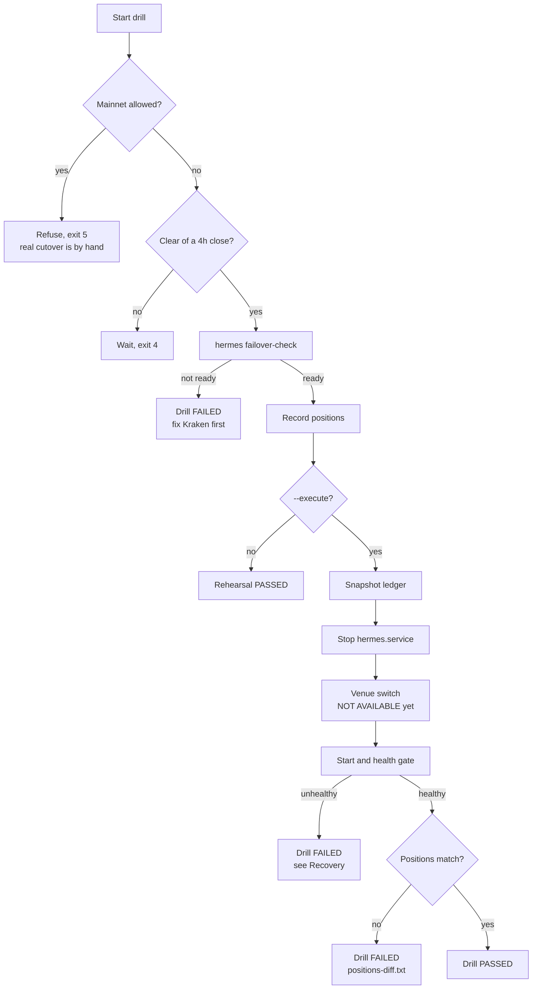
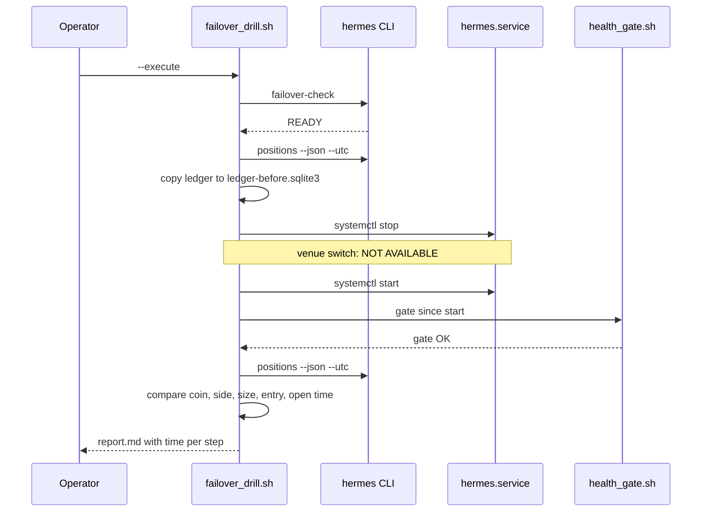

# Runbook: failover to Kraken (monthly drill and real cutover)

**Type**: Runbook (incident-response entry per ADR-009 §4)
**Owners**: Code Owner
**Last exercised**: never. Record the date of the first drill here.
**Related**: [ADR-004](../architecture/adr-004-exchange-decision.md)
(Decision 3 and 6), issue #31,
[VPS restart procedure](vps-restart-procedure.md),
[VPS operations](../guides/vps-operations.md)

ADR-004 keeps Kraken as a cold-but-ready backup for Binance and asks for a
written, rehearsed cutover with a 90-minute target. This entry holds the
monthly drill that keeps the claim honest, and the cutover itself for the
day Binance is no longer usable.

## What works today and what does not

The drill is honest about the gaps: a step that cannot run yet is reported
as `NOT AVAILABLE`, never skipped silently.

| Piece | State | How it is checked |
| --- | --- | --- |
| Kraken market data (closed 4h and 1d bars) | Works | `hermes failover-check` compares the last closes with Binance |
| Kraken pair symbols for BTC, ETH and SOL against USDT | Works | Same check; it caught the wrong ETH/USDT symbol fixed in #31 |
| Kraken fee schedule | Adapter exists (public endpoint) | Not checked by the drill yet |
| Stop and restart of `hermes.service` with positions intact | Works | `failover_drill.sh --execute` |
| A venue setting in `hermes serve` | Missing | Serve reads Binance only; the drill reports the step as `NOT AVAILABLE` |
| Signed Kraken trading (orders, balances) | Missing | Needed before real capital; ADR-004 Decision 2 |
| Capital transfer and reconciliation | Manual | Timed by hand during a real cutover |

## Symptom

A real cutover starts from one of these. A drill starts from the calendar.

- Binance announces a residency or KYC change the account cannot meet
  (the account-terms risk in ADR-004).
- Binance freezes withdrawals or trading for the account.
- `hermes health market_data` fails for more than a day while Kraken's
  public API answers.

## Diagnosis

```bash
# 1. Is Binance down for everyone or only for us? Public data first.
ssh hermes-01 'sudo bash -c "set -a; . /etc/hermes/env.production; set +a; \
  cd /var/lib/hermes && runuser -u hermes -- /opt/hermes/current/.venv/bin/hermes health market_data"'
# OK -> data is fine; the problem is the account, not the venue.

# 2. Can Kraken stand in right now?
ssh hermes-01 'sudo bash -c "set -a; . /etc/hermes/env.production; set +a; \
  cd /var/lib/hermes && runuser -u hermes -- /opt/hermes/current/.venv/bin/hermes failover-check"'
# Expected last line: verdict: READY
```

`hermes failover-check` exit codes: 0 Kraken ready, 1 not ready (a pair is
unreachable, missing a bar or more than 50 bps off), 2 usage, 3 config.

## Monthly drill (shadow mode)

Run it on the first weekend of the month, away from a 4h bar close
(00, 04, 08, 12, 16 and 20 UTC). The script refuses from 20 minutes before
to 10 minutes after a close (exit 4), so a restart never costs a bar.



### Steps

The script is not installed on the box by the deploy yet, so copy it from
an up-to-date checkout. `hermes failover-check` must be in the deployed
release (any release after #31 merged).

```bash
# From your checkout (Git Bash on Windows):
git pull
scp scripts/deploy/failover_drill.sh hermes-01:/tmp/failover_drill.sh

# 1. Rehearsal: read-only, changes nothing.
ssh hermes-01 'sudo bash /tmp/failover_drill.sh'

# 2. Full drill: restarts hermes.service once.
ssh hermes-01 'sudo bash /tmp/failover_drill.sh --execute'
# Last line: drill PASSED: report at /var/lib/hermes/backups/drills/<stamp>/report.md

# 3. Read the report.
ssh hermes-01 'sudo cat /var/lib/hermes/backups/drills/*/report.md | tail -n 20'
```

What the full drill does, in order:



`failover_drill.sh` exit codes: 0 passed, 1 a step failed (the report names
it), 2 usage, 4 too close to a bar close, 5 refused because
`HERMES_ALLOW_MAINNET` is on.

The positions check compares coin, timeframe, side, size, entry price and
open time. The stop price is left out because a trailing stop may move
between the two snapshots.

### After the drill

1. Update **Last exercised** at the top of this file.
2. Comment on #31 with the report's table and the total time.
3. If a step failed, open an issue with the Post-incident review questions
   below.

## Recovery

### The drill left hermes.service down or unhealthy

The drill installs nothing, so there is no release to roll back. Look first,
then start the unit.

```bash
ssh hermes-01 'systemctl status hermes.service --no-pager -l | head -30'
ssh hermes-01 'sudo journalctl -u hermes.service --since "-15 min" --no-pager | tail -50'
ssh hermes-01 'sudo systemctl start hermes.service'
```

Restore the drill's ledger snapshot only if `hermes status` shows the ledger
damaged. Events written after the snapshot are lost by the restore.

```bash
ssh hermes-01 'sudo systemctl stop hermes.service'
ssh hermes-01 'sudo cp /var/lib/hermes/backups/drills/<stamp>/ledger-before.sqlite3 /var/lib/hermes/hermes.sqlite3 \
  && sudo chown hermes:hermes /var/lib/hermes/hermes.sqlite3'
ssh hermes-01 'sudo systemctl start hermes.service'
```

### Real cutover (real capital)

Not possible end to end yet: serve has no venue setting and there is no
signed Kraken adapter. This is the order the cutover will follow once both
exist, with the time budget from ADR-004 Decision 6. Steps marked
"by hand" have no tooling and are timed with a stopwatch.

```mermaid
gantt
    title Cutover budget, 90 minutes
    dateFormat mm
    axisFormat %M min
    section Stop
    Pause engine and wait for no in-flight orders :a1, 00, 10m
    Snapshot ledger and stop the unit            :a2, after a1, 5m
    section Switch
    Check Kraken API keys (by hand)              :b1, after a2, 10m
    Move capital to Kraken (by hand)             :b2, after b1, 40m
    Switch venue in config and start             :b3, after b2, 10m
    section Verify
    Reconcile balances and positions             :c1, after b3, 15m
```



1. Pause the engine and wait until no order is in flight, as in
   [VPS restart procedure](vps-restart-procedure.md) Case B.
2. Run `hermes failover-check`. Do not continue unless it says `READY`.
3. Snapshot the ledger and stop `hermes.service`.
4. Check the Kraken API key works and is trade-only (no withdrawals).
5. Move capital to Kraken. Each transfer is a tax event; record it per
   ADR-002.
6. Switch the venue in config and start the unit (needs the venue setting).
7. Reconcile: Kraken balances against the ledger's positions.
8. Record the total time against the 90-minute target.

## Post-incident review

Open a retrospective issue after every failed drill and every real cutover:

- Which step failed or ran over its budget?
- Why did it fail?
- Why did `hermes failover-check` not warn earlier?
- Is there a code fix that prevents it next month?

## Prevention

- ADR-004 Decision 6: the drill is scheduled and its time is recorded.
- `hermes failover-check` can run any day without risk; run it before
  every real-capital milestone.
- Gaps to close before real capital: the venue setting in serve, the signed
  Kraken adapter, and installing `failover_drill.sh` to `/opt/hermes/bin`
  with the other release scripts.
