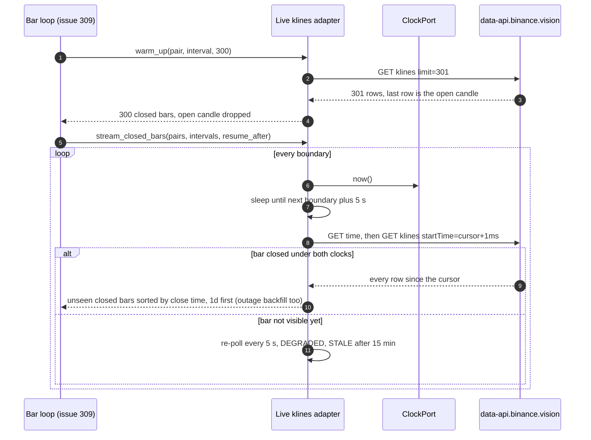
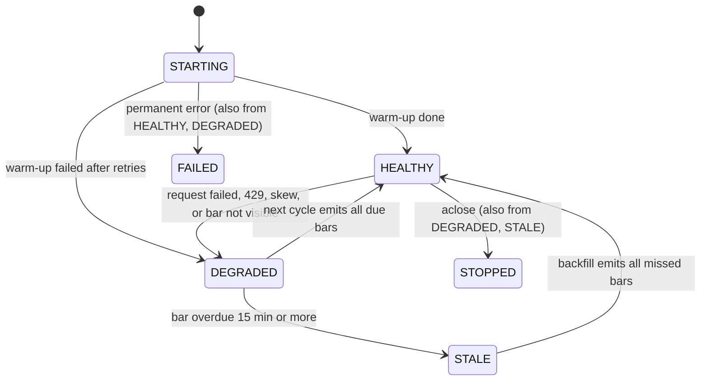

# Change: 307-live-bar-stream

**SDD change**: `307-live-bar-stream`
**Date**: 2026-10-02
**Status**: Shipped
**Tracking issue**: see sibling `issue.md` (#307, parent #301)

Mirror of engram topic key `sdd/live-bar-stream/change` (see
[ADR-009 §6](../../../docs/architecture/adr-009-documentation-strategy.md#6-change-specs--sdd-artifacts-dual-source-convention)
dual-source rule).

## TL;DR

- **Source (DECIDED by Code Owner, 2026-10-03)**: poll Binance public REST klines 5 s after each 4h and
  1d close, not the WebSocket in the issue title (D-1).
- **Host (DECIDED by Code Owner, 2026-10-03)**: `data-api.binance.vision`, public market data only: GET only, no keys, no link to
  `allow_mainnet` (D-2). Testnet is rejected: its 12:00 UTC bar today has a 75,000.00 low, the real
  market 85,162.90.
- **Both intervals**: the strategy never enters without 1d bars (`adapter.py:197-199`). Warm-up: 300
  bars per stream (D-4).
- **Order**: close time first, 1d before 4h at the same instant (D-5). The calibration script sorts by
  open time, up to 16 hours of look-ahead for the EMA filter (`run_calibration.py:228`).
- **Your call**: 5 PROPOSED decisions (D-3 to D-7). D-1 and D-2 are DECIDED. D-8, the governance question that live bars fall
  inside the pre-registered OOS dates, is DECIDED: forward testing stays available.

## Summary

Adds the live closed-bar source the shadow loop needs. An async adapter polls the public klines endpoint
for BTC/USDT, ETH/USDT and SOL/USDT at 4h and 1d, emits each closed bar once in a deterministic order and
reports its own health. It ships with a `ClosedBarFeedPort`, a config file with a host allow-list and a
`hermes health market_data` probe. The main pick is REST polling over a WebSocket (D-1). The main risk is
D-8, a pre-registration question, not a code one, now DECIDED and recorded in a decisions entry. Wiring into
`hermes serve` stays with #309.

## Scope

### In

- NEW `adapters/market_data/binance_live_klines.py`, `domain/market_data/bar_schedule.py` (pure time
  functions), `ports/bar_feed.py` (`ClosedBarFeedPort`, `SourceHealth`).
- NEW `config/market_data.yaml`; `MarketDataConfig` in `models.py`, `root.py`, `loader.py`.
- EDIT `entrypoints/_health.py`: `market_data` probe.
- NEW `docs/decisions/2026-10-02-binance-public-market-data-host.md`, superseding the mainnet-reads
  stance of the 2026-08-23 entry, whose "What would change this decision" (lines 96-99) asks for it.
- NEW `docs/decisions/2026-10-02-forward-testing-during-oos-window.md`, recording the D-8 reading of
  pre-registration v1: a forward feed holds no future data, and warm-up only primes buffers. Its
  description carries the guardrail paragraph quoted in D-8.
- NEW tests, recorded fixtures, `changelog.d/wave-live-bar-stream.md`.

### Out

- Serve wiring, bar loop, notifier fan-out, warm-up seeding without signals (#309); `SignalEmitted`,
  portfolio state (#308); unit file and deploy (sibling specs).
- Order book diffs stay on `BinanceLiveWsAdapter`, whose default hosts are the full trading hosts
  (`binance_live_ws.py:80-81`); moving them is a follow-up. Also out: the open-time sort in the
  calibration script (own issue), 1m and 1h bars, trades, Kraken fallback.

Inherited, not re-opened (DECIDED by the Code Owner): shadow mode is live market data plus
`SimulatedExchangeAdapter` (ADR-011 working architecture); `HERMES_SHADOW` is a dead flag (#175).

## Decisions

D-1 and D-2 are DECIDED by the Code Owner (2026-10-03). D-3 to D-7 are PROPOSED. D-8 is DECIDED.

### D-1: Poll REST klines instead of a WebSocket stream

- **Status**: DECIDED by Code Owner, 2026-10-03. **Decision**: poll `GET /api/v3/klines` after each close (timing in D-3).
- **Alternatives**: A, the public kline WebSocket (issue title); C, testnet data.
- **Rationale**: A is B plus a connection lifecycle plus a new dependency; its sub-second latency buys
  nothing for a strategy that evaluates once per 4h (`adapter.py:6`) and fills at the next bar open
  (ADR-011 D-10). C fails on fidelity.

| | A: kline WebSocket | B: REST polling | C: testnet data |
| --- | --- | --- | --- |
| New dependency | `websockets`: 0 hits in `pyproject.toml`, `uv.lock` | none | none |
| Lifecycle | valid 24 h, ping every 20 s, 300 connects per 5 min per IP | none | none |
| Gap after a drop | still needs REST backfill | built in (cursor) | built in |
| Test tooling | fake WS server; today's only test of the stream loop covers the missing-package path (`test_binance_live_ws.py:443-458`) | `respx` | `respx` |

  Evidence: Binance docs fetched 2026-10-02 (24 h, ping, `x` closed flag). GET on 2026-10-02, BTCUSDT 4h
  bar opening 12:00 UTC: real market low 85162.90, volume 6577.59; testnet low 75000.00, volume 213.05.
  The testnet range (12,745.57 against 2,057.10) distorts ATR, Donchian and Chandelier.

- **Cost of reversal**: LOW. Both sources sit behind `ClosedBarFeedPort`.

### D-2: Market-data-only host, enforced three ways

- **Status**: DECIDED by Code Owner, 2026-10-03. **Decision**: only `https://data-api.binance.vision`, enforced by (1) a
  `MarketDataConfig` host allow-list, (2) an adapter that sends only GET to `/api/v3/klines` and
  `/api/v3/time` and has no key or signature code, (3) tests that fail on any other verb, path or
  credential header.
- **Alternatives**: `api.binance.com` (trading endpoints live there, AGENTS.md prohibition #7); testnet.
- **Rationale**: public market data is unauthenticated and read-only, so it is not a real-capital API.
  Binance documents this host as public market data only; observed header
  `Access-Control-Allow-Methods: GET, HEAD, OPTIONS`. The `allow_mainnet` validator (`root.py:96-109`)
  governs trading adapters and is untouched; the source works with `allow_mainnet=false` in prod.
- **Cost of reversal**: LOW.

### D-3: Closed-bar rule and timing

- **Status**: PROPOSED. **Decision**: a bar is closed when `open_time + interval + settle <=
  min(local clock, exchange clock)`. Local: `ClockPort.now()`. Exchange: one `GET /api/v3/time` per
  cycle. `settle` is 5 s. The poller sleeps until the next boundary plus `settle` through an injected
  callable (as `rate_limiter.py:80-81`), so tests advance a `SimulatedClock` and never wait.
- **Alternatives**: drop the last row of each response (ignores skew); local clock only (a clock ahead by
  more than `settle` freezes a partial bar into the evidence); wait for the next bar's first row (fails
  when a window has no trade).
- **Rationale**: ADR-011 D-10 needs the bar closed before `on_bar`; D-15 keeps clock reads out of the
  domain. With the minimum of both clocks, skew can only delay a bar.
- **Cost of reversal**: LOW.

### D-4: Streams and warm-up depth

- **Status**: PROPOSED. **Decision**: 3 pairs (pre-registration v1 section 3) by 2 intervals (4h, 1d).
  Warm-up is 300 closed bars per stream. Config floors: 45 (4h), 200 (1d). 1d is mandatory: an empty
  1d buffer blocks every entry (`adapter.py:197-199`).
- **Rationale**: per-engine needs, read from the code:

| Engine | Needs | Reads at most | Source |
| --- | --- | --- | --- |
| Donchian(20), 4h | 21 | 21 | `donchian.py:63` |
| ATR(14), 4h | 15 | 29 | `atr.py:75,80` |
| Chandelier, ATR(22), 4h | 23 | 45 | `atr.py:75,80` |
| ADX(14), 4h | 29 | 43 | `adx.py:93,98` |
| EMA(200), 1d | 200 | 600, capped to 300 | `ema.py:57,64`, `adapter.py:78` |

  4h values stop changing at 45 bars. The strategy caps both buffers at 300 (`adapter.py:77-78`), so
  seeding 300 matches a long-running backtest; only a full 1d buffer gives steady-state EMA values.
  `macro_atr_halt` reads `MarketSnapshot.btc_log_return_1d` (`macro_atr_halt.py:53`) and nothing in
  `src/` builds a `MarketSnapshot`, so it is not a shadow-path consumer yet; BTC/USDT 1d already covers it.

- **Alternatives**: 100 bars (short for the EMA); 4h only (the strategy never enters).
- **Cost of reversal**: LOW (config).

### D-5: Ordering, dedupe and gap healing

- **Status**: PROPOSED. **Decision**: one shared poller serves all streams through
  `stream_closed_bars(pairs, intervals, resume_after=None)`. Output is sorted by (close time, larger
  interval first, pair), each `(pair, interval, open_time)` at most once. A pair's boundary completes
  only when all its due intervals are visible, so a 4h bar never precedes the 1d bar closing at the same
  instant. Each stream keeps a cursor (last emitted `open_time`) and every poll asks
  `startTime = cursor + 1 ms`, so one request also returns the bars missed in an outage.
  `stream_bars(pair, interval)` (the existing port) filters the same poller.
- **Alternatives**: one poller per stream (two tasks race at 00:00 UTC); sort by open time like the
  calibration script (the day-N 1d bar reaches the strategy before the 4h bars opening 04:00 to 20:00).
- **Rationale**: `adapter.py:26-28` says buffers hold bars with `close_time <=` the current bar's;
  spec-5 D-3 says the regime uses the 1d bar that already closed. Equal close time plus `<=` puts 1d first.
- **Cost of reversal**: MEDIUM (strategy behaviour depends on the order).

### D-6: Error policy and rate-limit budget

- **Status**: PROPOSED. **Decision**: ADR-003 §04 (`04-exchange-adapters.md:105`): idempotent reads
  retry 3 times, waiting 100, 200, 400 ms; transport errors and 5xx retry. 429 and 418 do not retry (as
  `binance_klines.py:25-30`); the poller waits `Retry-After`. Other 4xx (451 included) and schema or
  domain-invariant errors are permanent: `ExchangeError`, state FAILED. When retries run out on a
  transient error the cycle does not raise: DEGRADED, re-poll every 5 s, every 30 s once STALE.
- **Budget**: klines weight 2, time weight 1 (verified, see Design). Happy path 48 weight per day,
  warm-up 12 once, incident worst case about 160 per minute. Bucket 600 per minute (10 percent of the
  6000 cap) via `RateLimiter.try_acquire` plus `anyio.sleep`, so the loop never blocks.
  (`binance_klines.py:70-72` still says weight 1; untouched here.)
- **Alternatives**: raise after retries, the literal port text (`market_data.py:60-63`): a 2-minute
  outage kills the generator. Absorb every error: hides a wrong URL.
- **Cost of reversal**: LOW.

### D-7: Health surface

- **Status**: PROPOSED. **Decision**: in process, `health()` returns `SourceHealth` (states below). Out of
  process, `hermes health market_data` is a stateless probe: every check is a pure function of the env
  (`_health.py:407-409`) and cannot read the service's memory. It fails (exit 1) when the source is
  unreachable, skew exceeds `settle`, or the newest closed BTC/USDT 4h bar is older than
  `stale_after_seconds` past its close. "Service is alive" stays with the Healthchecks.io ping from #309.
- **Alternatives**: probe reads a status row written by serve (new persistence, #309); probe only calls
  `/time` (misses a stale feed).
- **Cost of reversal**: LOW.

### D-8: Live bars inside the OOS dates (DECIDED by Code Owner, 2026-10-02)

- **Status**: DECIDED. The Code Owner said: "We should start back and forward testing when possible, so
  we need to have this available too." **Decision**: both stay available. Forward testing (shadow on
  live data) is not wrapped by `DataSplitEnforcer`; backtesting on in-sample history keeps the enforcer
  on historical reads. Warm-up depth stays at D-4.
- **Facts**: pre-registration v1 puts OOS at 2025-09-01 to 2026-12-31 and says code refuses to read it
  outside certification (`pre-registration-v1.md:80`). `DataSplitEnforcer` raises on any bar opening in
  that window (`data_split_enforcer.py:146-162,185-187`). Today is 2026-10-02, so every live bar is
  inside it, and so is the 1d warm-up (starts December 2025, observed). `serve.py` wires no enforcer
  (`serve.py:184-187`).
- **Rationale**: the rule stops tuning on held-out history; a forward feed holds no future data and
  warm-up only primes buffers. This reading of the pre-registration is recorded in
  `docs/decisions/2026-10-02-forward-testing-during-oos-window.md`. The entry's description includes this
  paragraph, labelled as written here: "Proposed guardrail, Code Owner confirms at PR review: shadow
  observations made inside the OOS window must not motivate parameter changes before OOS certification;
  if they do, the new pre-registration treats that period as in-sample and certifies on later data."
- **Alternatives**: wrap with the enforcer (blocks every bar until 2027-01-01); certification mode
  (defeats the guard); amend the pre-registration to exempt the shadow phase.
- **Cost of reversal**: HIGH (touches the experiment's integrity claim).

## Requirements

### R-1: Behaviour

- **A-1.1**: `uv run pytest tests/unit/adapters/market_data tests/unit/domain/market_data -q` exits 0, including the property tests (no duplicate, monotonic close times, no gap after backfill, no open candle) and the D-6 error cases.
- **A-1.2**: `uv run pytest tests/unit/infrastructure/config -k market_data -q` exits 0 (floors 45 and 200, host allow-list).
- **A-1.3**: `uv run python -c "from hermes.infrastructure.config import load_config; print(load_config().market_data.pairs)"` exits 0.

### R-2: Safety, layering, health, contract

- **A-2.1**: a test shows every request is GET to one of two paths, with no `X-MBX-APIKEY` header and no `signature` parameter; `rg -n "api\.binance\.com|stream\.binance\.com" src/hermes/adapters/market_data/binance_live_klines.py` exits 1.
- **A-2.2**: `rg -n "datetime\.now|time\.time\(" src/hermes/domain src/hermes/adapters/market_data/binance_live_klines.py` exits 1; `uv run lint-imports` exits 0.
- **A-2.3**: `uv run python -c "from hermes.entrypoints._health import registered_integrations as r; assert 'market_data' in r()"` exits 0; probe tests cover OK, stale, skew, unreachable.
- **A-2.4**: `uv run pytest -m contract tests/contract/test_binance_public_klines.py -q` exits 0 (nightly, read-only); a plain `uv run pytest` still deselects it (`pyproject.toml:141`).
- **A-2.5**: `ls docs/decisions/2026-10-02-forward-testing-during-oos-window.md` exits 0, and `rg -q "Proposed guardrail, Code Owner confirms at PR review" docs/decisions/2026-10-02-forward-testing-during-oos-window.md` exits 0.

## Design

### One poll cycle, with warm-up and backfill



### Source health



### Interfaces

```python
# ports/bar_feed.py. SourceHealth(state, overdue_seconds, consecutive_failures, last_closed,
# clock_skew_ms, used_weight_1m) is a frozen dataclass; used_weight_1m is the x-mbx-used-weight-1m header.
class ClosedBarFeedPort(Protocol):  # runtime_checkable
    async def warm_up(self, pair: Pair, interval: KlineInterval, count: int) -> list[Bar]: ...
    def stream_closed_bars(
        self,
        pairs: Sequence[Pair],
        intervals: Sequence[KlineInterval],
        *,
        resume_after: Mapping[tuple[Pair, KlineInterval], datetime] | None = None,
    ) -> AsyncIterator[Bar]: ...
    def health(self) -> SourceHealth: ...
    async def aclose(self) -> None: ...


# domain/market_data/bar_schedule.py: every function takes its time as an argument
def next_boundary(
    now: datetime, interval: KlineInterval
) -> datetime: ...  # after now, UTC-epoch aligned
def is_closed(
    open_time: datetime,
    interval: KlineInterval,
    *,
    local_now: datetime,
    exchange_now: datetime,
    settle: timedelta,
) -> bool: ...
def delivery_key(bar: Bar) -> tuple[datetime, float, str]: ...  # (close_time, -duration_s, pair)


# adapters/market_data/binance_live_klines.py: also stream_bars (a filter over the shared poller);
# stream_trades, stream_orderbook_diffs, get_snapshot raise NotImplementedError (binance_historical.py:241-262).
class BinanceLiveKlinesAdapter:
    def __init__(
        self,
        *,
        config: MarketDataConfig,
        clock: ClockPort,
        client: httpx.AsyncClient,
        limiter: RateLimiter,
        sleep: Callable[[float], Awaitable[None]] = anyio.sleep,
    ): ...
```

`close_time` is Binance's inclusive value (`open + interval - 1 ms`), the one the Vision archives carry
(`binance_historical.py:458-464`), so live and backtest bars compare equal.

```yaml
# config/market_data.yaml (env overrides: HERMES_MARKET_DATA__<FIELD>)
base_url: https://data-api.binance.vision   # validator allows this host only
pairs: [BTC/USDT, ETH/USDT, SOL/USDT]       # pre-registration v1 section 3
intervals: [4h, 1d]
warmup_bars_4h: 300                         # floor 45, max 999
warmup_bars_1d: 300                         # floor 200, max 999
settle_delay_seconds: 5
retry_interval_seconds: 5
slow_retry_interval_seconds: 30
stale_after_seconds: 900
timeout_sec: 10.0
rate_limit_max_weight: 600
rate_limit_window_seconds: 60
```

### Verified against the current tree (2026-10-02)

```text
$ curl -sS -D - https://data-api.binance.vision/api/v3/time   (read-only GETs only)
Date: Fri, 02 Oct 2026 21:23:16 GMT  x-mbx-used-weight: 1  Access-Control-Allow-Methods: GET, HEAD, OPTIONS
GET klines BTCUSDT 4h limit=3   -> last row opens 20:00, close_time 23:59:59.999 (the open candle)
GET testnet klines, same query  -> 12:00 bar low 75000.00, volume 213.05 (real market: 85162.90, 6577.59)
GET klines BTCUSDT 1d limit=300 -> 300 rows from 2025-12-07, x-mbx-used-weight-1m 1+2+2 = 5
GET exchangeInfo                -> REQUEST_WEIGHT 6000 per MINUTE
D-3 rule on the 4h sample (settle 5 s): 12:00 closed, 16:00 closed, 20:00 FORMING, next poll 00:00:05
$ uv run pytest tests/unit/adapters/market_data tests/unit/adapters/exchanges/test_binance_klines.py -q -> 98 passed in 68.89s
$ uv run pytest tests/contract --collect-only -q  -> no tests collected (7 deselected)
$ uv run lint-imports                             -> Contracts: 5 kept, 0 broken.
$ uv run python -c "import websockets"            -> ModuleNotFoundError
$ rg -n "datetime\.now|time\.time\(" src/hermes/domain; rg -n "MarketSnapshot\(" src -> no match, no match
```

## Test plan

Tiers touched: 1 (unit, property), 2 (integration: `respx`, fake sleep), 2b (one `contract` test). Tier 3
is not touched. One invariant per test (`docs/guides/ai-authored-tests.md`).

1. **Unit and property** (Hypothesis, timeout override where `max_examples` is high), for example
   `test_bar_is_never_closed_before_boundary_plus_settle`, `test_exchange_clock_ahead_never_advances_closure`,
   `test_delivery_puts_1d_before_4h_at_equal_close_time`, `test_interval_duration_matches_consolidator`
   (drift guard), `test_feed_never_emits_the_open_candle`, `test_each_bar_is_emitted_once_across_overlapping_polls`,
   `test_emitted_close_times_are_monotonic`, `test_backfill_after_outage_leaves_no_gap`, plus the D-6 cases.
2. **Integration**: `respx` replays recorded fixtures in `tests/fixtures/binance_public/` (the 4h sample,
   the head of the 1d sample, `/time`). One scenario runs two simulated days with a 90 minute outage and
   asserts the post-outage sequence equals the no-outage one.
3. **Contract** (`tests/contract/test_binance_public_klines.py`, no credentials, read-only): `/time`
   returns an int `serverTime`; `/klines` returns 12-field rows with ms integers, the last `close_time`
   after `serverTime`.
4. `bash scripts/dev/pr-preflight.sh` green, all CI jobs green, Code Owner confirms the guardrail paragraph of the D-8 decisions entry at PR review.

## Risks

- **R-1 Phantom position from warm-up**: replaying warm-up bars through `on_bar` evaluates signals
  (`adapter.py:179-185`); a historical entry sets `_in_position` (`adapter.py:224-226`) and the first live
  exit then closes a trade that never existed. This spec returns warm-up bars apart from the live stream;
  #309 must seed buffers without evaluating signals (a strategy `seed` method) or reset after.
- **R-2 One strategy for three pairs**: `serve.py:181` builds one `SwingStrategyAdapter` whose buffers are
  not keyed by pair (`adapter.py:122-123`). #309 needs one instance per pair.
- **R-3 Restart gap**: a bar closing while serve is down becomes warm-up history and would never be
  evaluated. #309 closes it with its own cursor, the `close_time` of the last handled bar per stream,
  stored as a `BarProcessed` ledger event (309 D-6). It seeds warm-up bars up to the cursor and evaluates
  the rest, so it passes no `resume_after`. Close time is the key everywhere, as in D-5 and #311.
- **R-4 Backtest and live disagree on order**: the calibration script sorts by open time
  (`run_calibration.py:228`), and so does the backtest driver sketch
  (`backtest-driver-mvp1-phase2/change.md:210`). Shadow will not match backtest until both sort by close
  time. Needs its own issue.
- **R-5 Real exchange gap** (maintenance): the bar never appears. The adapter logs
  `market_data.gap_detected`, goes DEGRADED and delivers what exists; Vision archives carry the same hole.
- **R-6 Source drift or block**: the contract test checks shape, not values (spot check 10 recent bars
  against a Vision file, noted in the PR body). A 451 or 403 from the VPS region is permanent and fails
  loud at warm-up; the operator confirms `GET /api/v3/time` returns 200 from hermes-01 first.

## Dependencies on other changes

- **ADR-011** is PROPOSED. Its mode table names `LiveWebSocketMarketDataAdapter` for shadow (lines
  54-55). #309's D-02 amendment should say bars come from this REST source and WebSocket stays for L2.
- **#309** consumes `ClosedBarFeedPort`. It owns one strategy per pair, warm-up seeding, checking both
  intervals are configured, the cursor, the Healthchecks ping, `aclose()`, and the `Composition` type
  at `serve.py:120`.
- **179-cd-first-real-deploy**: `config/market_data.yaml` ships with the release (PROPOSED there). No
  secrets, no new env var, no change to `/etc/hermes/env.production`.
- **Code Owner**: confirms the D-8 guardrail paragraph at PR review; retitle #307 after D-1 (not done here).
