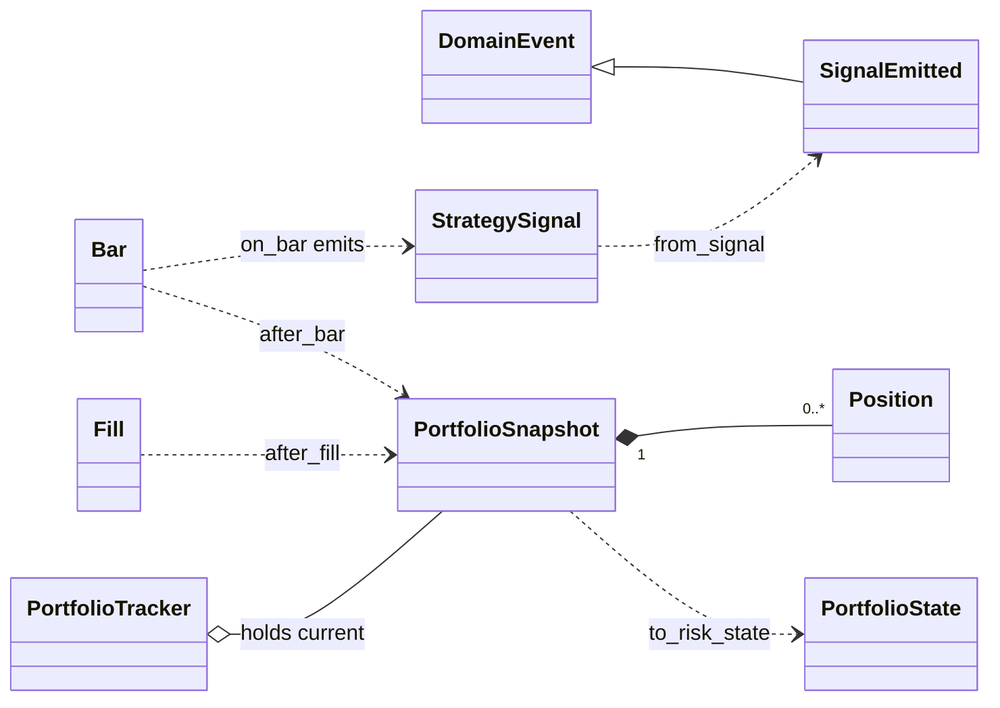
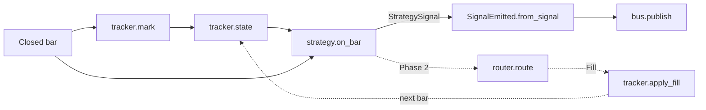

# Change: 308-signal-event-portfolio-state

**SDD change**: `308-signal-event-portfolio-state`
**Date**: 2026-10-02
**Status**: Shipped
**Tracking issue**: see sibling `issue.md` (#308, parent #301)

Mirror of engram topic key `sdd/signal-event-portfolio-state/change` (see
[ADR-009 §6](../../../docs/architecture/adr-009-documentation-strategy.md#6-change-specs--sdd-artifacts-dual-source-convention)
dual-source rule).

## TL;DR

- `SignalEmitted` domain event: signals can ride the `EventBus` and reach the ledger. Flat fields, time from the bar, no clock.
- `PortfolioSnapshot` (pure, domain) plus a thin `PortfolioTracker` (application). `PortfolioState` is not edited; the tracker hands one out.
- Phase 1 has no fills, so the tracker sits at its seed: 5000 USDT read from `config/strategies.yaml`. Fills arrive later through a direct `apply_fill` call.
- Reuses the phase-2 tracker design (#273). Changes: path, average cost instead of lots, a pure core, no `apply_rejection`.
- You approve 7 PROPOSED decisions and one config change: `strategies.yaml` becomes a swing-only roster. D-3 (strategy id) is DECIDED.

## Summary

`StrategySignal` is a plain value object (`signal.py:44`), and `on_bar` takes a `PortfolioState` that scripts build from a
constant (`run_calibration.py:77,230-235`). The tracker meant to build it was never written: #273 closed on a spec-only PR and
`src/hermes/application/backtest/` does not exist. This change adds the event and the tracker as small pure pieces; the serve
loop stays with #309. Main pick: keep `PortfolioState` as is and put cash and positions in a new snapshot beside it. Main risk:
two cash bookkeepers once fills flow, the tracker and `SimulatedExchangeAdapter._balances` (`simulated.py:120-122`); a
cross-check test pins them together. The swing adapter never reads the state (`adapter.py:137,148`); the router and risk
rules do, in Phase 2.

## Scope

### In

- NEW `domain/events/signal_emitted.py` (plus export), `domain/portfolio/` (`Position`, `PortfolioSnapshot`),
  `application/portfolio/tracker.py`; `InvalidPortfolioTransition` in `domain/errors.py`.
- Config: `config/strategies.yaml` becomes the single `swing-donchian-4h` entry with `capital_budget` and `quote` (`infrastructure/config/models.py`). #309 depends on this roster and does not edit the file.
- Docstring examples that name the id: `domain/value_objects/strategy_id.py:9,39` and `application/order_router/risk_engine.py:14` (D-3).
- Tests (see Test plan) and `changelog.d/wave-signal-event-portfolio-state.md`.

### Out

- #309: bar loop, tracker wiring in `build_composition`, publishing the event, notifier. #307: live bars.
- Router and `SimulatedExchangeAdapter` in shadow (Phase 2). This is why Phase 1 has no fills.
- Follow-up issues, filed at apply time: rebuild the tracker from the ledger on restart; `strategy_id` on `Order` and `Fill`
  (ADR-011 D-03, line 97; `rg strategy_id src/hermes/domain/trading` finds none); fix `BalanceLow` (see Risks); drop the legacy
  `DEFAULT 'swing'` on `lots.strategy_id` at the next lots-table rebuild (D-3).
- `realized_slippage_cumulative`, `correlations`, `dd_halt_required` stay `0`, empty, `False`.

## Decisions

### D-1: `SignalEmitted` is a DomainEvent (PROPOSED)

- **Decision**: the strategy still returns `StrategySignal`; the loop wraps it in `SignalEmitted` and publishes it. #308 scopes
  this; the explore left "event or direct to router" open.
- **Alternatives**: call the router directly (no ledger row, no subscriber, against ADR-011 D-16); make `StrategySignal` a
  `DomainEvent` (changes `strategy.py:49`, and the adapter has no correlation id, `adapter.py:228-237`).
- **Rationale**: `StrategyPort` and the backtest scripts stay untouched. The signal is the value, the event is the persisted shape.
- **Cost of reversal**: LOW. No consumer exists.

### D-2: Event shape is flat, built by a factory, time comes from the bar (PROPOSED)

- **Decision**: copy every `StrategySignal` field except `signal_time`; add `strategy_id: StrategyId` (ADR-011 D-03;
  `StrategyPaused` uses a bare `str`, `strategy_paused.py:46`) and `pair` (signals have none, `signal.py:68-75`).
  `from_signal()` sets `occurred_at = signal.signal_time`; the caller passes `correlation_id`.
- **Alternatives**: a nested `signal` field, as #308 words it (the payload shifts silently when `StrategySignal` changes);
  `now_utc()` at publish (breaks replay, ADR-011 D-15; domain cannot import infrastructure, `pyproject.toml:190-196`);
  inject a `ClockPort` (the bar already has the time).
- **Rationale**: events are append-only audit rows (`sqlite_ledger.py:224-239`). Explicit fields plus schema version 1 make a
  shape change deliberate; a drift test fails CI if the signal gains a field the event lacks.
- **Cost of reversal**: LOW before events reach the ledger, MEDIUM after (needs an upcaster, `base.py:12`).

### D-3: Strategy id is `StrategyId("swing-donchian-4h")`, from the roster name (DECIDED)

- **Decision** (DECIDED 2026-10-02: the Code Owner delegated the choice and the orchestrator decided): the composition root
  builds `StrategyId(cfg.name)` from the roster entry named `swing-donchian-4h`. The parameter version is not part of the id:
  the pre-registration hash versions the parameters. #308 also updates the docstring examples that name the id
  (`strategy_id.py:9,39`, `risk_engine.py:14`).
- **Alternatives**: `"swing"` (the `lots.strategy_id` default and the docstring); `"swing-mvp1-p2"` (phase-2 sketch, line 224).
- **Rationale**: the id names the variant, not the family. A later swing variant on another timeframe would collide with
  `"swing"`. `"swing-donchian-4h"` matches the ADR-011 examples (lines 97 and 112). Now is the cheapest moment: no production
  ledger exists, and every lot insert already passes the id explicitly (`sqlite_ledger.py:197`). The legacy
  `DEFAULT 'swing'` (`migrations/0002_lots_add_strategy_id.sql:13`) stays, because migrations are immutable (ADR-006 §2) and new
  writes never rely on it. Dropping it at the next lots-table rebuild is a follow-up (see Scope, Out).
- **Cost of reversal**: MEDIUM. Ids persist in rows.

### D-4: Pure snapshot in domain, thin tracker in application (PROPOSED)

- **Decision**: frozen `PortfolioSnapshot` and `Position` with pure transitions in domain; `PortfolioTracker` owns only the
  current snapshot and hands out `PortfolioState` through `to_risk_state()`.
- **Alternatives**: add cash and positions to `PortfolioState` (eight rules accept it, it is "deliberately thin", `state.py:9-10`,
  and fixtures change, `tests/unit/domain/risk/conftest.py:37-51`); one mutable application class, the phase-2 shape
  (accounting testable only through state); no tracker, the loop folds fills itself (backtest driver and serve loop each would).
- **Rationale**: pure transitions take property tests with no mocks, and the risk rules see no change.
- **Cost of reversal**: LOW.

### D-5: Long-only spot accounting, average cost, refuse overdraw (PROPOSED)

- **Decision**: each position keeps a total `cost_basis`; fees (quote-denominated, `fill.py:52-55`) go to cash. A BUY over
  cash, a SELL over the position, or another quote currency returns `Failure` and changes nothing. Equity is cash plus
  `qty x mark`; `peak_equity` is the running maximum of equity.
- **Alternatives**: FIFO lots, the phase-2 "lot ledger" (lots are the EUR tax view, ADR-003); signed NETTING with shorts
  (ADR-011 D-05; MVP1 is long-only, `signal.py:28`, and `Quantity` rejects negatives, `quantity.py:35`); allow negative cash
  and flag it (hides sizing bugs; the adapter already goes negative silently, `simulated.py:355`).
- **Rationale**: a total cost needs no division on BUY and one on a partial SELL, so
  `equity = starting_cash + realized_pnl + unrealized_pnl` holds exactly in `Decimal`. That is a property test.
- **Cost of reversal**: LOW.

### D-6: Seed comes from the swing roster entry in `config/strategies.yaml` (PROPOSED)

- **Decision**: rewrite the roster to the one `swing-donchian-4h` entry (weight `"1.0"`), removing `rebalancer` and `donchian`, and add
  `capital_budget` and `quote` to it. The root (#309) passes a `Money` to `PortfolioSnapshot.seed`; application code never
  reads config (`pyproject.toml:198-202`).
- **Alternatives**: a new `config/portfolio.yaml` (one portfolio number; ADR-011 D-03 and D-04 split capital per strategy); env
  var only (lives in `/etc/hermes/env.production`, off git, so capital does not trace to a commit, ADR-011 D-22); a constant in
  code (a second copy; the RiskEngine budget needs the same value, `risk_engine.py:70-74`).
- **Rationale**: pre-registration §2 fixes capital at 5,000 USDT and says a change invalidates the run
  (`pre-registration-v1.md:51,54`). One YAML line feeds the tracker now and the RiskEngine later. The current roster
  (rebalancer 0.6, donchian 0.4, `strategies.yaml:11-16`) is a pre-ADR-011 placeholder with no consumer in `src`. This relies
  on the config-ships-with-release layout, also PROPOSED in the deploy specs.
  The roster rewrite is not a pre-registration deviation (ADR-011 D-22, pre-registration §11). Pre-registration §11 lists §3,
  §4, §5, §6, §9 and §10 (`pre-registration-v1.md:256-263`); the roster is in none of them. D-22 detects drift through a config
  hash of universe, data windows, strategy parameters, fee model, sizing and kill triggers (`adr-011:453`), again not the
  roster. The signed hash covers only the pre-registration document (`:11-12`, `:336`), and nothing in `src` reads the roster
  (`rg` below). `capital_budget` equals the §2 value, so §2 does not move either.
  ADR-011 defers the rebalancer to MVP2 (`adr-011:677`) and adds a second bucket later through `strategy_id` (`:556`). If Spec 9
  later hashes the roster, landing this first avoids a counted edit. #309 relies on this roster (its D-9).
- **Cost of reversal**: LOW.

### D-7: The loop calls the tracker directly, no EventBus subscription (PROPOSED)

- **Decision**: the loop calls `tracker.mark(bar)` before `on_bar`, and `tracker.apply_fill(fill)` right after the router
  returns a `Fill`.
- **Alternatives**: subscribe to `TradeExecuted` (the router returns a `Fill`, not an event, `router.py:74`; only the preview
  samples build a `TradeExecuted` and nothing in `src` calls `publish`; a handler failure becomes one aggregated
  `EventDispatchError`, `event_bus.py:139-148`, which loses the typed `Failure`); subscribe to `SignalEmitted` and invent
  fills (bypasses the fill model, ADR-011 D-02).
- **Rationale**: explicit order, so the next bar always sees the fill. A later ledger replay folds `TradeExecuted` through the
  same `after_fill`.
- **Cost of reversal**: LOW. `apply_fill` can become the handler body.

### D-8: Reuse the phase-2 tracker design, with these changes (PROPOSED)

| Phase-2 design (`backtest-driver-mvp1-phase2/change.md`) | This change |
| --- | --- |
| Folds fills, emits `PortfolioState` (D-2, lines 59-75); `state()`, `open_position_count()`, `apply_fill()` (lines 229, 242, 248) | Kept, same names. |
| Path `application/backtest/portfolio_tracker.py` (line 20); "maintains lot ledger" (line 61) | `application/portfolio/tracker.py`, average cost (D-5). Shadow uses it too. |
| `apply_rejection` (line 251); consumes `Fill or Rejection`; start equity 10000 (line 195) | Dropped (a `Rejection` changes no state, the loop logs it); consumes `Fill`; config seed 5000 (D-6). |
| A-4.1: `current_value == 10000 - 0.1*50000 - fee` | Replaced. It treats `current_value` as cash, but `state.py:36` says mark-to-market, so RO-08 would read a large drawdown after that BUY (`portfolio_drawdown.py:57-59`). It is also a 50% position against the 5% cap (`sizing.py:41`). |

## Requirements

### R-1: `SignalEmitted` is deterministic and carries no wall clock

- **A-1.1**: `uv run pytest tests/unit/domain/events/test_signal_emitted.py -q` exits 0.
- **A-1.2**: `rg -n "now\(|now_utc|time\.time" src/hermes/domain/events/signal_emitted.py` exits 1.
- **A-1.3**: `uv run pytest tests/unit/adapters/ledger/test_sqlite_ledger.py -q -k signal_emitted` exits 0.

### R-2: Snapshot and tracker keep the cash and position invariants

- **A-2.1**: `uv run pytest tests/unit/domain/portfolio tests/unit/application/portfolio -q` exits 0.
- **A-2.2**: `rg -n "float" src/hermes/domain/portfolio` exits 1 (Decimal only).
- **A-2.3**: `uv run pytest tests/integration/portfolio -q` exits 0 (tracker matches the simulated exchange).

### R-3: The seed comes from config, not a constant

- **A-3.1**: `uv run pytest tests/unit/infrastructure/config -q` exits 0.
- **A-3.2**: `uv run python -c "from hermes.infrastructure.config.loader import load_config as c; s = c().strategies.strategies[0]; print(s.name, s.capital_budget, s.quote)"` prints `swing-donchian-4h 5000 USDT`.
- **A-3.3**: `rg -n "5000|5_000" src/hermes/domain/portfolio src/hermes/application/portfolio` exits 1.
- **A-3.4**: `! rg -q "name: (rebalancer|donchian)" config/strategies.yaml` (the roster is swing only).

### R-4: Nothing else moves

- **A-4.1**: `uv run lint-imports` exits 0 with 5 contracts kept.
- **A-4.2**: `git diff --exit-code main -- src/hermes/domain/risk/state.py src/hermes/entrypoints` exits 0.
- **A-4.3**: `uv run pytest tests/unit/domain/risk tests/unit/domain/strategy tests/unit/application/order_router -q` exits 0.

## Design

Files are listed under Scope. Types and neighbours (`PortfolioState`, `StrategySignal`, `Bar`, `Fill` exist and are not edited):



```python
@dataclass(frozen=True, slots=True)
class SignalEmitted(DomainEvent):
    __event_schema_version__: ClassVar[int] = 1
    strategy_id: StrategyId
    pair: Pair
    kind: SignalKind
    side: SignalSide
    entry_price: Decimal | None
    stop_price: Decimal
    atr_context: Decimal
    exit_reason: str | None = None
    f_star_estimate: Decimal | None = None

    def __post_init__(self) -> None:
        DomainEvent.__post_init__(self)  # explicit: BalanceLow skips it, see Risks
        if self.occurred_at.tzinfo is None:
            raise ValueError("SignalEmitted.occurred_at must be UTC-aware")

    @classmethod  # occurred_at = signal.signal_time
    def from_signal(
        cls, signal: StrategySignal, *, strategy_id: StrategyId, pair: Pair, correlation_id: str
    ) -> SignalEmitted: ...


class PortfolioSnapshot:  # frozen: strategy_id, quote, starting_cash, cash, positions (by pair), realized_pnl, peak_equity
    @classmethod
    def seed(
        cls, strategy_id: StrategyId, starting_cash: Money
    ) -> PortfolioSnapshot: ...  # ValueError if <= 0
    def after_fill(self, fill: Fill) -> Result[PortfolioSnapshot, DomainError]: ...
    def after_bar(
        self, bar: Bar
    ) -> PortfolioSnapshot: ...  # marks the pair when bar.close_time is newer
    def to_risk_state(
        self,
    ) -> PortfolioState: ...  # peak_equity, equity, slippage 0, no correlations


class PortfolioTracker:  # application, imports domain only; __init__(seed: PortfolioSnapshot)
    def mark(self, bar: Bar) -> None: ...
    def apply_fill(
        self, fill: Fill
    ) -> Result[PortfolioSnapshot, DomainError]: ...  # refused: state unchanged
    def state(self) -> PortfolioState: ...
    def open_position_count(self) -> int: ...
```

Transition rules. BUY: refuse if `qty*price + fee` exceeds cash; `cash -= that`; `cost_basis += qty*price`; the mark is the fill
price at `fill.timestamp`; `realized_pnl -= fee`. SELL: refuse if there is no position or `qty` exceeds it; the cost released is
the whole `cost_basis` when `qty` equals the position, else `cost_basis * qty / position_qty`; `cash += qty*price - fee`;
`realized_pnl += qty*price - cost_released - fee`; the position is dropped at zero. Every transition then sets
`peak_equity = max(peak_equity, equity)`.

Per-bar flow. The loop is #309; the tracker calls are the contract. Solid edges exist in Phase 1, dashed edges arrive with the
router. Until then `state()` is the seed on every bar.



Config. `StrategyConfig` (`models.py:51`) gains `capital_budget: Decimal = Field(gt=0)` and `quote: Currency`, both required (fail
fast, `models.py:17-19`):

```yaml
strategies:
  - name: swing-donchian-4h
    enabled: true
    weight: "1.0"
    capital_budget: "5000"   # pre-registration-v1.md §2, in quote units
    quote: USDT
```

Import-linter fit (`pyproject.toml:189-229`): domain modules import only domain, `returns` and stdlib; the tracker imports domain
only; `models.py` importing `domain.value_objects.currency` is allowed (no contract bars infrastructure from domain).

Verification against the current tree (main @ 278d847, read-only):

```text
$ rg -n "PortfolioTracker|SignalEmitted|application/backtest" src ; echo exit=$?   -> exit=1
$ rg -n "portfolio_state" src/hermes/domain/strategy/swing/adapter.py              -> 137, 148 (signature, docstring)
$ rg -n "strategy_id" src/hermes/domain/trading ; echo exit=$?                      -> exit=1
$ rg -n "\.publish\(" src ; echo exit=$?                                            -> exit=1 (nothing publishes today)
$ lint-imports                                                                      -> Contracts: 5 kept, 0 broken.
$ pytest tests/unit/infrastructure/config tests/unit/domain/events tests/unit/application/order_router -q  -> 174 passed
$ python -c "...load_config() roster..."   -> [('rebalancer', True, '0.6'), ('donchian', True, '0.4')]   # A-3.2 baseline
$ rg -n "config\.strategies|\.strategies\.strategies" src ; echo exit=$?                -> exit=1 (nothing reads the roster)
$ python probe.py   # throwaway, outside the repo, Python 3.14.7
BalanceLow payload_sha256 = ''
probe event (StrategyId + Pair fields, explicit DomainEvent.__post_init__): 64-char hash; ledger JSON has
  "pair": {"base": "BTC", "quote": "USDT"} and "strategy_id": {"value": "swing"}   # probe input; the id is now swing-donchian-4h
```

## Test plan

Follows `docs/guides/ai-authored-tests.md`: each item is its own test with a docstring naming one invariant; `Decimal` strategies
are bounded (`tests/strategies/money.py`: 18 digits, 8 places) so sums stay exact; the exchange is never mocked. Tiers: 1 unit
and property (most tests); 2 integration (one file); 2b contract not touched, since that marker means real HTTP to a third-party
sandbox (`pyproject.toml:135`); new domain code joins the weekly cosmic-ray run; no e2e.

- `tests/unit/domain/events/test_signal_emitted.py`: schema version is 1; event is frozen; `occurred_at` equals
  `signal.signal_time`; equal inputs give equal `payload_sha256` (property); every `StrategySignal` field except `signal_time`
  exists on the event (drift guard); naive `occurred_at` raises; `payload_sha256` is non-empty.
- `tests/unit/adapters/ledger/test_sqlite_ledger.py` (added): `append_event` stores type `SignalEmitted`, schema version 1 and
  the strategy id.
- `tests/unit/domain/portfolio/`: BUY 0.005 BTC at 50000, fee 0.25 gives cash 4749.75 and equity 4999.75; then SELL at 52000,
  fee 0.26 gives cash 5009.49, `realized_pnl` 9.49, position gone. Properties over operation lists (fill or bar):
  `equity == starting_cash + realized_pnl + unrealized_pnl`; position quantity equals the signed sum of accepted fills; cash is
  never negative; bars never change cash; BUY over cash and SELL over position return `Failure`; another quote currency returns
  `Failure(CurrencyMismatch)`; `peak_equity` never decreases and is at least `equity`, drawdown stays in [0, 1]; marking is
  idempotent and an older bar changes nothing; a full close leaves `open_position_count` 0 and `equity == cash`. Also
  `to_risk_state` mapping and `seed` rejecting non-positive cash.
- `tests/unit/application/portfolio/test_tracker.py`: `state()` equals the seed before any fill; a refused `apply_fill` leaves
  `state()` and `open_position_count()` unchanged; an accepted fill shows in the next `state()`.
- `tests/unit/infrastructure/config/` (fixtures updated: `test_loader.py:34-40,165-200`, `test_models_property.py:187-198`):
  `capital_budget <= 0` rejected; missing `quote` rejected; the shipped `config/strategies.yaml` loads.
- `tests/integration/portfolio/test_tracker_matches_simulated_exchange.py` (marker `integration`): a real
  `SimulatedExchangeAdapter` with `OrderbookWalkFillModel(apply_slippage=False)` (wired as `test_simulated_property.py:91-104`)
  takes BUY, BUY, SELL, SELL; after each fill the tracker cash equals `get_balance(USDT)` and position quantity equals
  `get_balance(BTC)`, exactly.

Then `uv run pytest -q` (coverage floor 90, `pyproject.toml:176`), `bash scripts/dev/pr-preflight.sh`, all CI jobs green.

## Risks

- **Two cash bookkeepers.** The tracker and `SimulatedExchangeAdapter._balances` both fold fills. Mitigation: the A-2.3 test. The
  tracker is the strategy view, the adapter the venue view.
- **Restart resets the tracker to its seed.** It lives in memory, as do the swing adapter's buffers (`adapter.py:121-128`).
  Harmless in Phase 1 (no fills); a ledger rebuild must exist before fills are enabled.
- **`BalanceLow` never computes its hash.** It overrides `__post_init__` without calling the base (`balance_low.py:54-71`), so
  `payload_sha256` is `''`. This change avoids it with an explicit base call and a test; fixing `BalanceLow` is out of scope.
- **Capital can be overridden on the box.** The loader applies env overrides generically (`test_loader.py:193`), so
  `HERMES_STRATEGIES__STRATEGIES__0__CAPITAL_BUDGET` would change the seed, which pre-registration §2 says invalidates the run.
  Mitigation: #309 logs the seed at startup. The config-hash check of ADR-011 D-22 is the real guard and is out of scope.
- **Gaps carried forward.** `Fill` has no `strategy_id`, so the tracker is built per strategy and trusts the caller; MVP2 needs
  the field first. `realized_slippage_cumulative` stays 0, so the RO-03 cumulative check (`max_slippage.py:56`) is inert until
  the router supplies reference prices.

## Dependencies on other changes

- #309 (309-serve-bar-loop) is the first caller: it builds the tracker in `build_composition`, calls `mark` and `state`, and
  publishes the event. This change merges first, and owns the `config/strategies.yaml` roster rewrite that #309 relies on (D-6).
  #307 (307-live-bar-stream) supplies `Bar` values; no code dependency. This spec owns the names #309 uses: the accessor
  `tracker.state()` (the phase-2 name), the domain type `PortfolioSnapshot`, and the event time field `occurred_at`.
- Deploy specs (#306, #179): `capital_budget` ships inside `config/`; the `--config-dir /opt/hermes/current/config` layout is
  PROPOSED there, and this spec works with any config path.
- ADR-011 is still PROPOSED and is the working architecture here (D-03, D-04, D-05, D-15, D-16). No ADR edit is needed; the
  D-02 amendment belongs to #309. The phase-2 backtest driver builds on this tracker; D-8 lists what changes for it.
