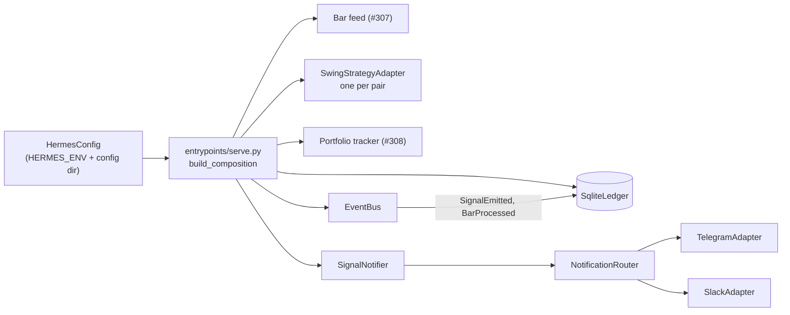
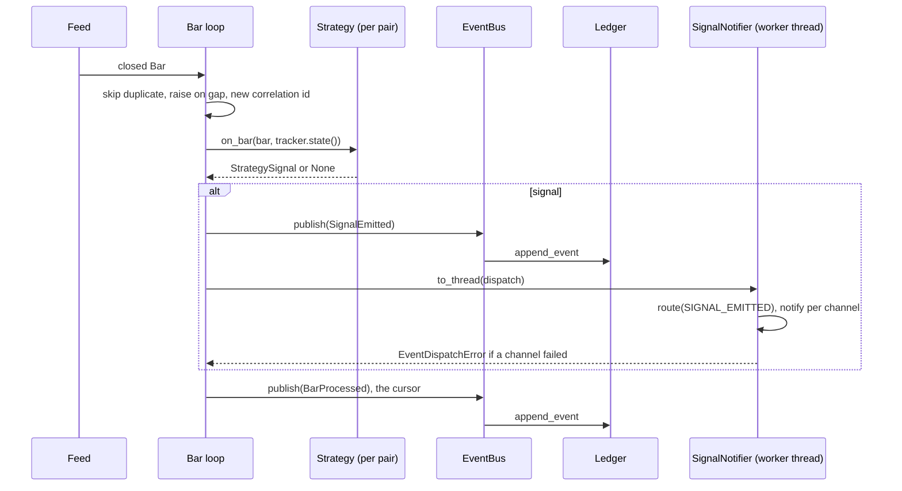
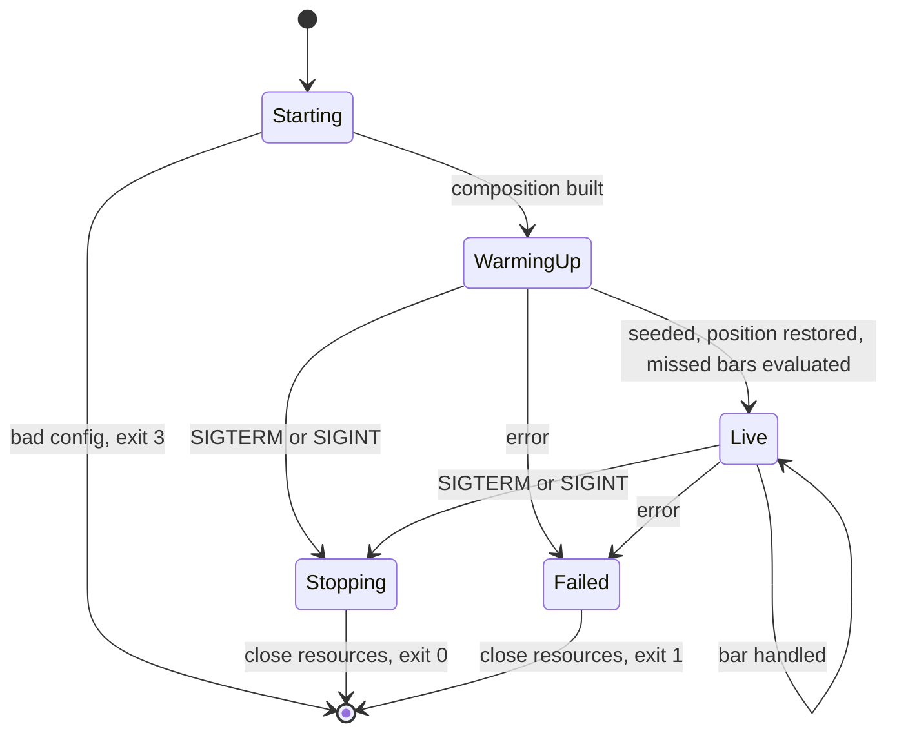
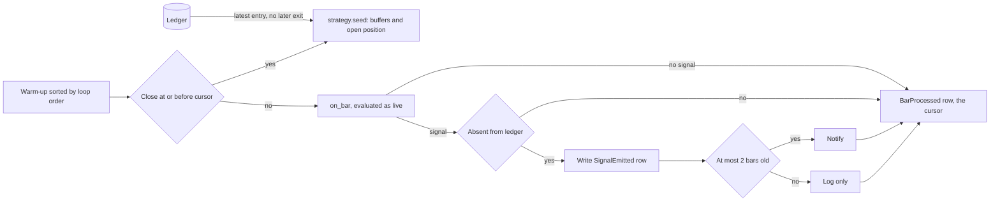

# Change: 309-serve-bar-loop

**SDD change**: `309-serve-bar-loop`
**Date**: 2026-10-02
**Status**: Shipped
**Tracking issue**: see sibling `issue.md` (#309, parent #301)

Mirror of engram topic key `sdd/serve-bar-loop/change` (see
[ADR-009 §6](../../../docs/architecture/adr-009-documentation-strategy.md#6-change-specs--sdd-artifacts-dual-source-convention)
dual-source rule).

## TL;DR

- `hermes serve` stops idling. One `asyncio.TaskGroup` task warms up one swing strategy per pair, then turns each live closed bar into a `SignalEmitted` event, a ledger row, and a Telegram + Slack message through `NotificationRouter`.
- Failures are loud. The feed (#307) retries transient errors itself. Any other error is logged, sent to Sentry, resources are closed, and the process exits 1 so systemd restarts it. Exit 2 and 3 stay reserved for usage and config errors, which systemd does not restart (#306). A Telegram or Slack outage never stops the loop.
- A restart never re-notifies, never skips a bar, and never forgets an open position. Warm-up seeds the bars #307 provides (its D-4 depth) into each strategy without evaluating them, up to a persisted cursor (the last handled bar), and restores each pair's open position from the ledger. Every bar after the cursor, including bars that closed while the service was down, is evaluated normally. A signal is notified only if it is at most 2 bars old and absent from the ledger.
- No `--env` flag: `HERMES_ENV` stays the only source (fix the #141 text). The swing-only `config/strategies.yaml` lands in #308, which this change depends on. It is not a pre-registration deviation (D-9).
- Needs your approval: D-1 to D-9 and R-0 to R-4 are approved by the Code Owner (2026-10-03). Only the release layout is DECIDED. ADR-011 is accepted, so ADR-013 supersedes its D-02 and its Shadow row. Your follow-ups, outside this code: add ADR-011 and ADR-013 to the AGENTS.md precedence list, fix #141.

## Summary

Today `run()` only awaits the shutdown event (`src/hermes/entrypoints/serve.py:222`). The Telegram adapter is built but never used (`serve.py:189`), Slack is not wired, and nothing publishes events. This change adds the Phase-1 shadow loop: warm-up, per-bar evaluation, event publish, notifier fan-out, an error policy, and an ordered shutdown. The main architectural pick is that the loop stays in the `entrypoints/` composition root, so a new ADR-013 supersedes ADR-011 D-02. The main risk is restart behaviour: the strategy is stateful (`swing/adapter.py:126-128`), so warm-up must fill its buffers without evaluating bars, and a restart must neither repeat old alerts, skip a bar, nor forget an open position. The issue is labelled `size:m`; the scope is closer to `size:l` (see Risks).

## Scope

### In

- `src/hermes/entrypoints/serve.py`: `Composition` rework, warm-up seed, bar loop, `run()` returns an exit code, ordered shutdown. `cli.py`: `_serve_main` returns that code (today `return 0`, `cli.py:276`); startup checks map to exit 3.
- `seed(bars, open_position=None)` on `StrategyPort` (`ports/strategy.py`) and `SwingStrategyAdapter`, plus a small `OpenPosition` value (entry time, entry price) beside `StrategySignal`: fills the buffers, restores an open position, and never evaluates (D-6, Design).
- NEW `src/hermes/application/signal_notifier.py`; a `SIGNAL_EMITTED` row in `notification_router.py`; `notify` on `ports/notifier.py`; a `SignalEmitted` template in `messages/telegram.py` and `messages/slack.py`; NEW `docs/decisions/2026-10-03-signal-notification-routing.md`.
- NEW `domain/events/bar_processed.py` (`BarProcessed`: pair, interval; `occurred_at` is the bar's close time, no clock, as in #308 D-2). `LedgerPort.has_signal_event`, `last_processed_close` and `latest_signal_event` (`ports/ledger.py` + `SqliteLedger`). No migration: all three read existing `events` columns.
- NEW `docs/architecture/adr-013-shadow-composition-root.md` (Accepted): supersedes ADR-011 D-02 (composition root) and the Shadow market-data row of its mode table. ADR-011 itself is not edited (AGENTS.md rule 10).

### Out

- OrderRouter and SimulatedExchangeAdapter wiring (Phase 2). Reconciling positions against an exchange (no exchange adapter is wired).
- The live feed (#307) and `SignalEmitted` plus tracker (#308). Interfaces needed are in Dependencies.
- The `config/strategies.yaml` roster rewrite (rebalancer and donchian to swing only): #308 owns it, because its seed needs it (D-9).
- `hermes.service`, env file, path defaults, `StartLimit*` (#306). Deploy scripts and rollback (#179).
- Daily digest and weekly report schedulers.

## Decisions

### D-1 (APPROVED): Loop lives in `entrypoints/serve.py`; ADR-013 supersedes ADR-011 D-02

- **Decision**: Keep the composition root in `entrypoints/`. A new ADR-013 supersedes ADR-011 D-02 and the Shadow row of its mode table (text in Design). Shadow market data is the REST polling source of #307 (`BinanceLiveKlinesAdapter`), not `LiveWebSocketMarketDataAdapter`.
- **Alternatives**: (a) `compose_engine()` in `application/`, as D-02 says today: the contract at `pyproject.toml:198-202` forbids application importing adapters, and wiring adapters is that import. (b) Relax the contract: weakens the rule that protects the domain. (c) Edit ADR-011: it is Accepted (2026-10-03, PR #338), so AGENTS.md rule 10 forbids content changes.
- **Rationale**: A superseding ADR is the route ADR-009 gives an immutable ADR. #305 already put the root here (`serve.py:151-200`).
- **Cost of reversal**: LOW.

### D-2 (APPROVED): TaskGroup, shutdown raced at the idle await only

- **Decision**: `run()` opens an `asyncio.TaskGroup` holding the bar-loop task. The loop races `anext(feed)` against `shutdown.wait()` and never cancels a bar that is being handled.
- **Alternatives**: (a) `task.cancel()` on shutdown: can cut a handler between the ledger write and the notify. (b) Bare `create_task` plus `asyncio.wait`: a sibling failure can be lost. (c) Check `shutdown.is_set()` only between bars: a feed that waits 4 hours never wakes.
- **Rationale**: A group cancels siblings when one fails, so later tasks (health ping, digest) join the same structure. Probes A and B in Design confirm both behaviours.
- **Cost of reversal**: LOW.

### D-3 (APPROVED): Fan-out is an explicit step in a worker thread, not a bus subscriber

- **Decision**: After `event_bus.publish(event)` (ledger append only), the loop runs `await asyncio.to_thread(signal_notifier.dispatch, event)`.
- **Alternatives**: (a) Notifier as a sync bus subscriber: both adapters use a blocking `httpx.Client` with a 10 s timeout (`telegram_adapter.py:52`, `slack_adapter.py:85`), which would freeze the loop that also runs the feed. (b) Subscriber that enqueues plus a worker task: same result, one more moving part. (c) Publish from the worker thread: `EventBus` is not thread-safe (`event_bus.py:81-83`) and SQLite rejects cross-thread use (probe C).
- **Rationale**: The bus and ledger stay on the loop thread; only the network call leaves it. Phase 2 can still subscribe to `SignalEmitted`.
- **Cost of reversal**: LOW.

### D-4 (APPROVED): New `SIGNAL_EMITTED` class and `notify(event)` on the port

- **Decision**: Add `EventClass.SIGNAL_EMITTED` routed to Telegram and Slack, add `notify(self, event: DomainEvent)` to `NotifierPort`, register a `SignalEmitted` template in both registries, and record the row in a new dated decisions entry.
- **Alternatives**: (a) Reuse `notify_urgent`: it builds a synthetic CRITICAL `AnomalyDetected` (`telegram_adapter.py:245-251`), the wrong shape. (b) Telegram only: no durable record. (c) Edit the 2026-08-23 entry: the prose guide says never edit a merged entry.
- **Rationale**: `NotifierPort` has only `notify_urgent` and `notify_report` (`ports/notifier.py:26-58`), but both adapters already implement `notify` (`telegram_adapter.py:194`, `slack_adapter.py:239`). Telegram gives the push, Slack the durable record, like `POSITION_LARGE`. The router table mirrors the decisions table (`notification_router.py:173-192`), so both and the parity test change together.
- **Cost of reversal**: LOW.

### D-5 (APPROVED): Error policy and exit codes

- **Decision**: Feed errors that survive the feed's own retries, strategy exceptions, ledger errors and bar gaps propagate out of the group. `run()` logs each with traceback, calls `sentry_integration.capture`, closes everything, returns 1. A notifier `InfraError` is caught per channel by `SignalNotifier`, raised as one `EventDispatchError`, logged at ERROR, captured, and the loop continues. Other notifier exceptions (a missing template) are bugs and propagate. Exit codes: 0 clean, 1 runtime failure, 2 usage, 3 config. Every transient or unrecoverable runtime failure exits 1, and systemd restarts it (`Restart=on-failure`). Exit 2 and 3 stay reserved for usage and config errors found at startup, and systemd does not restart them (`RestartPreventExitStatus=2 3`, #306 D-6): they never fix themselves. Runtime code must never return 2 or 3, or a transient failure would stop the unit for good.
- **Alternatives**: (a) Crash on any notifier failure: a Slack outage would stop signal evaluation. (b) Swallow notifier errors: silent. (c) Retry inside the loop: duplicates the feed's job.
- **Rationale**: The ledger row is the record of truth; a notification is a side effect. Mirrors `notification_router.py:30-33` and `event_bus.py:18-22`. Capture is explicit because a returned exit code no longer reaches Sentry's excepthook (`sentry_integration.py:119-127`). The unit keeps `Restart=on-failure`, and #306 adds `RestartPreventExitStatus=2 3`.
- **Cost of reversal**: LOW.

### D-6 (APPROVED): Restart idempotency: seed up to a persisted cursor, then evaluate

- **Decision**: Each stream (pair and interval) has a cursor: the `close_time` of its last handled bar, stored in the ledger as a `BarProcessed` event. On boot, fetch each stream's warm-up bars from the feed at the depth of #307 D-4 and sort the union in loop order (see Design). Seed every bar at or before its cursor through `strategy.seed`, which fills buffers and never evaluates. Evaluate every later bar through `on_bar`, as if it were live, so bars that closed while the service was down are not skipped. A stream with no cursor (first boot) seeds its whole warm-up set, and its cursor row is written at the last bar. Seeding also restores each pair's open position: the latest `SignalEmitted` for the pair at or before its 4h cursor decides. If that row is an ENTRY (so no EXIT follows it), its time and price go into `seed` as `open_position`; an EXIT or no row means flat. This is ADR-003 §10, "Reconcile on startup" (`adr-003-solution-architecture/10-failure-recovery.md:56`), with the ledger as the truth. Every evaluated signal that is absent from the ledger is written to it, so the ledger holds the full record the restore reads. It is notified only if `now - occurred_at <= 2 * interval`; an older one is logged and not notified. A signal already in the ledger is skipped. After each evaluated bar the loop appends one `BarProcessed` row, so the cursor moves even when the bar emits nothing. A cursor older than the warm-up window means bars were lost: the gap check raises `BarGapError` (exit 1).
- **Alternatives**: (a) Replay all history through `on_bar` and mute it: a historical entry opens a phantom position (`swing/adapter.py:224-226`), and a signal that fired during downtime is lost silently. (d) Seed buffers only and start flat: a pre-restart entry never gets its exit signal, and a new entry can fire. (b) Derive the cursor from `SignalEmitted` rows: most bars emit nothing, so the last signal sits far behind the last bar, and a quiet month would re-evaluate a month of bars. (c) A new table for the last handled bar: a migration, and a rollback meets a schema older code does not know.
- **Rationale**: The cursor is stored, not derived, because signals alone cannot give it (b). A `BarProcessed` event is the simplest store: it reuses the append-only `events` table and a lookup like `has_signal_event`, so there is no migration (c). It costs about 21 rows a day (3 pairs, 6 H4 bars and 1 D1 bar each). The cursor row is written after the signal row and the notify. A crash between them re-evaluates the bar, finds the signal in the ledger, and does not notify twice. The 2-bar window stops notifying signals too stale to act on (ADR-011 D-10 fills at the next bar open), but they stay in the ledger. Depth is #307's: 300 closed bars per stream (its D-4), which fills the 300-bar buffer caps (`swing/adapter.py:77-78`) and covers the 200 bars the EMA needs (`:64`). The position restore needs only an entry time and price: the exit stop comes from the buffers, and the strategy reads nothing else of its position state (`swing/adapter.py:239-300`).
- **Cost of reversal**: MEDIUM: adds ports methods and an event type.

### D-7 (APPROVED): One strategy instance per pair; universe constant mirrors pre-reg §3

- **Decision**: Build `dict[Pair, SwingStrategyAdapter]` for BTC/USDT, ETH/USDT, SOL/USDT and route by `bar.pair`. All three share the one `StrategyId("swing-donchian-4h")`, built from the roster entry name (#308 D-3).
- **Alternatives**: (a) One shared instance (today, `serve.py:181`): the adapter has one bar buffer and one position flag, no pair awareness (`swing/adapter.py:122-128`), so pairs would corrupt each other. (b) Read the universe from `PreRegistration`: it reads a docs file the wheel does not ship (`preregistration.py:203-219`).
- **Rationale**: Pre-reg §3 fixes three pairs (`pre-registration-v1.md:58-66`). A test compares the constant to `PreRegistration().universe()`.
- **Cost of reversal**: LOW.

### D-8 (APPROVED): No `--env` flag; `HERMES_ENV` only

- **Decision**: Do not add `--env`. Fix the #141 text.
- **Alternatives**: Add `--env`: a second source that can disagree with `HERMES_ENV` and with the `allow_mainnet` validator on the config model.
- **Rationale**: The loader reads `HERMES_ENV` (`loader.py:67`, `:241-258`) and systemd feeds it from an env file (`hermes.service:25`). #141 also names `--shadow` (dead flag, #175 closed not planned) and `/etc/hermes.env` (the layout is `/etc/hermes/env.production`). Replacement text: "`hermes serve` runs with `HERMES_ENV=prod` set in `/etc/hermes/env.production`".
- **Cost of reversal**: LOW.

### D-9 (APPROVED): The roster comes from #308; `serve` checks it at startup

- **Decision**: This change depends on #308 for the `config/strategies.yaml` rewrite: one entry, `swing-donchian-4h`, `enabled: true`, weight `"1.0"` (#308 D-3 and D-6). #308 lands first and owns the file. This change adds only the startup check: `serve` exits 3 if the enabled roster is not exactly that entry, or if `env == "prod"` and neither channel has credentials.
- **Alternatives**: (a) Rewrite the roster here too: #308 needs the entry for its seed and lands first, so two changes would edit one file. (b) Keep `rebalancer` disabled: an env override (`strategies.yaml:7-8`) could switch it on.
- **Rationale**: ADR-011 defers the rebalancer to MVP2 (`adr-011:677`), names the bucket `swing-donchian-4h` (`:112`), and adds a second bucket later via `strategy_id` (`:556`). Not a §11 deviation (the full reasoning is in #308 D-6): §11 lists §3, §4, §5, §6, §9, §10 (`pre-registration-v1.md:256-263`), the signed hash covers only that document (`:11-12`, `:336`), and nothing reads the roster today (`rg` below). If Spec 9 later hashes the roster, landing it first avoids a counted edit.
- **Cost of reversal**: LOW.

## Requirements

### R-0: Aggregate blind during shadow (Code Owner ruling, 2026-10-02)

- **A-0.1**: until OOS certification, no notification or message this change emits (entry, exit, warm-up summary, error) contains P&L, return, equity, Sharpe, drawdown or win-rate fields. Entry and exit messages may show pair, side, price and bar time. A unit test renders every new template with a populated exit and asserts none of those fields or values appear. See ADR-012 ruling 1 and #319.

### R-1: The loop behaves as decided

- **A-1.1**: `uv run pytest tests/integration/entrypoints/test_serve_bar_loop.py -q` exits 0 (one signal gives one ledger row and one call per channel; feed error, notifier outage, bar gap, SIGTERM, first boot, restart, downtime, warm-up and bar-order cases all pass).
- **A-1.2**: `rg -n "TaskGroup" src/hermes/entrypoints/serve.py` has a match.
- **A-1.3**: `uv run hermes serve --env prod; test $? -eq 2` (the flag stays rejected).

### R-2: Notification surface is consistent

- **A-2.1**: `rg -n "SIGNAL_EMITTED" src/hermes/application/notification_router.py` has a match, and `uv run pytest tests/unit/application -q` exits 0.
- **A-2.2**: `rg -n "def notify\b" src/hermes/ports/notifier.py` has a match, and `ls docs/decisions/2026-10-03-signal-notification-routing.md` exits 0.

### R-3: Config and architecture match the signed scope

- **A-3.1**: `rg -q "name: swing-donchian-4h" config/strategies.yaml` (the roster lands in #308, whose A-3.4 checks the removal); `uv run pytest tests/unit/entrypoints -q` exits 0 (startup check).
- **A-3.2**: `uv run lint-imports` exits 0 (5 kept).
- **A-3.3**: `rg -n "Supersedes.*ADR-011 D-02" docs/architecture/adr-013-shadow-composition-root.md` has a match, and `git diff --exit-code origin/main -- docs/architecture/adr-011-paper-trading-engine.md` exits 0 (ADR-011 is untouched, or at most gains a Superseded-by pointer).
- **A-3.4**: `rg -n "Shadow.*BinanceLiveKlinesAdapter" docs/architecture/adr-013-shadow-composition-root.md` has a match, and `! rg -q "Shadow.*LiveWebSocketMarketDataAdapter" docs/architecture/adr-013-shadow-composition-root.md`.

### R-4: Warm-up seeds, and a restart loses no bar and no open position

- **A-4.1**: `uv run pytest tests/unit/domain/strategy -q -k seed` exits 0 (history that satisfies the entry conditions, once seeded, returns no signal and leaves the adapter flat unless `open_position` is passed; the next live bar still evaluates).
- **A-4.2**: `rg -n "def seed" src/hermes/ports/strategy.py src/hermes/domain/strategy/swing/adapter.py` has a match in each file.
- **A-4.3**: `git diff --exit-code main -- src/hermes/adapters/ledger/migrations` exits 0 (the cursor and the restore need no migration).
- **A-4.4**: `uv run pytest tests/integration/entrypoints/test_serve_bar_loop.py -q -k restart_between_entry_and_exit` exits 0 (a restart between an entry and its exit still emits exactly one exit).

## Design

### Composition after this change



### One bar, end to end



### Serve lifecycle



### Core of the loop (copy-ready shape)

```python
# Warm-up depth is MarketDataConfig.warmup_bars_4h and warmup_bars_1d (#307 D-4: 300 each).
CATCHUP_BARS: Final = 2  # H4: a signal up to 8 h old is still notified
SHADOW_UNIVERSE: Final = ("BTC/USDT", "ETH/USDT", "SOL/USDT")  # pre-reg §3


async def run(c: Composition, shutdown: asyncio.Event) -> int:
    _log.info("serve.run.started", env=c.config.env, pairs=len(c.strategies))
    code = 0
    try:
        async with asyncio.TaskGroup() as tg:
            tg.create_task(_bar_loop(c, shutdown))
    except* Exception as eg:  # never swallowed: log + Sentry + exit 1
        for exc in eg.exceptions:
            _log.error("serve.run.failed", exc_info=exc)
            sentry_integration.capture(exc)
        code = 1
    finally:
        await c.feed.aclose()
        _close_all(c)  # ExitStack: Slack, Telegram, then SQLite last
    return code


async def _bar_loop(c: Composition, shutdown: asyncio.Event) -> None:
    warm = await _warm_up(c)  # feed.warm_up per stream, sorted by delivery_key
    cursor = _load_cursors(c, warm)  # BarProcessed rows; first boot: last bar, written now
    for pair, strategy in c.strategies.items():
        seeded = [b for b in warm if b.pair == pair and b.close_time <= cursor[pair, b.interval]]
        strategy.seed(seeded, open_position=_restore_position(c, pair, cursor))  # never on_bar
    for bar in warm:
        if bar.close_time > cursor[bar.pair, bar.interval]:
            await _handle(c, bar)  # catch-up: the same path as a live bar
    stream = c.feed.stream_closed_bars(c.pairs, c.intervals).__aiter__()
    while (bar := await _next_or_stop(stream, shutdown)) is not None:
        await _handle(c, bar)


async def _handle(c: Composition, bar: Bar) -> None:
    if sig := _evaluate(c, bar):
        event = SignalEmitted.from_signal(...)  # shape owned by #308
        if not c.ledger.has_signal_event(event):  # at-most-once across restarts
            c.event_bus.publish(event)  # ledger append, loop thread
            if _is_recent(c, event):  # stale: recorded, not notified
                await _notify(c, event)
    c.event_bus.publish(BarProcessed.from_bar(bar, ...))  # the cursor row, always last


async def _notify(c, event) -> None:
    try:
        await asyncio.to_thread(c.signal_notifier.dispatch, event)
    except EventDispatchError as exc:  # channel outage only
        _log.error("serve.notify.failed", exc_info=exc)
        for failure in exc.failures:
            sentry_integration.capture(failure)
```

- `_next_or_stop` waits on `anext` and `shutdown.wait()` with `FIRST_COMPLETED`, cancels the loser, and returns `None` on shutdown.
- `_evaluate` skips a bar whose `open_time` repeats, raises `BarGapError` unless `open_time == previous.open_time + interval`, then calls `strategies[bar.pair].on_bar(bar, c.tracker.state())` under a fresh correlation id (`infrastructure/logging.py:81`).
- `_warm_up` calls `feed.warm_up(pair, interval, count)` for each pair and interval, with `count` from `MarketDataConfig.warmup_bars_4h` and `warmup_bars_1d`, and returns the union sorted by `delivery_key`.
- `_load_cursors` reads `ledger.last_processed_close(pair, interval)` per stream. A stream with no row gets its last warm-up bar as cursor, and the row is written at once.
- Seeding passes each pair's seeded bars to `strategy.seed`, and records each stream's last seeded bar as `previous` for the gap check. It never calls `on_bar`.
- `_restore_position` reads `ledger.latest_signal_event(strategy_id, pair, at_or_before=cursor[pair, H4])`. An ENTRY row gives `OpenPosition(entry_time=occurred_at, entry_price=entry_price)`; an EXIT row or no row gives `None`.
- `SignalNotifier.dispatch` loops `route(SIGNAL_EMITTED, cfg)`, catches `InfraError` per adapter, and raises one `EventDispatchError` at the end.
- `Composition` types `feed` and `strategies` as ports so tests inject fakes. `telegram` and `slack` stay concrete because only they have `close()`.

### Warm-up seeds, it does not evaluate

`on_bar` on a 4h bar updates the buffer and then evaluates an entry or an exit (`swing/adapter.py:179-185`). A passing entry sets `_in_position`, `_entry_time` and `_entry_price` (`:224-226`). Replaying warm-up bars through `on_bar` would open positions that never existed, and the first live exit would close one. Warm-up therefore uses `seed(bars, open_position=None)`, a method that:

- appends to the same 4h and 1d buffers `on_bar` fills, with the same 300-bar caps;
- never calls `_evaluate_entry` or `_evaluate_exit`, so it returns nothing and cannot emit a signal;
- sets `_in_position`, `_entry_time` and `_entry_price` only from the `open_position` argument, and never derives a position from bars. With `None` the adapter stays flat.

Every seeded bar closes at or before the cursor and the next evaluated bar closes after it, so the no-lookahead contract holds (`swing/adapter.py:26-28`).

The open position comes from the ledger, not from replay. Seeding alone would start every boot flat, so an entry signaled before a restart would never get its exit, and a new entry could fire. The loop therefore reads the latest `SignalEmitted` for the pair at or before its 4h cursor, after the buffers are seeded. ADR-003 §10 sets the rule: "Reconcile on startup. Never assume post-crash state matches pre-crash state" (`adr-003-solution-architecture/10-failure-recovery.md:56`). In Phase 1 there is no exchange to reconcile against, so the ledger is the truth. The cursor bound matters: a crash after the signal row and before the cursor row leaves a signal newer than the cursor, and the re-evaluation of that bar must see the state before it.



### Bar order

The loop handles bars in ascending `close_time`. When close times are equal, the daily bar goes before the 4h bar, then by pair. This is the key of #307 D-5 (`delivery_key`). Live bars arrive in that order (F-2). Warm-up returns one list per stream, so the loop sorts their union with the same key before it splits it at the cursors.

The tie rule matters because the last 4h bar of a day closes at the same instant as that day's 1d bar, and the strategy buffers may hold only bars with `close_time` up to the current bar's (`swing/adapter.py:26-28`). Ordering by `open_time` hands the strategy the day's 1d bar before the 4h bars that close earlier in that day. That is look-ahead for the EMA regime filter, up to 16 hours (#311, found in `run_calibration.py:228`; see #307 TL;DR and Risks R-4).

### ADR-013: supersedes ADR-011 D-02 and the Shadow row (summary of the new ADR)

```markdown
**ADR-013 (change `309-serve-bar-loop`, #309)**: the composition
root is `src/hermes/entrypoints/serve.py`, not the application layer. The
application layer cannot import adapters (`pyproject.toml:198-202`), and
choosing a concrete adapter is that import. The mode is chosen by which
adapters `serve` wires. Phase 1 wires market data, strategy, ledger and
notifiers, and wires no exchange adapter, so no order can be placed by
construction. The real-money gate stays on `HermesConfig` (`env` and
`allow_mainnet`). `HERMES_SHADOW` is not read: #175 was closed as not
planned and the port swap makes it redundant.

The Shadow row of the ADR-011 mode table (line 54) no longer names
`LiveWebSocketMarketDataAdapter`. Shadow market data is
`BinanceLiveKlinesAdapter`, which polls the public REST klines endpoint after
each 4h and 1d close (change `307-live-bar-stream`, D-1). The strategy decides
once per 4h bar and fills at the next bar open (D-10), so WebSocket latency
buys nothing. The WebSocket adapter stays for order book diffs. The Live
(MVP2) row is unchanged.
```

### Verification run on `main` @ 278d847 (read-only, local)

```text
$ uv run hermes serve --env prod; echo exit=$?
hermes serve: error: unrecognized arguments: --env prod
ERROR: could not parse `hermes serve` arguments.
exit=2

$ HERMES_ENV=prod uv run python -c "...load_config(Path('config'))..."
env = prod | allow_mainnet = False
strategies = [('rebalancer', '0.6', True), ('donchian', '0.4', True)]

$ uv run lint-imports                 -> Contracts: 5 kept, 0 broken.
$ rg -n "config\.strategies|\.strategies\.strategies" src   -> no match (exit 1)
$ rg -n "SlackAdapter|TaskGroup|RouterConfig" src/hermes/entrypoints
  only _health.py:47 and :224 (serve.py wires none)
$ rg -n "SignalEmitted|has_signal" src   -> no match (#308 adds the event)
```

Scratch probes (not committed), Python 3.14.7, SQLite 3.53.1:

```text
A shutdown race: group exited cleanly, loop returned None
B failure: ExceptionGroup ['source dead'] | sibling cancelled = True
C sqlite from worker thread: ProgrammingError
D sqlite 3.53.1 json_extract ok = True
```

Replaying 2555 synthetic bars (365 days of H4 and D1) through one default `SwingStrategyAdapter` took 0.06 s, so about 0.2 s for three pairs. The test sequence (12 rising D1 bars, 6 flat H4, 5 flat, then a jump to 2000, with the small periods of `test_swing_adapter_integration.py:71-85`) produced exactly one `entry` and no `exit` in 30 H4 bars.

## Test plan

Tiers touched: Tier 1 (unit, property) and Tier 2 (integration). Not touched: Tier 3 (real testnet, Phase 3) and `contract` (a send must never fire from CI; the `notify` path stays covered by the existing `MockTransport` tests). Async tests use `asyncio.run` inside sync tests with `asyncio.wait_for` caps, like `test_serve.py:127`. Each test docstring names one invariant.

1. Every acceptance criterion above passes.
2. Tier 1, `tests/unit/`:
   - Router: add the row to `_EXPECTED_ROUTING` and `notify` to the fake (`test_notification_router.py:112`, `:61`).
   - `SignalNotifier`: one failing channel never stops the other; failures arrive in one `EventDispatchError`; a non-`InfraError` propagates; zero wired channels is not an error.
   - Templates: Telegram and Slack output carries pair, kind, price and `occurred_at`, and is MarkdownV2-escaped.
   - `@pytest.mark.property` (Hypothesis): `within_catchup(now, occurred_at, interval)` is true exactly when `0 <= now - occurred_at <= 2 * interval`.
   - `seed` (`tests/unit/domain/strategy`): history that satisfies the entry conditions returns no signal and leaves the adapter flat (unless `open_position` is passed, which restores it: the next bar that breaks the Chandelier stop emits one EXIT carrying the restored entry price); the next live bar still evaluates; seeding applies the buffer caps; a seeded adapter and one fed the same bars through `on_bar` give the same next evaluation when that replay emitted no signal.
   - Bar order: equal close times put the daily bar before the 4h bar; the warm-up sort equals `delivery_key` order.
   - Cursor: `last_processed_close` against `:memory:` SQLite (found, absent, other pair, other interval, newest wins); `latest_signal_event` the same way (entry, exit after entry, none, other pair, `at_or_before` respected); `BarProcessed.occurred_at` equals the bar's close time.
   - Contiguity (duplicate skipped, gap raises, in-order passes), startup check (wrong roster exits 3, prod without channel exits 3, dev without channel allowed), `SHADOW_UNIVERSE` equals `PreRegistration().universe()` once `/` is removed, `serve --env prod` exits 2, `_serve_main` returns `run()`'s code, every runtime failure returns 1 and never 2 or 3.
3. Tier 2, `tests/integration/entrypoints/test_serve_bar_loop.py` (`@pytest.mark.integration`; fake feed, real `SqliteLedger`, recording notifiers, `httpx.MockTransport` clients):
   - `test_scripted_bars_emit_exactly_one_signal_and_one_notification_per_channel`
   - `test_sigterm_while_idle_closes_every_resource_and_exits_zero`
   - `test_unrecoverable_feed_error_exits_one_after_closing_resources`
   - `test_notifier_outage_does_not_stop_the_loop`
   - `test_restart_over_same_history_emits_nothing_new`
   - `test_signal_missed_during_downtime_is_emitted_once_across_two_restarts`
   - `test_restart_between_entry_and_exit_still_emits_exactly_one_exit`
   - `test_stale_signal_from_downtime_is_recorded_but_not_notified`
   - `test_bar_closed_while_down_is_evaluated_after_restart`
   - `test_warmup_history_that_qualifies_for_entry_emits_no_signal_and_opens_no_position`
   - `test_first_boot_notifies_nothing_and_writes_the_cursor`
   - `test_cursor_older_than_history_exits_one`
   - `test_bar_gap_exits_one`, and `has_signal_event` against `:memory:` SQLite (found, absent, other pair, other kind).
4. `bash scripts/dev/pr-preflight.sh` is green, all CI jobs are green, and the Code Owner approves D-1 to D-9.

## Risks

- **Position state comes from the ledger, not from replay.** Warm-up never evaluates, so it cannot open phantom positions (`swing/adapter.py:224-226`). The open position is restored from the latest `SignalEmitted` of the pair at or before its cursor (D-6, ADR-003 §10), so an entry signaled before a restart still gets its exit. Residual: the ledger is the only source, so a hand-edited ledger restores a wrong position. Every evaluated signal is written to the ledger, even a stale one that is not notified, or the restore would drift. Phase 2 can also reconcile against the exchange.
- **Restart loop hammers the exchange.** Today's `hermes.service` has `RestartSec=10s` and no `StartLimit*` (`:27-28`), so a bug that crashes on every boot repeats the history fetch every 10 s. #306 D-6 bounds it: `RestartSec=30s`, 5 starts per 10 min, then the unit stays `failed`.
- **Notifications are at-most-once, and can be late.** The ledger row is written first. A kill between write and send, or a Telegram outage, loses that alert. It stays in the ledger, the ERROR log and Sentry. After downtime a signal up to 8 h old can arrive; the message shows its `occurred_at`. Accepted for a signals-only phase.
- **Pre-registration data window.** Warm-up seeds bars inside the OOS window (2025-09-01 to 2026-12-31) into a strategy with fixed parameters. This primes buffers and tunes nothing. Spec 9 (D-22) must not treat the seed as an OOS read (#307 D-8).
- **Size and naming.** About 25 files and over 500 lines (the cursor event, `seed`, `OpenPosition` and the ledger methods add about 5): relabel #309 `size:l`, or split into PR-A (D-4 surface) and PR-B (loop). Names in Dependencies are placeholders until #307 and #308 are final; a mismatch costs a rename, not a redesign.

## Dependencies on other changes

- **#307, `openspec/archive/307-live-bar-stream/`**, needed from the feed: (F-1) `warm_up(pair, interval, count) -> list[Bar]`: the latest `count` closed bars of one stream, open candle dropped. The loop calls it per pair and interval with `MarketDataConfig.warmup_bars_4h` and `warmup_bars_1d` (#307 D-4: 300 each, floors 45 and 200; the 1d stream is mandatory). (F-2) `stream_closed_bars(pairs, intervals)`: one merged `AsyncIterator[Bar]` over all pairs and both intervals: closed bars only, each once, in `delivery_key` order: ascending `close_time`, the daily bar before the 4h bar at equal close time, then pair (#307 D-5; not the open-time order of `backtest-driver-mvp1-phase2/change.md:210`, see #311). (F-3) Transient errors retried inside; unrecoverable ones raise `InfraError` (`ports/market_data.py:60-63`). (F-4) `aclose()` is idempotent, and cancelling a pending `anext` leaves no partial bar. The loop keeps its own cursor (D-6) and splits the warm-up set itself, so it passes no `resume_after`. Any overlap between the last warm-up bars and the first stream bars is skipped by the duplicate check in `_evaluate`.
- **#308, `openspec/archive/308-signal-event-portfolio-state/`**, owns the portfolio and signal names used here and merges first. Needed: (S-1) `SignalEmitted(DomainEvent)` with `strategy_id`, `pair`, `kind`, `side`, `entry_price`, `stop_price`, `atr_context`, `exit_reason`, plus `from_signal`; its time field is `occurred_at`, set from the signal's bar time. (S-2) `PortfolioTracker` with `state() -> PortfolioState` (`domain/risk/state.py:30`); the domain type behind it is `PortfolioSnapshot`. (S-3) A layout where `occurred_at` (a column) and the payload `pair` and `kind` are queryable (`sqlite_ledger.py:224-239`, `:288`). (S-4) `config/strategies.yaml` with the single `swing-donchian-4h` entry (D-9); this change checks it and does not edit it. `event_bus.subscribe(SignalEmitted, ledger.append_event)` and the same for `BarProcessed` are wired in `build_composition` unless #308 already does it.
- **#306, `openspec/archive/306-serve-systemd-boot/`**: `StartLimit*`, `RestartPreventExitStatus=2 3` (D-5 relies on it) and the `--config-dir` and `--db` defaults. The DECIDED layout (versioned releases, `current` and `previous` symlinks, rollback by symlink flip) needs nothing here: this change adds no migration, so a rollback leaves the ledger readable by older code. PROPOSED elsewhere, relied on here: config ships per release, so the roster (#308) rolls back with code. **#179, `openspec/archive/179-cd-first-real-deploy/`**: no overlap.
- **Code Owner follow-ups (not code in this change)**: add ADR-011 and ADR-013 to the AGENTS.md precedence list (`AGENTS.md:18-30` covers ADRs 001-010 only); edit #141 as in D-8 (only you can edit it). ADR-011 was accepted on 2026-10-03 (PR #338). It still says the pre-registration is pending signature (`:495`, `:592`, `:630`) while `pre-registration-v1.md:7-10` is `SIGNED` (2026-08-25). Left as-is (immutable); ADR-013 notes the stale text.
