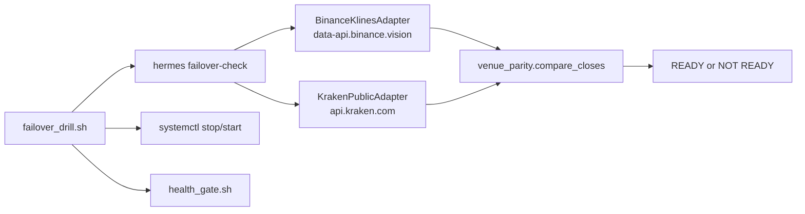

# Change: 31-failover-drill

**SDD change**: `31-failover-drill`
**Date**: 2026-10-04
**Status**: Shipped
**Tracking issue**: see sibling `issue.md`

Mirror of engram topic key `sdd/31-failover-drill/change` (see
[ADR-009 §6](../../../docs/architecture/adr-009-documentation-strategy.md#6-change-specs--sdd-artifacts-dual-source-convention)
dual-source rule).

## Summary

ADR-004 promises a rehearsed Binance to Kraken cutover in under 90 minutes,
but nothing exercised it. This change adds the runbook entry ADR-004 names
(`docs/runbook/failover-to-kraken.md`), a read-only `hermes failover-check`
that compares the last closed bars of every traded pair on both venues, and
`scripts/deploy/failover_drill.sh`, which the operator runs monthly on
hermes-01 to time the steps that can run today. The main risk is that the
drill restarts the live shadow unit; the script defaults to a read-only
rehearsal, refuses near a bar close and refuses outright in real-capital
mode.

## Scope

### In

- `src/hermes/domain/market_data/venue_parity.py`: pure close comparison.
- `src/hermes/entrypoints/failover_check.py` and its command module.
- `scripts/deploy/failover_drill.sh`: rehearsal by default, `--execute`
  to stop, start, gate and compare positions; timed report.
- Kraken adapter fixes the check found: ETH/USDT and ETH/USDC symbols,
  4h interval.
- `docs/runbook/failover-to-kraken.md` with Mermaid diagrams; runbook index.

### Out

- A venue setting in `hermes serve`: serve reads Binance only. The drill
  reports the step as `NOT AVAILABLE` until it exists.
- Signed Kraken trading (orders, balances): ADR-004 Decision 2, before
  real capital.
- Installing `failover_drill.sh` to `/opt/hermes/bin`: needs edits to
  `cd.yml` and `install_release.sh`, which other work owns. The runbook
  copies it with `scp` until then.
- A dispatch workflow: the drill restarts the unit and must be watched, so
  it stays an operator command over SSH.

## Decisions

### D-1: Compare closes in basis points, not equality

- **Decision**: a pair passes when every bar is on both venues and each
  close is within a tolerance (default 50 bps).
- **Alternatives**: exact OHLCV match (two venues never agree); ticker
  price only (says nothing about bar alignment or gaps).
- **Rationale**: the strategy consumes closed bars; a missing bar or a
  wrong symbol (percent off, not bps) is what would break a cutover.
  Measured 2026-10-04: BTC 1.8, ETH 3.5, SOL 10.9 bps over six 4h bars.
- **Cost of reversal**: LOW.

### D-2: Rehearsal by default, `--execute` to restart

- **Decision**: the script changes nothing unless `--execute` is given.
- **Alternatives**: always restart (too easy to run by accident); a
  separate script per mode (two copies of the guards).
- **Rationale**: AGENTS.md rule 7 spirit; the unit runs the 90-day
  shadow clock.
- **Cost of reversal**: LOW.

### D-3: Guard the bar window and real-capital mode

- **Decision**: refuse from 20 min before to 10 min after a 4h close
  (exit 4) and when `HERMES_ALLOW_MAINNET` is on (exit 5).
- **Alternatives**: rely on the operator's timing.
- **Rationale**: a restart over a close costs a bar; with real capital
  the cutover needs the engine paused first, which the script cannot do.
- **Cost of reversal**: LOW.

### D-4: Positions compared on identity fields

- **Decision**: coin, timeframe, side, size, entry price and open time;
  stop price and P&L are left out.
- **Rationale**: a trailing stop and marks may move between snapshots
  without anything being wrong.
- **Cost of reversal**: LOW.

## Requirements

### R-1: failover-check reports readiness per pair

- **A-1.1**: `uv run pytest tests/unit/entrypoints/test_failover_check.py`
- **A-1.2**: `uv run pytest tests/unit/domain/market_data/test_venue_parity.py`

### R-2: the drill script is safe by default and timed

- **A-2.1**: `uv run pytest tests/integration/deploy/test_failover_drill.py`

### R-3: Kraken answers for every traded pair at 4h

- **A-3.1**: `uv run pytest tests/unit/adapters/exchanges/test_kraken_public.py`
- **A-3.2**: `uv run hermes failover-check` prints `verdict: READY`
  (network; run 2026-10-04 02:45Z, all three pairs OK).

## Design

Window: the last N closed bars before now, `until` floored to the interval
boundary so the open bar is never compared.

## Test plan

1. Every acceptance criterion above passes.
2. `bash scripts/dev/pr-preflight.sh` passes.
3. CI green.
4. Operator runs the rehearsal, then `--execute`, on hermes-01.

Test tiers touched: unit, property, integration

## Risks

- **The drill restarts the shadow unit.** Mitigation: D-2, D-3, health
  gate, ledger snapshot kept in the report directory.
- **Kraken changes a symbol again.** Mitigation: the monthly check fails
  with Kraken's own error text per pair.
- **Snapshots accumulate in `/var/lib/hermes/backups/drills`.** One per
  month, outside the deploy rotation; prune by hand.

## Dependencies on other changes

- ADR-004 Decision 6 (drill), Decision 3 (runbook path).
- Follow-ups: venue setting in serve; signed Kraken adapter; installing
  the script with the release scripts.
