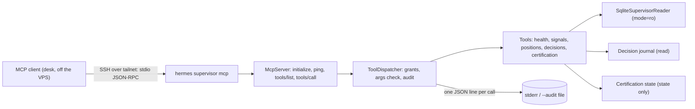

# Change: 34-supervisor-read-tools

**SDD change**: `34-supervisor-read-tools`
**Date**: 2026-10-03
**Status**: Shipped
**Tracking issue**: see sibling `issue.md` (#34; also closes #470)

Mirror of engram topic key `sdd/34-supervisor-read-tools/change` (see
[ADR-009 §6](../../../docs/architecture/adr-009-documentation-strategy.md#6-change-specs--sdd-artifacts-dual-source-convention)
dual-source rule).

## Summary

Adds the read-only supervisor layer that ADR-003 §08 describes and ADR-012
D-07 moves into MVP1: five outcome-blind read tools, deny-by-default scope
grants, a memorization guard, a per-call audit line, and `hermes supervisor
mcp`, an MCP server over stdio. The tools return times, states, pairs, counts
and the Code Owner's own decision titles; no price, value or P&L reaches them
(ADR-012 D-06). There is no write, pause or order tool, and an import-linter
contract keeps the layer away from exchanges, order paths and the ledger's
write port. The main risk is a future field leaking an outcome, which a
reviewed allow-list test blocks. The supervisor desk (#365) builds on this.

## Scope

### In

- `ports/supervisor.py`: `SupervisorReadPort` (status reads plus a price-free
  signal history), `SignalFact`, `CertificationFact`, `CertificationLookup`.
- `adapters/ledger/supervisor_reader.py`: read-only SQLite reader (`mode=ro`).
- `application/supervisor/tools.py`: the projections, the tool registry, the
  memorization guard and `ToolDispatcher` (grants and audit).
- `application/supervisor/mcp.py`: the MCP JSON-RPC handler (initialize,
  ping, tools/list, tools/call).
- `entrypoints/supervisor.py` and `entrypoints/commands/supervisor.py`:
  `hermes supervisor list | call TOOL | mcp`.
- The `supervisor-is-read-only` import-linter contract.
- A runbook section in `docs/guides/vps-operations.md`.

### Out

- **Dual-LLM reconciliation** (#34's summary): the second model that argues
  against a recommendation is the decision-card dissent of the supervisor
  desk (#365, ADR-012 D-05). This server makes no model call.
- **The one-way pause control** (ADR-012 D-04): a separate command with its
  own scope, never a tool on this server.
- **VPS provisioning for D-07**: a dedicated `hermes-mcp` unix user with
  read-only access to the ledger and no env file, plus an SSH forced command
  on the tailnet. Until then the operator runs it as `hermes` without the
  env file (runbook).
- **Fill and tax tools**: fills land with #353 and will appear as basis-point
  deviation from the decision price; the tax tool's gains half stays blind
  until certification (ADR-012 D-06).
- **`llm_audit` table**: model calls are logged by the desk that makes them;
  this server audits tool calls as JSON lines.

## Decisions

### D-1: Hand-written MCP handler over stdio, no SDK

- **Decision**: implement the four MCP methods a read-only tool server needs
  on top of JSON-RPC 2.0 over newline-delimited stdio.
- **Alternatives**: the MCP Python SDK (pulls an HTTP and ASGI stack onto the
  VPS process, a supply-chain surface per ADR-010, for four methods); an HTTP
  transport (a listening port, which D-07 would then have to firewall).
- **Rationale**: stdio over SSH is reachable only from the tailnet with the
  operator's key (D-07), and a ~150-line handler is fully tested here.
- **Cost of reversal**: LOW. The dispatcher is transport-agnostic.

### D-2: Deny-by-default grants with no wildcard

- **Decision**: the caller names every scope (`--grant`, or
  `HERMES_SUPERVISOR_GRANTS`). Ungranted tools are not listed and their calls
  are refused; an unknown scope (including `hermes:read:*`) is an error.
- **Rationale**: ADR-003 §08 "per-tool scoped, deny-by-default"; ADR-012
  D-08 "a CI check fails on any wildcard permission".
- **Cost of reversal**: LOW.

### D-3: Stricter blindness than ADR-012 D-06 for positions and signals

- **Decision**: positions show pair and entry time only; signals show pair,
  entry or exit, and time. Entry price, stop level, ATR, Kelly estimate and
  exit reason stay out. Strategy decisions in the journal show id and date
  only until OOS certification.
- **Alternatives**: show stop levels, as D-06 allows.
- **Rationale**: the console visibility rule (`application/console/visibility`,
  Code Owner ruling 2026-10-03) hides prices of open positions from every
  non-operator surface, MCP included; a stop level next to a live price is a
  P&L reading, and an exit reason ("stop" against "target") hints at the
  outcome. Stricter is reversible at certification; a leak is not.
- **Cost of reversal**: LOW. Add the field to the projection and the allow
  list, through review.

### D-4: Read failures report the error class only

- **Decision**: a tool that fails returns `isError` with the exception class
  name, never its message.
- **Rationale**: ADR-012 D-08 "no raw untrusted text in prompts": messages
  can carry paths, SQL or payload text.
- **Cost of reversal**: LOW.

### D-5: The supervisor never reads a dotenv file

- **Decision**: `hermes supervisor` passes an explicit env snapshot to
  `load_config`, which skips `.env.local`.
- **Rationale**: D-07, no read access to the env file. The tools need no
  secret.
- **Cost of reversal**: LOW.

## Requirements

### R-1: Outcome-blind projections

- **A-1.1**: `uv run pytest tests/unit/application/supervisor/test_tools.py -k "allow_list or outcome or price"`
  passes: every projection field is on the reviewed allow list, none names an
  outcome, and no entry price appears in any output for arbitrary prices.

### R-2: Read-only, scoped, deny-by-default

- **A-2.1**: `uv run lint-imports` keeps `supervisor-is-read-only`.
- **A-2.2**: `uv run pytest tests/unit/application/supervisor/test_tools.py -k "scope or grant or write"`
  passes: every scope is `hermes:read:<name>`, no tool name reads as a write,
  no `hermes:trade:` or `hermes:write:` string exists in `src/`, nothing is
  served without a grant.

### R-3: Memorization guard

- **A-3.1**: a `signals` call with `since` before 2026-02-01 is refused, and
  a configured guard can only be later (`-k guard`).

### R-4: MCP over stdio

- **A-4.1**: `uv run pytest tests/unit/application/supervisor/test_mcp.py tests/unit/entrypoints/test_supervisor.py`
  passes.

## Design

| Tool | Scope | Returns |
| --- | --- | --- |
| `health` | `hermes:read:health` | verdict, headline, reason, next step, each stream's last and next close and state, signal counts |
| `signals` | `hermes:read:signals` | signals since a time: pair, entry or exit, time |
| `positions` | `hermes:read:positions` | open shadow positions: pair, entry time |
| `decisions` | `hermes:read:decisions` | decisions due (id, title, date); strategy calls sealed (id, date) |
| `certification` | `hermes:read:certification` | lifecycle state and when it was entered |

Audit line: `{"at", "tool", "scope", "outcome", "args_sha256", "output_sha256"}`,
with `outcome` one of `ok`, `denied`, `bad_arguments`, `memorization_guard`,
`error`.

## Test plan

1. Reader: read-only connection, inclusive `since`, no price fields, bad
   payload is a `LedgerError`.
2. Tools: allow list, outcome words, Hypothesis property that no entry price
   reaches any output, scopes, write-free names, source scan, grants, guard,
   bad arguments, error class only, audit hashes, sealed decisions,
   certification state.
3. Protocol: version negotiation, notifications, ping, granted listing with
   read-only annotations, structured results, tool errors, method-not-found
   for resources, prompts and sampling, JSON-RPC error codes.
4. CLI: registration, env grants, refusal exit codes, guard, missing ledger
   not created, MCP over stdin, audit file.
5. `bash scripts/dev/pr-preflight.sh` passes.

## Risks

- **A new field leaks an outcome**: the allow-list test fails until a
  reviewer adds the field on purpose.
- **A future tool reaches a write path**: the import contract, the source
  scan for write scopes and the write-word name check each fail first.
- **SQLite read-only access under a separate unix user** (D-07 follow-up):
  a WAL-mode ledger needs the `-shm` file to be accessible; the provisioning
  change has to verify `mode=ro` reads as that user.
