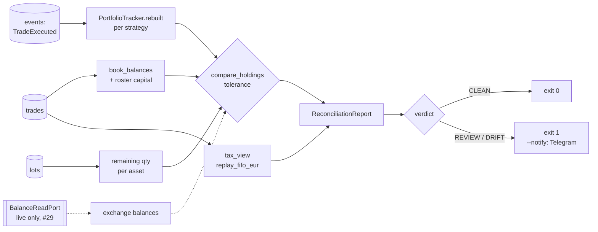

# Change: 35-monthly-reconciliation

**SDD change**: `35-monthly-reconciliation`
**Date**: 2026-10-04
**Status**: Shipped
**Tracking issue**: see sibling `issue.md`

Mirror of engram topic key `sdd/35-monthly-reconciliation/change` (see
[ADR-009 §6](../../../docs/architecture/adr-009-documentation-strategy.md#6-change-specs--sdd-artifacts-dual-source-convention)
dual-source rule).

## Summary

`hermes reconcile [YYYY-MM]` reconciles one Madrid calendar month, read-only.
It compares the **trade book** (the trades table plus the roster's starting
capital) asset by asset with every other view of the same account: the
`TradeExecuted` replay the shadow loop rebuilds its portfolio from, the lot
table the tax lots are read from and, once a live account exists, the
exchange's balances. It also reports the month's realized FIFO EUR P&L and the
lots open at month end, and ends in a verdict: CLEAN, REVIEW (EUR values
pending) or DRIFT. Main pick: in shadow mode there is no exchange account, so
the "account" is the event replay; the exchange comparison is a port with no
adapter yet. Main risk: the verdict is only as strong as the views' independence
(trades and events are written in one transaction, see Risks).

## Scope

### In

- Domain `hermes.domain.reconciliation`: `ReconciliationMonth` (Madrid month,
  UTC bounds), `LedgerTrade`, `book_balances`, `compare_holdings`,
  `HoldingCheck`, `tax_view` (month P&L + open lots), `ReconciliationReport`
  and `Verdict`.
- Port `hermes.ports.reconciliation`: `ReconciliationReadPort` (ledger,
  read-only) and `BalanceReadPort` (account balances).
- Adapter `hermes.adapters.ledger.reconciliation_reader.SqliteReconciliationReader`
  (`mode=ro`, never migrates, safe next to `hermes serve`).
- Application `hermes.application.reconciliation`: `reconcile_month`,
  `reconciliation_alert`, `StrategySeed`.
- `PortfolioTracker.snapshot` read-only property (the replay's cash and
  positions).
- CLI `hermes reconcile` (own command module, #457): text view, `--json`,
  `--tolerance`, `--notify`.
- Tests: unit (domain, application, adapter, entrypoint) and property
  (month tiling, book value conservation, drift sign).

### Out

- **Live exchange balances.** `BalanceReadPort` has no adapter: shadow mode
  has no real account, and the testnet account's balances bear no relation to
  the shadow ledger. The live adapter lands with mainnet wiring (#29); the
  service already compares it for the current month when one is passed.
- **The month-end lot cut itself.** No cut exists in code yet. The report
  exposes `ready_for_cut` (month ended and verdict CLEAN) for that step to gate
  on; "manual review + resolution" stays a human act on the DRIFT list.
- **A systemd timer.** ADR-008 §5 schedules the monthly report for the first
  Sunday; enabling a new timer on the VPS is a deploy change for the Code
  Owner. The command's exit code (0 clean, 1 not clean) is timer-ready.
- **Writing results back.** No `AnomalyDetected` row is appended: the command
  is read-only by design. The alert is pushed, not persisted.

## Decisions

### D-1: The trade book is the reference; every other view is compared to it

- **Decision**: Expected balances come from the trades table folded over the
  roster's `capital_budget`; each other view yields per-asset `HoldingCheck`s
  of `observed - book`.
- **Alternatives**: (a) Exchange as reference: there is no exchange account in
  shadow. (b) Pairwise comparison of every view: N² rows for the same signal.
- **Rationale**: The trades table is what the EUR tax figures derive from
  (ADR-002, ADR-016 item 3), so it is the record a tax cut must agree with.
- **Cost of reversal**: LOW — the reference is one argument to
  `compare_holdings`.

### D-2: Shadow "account" = the TradeExecuted replay; lots and exchange are scoped

- **Decision**: `events` is always compared (replayed per roster strategy with
  `PortfolioTracker.rebuilt`, events before the period end). `lots` is compared
  only when no fill came after the period end, since the table holds current
  state. `exchange` is compared only for the current month, since a venue
  reports balances now. A view not compared is listed with its reason and does
  not change the verdict.
- **Alternatives**: Rebuild historic lot-table state: the table has no history;
  the tax view already replays FIFO as of the period end.
- **Rationale**: ADR-003 §10 "fail loud, not silent": report what can be
  checked, say what was not.
- **Cost of reversal**: LOW.

### D-3: A month is a calendar month in Europe/Madrid

- **Decision**: Bounds are Madrid midnights as UTC instants, half-open.
  Default month = the previous one (the month a cut closes).
- **Alternatives**: UTC months: a 23:30 UTC fill on the last day would land in
  a different month than the tax year assigns it.
- **Rationale**: ADR-016 item 2 (tax year in Madrid time); code-conventions §9.
- **Cost of reversal**: LOW.

### D-4: Month P&L is the FIFO EUR replay, read as of the period end

- **Decision**: `tax_view` runs `replay_fifo_eur` (the ledger's own projection)
  over trades before the period end, sums the consumptions of SELLs inside the
  month, and lists lots still open. A pending trade makes the figures it feeds
  `None` and is counted.
- **Alternatives**: Read `lot_consumptions`: current state only, and a later
  backfill rewrites it; the replay is the same pure function on the same rows.
- **Rationale**: One source of truth for EUR values (change trade-eur-values
  D-5); a past month reads as it stood.
- **Cost of reversal**: LOW.

### D-5: Verdict and alert

- **Decision**: DRIFT on any drift beyond tolerance, any problem (unseeded
  strategy, replay failure, book selling more than it holds); else REVIEW when
  trades lack EUR values; else CLEAN. `--notify` pushes an `AnomalyDetected`
  (source `reconciler`; WARNING for DRIFT, INFO for REVIEW) through Telegram.
  Default tolerance `1e-8` (Binance's spot quantity step), `--tolerance` to
  override.
- **Alternatives**: Auto-heal small drift: rejected by ADR-003 §10.
- **Rationale**: ADR-008 §4 lists reconciliation mismatches as immediate push.
- **Cost of reversal**: LOW.

### D-6 (default picked, flag for the Code Owner): pushed alert is amount-free

- **Decision**: The Telegram alert names the month, views and assets only, no
  quantities or EUR figures; the P&L appears only on the operator CLI.
- **Alternatives**: Include drift amounts in the push.
- **Rationale**: `hermes.application.console.visibility`: pushed surfaces are
  blind to shadow money until certification; the CLI is an operator surface.
- **Cost of reversal**: LOW — one format string.

## Requirements

### R-1: Book and views agree on a ledger written through `record_trade`

- **A-1.1**: `uv run pytest tests/unit/application/reconciliation/test_service.py -k clean` passes.

### R-2: Each view detects drift on its own

- **A-2.1**: `uv run pytest tests/unit/application/reconciliation/test_service.py -k "tampered or without_its_event or exchange"` passes.

### R-3: A past month reads at its end; the month is Madrid

- **A-3.1**: `uv run pytest tests/unit/domain/reconciliation/test_month.py tests/unit/domain/reconciliation/test_tax_view.py` passes.

### R-4: CLI exit codes 0 clean, 1 review/drift, 2 usage, 3 config/ledger

- **A-4.1**: `uv run pytest tests/unit/entrypoints/test_reconcile.py` passes.

### R-5: Read-only

- **A-5.1**: `uv run pytest tests/unit/adapters/ledger/test_reconciliation_reader.py -k write` passes (a write through the reader raises).

## Design



Which views a run compares:

| View | Current month | Past month, no later fills | Past month, later fills |
| --- | --- | --- | --- |
| events | yes | yes | yes |
| lots | yes | yes | skipped |
| exchange (if connected) | yes | skipped | skipped |

Files:

```text
src/hermes/domain/reconciliation/{__init__,month,holdings,tax_view,report}.py
src/hermes/ports/reconciliation.py
src/hermes/adapters/ledger/reconciliation_reader.py
src/hermes/application/reconciliation/{__init__,service}.py
src/hermes/entrypoints/reconcile.py
src/hermes/entrypoints/commands/reconcile.py
src/hermes/application/portfolio/tracker.py   (+ snapshot property)
```

## Test plan

1. Every acceptance criterion above passes.
2. `bash scripts/dev/pr-preflight.sh` green on the tree merged with main.
3. Smoke: `hermes reconcile 2026-09 --db <ledger>` on a ledger with a BUY and a
   partial SELL prints CLEAN, realized 15.60 EUR, one open lot.

Test tiers touched: unit, property

TDD posture: tests written after the production code, from the requirements
above.

## Risks

- **Trades and events share a transaction.** `record_trade` writes both in one
  commit (I-06), so the `events` view catches bugs and manual edits, not a
  crash between writes. The `exchange` view is the independent one; it arrives
  with #29.
- **Lot table vs replayed lots.** Legacy lot rows without a trade link
  (pre-0004) are counted in the lot table but not in the book; such a ledger
  shows drift. Shadow started after 0004, so none exist on the VPS.
- **Roster changes.** Events of a strategy no longer in the roster cannot be
  seeded and are reported as a problem rather than silently dropped.

## Dependencies on other changes

- None blocking. #29 (mainnet adapter) supplies a `BalanceReadPort`.
