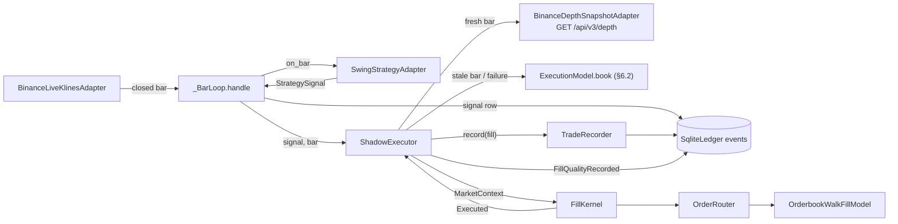

# Change: 353-fill-kernel-in-serve

**SDD change**: `353-fill-kernel-in-serve`
**Date**: 2026-10-04
**Status**: Shipped
**Tracking issue**: see sibling `issue.md` (#353)

Mirror of engram topic key `sdd/353-fill-kernel-in-serve/change` (see
[ADR-009 §6](../../../docs/architecture/adr-009-documentation-strategy.md#6-change-specs--sdd-artifacts-dual-source-convention)
dual-source rule).

## Summary

`hermes serve` starts turning live signals into simulated orders and fills. Each signal goes through the
`FillKernel` the backtest uses (#313, merged as #519: `OrderRouter` → `OrderbookWalkFillModel` →
`PortfolioTracker`), sized by the enabled roster entry's `StrategyConfig.sizing_policy()` (#510),
fed by a public, keyless Binance depth snapshot taken when the bar is handled, and each fill is written
with `TradeRecorder.record` as a `TradeExecuted` v2 trade carrying `strategy_id` and EUR values (or
pending). Next to every fill the loop stores a `FillQualityRecorded` event: which book was used, the
fill price, the pre-registration §6.2 model price for the same order and the drift between them. The
SHADOW_CERTIFIED gate (pre-registration §7, "< 30 bps p50 over 90 days") is computed from these rows.
The main risk is a live book that is unavailable or stale. The loop then falls back to the §6.2
synthetic book and records that it did; entries on that book are refused by the stale-book rule (RO-04).
The Code Owner confirmed this behaviour on 2026-10-04 (D-2).

Rebased on 2026-10-04 onto `main` at `e986a6d`, which has the merged kernel (#519), the
`SizingPolicy` sizing API (#510), the USDT capital seed (#405 via #503/#504) and the per-bar portfolio
marks (#511). The adaptations are D-8 to D-10.

## Scope

### In

- **NEW** `src/hermes/ports/orderbook_snapshot.py`: `OrderbookSnapshotPort` (async `snapshot(pair)`, `aclose()`).
- **NEW** `src/hermes/adapters/market_data/binance_depth_snapshot.py`: `BinanceDepthSnapshotAdapter`.
  It sends public GETs to `/api/v3/depth` on the allow-listed market-data host and holds no key. Its
  token bucket never blocks the loop, and it keeps the last book per pair for one second.
- **NEW** `src/hermes/domain/events/fill_quality_recorded.py`: `FillQualityRecorded` v1 and `BookSource`.
- **NEW** `src/hermes/domain/trading/execution_quality.py`: pure book mid, spread, drift and slippage maths.
- **MOVE** `ExecutionModel` (the §6.2 book) from `application/backtest/replay.py` to
  `application/execution/prereg_book.py`. `replay` re-exports it, so nothing changes for the backtest.
- **NEW** `src/hermes/application/execution/shadow.py`: `ShadowExecutor`. It picks the book, builds
  the real risk and kill inputs, calls the kernel, records the trade and its quality row, and makes
  re-execution after a restart idempotent.
- **EDIT** `src/hermes/adapters/ledger/sqlite_ledger.py`: add the `fill_quality_events(strategy_id)` reader;
  **EDIT** `src/hermes/ports/ledger.py`: add the `ExecutionLedgerPort` protocol.
- **EDIT** `src/hermes/entrypoints/serve.py`: wire the kernel (with `roster.sizing_policy()`, D-8),
  executor (with the capital seed's date as `not_before`, D-9), depth adapter, FX pricer, fee history
  and pre-registration into `build_composition`; call the executor from `_BarLoop.handle` before the
  bar's portfolio mark (D-10); `check_startup` refuses a missing experiment file.
- **EDIT** `src/hermes/entrypoints/commands/serve.py`: pass the experiment root (`--config-dir`'s parent).
- **EDIT** `.github/workflows/cd.yml` and `scripts/deploy/install_release.sh`: ship
  `docs/experiments/swing-mvp1/{pre-registration-v1.md,fee-history.csv}` in each release (D-6).
- **EDIT** `tests/support/serve_loop.py`: by default `build()` injects an unavailable book source and a
  down FX provider, so the existing loop tests stay offline. This changes fixtures only, no assertions.
- **NEW** tests (unit, integration, contract), the recorded fixture
  `tests/fixtures/binance_public/depth_btcusdt_limit20.json`, and `changelog.d/353-added.md`.

### Out

- The L2 collector and a 1-hour spread median. RO-02 (spread spike) is not wired: it needs a median of
  the spread over the last hour, and serve samples the book only on signals. Follow-up issue.
- RO-01 correlation lock and cumulative slippage: `PortfolioSnapshot.to_risk_state()` leaves them empty
  and the kernel passes `tracker.state()` unchanged (#313 R-5). This is Phase 3 of the backtest driver.
- The SA-9 "3+ fires in 30 days" and recovery-period kill inputs need persisted history. Until it exists
  they are `sa9_halt=False` and `days_since_equity_high=0` (D-3).
- Computing the SHADOW_CERTIFIED verdict itself (#355). This change records the per-fill input.
- Sizing math. It landed in #510; serve only passes the roster's policy (D-8).
- Writing the capital seed. `build_composition` already does it once on `main` (#405 D-1); this change
  only reads the recorded seed's date (D-9).
- Any authenticated or trading endpoint. The spot trading adapter on main (#477) is not used.

## Decisions

### D-1: Live order book from a public REST depth snapshot, behind a port

- **Decision**: When a signal is executed, `BinanceDepthSnapshotAdapter.snapshot(pair)` sends
  `GET /api/v3/depth?symbol=…&limit=20` to `market_data.base_url`, the allow-listed
  `https://data-api.binance.vision`. The adapter stamps the book with the injected clock when the
  response arrives and keeps it for one second, which is below RO-04's two-second limit, so a cached
  book never trips the rule by itself. Each request costs a weight of 5 from a non-blocking token
  bucket built from `rate_limit_max_weight`/`rate_limit_window_seconds`. The adapter refuses an
  `X-MBX-APIKEY` header, as the klines adapter does, and can call no other path.
- **Alternatives**: (a) The WebSocket diff stream (`BinanceLiveWsAdapter`) kept up as a local book: a
  24/7 connection plus resync logic, to use one book every few days. (b) Reusing
  `BinanceLiveWsAdapter.get_snapshot`: it hard-codes `api.binance.com` and `datetime.now`, so it is not
  on the market-data allow-list and cannot be tested against a clock. (c) Synthetic books in shadow:
  pre-registration §6.2 says shadow replaces them with the live book walk.
- **Rationale**: ADR-011 D-07/D-08 (the same fill model walks a real book in shadow); ADR-013 §2
  (public REST market data, no key); the decision record
  `2026-10-02-binance-public-market-data-host`. The fill happens a few seconds after the bar closes
  (settle delay), close to the §5.3 "market order at bar close".
- **Cost of reversal**: LOW. A collector-backed adapter is another `OrderbookSnapshotPort`.

### D-2: Book choice per signal and the synthetic fallback

- **Decision**: The live book is used when the bar closed at most `LIVE_BOOK_WINDOW` (5 min) before
  now and the snapshot succeeds. Otherwise the executor builds the §6.2 synthetic book
  (`ExecutionModel.book`, the backtest's code) for that bar and stamps the fill at `signal_time`, as
  the backtest does. A live fill is stamped with the snapshot time. Every fill's
  `FillQualityRecorded.book_source` is `live` or `synthetic`, and a snapshot failure is logged
  (`serve.book.snapshot_failed`). A catch-up bar after a restart always uses the synthetic book: a live
  book taken hours later would measure the outage, not the model.
- **Alternatives**: no fallback, so the signal is declined (an exit would then be lost while the
  strategy considers itself flat); using the live book for stale bars (records a fictional drift).
- **Rationale**: the issue asks for a fallback that is recorded; exits do not go through the risk
  overlay, so the fallback keeps the portfolio in step with the strategy's exits.
- **Cost of reversal**: LOW.
- **Decided by the Code Owner (2026-10-04)**: when the live order book is missing or stale, new
  entries for that bar are skipped; exits still fill at the §6.2 price. This is the behaviour as
  built: an entry on the synthetic fallback is refused by RO-04, and an exit fills on the §6.2 book.

### D-3: Real risk and kill inputs where serve has the data

- **Decision**: `RiskEngine(rules=[MaxSlippage(), StaleBook(), DepegWarn(), DepegHalt(), MacroATRHalt(), PortfolioDrawdown()])`
  and `KillTriggerEvaluator(PreRegistration(project_root=experiment_root))`. The inputs for each entry:

  | Input | Source |
  | --- | --- |
  | `current_spread` | the book used: `(ask − bid) / mid` |
  | `median_spread_1h` | same value (RO-02 is not wired; see Out) |
  | `orderbook_age_seconds` | `now − book.snapshot_time` (live ≈ 0; synthetic = time since bar close, so RO-04 refuses entries on a synthetic book) |
  | `realized_slippage_last` | adverse slippage vs the book mid of the newest `FillQualityRecorded`, read from the ledger at start-up and updated after each fill |
  | `stable_price` | `None`: BTC/ETH/SOL against USDT are not stablecoin pairs (RO-05/06 skip) |
  | `btc_log_return_1d` | `ln(close_t / close_t−1)` of the last two BTC/USDT 1d bars the loop has seen (warm-up included); `None` (so RO-07 halts) until two exist |
  | `ExperimentState.max_drawdown` | `(peak_equity − equity) / peak_equity` from the tracker snapshot |
  | `days_since_equity_high`, `sa9_halt`, `rolling_30d_sharpe` | `0`, `False`, `None` (no persisted history yet; see Out) |

- **Alternatives**: the backtest stubs (D-5 of #313), which would leave serve without the rules
  phase 2 deferred to it; inventing a spread median or a correlation, which would change trading
  without evidence.
- **Rationale**: #313 D-5 hands these inputs to serve. Every value is computed from data the process
  already holds, so none is a placeholder that alters a decision: an unwired rule is not called.
- **Cost of reversal**: LOW. Each rule or input is one list entry.

### D-4: Drift recorded per fill against the §6.2 model price

- **Decision**: After a fill, the executor walks the same order (`fill.order`) through the same
  `OrderbookWalkFillModel` against the §6.2 synthetic book of the signal bar. That walk gives the
  model price. Signed drift in the cost direction:
  `BUY: (fill − model) / model × 10 000`, `SELL: (model − fill) / model × 10 000`, so a positive value
  means shadow paid more than the backtest assumes. `FillQualityRecorded` (same `correlation_id` as the
  trade) stores `book_source`, `fill_price`, `model_price`, `book_mid`, `drift_bps`, `slippage` and
  `book_time`. The gate reads `p50(|drift_bps|)` over the `live` rows. A synthetic fill's drift is 0 by
  construction and is excluded, and a model walk that fails stores `model_price = drift_bps = None`.
- **Alternatives**: drift against the book mid (that is slippage, not sim-vs-live); a new table and
  migration (the `events` table already stores versioned events, and `trade_events` reads the same way).
- **Rationale**: the Code Owner ruling quoted in `shadow_parity.py` says "sim vs real" in shadow means
  the live run against a replay of the same days. Per fill, the replay price is the §6.2 price of the
  same order, which is what pre-registration §7/§10 compare.
- **Cost of reversal**: LOW. The data is append-only and can be re-derived.

### D-5: Idempotency on restart

- **Decision**: Two guards. (1) The bar cursor, unchanged: a bar at or before the persisted
  `BarProcessed` cursor is never evaluated again. (2) Within one bar the order is signal row → trade
  row → quality row → notification → live bar → portfolio mark → cursor row (D-10). A bar re-evaluated after a crash before its
  cursor row is executed only if `ledger.trade_events(strategy_id)` holds no trade for the same pair
  and side at or after `signal.signal_time`; otherwise the executor returns `AlreadyFilled`. The signal
  dedupe (`has_signal_event`) still decides whether the signal row and the notification are repeated.
  A tracker rebuilt from the recorded trades already holds the position, so a re-evaluated exit sells
  the same quantity once.
- **Alternatives**: one SQLite transaction for signal + trade + cursor (spans three ledger methods
  and the EUR pricer's network call); trade dedupe by `correlation_id` (correlation ids are random per
  handling, so a re-evaluated bar gets a new one).
- **Rationale**: reuses the cursor and signal dedupe the loop already has, and adds one read-only
  check keyed on facts that do not change between runs (pair, side, signal time).
- **Cost of reversal**: LOW.

### D-6: Experiment files ship with each release

- **Decision**: The release bundle carries `docs/experiments/swing-mvp1/pre-registration-v1.md` and
  `fee-history.csv` at their repo paths. `install_release.sh` refuses a stage without them and copies
  `docs/` into the version directory, and `hermes serve` uses `--config-dir`'s parent as the experiment
  root (`/opt/hermes/current` on the VPS, the repo root in development). `check_startup` exits 3 when
  either file is missing.
- **Alternatives**: copying the fee table into `config/` (two sources for a §6.1 input); packaging the
  files into the wheel (needs a moved or mapped signed file).
- **Rationale**: today the bundle holds only the wheel, `config/` and `deploy/`, so
  `PreRegistration()` cannot find the signed file on the VPS (see the command below). The kernel's kill
  evaluator and the §6.1 fees both need it.
- **Cost of reversal**: LOW.

### D-7: P&L stays out of pushed notifications and logs

- **Decision**: No new notification is pushed; signal notifications are unchanged. The fill logs
  (`serve.fill.executed`, `serve.fill.declined`, `serve.fill.halted`, `serve.fill.already_filled`)
  carry pair, side, quantity, price, fee, book source and rule. They carry no equity, P&L, drawdown or
  drift, and a risk HALT or kill reason (which can quote the drawdown) is never logged by this change.
  The P&L the operator pulls comes from the console (decision record 2026-10-03).
- **Rationale**: ruling 1 / #319; binding rule 4 of
  `docs/decisions/2026-10-03-operator-sees-shadow-pnl.md` (journal lines are durable records AI
  sessions read).

### D-8: Serve sizes with the roster's pre-registered policy

- **Decision**: `_build_kernel` takes `roster.sizing_policy()` of the enabled roster entry and hands it
  to `FillKernel(sizing=...)`.
- **Alternatives**: a serve-local policy (two sources for the §5.4 and §5.5 limits).
- **Rationale**: the backtest and serve then size from the same `config/strategies.yaml` values.
- **Cost of reversal**: LOW.

### D-9: A fill is never stamped before the capital seed

- **Decision**: `build_composition` reads the recorded seed after `seed_capital_once` and passes its
  `seeded_at` to `ShadowExecutor(not_before=...)`. The executor stamps a fill at the later of its
  book or signal time and `not_before`.
- **Alternatives**: date a first-boot seed earlier than the clock's now (changes #405 D-1 and its
  tests); write the seed after the warm-up (moves #405's write out of `build_composition`).
- **Rationale**: on a first boot the seed is dated at the clock's now (#405 D-1). A bar that closed
  just before the start and arrives after it (the settle delay) fills on the synthetic book at its
  close time, before the seed. The USDT FIFO replay then finds no lot, the trade write raises
  `LedgerError`, the loop exits 1, and every restart re-evaluates the same bar and fails again. On a
  ledger with earlier activity the seed is dated at the earliest event, so the clamp never moves a
  later fill. The main test `test_duplicate_live_bar_is_evaluated_once` hit this (exit 1); with the
  clamp it passes with its assertions unchanged.
- **Cost of reversal**: LOW.

### D-10: Order of the per-bar writes

- **Decision**: `_BarLoop.handle` runs tracker mark → strategy → signal row → executor (trade row,
  quality row) → notification → live bar → portfolio mark (#511) → `BarProcessed` cursor row. The
  portfolio mark is read from the tracker the kernel just folded the fill into, so the mark of an
  entry bar holds the position. The seed is not written per bar.
- **Rationale**: the mark is the portfolio after the bar, fill included. Each record has one writer:
  trades only through `TradeRecorder`, marks only in `handle`, the seed only in `seed_capital_once`.
  A re-evaluated bar keeps its stored mark (`INSERT OR IGNORE`) and its trade (D-5), so nothing is
  recorded twice.
- **Cost of reversal**: LOW.

## Requirements

### R-1: A live signal becomes a simulated order and fill in the ledger

- **A-1.1**: Integration: scripted bars through `run()` with a fake live book produce, for the entry
  bar, one `TradeExecuted` v2 row with `strategy_id = swing-donchian-4h`, one `trades` row and one
  `FillQualityRecorded` row with `book_source = live`, sharing a `correlation_id`.
- **A-1.2**: The exit bar sells exactly the held quantity and leaves the portfolio flat.

### R-2: One kernel

- **A-2.1**: `serve.py` builds `FillKernel` from `hermes.application.execution`, and the `ExecutionModel`
  the backtest uses is the one serve uses. Checked by a test that compares the objects' identities.
- **A-2.2**: No module under `src/hermes/entrypoints` or `application/execution/shadow.py` constructs an
  `Order` or calls a fill model's `fill_order` outside the drift walk.

### R-3: Drift per fill

- **A-3.1**: `drift_bps` matches D-4 for BUY and SELL (unit + hypothesis: sign, zero when equal,
  antisymmetry).
- **A-3.2**: A failed snapshot falls back to the synthetic book: an exit fills with `book_source =
  synthetic`, and an entry is refused by RO-04.

### R-4: Restart

- **A-4.1**: Boot 1 fills the entry; boot 2 rebuilds the tracker from recorded trades (the position is
  held with the same quantity) and fills the exit.
- **A-4.2**: A bar re-evaluated after a crash before its cursor row adds no second trade.
- **A-4.3**: On a first boot, a signal of a bar that closed just before the start fills at the capital
  seed's date, the seed lot pays for it, and the loop exits 0 (D-9).

### R-5: Blind outputs

- **A-5.1**: The pushed notifications of a run with fills are exactly the `SignalEmitted` events (no
  trade, equity or P&L event). The captured fill log lines carry no `equity`, `pnl`, `drawdown` or
  `drift` key.

### R-6: Keyless, read-only depth

- **A-6.1**: The adapter refuses a client with an API-key header and any path other than `/api/v3/depth`.
- **A-6.2**: The recorded fixture parses into a valid `Orderbook`; the contract test (marker
  `contract`) checks the live shape.

### R-7: Gates

- **A-7.1**: `uv run pytest tests/unit tests/integration -q`, `uv run ruff check`,
  `uv run ruff format --check src tests`, `uv run mypy src`, `uv run lint-imports` are green.

### R-8: Portfolio marks after fills

- **A-8.1**: The portfolio mark stored for the entry bar holds the bought quantity (D-10).

## Design



```python
class ShadowExecutor:
    def __init__(
        self,
        *,
        kernel: FillKernel,
        fill_model: FillModelPort,
        books: OrderbookSnapshotPort,
        recorder: FillRecorder,
        ledger: ExecutionLedgerPort,
        clock: ClockPort,
        fees_at: Callable[[datetime, Pair], FeeSchedule],
        strategy_id: StrategyId,
        model: ExecutionModel | None = None,
        live_window: timedelta = LIVE_BOOK_WINDOW,
        not_before: datetime | None = None,  # the capital seed's date (D-9)
    ) -> None: ...
    def observe(self, bar: Bar) -> None: ...  # BTC 1d closes for RO-07
    async def execute(
        self, signal: StrategySignal, bar: Bar, *, correlation_id: str
    ) -> ShadowOutcome: ...


# ShadowOutcome = ExecutionOutcome | AlreadyFilled
```

No migration: `FillQualityRecorded` lives in the existing `events` table.

### Sizing (#480, landed in #510)

The merged kernel takes a required `sizing: SizingPolicy` and builds `SizingInput(entry_px,
stop_px=signal.stop_price, open_notional=tracker.open_notional())` itself. Serve passes
`roster.sizing_policy()` to `_build_kernel` (D-8). This change defines no sizing type, and nothing in
`ShadowExecutor` or the loop sizes anything.

## Test plan

1. Domain: `execution_quality` drift and slippage maths (examples + hypothesis); `FillQualityRecorded`
   validation and its base-hash invariant (the existing parametrised event test picks it up).
2. Adapter: `BinanceDepthSnapshotAdapter` with `respx` on the recorded fixture (parse, cache,
   rate-limit wait, key refusal, HTTP error → `ExchangeError`, transport → `NetworkError`); contract
   test on the real host (excluded by default).
3. Ledger: `fill_quality_events` round trip.
4. Application: `ShadowExecutor` book choice, fallback, risk inputs (RO-04 on a synthetic entry, RO-07
   from BTC 1d closes), idempotency, quality row.
5. Integration: bar → ledger fill through `run()`; restart rebuild; crash-window re-evaluation;
   notification and log blindness.
6. Deploy: the bundle step ships both experiment files; `install_release.sh` copies them.

### Commands run against the tree (2026-10-04, base `4261549`)

```text
$ curl -s -D - "https://data-api.binance.vision/api/v3/depth?symbol=BTCUSDT&limit=20"
HTTP/1.1 200 OK
x-mbx-used-weight: 5
{"lastUpdateId": …, "bids": [["84833.11000000","5.11389000"], …20], "asks": [["84833.12000000","6.49267000"], …20]}

$ uv run python -c "PreRegistration(project_root=Path('/opt/hermes/current'))"
FileNotFoundError: Pre-registration file not found at \opt\hermes\current\docs\experiments\swing-mvp1\pre-reg…

$ grep -n "docs" .github/workflows/cd.yml scripts/deploy/install_release.sh
.github/workflows/cd.yml:21:# See docs/guides/vps-operations.md for the operator checklist and

$ uv run python -c "select_fee_schedule(load_binance_fee_history(...), 2026-10-04, BTC/USDT)"
FeeSchedule(pair=BTC/USDT, tiers=(FeeTier(volume_threshold_usd=0, maker_bps=10, taker_bps=10),))
```

The depth host answers keyless with weight 5. The release has no `docs/` today, and the current fee
row is VIP0 10/10 bps.

## Risks

- **R1**: The depth snapshot is taken a few seconds after the close (settle delay), not at the close.
  This is the shadow reality the drift measures, not an error.
- **R2**: A long Binance outage refuses every entry (RO-04 on the synthetic book). This is an
  operational halt under binding rule 2(b), visible in `serve.fill.declined rule=HALT`.
- **R3**: `peak_equity` after a restart comes from the trade replay only, with no bar marks, so
  `max_drawdown` can read low just after a reboot. The marks #511 stores per bar carry the peak, but
  the tracker rebuild does not read them yet; that is a follow-up.
- **R7**: A first-boot fill stamped at the seed's date (D-9) is up to one settle delay later than its
  bar close; the §6.1 fee row and the kill check use that stamp.
- **R4**: Strategy and portfolio can still diverge, for example on an entry the risk overlay refuses
  (#313 R4). The declined log line shows it.
- **R5**: The deploy change has to land with this change: a release without `docs/` now fails
  `check_startup` with exit 3, on purpose.
- **R6**: Pricing in EUR calls Frankfurter synchronously on the loop. It is bounded by its timeout, and
  a failure stores the trade pending (#435).

## Dependencies on other changes

- Builds on #313 (kernel, merged as #519), #392 (tracker rebuild), #435 (TradeRecorder), #309/#421
  (bar loop, cursor), #510 (sizing policy), #405 (USDT FIFO and capital seed, #503/#504) and #511
  (portfolio marks per bar).
- The decision record `2026-10-03-operator-sees-shadow-pnl.md` and its lab-notebook entry must merge
  before the first simulated fill.
