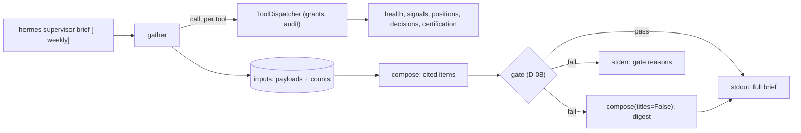

# Change: 365-supervisor-desk-briefings

**SDD change**: `365-supervisor-desk-briefings`
**Date**: 2026-10-04
**Status**: Shipped
**Tracking issue**: see sibling `issue.md` (#496, first slice of #365)

Mirror of engram topic key `sdd/365-supervisor-desk-briefings/change` (see
[ADR-009 §6](../../../docs/architecture/adr-009-documentation-strategy.md#6-change-specs--sdd-artifacts-dual-source-convention)
dual-source rule).

## Summary

Starts the supervisor desk (ADR-012 D-05) in its rollout order, "briefings
first": `hermes supervisor brief` prints a daily line and `--weekly` a weekly
brief, built by code from the read-only supervisor tools (#34) with no model
call. Every line cites the tool it came from. The change also adds the D-08
output gate, the deterministic check every desk text must pass before it is
posted, and applies it to the briefs now, so the decision cards and answers
that follow inherit a tested boundary. The main risk is a free-text field
(a status reason or a decision title) carrying something the gate rejects;
the brief then falls back to the digest of states and counts.

## Scope

### In

- `application/supervisor/briefing.py`: `gather` (reads every source tool
  through `ToolDispatcher` and adds code-computed counts), `compose` (cited
  items for the daily line and the weekly brief), `publishable` (gate, then
  the digest on failure).
- `application/supervisor/gate.py`: the D-08 output gate.
- `hermes supervisor brief [--weekly]` in the existing command.
- A "Desk briefings" section in `docs/guides/vps-operations.md`.

### Out

All of these stay on #365:

- **Decision cards with a dissent model**, **ask anything**, **watchdog
  explanations**, **project oversight** and **pre-mortems**: each needs a
  model call, and with it a pinned model id, a provider key in the loop
  workspace, the `llm_audit` trail and the D-09 spend ceiling, which are the
  Code Owner's setup steps (ADR-012 D-09, `AGENTS.md` rule 9).
- **Posting** to Slack or GitHub on a schedule: a standing automation, which
  the Code Owner enables.
- **Fill drift and kill-trigger state**: no read tool serves them yet (fills
  land with #353). The weekly brief says so in those two lines.
- **Spend tracking**: there is no model spend to report; the brief says it
  was built without a model.

## Decisions

### D-1: Briefings are deterministic first

- **Decision**: the briefs are composed by code from the tool payloads. No
  model writes them.
- **Alternatives**: have a model write the brief from the same input and
  gate it.
- **Rationale**: ADR-012 D-09 asks for a deterministic prefilter and a
  zero-token all-clear for a clean bundle, and D-08 needs a deterministic
  digest to fall back to. This is both. A model-written brief can be added
  on top later, through the same gate, once the provider setup exists.
- **Cost of reversal**: LOW.

### D-2: The desk reads through the dispatcher, not the reader

- **Decision**: `gather` calls the tools through `ToolDispatcher`, so the
  brief holds the same grants and leaves the same audit lines as an MCP
  client. An ungranted tool reads as "Unavailable (not granted)".
- **Alternatives**: call the projection functions directly.
- **Rationale**: one boundary for every supervisor reader (ADR-003 §08
  deny-by-default); the brief can never see more than the tools return.
- **Cost of reversal**: LOW.

### D-3: Counts are computed by code and put in the input

- **Decision**: `gather` adds a `counts` section (signals, entries, exits,
  open positions, decisions waiting and sealed). The text states only those.
- **Rationale**: the gate requires every number in a text to exist in its
  input (D-08). Counting in code keeps that rule exact for the briefs and
  gives a later model the same numbers to cite instead of counting itself.
- **Cost of reversal**: LOW.

### D-4: Gate rules

- **Decision**: reject an empty or over-long text (4000 characters), any
  link form, a code fence, a secret-shaped string, an outcome word (P&L,
  profit, loss, equity, Sharpe, drawdown, win rate, returns and similar), a
  `[reference]` not in the caller's list, and any number not written in the
  input's canonical JSON. Digits inside a checked reference are not figures.
- **Rationale**: ADR-012 D-08 lists schema and length, links, code fences,
  secret patterns and "every cited number and ID must exist in the input";
  D-06 adds the outcome words.
- **Cost of reversal**: LOW. Rules only tighten through review.

### D-5: On a gate failure, print the digest and log the reasons

- **Decision**: `publishable` returns the digest (states and counts, no free
  text) when the full brief fails, and the CLI writes the gate's reasons to
  stderr as one JSON line. If the digest fails too, the CLI prints
  `REFUSED` and exits 1.
- **Rationale**: D-08 "On failure the deterministic digest goes out
  instead". The reasons go to the operator's log, not into the brief, since
  they can quote the rejected word.
- **Cost of reversal**: LOW.

## Requirements

### R-1: Cited and gated

- **A-1.1**: `uv run pytest tests/unit/application/supervisor/test_briefing.py -k "cites or gate or daily"`
  passes: every source tool is cited and both briefs pass the gate.

### R-2: Blind and sealed

- **A-2.1**: `uv run pytest tests/unit/application/supervisor/test_briefing.py -k "price or sealed"`
  passes: no entry price reaches either brief for any price, and strategy
  decisions appear by count only.

### R-3: Deny-by-default

- **A-3.1**: `uv run pytest tests/unit/application/supervisor/test_briefing.py tests/unit/entrypoints/test_supervisor.py -k "ungranted or without_grants"`
  passes.

### R-4: Gate rules

- **A-4.1**: `uv run pytest tests/unit/application/supervisor/test_gate.py`
  passes.
- **A-4.2**: `uv run lint-imports` keeps `supervisor-is-read-only`.

## Design

Weekly brief lines: Health, Signals, Open positions, Decisions waiting,
Certification, Fill drift, Kill triggers, Model spend. The daily line is one
item over the last day.

## Test plan

1. Gate: a clean text passes; links, fences, secret shapes, outcome words,
   unknown references, invented numbers, over-long and empty texts are each
   rejected; a Hypothesis property that any number from the input passes.
2. Briefing: every source cited and gate passes; counts stated exactly;
   sealed decisions by count only; unserved items say so; ungranted tools
   are unavailable and audited as denied; the daily line; a Hypothesis
   property that no entry price reaches a brief; the digest fallback.
3. CLI over a real ledger file: daily line, weekly headings, no grants.
4. `bash scripts/dev/pr-preflight.sh` passes.

## Risks

- **A free-text field trips the gate every day**: the digest still goes
  out, and the stderr line names the rule, so the operator sees it.
- **Gate false negatives**: the gate is a deny list for forms of text plus
  an allow list for numbers and references. New outcome words get added by
  review, and the number rule bounds what a model could invent.
