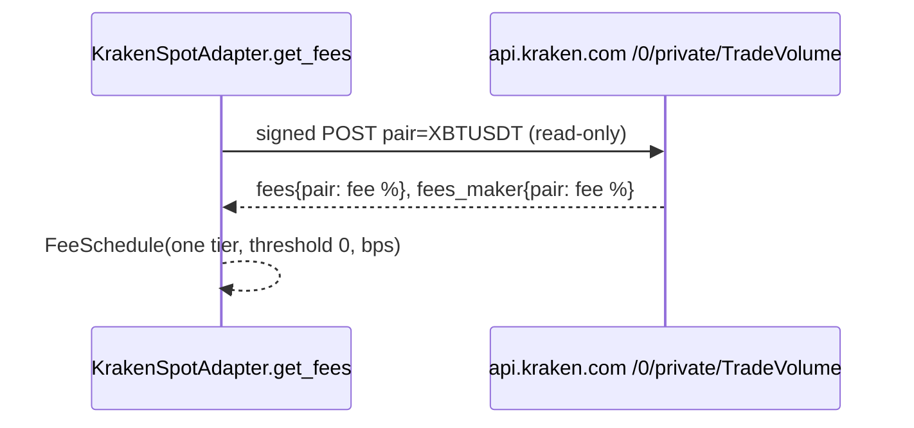

# Change: 599-kraken-trade-volume-fees

**SDD change**: `599-kraken-trade-volume-fees`
**Date**: 2026-10-04
**Status**: Shipped
**Tracking issue**: see sibling `issue.md` (#599)

Mirror of engram topic key `sdd/599-kraken-trade-volume-fees/change` (see
[ADR-009 §6](../../../docs/architecture/adr-009-documentation-strategy.md#6-change-specs--sdd-artifacts-dual-source-convention)
dual-source rule).

## Summary

On 2026-10-04 Kraken's public `AssetPairs` reply started returning empty
`fees` and `fees_maker` lists for every pair, so the Kraken failover adapter
had no fee schedule and the daily contract test went red. The Code Owner chose
to read fees from the account's own schedule through the private, read-only
`TradeVolume` call. The main risk is that the contract test now needs a
read-only Kraken key and skips until one exists.

## Scope

### In

- `KrakenSpotAdapter.get_fees` calls `TradeVolume` for the pair and returns a
  one-tier schedule with the account's current maker and taker fee.
- `tests/contract/test_kraken_public_fees.py` checks the real `TradeVolume`
  reply and skips without `HERMES_KRAKEN__API_KEY` / `HERMES_KRAKEN__API_SECRET`.
- `scheduled.yml` passes those two secrets to the contract job.

### Out

- Binance fees and the experiment's fee numbers (frozen until certification).
- Removing `KrakenPublicAdapter.get_pair_fees`; it stays, documented as
  failing against the live API, until the failover work is picked up.

## Decisions

### D-1: Kraken fees come from the private TradeVolume call

- **Decision**: The failover adapter asks Kraken for the account's own fee.
- **Alternatives**: a hand-set Kraken entry in `config/fees.yaml` (goes stale
  silently); leaving the daily run red until the failover work (no signal for
  weeks).
- **Rationale**: an adapter that would trade real money should charge the
  fee the account actually pays. Chosen by the Code Owner on 2026-10-04.
- **Cost of reversal**: LOW.

### D-2: One tier at threshold zero

- **Decision**: `TradeVolume` reports the fee for the account's current
  volume, so the schedule has one tier that applies at any volume.
- **Rationale**: the reply carries only the current and next fee, not the
  full table; inventing the other rows would be guessing.
- **Cost of reversal**: LOW.

## Requirements

### R-1: Fees from TradeVolume

- **A-1.1**: `test_fees_are_the_accounts_trade_volume_fees` passes: the
  signed call sends `pair=XBTUSDT` and 0.25% / 0.40% become 25 / 40 bps.
- **A-1.2**: `test_trade_volume_reply_without_fees_raises` passes.

### R-2: Daily run green without keys

- **A-2.1**: `uv run pytest tests/contract -m contract` skips the Kraken fee
  test when the two variables are unset.

## Design

## Test plan

1. Kraken spot unit tests pass.
2. Contract tier skips the Kraken fee test without keys.
3. `bash scripts/dev/pr-preflight.sh` is green.

## Risks

- Until the maintainer adds a read-only key as repository secrets, the fee contract
  test is skipped, so a future change to the `TradeVolume` reply would not be
  caught by the daily run.
