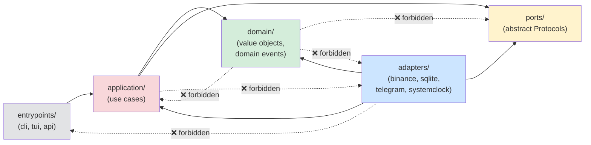
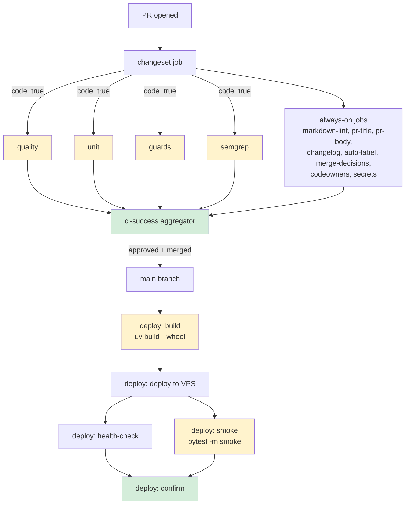

# Design: phase-0-python-toolchain

**SDD change**: `phase-0-python-toolchain`
**Date**: 2026-08-21
**Status**: Proposed

Mirror of engram topic key `sdd/phase-0-python-toolchain/design` (see ADR-009 §6).

Concrete, copy-ready file shapes for the `sdd-apply` phase. Every code block below is the intended final content or a spec-quality diff.

## Hexagonal import direction (enforced by `import-linter`)



Green = domain (pure). Yellow = ports (Protocols, no logic). Blue = adapters (I/O). Pink = application (use cases). Grey = entrypoints. Dashed lines are the three `forbidden` contracts.

## CI + CD execution shape (self-hosted, Docker/Linux)



Yellow = jobs whose bodies this change fills. Green = aggregators.

## File tree (new + modified + deleted)

```text
hermes/
├── .gitignore                              [modify: remove `uv.lock` line]
├── .pre-commit-config.yaml                 [modify: +4 Python hooks (§ Pre-commit patch)]
├── .python-version                         [create: "3.14"]
├── pyproject.toml                          [create: all-in-one config, see § pyproject.toml]
├── uv.lock                                 [create: generated by `uv lock`, committed]
├── known_advisories.yaml                   [create: header + `advisories: []`]
├── .github/dependabot.yml                  [ALREADY LIVE — no change; supersedes renovate.json]
├── src/
│   └── hermes/
│       ├── __init__.py                     [create: `__version__ = "0.0.0"`]
│       ├── domain/__init__.py              [create: empty]
│       ├── application/__init__.py         [create: empty]
│       ├── ports/__init__.py               [create: empty]
│       ├── ports/exchange.py               [create: ExchangePort Protocol stub]
│       ├── adapters/__init__.py            [create: empty]
│       ├── adapters/exchanges/__init__.py  [create: empty]
│       ├── adapters/ledger/__init__.py     [create: empty]
│       ├── adapters/notifier/__init__.py   [create: empty]
│       ├── adapters/clock/__init__.py      [create: empty]
│       ├── infrastructure/__init__.py      [create: empty]
│       └── entrypoints/__init__.py         [create: empty]
├── tests/
│   ├── __init__.py                         [create: empty]
│   ├── conftest.py                         [create: registers sev1_guard]
│   ├── plugins/
│   │   ├── __init__.py                     [create: empty]
│   │   └── sev1_guard.py                   [create: pytest plugin, see § sev1_guard]
│   ├── unit/
│   │   ├── __init__.py                     [create: empty]
│   │   └── test_sev1_guard.py              [create: pytester-based self-test]
│   ├── integration/__init__.py             [create: empty]
│   └── e2e/__init__.py                     [create: empty]
├── scripts/dev/coverage-check.py           [create: per-package threshold]
└── .github/workflows/
    ├── ci.yml                              [modify: fill quality/unit/guards/semgrep bodies]
    └── deploy.yml                          [modify: fill build/smoke bodies]
```

No files deleted (repo `main.py` was already absent per exploration).

## `pyproject.toml`

```toml
[project]
name = "hermes"
version = "0.0.0"
description = "Crypto trading engine — hexagonal, event-sourced, tax-compliant."
requires-python = ">=3.14,<3.15"
readme = "README.md"
license = { text = "Proprietary" }
authors = [{ name = "Ricardo Afonso" }]
dependencies = [
  "pydantic>=2.9,<3",
  "pydantic-settings>=2.5,<3",
  "httpx>=0.27,<1",
  "structlog>=24.4,<25",
  "typer>=0.12,<1",
  "rich>=13.8,<14",
  "textual>=0.79,<1",
  "apscheduler>=3.10,<4",
  "python-telegram-bot>=21.5,<22",
  "ulid-py>=1.1,<2",
]

[dependency-groups]
dev = [
  "pytest>=8.3,<9",
  "pytest-xdist>=3.6,<4",
  "hypothesis>=6.112,<7",
  "syrupy>=4.7,<5",
  "mutmut>=3.1,<4",
  "respx>=0.21,<1",
  "freezegun>=1.5,<2",
  "coverage[toml]>=7.6,<8",
  "ruff>=0.6,<1",
  "mypy>=1.11,<2",
  "import-linter>=2.1,<3",
  "safety>=3.2,<4",
  "pip-audit>=2.7,<3",
  "cyclonedx-python-lib>=8.5,<9",
  "pre-commit>=3.8,<4",
  "radon>=6.0,<7",
  "vulture>=2.13,<3",
]

[build-system]
requires = ["hatchling"]
build-backend = "hatchling.build"

[tool.hatch.build.targets.wheel]
packages = ["src/hermes"]

[tool.ruff]
target-version = "py314"
line-length = 100
extend-exclude = ["src/hermes/**/__init__.py"]

[tool.ruff.lint]
select = ["E", "F", "W", "I", "N", "UP", "B", "SIM", "PL", "RUF", "S", "PTH", "ERA", "PGH"]
ignore = ["PLR0913"]  # arg count — hexagonal use cases take many ports

[tool.ruff.lint.per-file-ignores]
"tests/**" = ["S101", "PLR2004"]  # assert allowed in tests, magic numbers fine

[tool.mypy]
strict = true
python_version = "3.14"
mypy_path = "src"
packages = ["hermes"]
exclude = ["build/", "dist/", ".venv/"]

[tool.pytest.ini_options]
testpaths = ["tests"]
markers = [
  "smoke: post-deploy smoke tests",
  "integration: tier-2 tests (SQLite :memory:, testnet)",
  "e2e: tier-3 end-to-end against testnet",
  "slow: >1s per test",
]
addopts = "-ra --strict-markers --strict-config -p tests.plugins.sev1_guard"

[tool.coverage.run]
source = ["src/hermes"]
branch = true

[tool.coverage.report]
exclude_lines = [
  "pragma: no cover",
  "if TYPE_CHECKING:",
  "@abstractmethod",
  "raise NotImplementedError",
]

[tool.importlinter]
root_packages = ["hermes"]

[[tool.importlinter.contracts]]
name = "domain-is-pure"
type = "forbidden"
source_modules = ["hermes.domain"]
forbidden_modules = [
  "hermes.application", "hermes.ports", "hermes.adapters",
  "hermes.infrastructure", "hermes.entrypoints",
]

[[tool.importlinter.contracts]]
name = "application-imports-only-domain-and-ports"
type = "forbidden"
source_modules = ["hermes.application"]
forbidden_modules = ["hermes.adapters", "hermes.infrastructure", "hermes.entrypoints"]

[[tool.importlinter.contracts]]
name = "adapters-never-import-entrypoints"
type = "forbidden"
source_modules = ["hermes.adapters"]
forbidden_modules = ["hermes.entrypoints"]

[tool.mutmut]
paths_to_mutate = ["src/hermes/domain/"]
tests_dir = "tests/unit/"
runner = "uv run pytest tests/unit/ -x -q"

[tool.vulture]
min_confidence = 80
paths = ["src/hermes"]
exclude = ["src/hermes/ports/"]
```

## `tests/plugins/sev1_guard.py`

```python
"""Pytest plugin: fail session if SEV-1 tests were skipped without opt-in.

A test is SEV-1-annotated if the source has `# SEV-1:` comment above `def test_*`.
If any such test is skipped and `PYTEST_SEV1_ALLOW_SKIP` env var is not set,
the session exits 1 (post-run).
"""

from __future__ import annotations

import os
import re
from pathlib import Path

import pytest

_SEV1_RE = re.compile(r"#\s*SEV-1:", re.IGNORECASE)
_skipped_sev1: list[str] = []


def _is_sev1_test(nodeid: str) -> bool:
    file_part = nodeid.split("::")[0]
    try:
        src = Path(file_part).read_text(encoding="utf-8").splitlines()
    except OSError:
        return False
    test_name = nodeid.split("::")[-1].split("[")[0]
    for i, line in enumerate(src):
        if f"def {test_name}" in line:
            for j in range(max(0, i - 3), i):
                if _SEV1_RE.search(src[j]):
                    return True
    return False


def pytest_report_teststatus(report: pytest.TestReport) -> None:
    if report.when == "setup" and report.skipped and _is_sev1_test(report.nodeid):
        _skipped_sev1.append(report.nodeid)


def pytest_sessionfinish(session: pytest.Session, exitstatus: int) -> None:
    if _skipped_sev1 and not os.environ.get("PYTEST_SEV1_ALLOW_SKIP"):
        for nid in _skipped_sev1:
            print(f"SEV1_GUARD: SEV-1 test skipped without opt-in: {nid}")
        session.exitstatus = 1
```

## `tests/unit/test_sev1_guard.py`

Uses pytest's built-in `pytester` fixture to instantiate a mini-test that skips a `# SEV-1:`-annotated function and asserts the guard fires. Shape:

```python
def test_sev1_skip_without_optin_fails(pytester):
    pytester.makepyfile("""
        import pytest

        # SEV-1: Security axis S1
        def test_placeholder():
            pytest.skip("temporarily disabled")
    """)
    result = pytester.runpytest_subprocess("-p", "tests.plugins.sev1_guard")
    assert result.ret == 1
```

## `scripts/dev/coverage-check.py`

```python
"""Enforce per-package coverage thresholds by reading coverage.json.

Usage:
  python scripts/dev/coverage-check.py [--bootstrap] [--report coverage.json]

--bootstrap: packages with 0 executable lines pass instead of fail.
"""

from __future__ import annotations

import argparse
import json
import sys
from pathlib import Path

THRESHOLDS = {
    "src/hermes/domain": 95,
    "src/hermes/application": 90,
    "src/hermes/adapters/ledger": 90,
    "src/hermes/adapters/exchanges": 80,
    "src/hermes/adapters/notifier": 85,
    "src/hermes/entrypoints": 70,
}


def main() -> int:
    parser = argparse.ArgumentParser()
    parser.add_argument("--bootstrap", action="store_true")
    parser.add_argument("--report", default="coverage.json", type=Path)
    args = parser.parse_args()

    data = json.loads(args.report.read_text())
    files = data["files"]
    failures: list[str] = []

    for prefix, threshold in THRESHOLDS.items():
        matching = {p: f for p, f in files.items() if p.replace("\\", "/").startswith(prefix)}
        total_lines = sum(f["summary"]["num_statements"] for f in matching.values())
        if total_lines == 0:
            marker = "PASS (bootstrap)" if args.bootstrap else "FAIL"
            print(f"{prefix:45s} EMPTY — {marker}")
            if not args.bootstrap:
                failures.append(f"{prefix}: no executable lines")
            continue
        covered = sum(f["summary"]["covered_lines"] for f in matching.values())
        pct = 100 * covered / total_lines
        status = "PASS" if pct >= threshold else "FAIL"
        print(f"{prefix:45s} {pct:6.2f}% (threshold {threshold}%) — {status}")
        if pct < threshold:
            failures.append(f"{prefix}: {pct:.2f}% < {threshold}%")

    return 0 if not failures else 1


if __name__ == "__main__":
    sys.exit(main())
```

## `.pre-commit-config.yaml` — additions

Append this block to the existing `repos:` list:

```yaml
  - repo: local
    hooks:
      - id: ruff-check
        name: ruff check
        language: system
        entry: uv run ruff check
        types: [python]
      - id: ruff-format
        name: ruff format
        language: system
        entry: uv run ruff format --check
        types: [python]
      - id: mypy
        name: mypy --strict
        language: system
        entry: uv run mypy --strict
        types: [python]
        pass_filenames: false
        args: ["src/"]
      - id: import-linter
        name: import-linter
        language: system
        entry: uv run import-linter
        pass_filenames: false
```

## Dependency updates — Dependabot (already live)

**No new file.** `.github/dependabot.yml` is in place and correctly configured:

- Weekly Monday 06:00 (Europe/Madrid)
- 7-day cooldown on brand-new releases (blast radius reduction)
- Two ecosystems: `pip` (via `pyproject.toml`/`uv.lock`) and `github-actions`
- Grouped: `production-minor-patch`, `development-minor-patch`, `actions-minor-patch`
- Majors arrive as own PR (recorded decision per group)
- Labels + assignees + reviewers configured
- Open-PR limit: 3 per ecosystem

Verify with `bat .github/dependabot.yml`. Any change to the file is out of scope for this Phase 0 change (touch it only if the exchange lib lands and needs a new grouping rule).

**ADR-010 §2 says "Renovate over Dependabot"** — that decision was reversed in practice and the ADR is stale. Refresh is a separate follow-up (see proposal § Dependencies).

## `known_advisories.yaml`

```yaml
# Registry of CVEs we've reviewed and accepted (with expiry).
# Referenced by pip-audit/safety runs to allow-list known-benign findings.
# Entry shape:
#   - id: CVE-YYYY-NNNNN
#     package: <pypi-name>
#     reason: <why safe / mitigation>
#     accepted_by: <initials>
#     expires: YYYY-MM-DD  # MUST re-review by this date
advisories: []
```

## `.github/workflows/ci.yml` — `quality` body

```yaml
      - uses: actions/checkout@v5
      - uses: astral-sh/setup-uv@v3
        with: { version: "0.12.5" }
      - run: uv sync --frozen
      - run: uv run ruff check .
      - run: uv run ruff format --check .
      - run: uv run mypy --strict src/
      - run: uv run import-linter
      - run: uv run pip-audit --strict
      - run: uv run safety check --full-report
      - run: uv run radon cc --min B src/
      - run: uv run vulture src/
```

## `.github/workflows/ci.yml` — `unit` body

```yaml
      - uses: actions/checkout@v5
      - uses: astral-sh/setup-uv@v3
        with: { version: "0.12.5" }
      - run: uv sync --frozen
      - run: uv run pytest tests/unit/ --cov=src/hermes --cov-branch --cov-report=xml --cov-report=json
      - run: uv run python scripts/dev/coverage-check.py --bootstrap
```

## `.github/workflows/ci.yml` — `guards` body

Test-deletion guard, one bash step:

```yaml
      - uses: actions/checkout@v5
        with: { fetch-depth: 0 }
      - name: Test-deletion guard
        run: |
          set -euo pipefail
          DELETED=$(git diff --name-only --diff-filter=D \
            "origin/${{ github.base_ref }}...HEAD" -- 'tests/**/*.py' || true)
          [ -z "$DELETED" ] && exit 0
          if ! grep -q '^SEV-1:' <<< "${{ github.event.pull_request.body }}"; then
            echo "Tests deleted but PR body lacks 'SEV-1:' opt-in header." >&2
            echo "$DELETED" >&2
            exit 1
          fi
```

## `.github/workflows/ci.yml` — `semgrep` body

```yaml
      - uses: actions/checkout@v5
      - uses: returntocorp/semgrep-action@v1
        with:
          config: p/security-audit p/python
          publishToken: ""  # no cloud upload
```

## `.github/workflows/deploy.yml` — `build` body

```yaml
      - uses: actions/checkout@v5
      - uses: astral-sh/setup-uv@v3
        with: { version: "0.12.5" }
      - run: uv sync --frozen
      - run: uv build --wheel
      - uses: actions/upload-artifact@v4
        with: { name: hermes-wheel, path: dist/*.whl }
```

## `.github/workflows/deploy.yml` — `smoke` body

```yaml
      - uses: actions/checkout@v5
      - uses: astral-sh/setup-uv@v3
        with: { version: "0.12.5" }
      - run: uv sync --frozen
      - run: uv run pytest -m smoke --tb=short
```

## Windows / PyCharm follow-up (dev machine, out of CI)

Existing `.venv/` is already Python 3.14 — no venv recreate needed. Just:

1. `uv sync --frozen` — pulls all new deps into the existing 3.14 venv.
2. In PyCharm: File → Invalidate Caches (only if the interpreter list looks stale); then Project Interpreter → confirm `.venv/Scripts/python.exe` is selected.

Document in the PR body and (once written) in `docs/guides/local-setup.md`.
