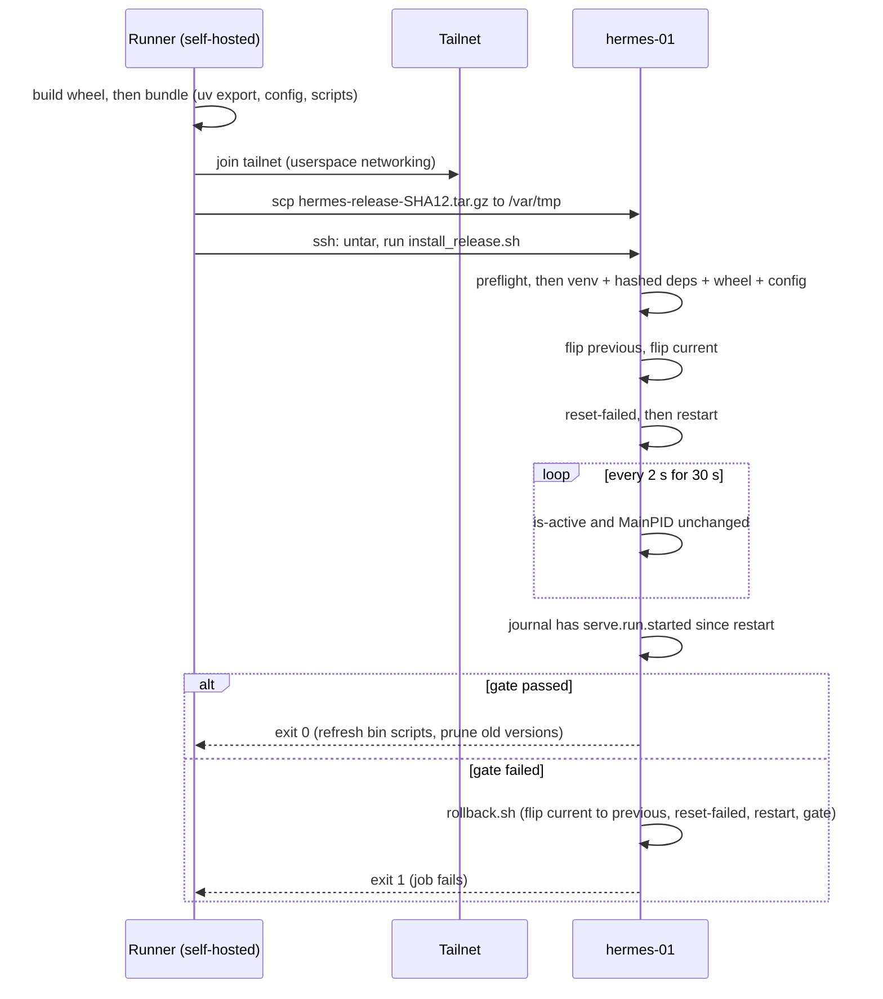
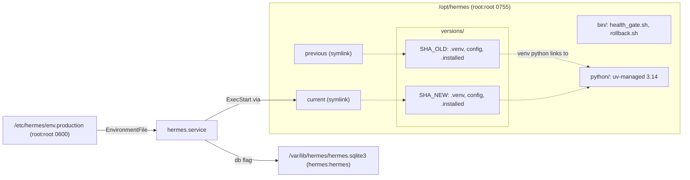
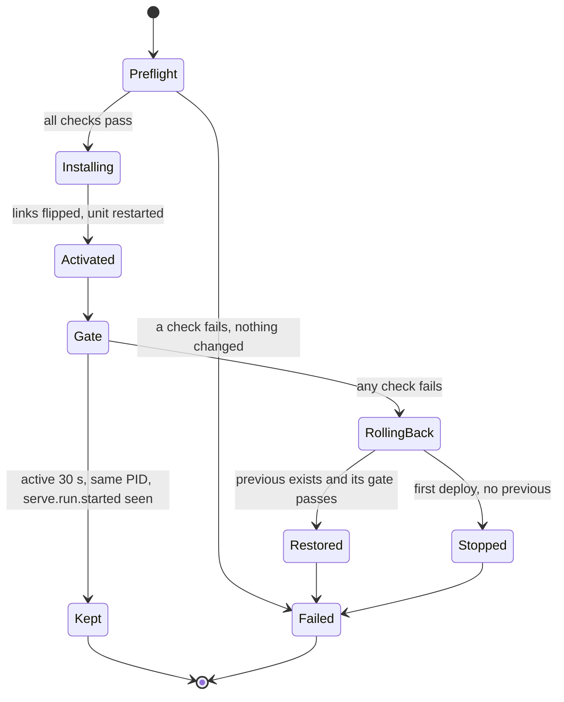

# Change: 179-cd-first-real-deploy

**SDD change**: `179-cd-first-real-deploy`
**Date**: 2026-10-02
**Status**: Proposed
**Tracking issue**: see sibling `issue.md` (#179)

Mirror of engram topic key `sdd/cd-first-real-deploy/change` (see
[ADR-009 §6](../../../docs/architecture/adr-009-documentation-strategy.md#6-change-specs--sdd-artifacts-dual-source-convention)
dual-source rule).

## TL;DR

- The CD deploy path has never run for real. Reading it found 9 latent bugs that stop the first run (table in Design). The first real dispatch confirmed it: it failed at its first check ("/opt/hermes/.venv missing") before touching anything (Evidence).
- Each deploy ships one bundle (wheel, hash-pinned requirements, config, scripts), installs it in `/opt/hermes/versions/<sha12>/`, then flips `current` atomically.
- A health gate over SSH replaces the self-ping: unit active for 30 s, same PID, `serve.run.started` in the journal. A failed gate rolls back to `previous` and fails the job.
- `scripts/deploy/vps_bootstrap.sh` becomes the only bootstrap script. `deploy/bootstrap-vps.sh` is deleted.
- #306 is merged (as #321). It owns `hermes.service` and its start limit, which this deploy restarts, and it lists what this change must do (Dependencies).
- `vps_bootstrap.sh` owns every one-time box prerequisite it can (user, dirs, pinned uv and Python 3.14.7 verified as the `hermes` user, units, env file, optional deploy sudoers). What stays manual is in "Operator-present prerequisites (OPEN)".
- This PR closes #179. The follow-up issues are filed when it merges (Scope, Out).
- Needs your approval: D-2 to D-9 (PROPOSED). D-4 departs from ADR-010 §1 (hashed requirements instead of `uv sync --frozen` on the box). A decision record in this change records the departure.

## Summary

Makes `cd.yml` able to deploy for the first time. The build produces one release bundle. The VPS installs it into its own versioned directory from the CI-built wheel and the hash-pinned lock, flips `current`, restarts `hermes.service`, and proves the new process is alive before the job passes. If the proof fails, the job restores `previous`. The main risk is the first run itself: an operator must check secrets and the tailnet key first (Operator-present prerequisites, OPEN, in Design). The unit file content belongs to #306, merged as #321.

## Scope

### In

- `.github/workflows/cd.yml`: new `bundle` job, new deploy steps, SSH health gate, fixed smoke guard, fixed `confirm` aggregator, `health-check` job removed.
- New `scripts/deploy/install_release.sh`, `health_gate.sh`, `rollback.sh` (run on the VPS, shipped in the bundle). The bundle also carries `deploy/*.sh` (health ping, failure notifier, backup), which the units run from `/opt/hermes/current/deploy/`.
- `scripts/deploy/vps_bootstrap.sh` extended with guarded, tested steps (user, dirs, uv, pinned Python 3.14.7, units, env file, optional deploy sudoers); `vps-bootstrap.yml` ships `deploy/systemd/` to the box and forwards `DEPLOY_USER`.
- Delete `deploy/bootstrap-vps.sh` and fix the doc lines that become false: `deploy/README.md`, `deploy/hetzner-storagebox-setup.md:35`, `docs/guides/vps-operations.md:340-344,377-380`, `docs/guides/ai-development-lifecycle.md:252`. Add `changelog.d/wave-cd-first-real-deploy.md`.
- NEW `docs/decisions/2026-10-02-vps-install-from-hashed-requirements.md`: records the departure from ADR-010 §1. The VPS installs from the hash-pinned exported requirements file plus the wheel with `--no-deps`, not `uv sync --frozen`. The reason (D-4): the box has no source checkout, and it should run the exact wheel CI built. Shape: Decision, Context, Consequences.
- NEW `docs/decisions/2026-10-02-env-file-path-etc-hermes-env-production.md`: supersedes the env-file path in `docs/decisions/2026-08-23-credential-storage-layered-by-env.md` (`/etc/hermes.env` becomes `/etc/hermes/env.production`). That entry is immutable, so it stays as written. The path is the one #306 sets in the unit and #179 creates, with owner and mode `root:root 0600` (D-2, D-8). #306 leaves this entry to #179.

### Out

- Unit file, env example, `__main__.py`, CLI path defaults: #306 (306-serve-systemd-boot).
- This PR closes #179. Follow-up issues to file when this merges: `push:main` trigger; Slack deploy notice; a real `@smoke` suite; deployment docs (`vps-deployment.md`); least-privilege deploy user instead of root (`VPS_SSH_USER` is `root` today, `cd.yml:35`). Two more already named in this spec: `rollback` as a dispatch input (D-6); backup-before-activate once the ledger has migrations (Risks).

## Decisions

### D-1: Versioned releases with `current` and `previous` (DECIDED by Code Owner, 2026-10-02)

- **Decision**: `/opt/hermes/versions/<version>/` with its own `.venv` and `config/`, plus `current` and `previous` symlinks. Rollback is an atomic symlink flip.
- **Alternatives**: one `/opt/hermes/.venv` reinstalled with `--force-reinstall` (`cd.yml:169,179`): no rollback path.
- **Rationale**: same layout as D-2 in `phase-1-observability-rollback-slack-scaffolds/change.md:38-43`.
- **Cost of reversal**: MEDIUM.

### D-2: Config ships per release, secrets in one file, state outside `/opt` (PROPOSED)

- **Decision**: config at `versions/<v>/config`, read with `--config-dir /opt/hermes/current/config`. Secrets only in `/etc/hermes/env.production` (root:root 0600). State at `/var/lib/hermes/hermes.sqlite3`, passed as `--db` (the flag is `--db`, `cli.py:232`, not `--db-path`).
- **Alternatives**: (a) operator-managed `/etc/hermes/config`: hand edits with no commit trace; (b) config inside the wheel: needs a hatch include and a loader change (`pyproject.toml:87-88` ships only `src/hermes`, `loader.py:57` defaults to `./config`).
- **Rationale**: `config/` is 10 tracked YAML files, 26 KB, no secrets (`sentry.yaml:25` DSN is empty). Pre-registered strategy parameters must trace to a commit (ADR-011 D-22) and roll back with the code.
- **Cost of reversal**: LOW.

### D-3: Version id is the first 12 hex chars of the git sha (PROPOSED)

- **Decision**: `versions/<sha12>/`. A redeploy of the same sha skips the install (`.installed` marker) and repeats the flip.
- **Alternatives**: full 40-char sha (same information, longer paths); package version plus sha (`pyproject.toml:3` is `0.0.0`, adds nothing until tags exist); UTC timestamp plus sha (a rerun of one commit makes two directories).
- **Rationale**: one commit, one directory, `git show <sha12>` works. Pruning sorts by directory mtime, not by name.
- **Cost of reversal**: LOW.

### D-4: One bundle, installed from hashed requirements (PROPOSED, departs from ADR-010 §1)

- **Decision**: a `bundle` job in `cd.yml` builds `hermes-release-<sha12>.tar.gz`: the wheel (original filename), `requirements.txt` from `uv export --frozen --no-dev --no-emit-project`, `config/`, `bin/`. The box runs `uv pip install --require-hashes -r requirements.txt`, then the wheel with `--no-deps`.
- **Alternatives**: (a) `uv sync --frozen` on the box, as ADR-010 §1 says (`adr-010-dependency-management-and-supply-chain.md:44`): needs a source checkout there and installs from source, not the wheel CI built; (b) three loose `scp`s: three places to drift; (c) extend `_build-wheel.yml`: `release.yml:130` also calls it, so a CD need would change the release path.
- **Rationale**: same lock, same SHA-256 hashes (ADR-010 §4). The box runs the exact wheel CI built. ADR-010 lines 47-48 allow `uv export` for interop. The decision record that amends §1 is a deliverable of this change (Scope, In).
- **Cost of reversal**: LOW.

### D-5: Code is root-owned, Python lives in `/opt/hermes/python` (PROPOSED)

- **Decision**: root runs uv. `UV_PYTHON_INSTALL_DIR=/opt/hermes/python` and `UV_PYTHON_PREFERENCE=only-managed` at bootstrap and deploy, `UV_PYTHON_DOWNLOADS=never` at deploy. Bootstrap installs one exact patch (`PYTHON_VERSION=3.14.7`, a test keeps it inside `requires-python`) and verifies it: the path is under `/opt/hermes/python` and `runuser -u hermes` prints `Python 3.14.7`. `hermes` owns only `/var/lib/hermes`.
- **Alternatives**: run uv as `hermes`: the service could then rewrite its own code. Default uv dir: the venv `python` would point into `/root`, which `hermes` cannot read (`hermes.service:34` sets `ProtectHome=true`).
- **Rationale**: read-only code for the service, a readable interpreter, no runtime `.pyc` writes (`--compile-bytecode`).
- **Cost of reversal**: LOW.

### D-6: Atomic flip, automatic rollback, keep 3 (PROPOSED)

- **Decision**: install at the final path (a venv is not relocatable). Flip `previous` then `current` with `ln -sfn` to a temp link plus `mv -T`. Keep the 3 newest directories plus whatever `current` and `previous` point to. A failed gate runs `rollback.sh` (first deploy: stop the unit) and fails the job. Rollback is not a workflow input yet; the operator runs `/opt/hermes/bin/rollback.sh` over SSH.
- **Alternatives**: a `rollback` boolean on `cd.yml` (adds a second mode to every job's `if`); a separate `rollback.yml` (a third copy of the tailnet steps; D-5 of `chore-vps-bootstrap-workflow` says extract at the third copy, which is a refactor, not this change's work).
- **Rationale**: auto-rollback covers the failure that matters. The manual path is one command.
- **Cost of reversal**: LOW.

### D-7: Health gate reads the journal over SSH (PROPOSED)

- **Decision**: gate = `hermes.service` active for 30 s, same `MainPID` throughout, and `serve.run.started` in the journal since the restart. It runs inside the deploy job, so failure and rollback are one unit. The `health-check` job is removed.
- **Alternatives**: (a) healthchecks.io read-only API key: a new secret, and it watches `hermes-health`, which fires every 5 min (`hermes-health.timer:13`) and is a placeholder echo (`hermes-health.service:24-25`), so it says nothing about `serve`; (b) keep the self-ping (`cd.yml:222`): it curls the ping URL, so each poll records an "up" and returns 200 even when `serve` is down.
- **Rationale**: no new secret, checks the exact process. Limit: proves start and 30 s of stability, not strategy behaviour.
- **Cost of reversal**: LOW.

### D-8: One bootstrap script; env file written once (PROPOSED)

- **Decision**: keep `scripts/deploy/vps_bootstrap.sh` (run by `vps-bootstrap.yml`) and delete `deploy/bootstrap-vps.sh`. Fold in user, dirs, uv, Python. Drop from the deleted script: `systemd-creds --with-key=tpm2 setup` (line 99, aborts under `set -e` on a host without a TPM; hermes-01 TPM unverified), the `.placeholder` links (61-74), unpinned `curl | sh` for uv (89), the commented deploy-user stub (115-135). The env file is created only when absent; if present, only owner and mode are repaired.
- **Alternatives**: keep `deploy/bootstrap-vps.sh` as canonical: it has never run and nothing calls it. Render the env file on every run (today, `vps_bootstrap.sh:97`): overwrites hand fixes, and writes an empty file when no `HERMES_*` var is passed (`:77` truncates, `:97` moves it into place).
- **Rationale**: `cd.yml:13` says `vps_bootstrap.sh` creates the `hermes` user, but it has no `useradd` (rg finds none). Re-dispatch no longer re-renders the file: rotate a secret by editing the file, or by deleting it and re-dispatching.
- **Cost of reversal**: LOW.

### D-9: Bootstrap owns the one-time prerequisites, each guarded (PROPOSED)

- **Decision**: every one-time step the box needs lives in `vps_bootstrap.sh` as a function that checks before it acts and is run twice in tests: `require_tools`, `ensure_uv` (verifies the version after install), `ensure_python` (pinned patch, verified as `hermes`), `install_units`, `ensure_deploy_sudoers`. The sudoers step runs only when `DEPLOY_USER` (repo variable `VPS_DEPLOY_USER`) names a non-root account. It writes `/etc/sudoers.d/hermes-deploy` as a dot-file candidate (sudo ignores it), `chmod 0440`, accepts it only after `visudo -cf`, then `mv -T`. It grants the deploy entry point and `rollback.sh` only. `cd.yml` runs `sudo -n /usr/bin/bash <stage>/bin/install_release.sh` when it is not root.
- **Alternatives**: a runbook of manual commands (drifts, never tested); give a non-root user `NOPASSWD: ALL` (not least privilege); a root-owned wrapper that takes only a sha12 (real least privilege, follow-up).
- **Rationale**: evidence says the bootstrap runs as root (`uid=0`, run 27), so CD as root needs no sudoers rule today and the step writes nothing. It exists so moving `VPS_SSH_USER` off root is one variable, not a hand edit on the box.
- **Known limit**: the stage dir is writable by the deploy user, so the rule narrows the entry point, not the privilege: it is root-equivalent for whoever controls the CD key. Honest least privilege is the wrapper follow-up.
- **Cost of reversal**: LOW.

## Requirements

### R-1: The bundle is built in CI, with or without `dry_run`

- **A-1.1**: `uv export --frozen --no-dev --no-emit-project | rg -c -- '--hash=sha256:'` prints at least 37 (observed 120).
- **A-1.2**: `tar -tzf hermes-release-<sha12>.tar.gz` lists the wheel, `requirements.txt`, `config/strategies.yaml`, `deploy/hermes-health-ping.sh`, `deploy/hermes-notify-failure.sh`, `deploy/hermes-backup.sh`, `bin/install_release.sh`, `bin/health_gate.sh`, `bin/rollback.sh`.
- **A-1.3**: a `dry_run=true` run uploads the `hermes-release` artifact and runs no tailnet, scp or ssh step.

### R-2: The release installs from the lock and the CI wheel

- **A-2.1**: `ssh hermes-01 '/opt/hermes/current/.venv/bin/hermes serve --help'` exits 0, `ls /opt/hermes/current/config | wc -l` prints `10`, and `ls /opt/hermes/current/deploy` lists the three `.sh` files.
- **A-2.2**: `ssh hermes-01 'readlink -f /opt/hermes/current/.venv/bin/python'` starts with `/opt/hermes/python/`.
- **A-2.3**: a `requirements.txt` with one altered hash makes `install_release.sh` exit non-zero and leaves `current` unchanged.

### R-3: Activation is atomic and bounded; rollback flips back and re-gates

- **A-3.1**: `readlink /opt/hermes/current` ends with `versions/<sha12>`; after a second deploy `readlink /opt/hermes/previous` is the first version.
- **A-3.2**: `ls -d /opt/hermes/versions/*/ | wc -l` prints at most 5 (3 newest plus `current` and `previous`).
- **A-3.3**: `ssh hermes-01 /opt/hermes/bin/rollback.sh` exits 0 and `current` equals the old `previous`; it exits 1 when `current` already equals `previous`.

### R-4: The health gate decides the deploy

- **A-4.1**: with a unit that exits at start (test stub), `install_release.sh` exits 1 and `current` still points at the old version.
- **A-4.2**: after a real deploy, `ssh hermes-01 'journalctl -u hermes.service -o cat --no-pager | rg -c serve.run.started'` prints at least 1.
- **A-4.3**: `rg -c 'VPS_HEALTHCHECK_URL|health-check' .github/workflows/cd.yml` finds nothing.

### R-5: Bootstrap is idempotent and never rewrites the env file

- **A-5.1**: after dispatch, `ssh hermes-01 'id hermes && stat -c "%a %U:%G" /etc/hermes/env.production'` prints `600 root:root`; `systemctl is-enabled hermes.service` prints `enabled`; `hermes-backup.timer` and `hermes-health.timer` stay disabled.
- **A-5.2**: a second dispatch exits 0 and `stat -c %Y /etc/hermes/env.production` is unchanged.
- **A-5.3**: a dispatch while `/mnt/storage-box` is already an active SSHFS mount exits 0. The mount-point preparation (`install -d -o hermes ...`) runs only when `mountpoint -q /mnt/storage-box` fails, because chown on a FUSE mount fails even as root. Evidence: run 37070991389 (2026-10-02) failed at `scripts/deploy/vps_bootstrap.sh` step 3 with "install: cannot change owner and permissions of '/mnt/storage-box': Operation not permitted" after rendering the env file.

- **A-5.4**: a dispatch prints `verified: user hermes runs /opt/hermes/python/... (Python 3.14.7)`; a second dispatch prints `already installed` for uv and Python and runs no installer (`tests/integration/deploy/test_vps_bootstrap_guards.py`).
- **A-5.5**: with `DEPLOY_USER` unset or `root`, `/etc/sudoers.d/hermes-deploy` does not exist. With a plain login name it exists, is `440 root:root`, passes `visudo -cf`, and contains exactly the two commands of D-9. A rule `visudo` rejects is never installed and leaves the previous one in force.

### R-6: Smoke guard and confirm aggregator work

- **A-6.1**: `uv run pytest -m smoke -q; test $? -eq 5` exits 0 (no smoke tests exist) and the workflow maps exit 5 to success.
- **A-6.2**: `rg -c 'contains\(needs\.\*\.result' .github/workflows/cd.yml` prints at least 1; `rg -c '"result":"' .github/workflows/cd.yml` finds nothing.

### R-7: One bootstrap script remains

- **A-7.1**: `test ! -e deploy/bootstrap-vps.sh` and `rg -l 'bootstrap-vps\.sh' deploy docs/guides` prints nothing (ADR-003 and CHANGELOG keep their history).

### R-8: The departure from ADR-010 §1 is recorded

- **A-8.1**: `ls docs/decisions/2026-10-02-vps-install-from-hashed-requirements.md` exits 0, and `rg -q "ADR-010 §1" docs/decisions/2026-10-02-vps-install-from-hashed-requirements.md` exits 0.
- **A-8.2**: `rg -c 'reset-failed' scripts/deploy/install_release.sh scripts/deploy/rollback.sh` prints at least 1 per file, and the Tier 2 test shows `reset-failed` runs before `restart`.
- **A-8.3**: `ls docs/decisions/2026-10-02-env-file-path-etc-hermes-env-production.md` exits 0, and `rg -q "2026-08-23-credential-storage-layered-by-env" docs/decisions/2026-10-02-env-file-path-etc-hermes-env-production.md` exits 0.

## Design

### Latent bugs this change fixes

| # | Evidence | Problem | Fix |
| --- | --- | --- | --- |
| 1 | `cd.yml:151,179` | wheel is copied as `/tmp/hermes.whl`, not a valid wheel filename | bundle keeps `hermes-0.0.0-py3-none-any.whl` |
| 2 | `cd.yml:169,179` | `uv venv` makes no `pip`; `--force-reinstall` ignores `uv.lock` | D-4 |
| 3-5 | `hermes.service:24-26,35`, `loader.py:57`, `serve.py:78`, `vps_bootstrap.sh:97` | no `__main__.py` (console script at `pyproject.toml:40-41`); `./config` and `./hermes.sqlite3` under a read-only `/opt`; `/etc/hermes.env` vs `/etc/hermes/env.production` | D-2, #306 |
| 6 | `cd.yml:222` | health check pings the ping URL, always 200 | D-7 |
| 7 | `cd.yml:259` | guard greps `no tests ran`; pytest prints `no tests collected` and exits 5 | exit 5 means success |
| 8 | `cd.yml:285` | `confirm` greps `"result":"failure"`; the real log has `"result": "success"` (with a space), so it can never fail | `contains(needs.*.result, ...)` |
| 9 | `deploy/systemd/*.service` | after #328 the units run `/opt/hermes/current/deploy/hermes-*.sh`, but the bundle shipped no `deploy/` dir, so the failure notifier and health ping could not start | bundle ships `deploy/*.sh`; `install_release.sh` copies it into the release |

### Verified against the current tree (AGENTS.md design gate)

```text
$ uv export --frozen --no-dev --no-emit-project > requirements.txt          (exit=0)
223 lines, 37 pins, 120 --hash=sha256 lines, no "-e ." line; 2 pins Windows-only (colorama, tzdata)
$ uv pip install --dry-run --require-hashes --python-platform x86_64-manylinux_2_28 \
      --python-version 3.14 --target <tmp> -r requirements.txt              (exit=0)
Resolved 35 packages in 29ms / Would download 2 packages / Would install 35 packages
$ uv run pytest --collect-only -m smoke -q; echo "exit=$?"
no tests collected (1618 deselected) in 1.73s
exit=5
$ uv run pytest --collect-only -m smoke 2>&1 | rg -c 'no tests ran'    # the cd.yml:259 string
(no match, rg exit 1)
$ HERMES_ENV=dev timeout 25 uv run hermes serve --config-dir config --db <tmp>.sqlite3
2026-10-02 23:20:26 [info     ] serve.run.started              env=dev   (exit=124, killed by timeout)
```

`actionlint`, `shellcheck` and `jq` are not installed locally, and no CI job runs them. The three scripts pass `bash -n`. `install_release.sh`, `health_gate.sh` and `rollback.sh` also ran against stubbed `systemctl`, `journalctl`, `uv`, `stat` and `id` in a scratch root: first deploy, second deploy, failed gate, failed first deploy, prune to 3, manual rollback, second rollback refused.

### Evidence from the first real dispatch

```text
cd.yml dispatched with dry_run=false (night of 2026-10-02/03, before this change)
Deploy step, first check: "/opt/hermes/.venv missing"
-> failed safely: nothing on the VPS was touched, no service restarted
```

That is the old `cd.yml` assuming a single `/opt/hermes/.venv` (bug 2, D-1). The new `cd.yml` has no reference to it (`rg '/opt/hermes/\.venv' .github/workflows/cd.yml` prints nothing) and deploys into `/opt/hermes/versions/<sha12>/`. The same run fixes the bootstrap evidence: run 27 of `vps-bootstrap` logged `user: uid=0`, so the scripts run as root.

### Diagrams







### `cd.yml` changes

- `bundle` job (needs `build`): checkout, `setup-uv` 0.12.5, download `hermes-wheel`, `uv export --frozen --no-dev --no-emit-project --output-file stage/requirements.txt`, copy `config/`, `deploy/*.sh` and the three scripts, `tar -czf hermes-release-${GITHUB_SHA::12}.tar.gz -C stage .`, upload artifact `hermes-release`. Runs in dry-run too. `_build-wheel.yml` is unchanged.
- `deploy`: download `hermes-release`; keep the openssh, tailnet and keyfile steps; replace the scp and install steps with one `scp` of the tarball to `/var/tmp/` and one `ssh` that untars to `/var/tmp/hermes-release-<sha12>/`, runs `bash <stage>/bin/install_release.sh <sha12> <stage>` (as `sudo -n /usr/bin/bash ...` when the SSH user is not root, D-9), and removes the stage on exit. Every real step keeps `if: inputs.dry_run != true`. Drop the header prerequisites that no longer apply (`cd.yml:13-17,37`).
- Remove `health-check`. `confirm` needs `[build, bundle, deploy, smoke]` and fails on `contains(needs.*.result, 'failure') || contains(needs.*.result, 'cancelled')`.
- `smoke`: run `uv run pytest -m smoke --tb=short`, keep the exit code, map 5 to a warning and exit 0, pass any other code through.

### `install_release.sh <sha12> <stage>` (root, on the VPS)

Test seams: `HERMES_ROOT`, `HERMES_ENV_FILE`, `SYSTEMCTL` env overrides. Steps, in order:

1. Preflight, no disk change until all pass: `uv` on PATH, `id hermes`, `systemctl cat hermes.service`, `stat -c '%a %U:%G' $ENV_FILE` is `600 root:root`, no line matching `^HERMES_ALLOW_MAINNET="?yes`, exactly one wheel in the stage.
2. If `versions/<sha12>/.installed` is missing: `rm -rf` the dir, then `uv venv --python 3.14 .venv`, `uv pip install --python .venv/bin/python --require-hashes --compile-bytecode -r requirements.txt`, `uv pip install --python .venv/bin/python --no-deps --no-cache <wheel>`, `cp -r config`, `cp -r deploy`, write `.installed` last.
3. Set `cur` only when `[ -L current ]`. `touch` the new dir. Flip `previous` to `cur` when they differ. Flip `current`. `since=$(date +%s)`, `daemon-reload`, `systemctl reset-failed hermes.service`, `restart`. The reset is needed because #306 D-6 adds a start limit (5 starts per 10 min); a limit tripped by an earlier crash loop would block the restart.
4. `health_gate.sh $since`. On failure: `rollback.sh` when there is a previous, otherwise `systemctl stop`. Exit 1.
5. On success: `install -m 0755` the helper scripts into `/opt/hermes/bin/` (a bad release never replaces them), then prune.

Gotchas found by running the sketch: `readlink -f` exits 0 on a missing link, so `current` needs `-L`, or the first deploy writes `previous -> current`. An unmatched `hermes-*.whl` glob stays literal, so the wheel check needs `-f`. `journalctl | grep -q` under `pipefail` fails on SIGPIPE even when grep matched.

### `scripts/deploy/health_gate.sh`

```bash
#!/usr/bin/env bash
# Usage: health_gate.sh <since_epoch>   Exit 0 = healthy, 1 = unhealthy.
set -euo pipefail
unit=hermes.service
since=${1:?usage: health_gate.sh <since_epoch>}
hold=${GATE_HOLD_SECONDS:-30}
SYSTEMCTL=${SYSTEMCTL:-systemctl}
JOURNALCTL=${JOURNALCTL:-journalctl}
bad() { echo "::error::$*"; exit 1; }

pid=""
for ((t = 0; t < hold; t += 2)); do
    "$SYSTEMCTL" is-active --quiet "$unit" || bad "$unit not active at t=${t}s"
    now=$("$SYSTEMCTL" show -p MainPID --value "$unit")
    [ -z "$pid" ] || [ "$now" = "$pid" ] || bad "$unit restarted itself ($pid -> $now)"
    pid=$now
    sleep 2
done
# Capture first: `journalctl | grep -q` under pipefail fails on SIGPIPE.
logs=$("$JOURNALCTL" -u "$unit" --since "@$since" --no-pager -o cat)
grep -q 'serve\.run\.started' <<<"$logs" || bad "no serve.run.started since the restart"
echo "gate OK: $unit active ${hold}s, MainPID=$pid, serve.run.started seen"
```

### `scripts/deploy/rollback.sh`

Same `HERMES_ROOT` and `SYSTEMCTL` seams. It fails with a clear message when `previous` or `current` is missing, when `previous` has no `.installed` marker, or when `current` already equals `previous`. Otherwise it flips `current` to `previous` (temp link plus `mv -T`), runs `systemctl reset-failed hermes.service`, restarts the unit, and runs `health_gate.sh` with the restart time. It leaves `previous` alone, so a second run fails instead of toggling. After an automatic rollback `previous` equals `current`; the next good deploy repairs it.

### `vps_bootstrap.sh` additions (all idempotent, run before the existing steps)

| Step | Command shape |
| --- | --- |
| user | `id hermes \|\| useradd --system --home-dir /var/lib/hermes --no-create-home --shell /usr/sbin/nologin hermes` |
| dirs | `install -d -m 0755 /opt/hermes /opt/hermes/versions /opt/hermes/bin`; `install -d -m 0750 -o hermes -g hermes /var/lib/hermes /var/log/hermes`; `/etc/hermes` becomes `root:root 0755` |
| tools | `require_tools curl tar cmp install mountpoint runuser systemctl journalctl`: one failure naming every missing tool, before any change |
| uv | `ensure_uv`: install 0.12.5 (the CD pin) to `/usr/local/bin` only when `uv --version` differs, then verify the version |
| python | `ensure_python`: `UV_PYTHON_INSTALL_DIR=/opt/hermes/python`, install exactly `PYTHON_VERSION` (3.14.7) only when `uv python find` is not already under that dir, then verify it runs as `hermes` |
| units | `vps-bootstrap.yml` adds `deploy/systemd` to its sparse checkout and streams it with `tar \| ssh` to `/var/tmp/hermes-bootstrap/systemd/` (the script itself arrives on stdin, `vps-bootstrap.yml:179-180`). `install_units` runs `install -m 0644` per file that differs (`cmp -s`), `daemon-reload` on change, and `systemctl enable hermes.service` only (no `--now`). Timers stay off: backup needs borg setup, the health timer needs a healthchecks.io check |
| sudoers | `ensure_deploy_sudoers` (D-9): only when `DEPLOY_USER` is a non-root login name; validated with `visudo -cf` before the move |
| env | the existing render loop, only when the file is absent and at least one `HERMES_*` var is non-empty; `root:root 0600`. Drop the dead `HERMES_SHADOW` line (`vps-bootstrap.yml:129`, #175 closed not planned) |

### Operator-present prerequisites (OPEN)

Every item is OPEN: nothing below is done. The target morning is: merge this PR, dispatch `vps-bootstrap`, dispatch `cd`. Items 1 to 3 are checks only a human can make; 4 to 8 are the sequence; 9 to 11 are not blocking.

1. **OPEN, Tailnet key**: in the Tailscale admin console confirm the key behind `TAILSCALE_AUTHKEY` has not expired (last used 2026-09-06; keys rotate every 90 days, `vps-operations.md:387-388`) and carries `tag:ci-runner`. Why manual: only the console shows expiry.
2. **OPEN, Secrets and variables**: `gh secret list --env prod --repo ricardoafo/hermes` shows `VPS_SSH_HOST`, `VPS_SSH_USER` (`root`), `VPS_SSH_KEY`, `TAILSCALE_AUTHKEY`. The `prod` environment is limited to `main` (`deploy/README.md:178`). No secret or variable named `HERMES_ALLOW_MAINNET` is set to `yes`. `HERMES_TELEGRAM__BOT_TOKEN` and `HERMES_TELEGRAM__CHAT_ID` are set if the failure notifier should work. `VPS_DEPLOY_USER` stays unset while CD runs as root. Why manual: secret values are not readable by an agent.
3. **OPEN, Outbound HTTPS from the box**: `ssh hermes-01 'curl -sSfI https://astral.sh >/dev/null && curl -sSfI https://github.com >/dev/null && uname -m'` exits 0 and prints `x86_64`. The uv installer and the Python download need both hosts; the lock's hashes are for x86_64. Why manual: only the box knows its firewall.
4. **OPEN, Merge this PR**: `vps-bootstrap` and `cd` run the scripts from `main` (`--ref main`). Merge first.
5. **OPEN, Dispatch `vps-bootstrap`**: `gh workflow run vps-bootstrap.yml --repo ricardoafo/hermes --ref main`, then `gh run watch`. It covers: tool check, `hermes` user, FHS dirs, uv 0.12.5, Python 3.14.7 under `/opt/hermes/python` verified as `hermes`, all unit files, `hermes.service` enabled, `/etc/hermes/env.production` (only when absent), storage-box mount (when credentials are set), deploy sudoers (only when `VPS_DEPLOY_USER` is set).
6. **OPEN, Check the bootstrap result** (read-only): `ssh hermes-01 'id hermes; stat -c "%a %U:%G" /etc/hermes/env.production; rg -c "ALLOW_MAINNET=\"?(yes|true|on|1)" /etc/hermes/env.production; systemctl is-enabled hermes.service; /opt/hermes/python/*/bin/python3.14 --version'` shows `600 root:root`, no mainnet match, `enabled`, `Python 3.14.7`. If the env file predates this change, its content is kept: confirm it has `HERMES_ENV="prod"` and `HERMES_ALLOW_MAINNET="no"`. To rotate a value, edit the file or delete it and re-dispatch.
7. **OPEN, Dry run**: `gh workflow run cd.yml --repo ricardoafo/hermes --ref main -f dry_run=true` (builds the bundle, touches nothing).
8. **OPEN, Real deploy**: `gh workflow run cd.yml --repo ricardoafo/hermes --ref main -f dry_run=false`, then `gh run watch`. Afterwards on the box: `readlink /opt/hermes/current`, `systemctl is-active hermes.service`, `journalctl -u hermes.service -n 20 --no-pager`, `systemd-analyze verify /etc/systemd/system/hermes.service`. The first deploy has no `previous`, so the rollback drill waits for the second.
9. **OPEN, not blocking, health timer**: after the first deploy, `systemctl enable --now hermes-health.timer` once the healthchecks.io check (period 5 min, grace 10 min, Telegram integration) exists and `HERMES_HEALTHCHECKS__PING_URL` is in the env file. Why manual: it is an account-side setup, and the timer pings a URL that must exist. The bootstrap keeps both timers off on purpose.
10. **OPEN, not blocking, backup timer**: stays off until borg is set up (`deploy/hetzner-storagebox-setup.md`).
11. **OPEN, only if CD moves off root**: create the account and its `authorized_keys` by hand, set the repository variable `VPS_DEPLOY_USER` and the `VPS_SSH_USER` secret to it, re-dispatch `vps-bootstrap` (writes the sudoers rule). Not needed today: `uid=0` in run 27.

## Test plan

Tiers touched: Tier 1 and Tier 2. No Tier 3 automation (the first real deploy is the acceptance run). No `contract` tests: no third-party API is called. Each test names one invariant in its docstring (`docs/guides/ai-authored-tests.md`).

1. Tier 1, `tests/unit/deploy/test_cd_workflow.py` (parse `cd.yml` with PyYAML): `confirm` needs every other job; no `health-check` job; no `/tmp/hermes.whl`; every real deploy step carries `if: inputs.dry_run != true`.
2. Tier 2 (`integration` marker, skipped on win32), `tests/integration/deploy/test_release_scripts.py`, scratch `HERMES_ROOT` plus stub binaries on `PATH`: `bash -n` passes for the three scripts; first deploy sets `current` and no `previous`; second deploy sets both; same-sha redeploy does not call `uv`; failed gate restores the old `current`; failed first deploy stops the unit and exits 1; preflight rejects a wrong-mode env file and `ALLOW_MAINNET=yes` and changes nothing on disk; a hash mismatch leaves `current` unchanged; the gate fails when the journal lacks `serve.run.started`; the gate fails when `MainPID` changes; rollback refuses when `current` equals `previous`; `systemctl reset-failed hermes.service` is called before `restart` in both the deploy and the rollback (the stub `systemctl` logs its calls).
3. Property (Hypothesis, same file, `@pytest.mark.timeout(120)`, `max_examples=25`): for any set of 1 to 8 version directories with any `current` and `previous`, prune never deletes either and keeps the 3 newest.
4. Tier 2, `tests/integration/deploy/test_vps_bootstrap.py` and `test_vps_bootstrap_guards.py`: the script's guard functions are extracted by name and run under bash with stub `uv`, `curl`, `runuser`, `visudo`, `id`, `chown`, `install`. Each guard is run twice; the second run changes nothing. Cases: pinned uv skipped, wrong uv version fatal, Python installed once and verified as `hermes`, interpreter outside `/opt/hermes/python` or of another version rejected, units copied only when different, sudoers rule exact, `0440`, validated before it is live, rejected rule never installed, username injection refused. Tier 1 adds drift tests in `test_cd_workflow.py`: Python pin inside `requires-python`, every script a unit runs is in the bundle, the deploy step matches the sudoers command. Stated gap: the full script has no end-to-end test; the real box run (R-5) is the acceptance.
5. Every acceptance criterion passes; `bash scripts/dev/pr-preflight.sh` is green; the `cd` dry-run is green; the checklist ends with `current` active and the gate log shown.

## Risks

- **Process stays up, strategy does nothing**: the swing strategy evaluates on 4h bar close (`swing/adapter.py:6-23`) and `serve` has no bar loop yet (#309). The gate proves start and 30 s of stability only. A green deploy does not mean trading works.
- **`Type=simple` reports active at fork**: `is-active` alone passes a unit that crashes 100 ms later. The gate also needs a stable `MainPID` and the journal line. Do not drop either.
- **Python path**: the venv `python` is a link into the uv Python dir. If the first run shows it under `/root`, `hermes` cannot start it (A-2.2 catches this). `ensure_python` already refuses an interpreter outside `/opt/hermes/python` and one `hermes` cannot run; `PYTHON_VERSION` must exist in uv 0.12.5's download list (3.14.7 does, `uv python list --only-downloads 3.14` on this tree).
- **Sudoers rule is root-equivalent**: see D-9. Inactive while CD runs as root.
- **Never run on a real box**: no agent dispatched a workflow or touched the VPS. The guards are proven against stubs on Linux (WSL), not on hermes-01. Item 5 and 6 of the prerequisites are the first real run.
- **Rollback does not roll back state**: `hermes.sqlite3` is shared across versions, so old code on a newer schema breaks. Moot until migrations exist; the first migration release needs a backup-before-activate step (follow-up).
- **Restart without pause**: deploy restarts the service without the pause, wait, backup sequence of `docs/runbook/vps-restart-procedure.md:73-91`. Acceptable while no real orders exist (shadow mode). Revisit before live capital.
- **Doc and ADR drift**: ADR-010 §1 keeps saying `uv sync --frozen` on the VPS (ADRs are immutable); the decision record in this change is the record of the departure. Bootstrap no longer re-renders the env file, while `vps-operations.md:340-344,377-380` say it does; this PR rewrites those lines.
- **uv installer trust**: the pinned installer URL fixes the version, not the content. Mitigation: root-only, outbound TLS to the vendor. Pinning the tarball hash is a follow-up.
- **#179 closes on merge, so follow-ups can be lost**: the PR body says `Closes #179` (`issue.md`). File the follow-up issues from Scope, Out right after the merge, each linking #179.

## Dependencies on other changes

- **#306 306-serve-systemd-boot (merged as #321)**: owns `hermes.service`, `hermes.env.example` and the CLI path defaults. This change assumes `ExecStart=/opt/hermes/current/.venv/bin/hermes serve --config-dir /opt/hermes/current/config --db /var/lib/hermes/hermes.sqlite3`, `EnvironmentFile=/etc/hermes/env.production`, `ReadWritePaths=/var/lib/hermes`, and an env example with `HERMES_ALLOW_MAINNET=no`.
- Departs from ADR-010 §1 and records it in a decision entry in this change. ADR-011 is not touched.
- Operator-applied settings: tailnet key, `prod` environment secrets, outbound HTTPS, the health timer (Operator-present prerequisites, OPEN, above).
