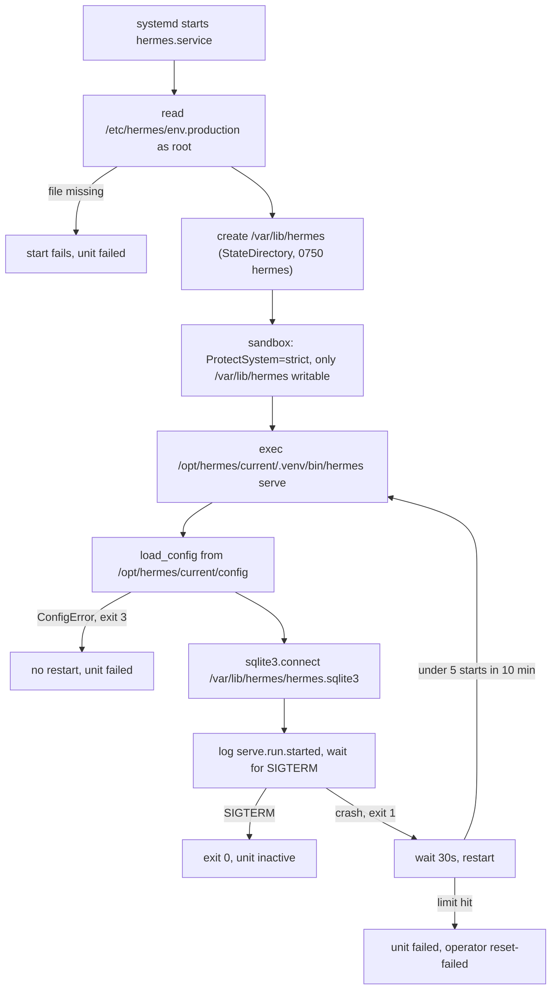
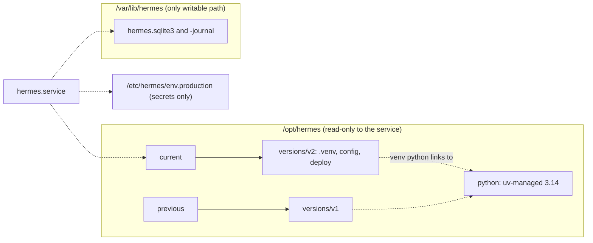

# Change: 306-serve-systemd-boot

**SDD change**: `306-serve-systemd-boot`
**Date**: 2026-10-02
**Status**: Proposed
**Tracking issue**: see sibling `issue.md` (#306)

Mirror of engram topic key `sdd/serve-systemd-boot/change` (see
[ADR-009 §6](../../../docs/architecture/adr-009-documentation-strategy.md#6-change-specs--sdd-artifacts-dual-source-convention)
dual-source rule).

## TL;DR

- `hermes.service` cannot start `hermes serve` today: no `__main__.py` for `python -m hermes`, a config dir the wheel never ships, a DB path under a read-only mount, an env file nobody writes.
- Fix: run the active release's console script from `/var/lib/hermes` with `/etc/hermes/env.production` (full unit in Design).
- Same deploy, three more traps fixed here: the env example makes `serve` exit 3, the timers use inline comments systemd rejects (the health timer never fires), the backup job skips the ledger.
- Crash loops are bounded: no restart on exit 2 or 3, 30 s between restarts, 5 starts per 10 min, then the unit stays `failed`.
- Needs your approval: D-2 to D-8 (D-1 is decided). All evidence was run locally. Nothing touched the VPS.

## Summary

`deploy/systemd/hermes.service` predates `hermes serve` and has never run. This
change rewrites it for the versioned-release layout (D-1), adds
`python -m hermes`, makes the env example loadable and paper-only, and aligns
the two sibling units. The main pick is to keep CLI defaults relative and put
absolute paths only in the unit (D-3). The unit relies on #179 D-5: the deploy
builds the venv in place against the Python in `/opt/hermes/python`, which
`hermes` can read under `ProtectHome=true`.

## Scope

### In

- `deploy/systemd/hermes.service` (rewritten), `hermes-backup.service` (paths), `hermes-health.service` (one stale TODO path), both timers (inline comments), `hermes.env.example`.
- `deploy/hermes-backup.sh`: env-file path in messages; DB glob also matches `*.sqlite3`.
- Path-only doc and comment fixes (`/etc/hermes.env` to `/etc/hermes/env.production`): `deploy/README.md`, `deploy/hetzner-storagebox-setup.md`, `config/sentry.yaml:18`, `config/healthchecks.yaml:13`, `loader.py:59`, `.env.local.example:5-6`.
- NEW `src/hermes/__main__.py`, three test files, `changelog.d/wave-serve-systemd-boot.md`.

### Out

- Creating `versions/`, symlinks, venv, `config/`; installing and enabling units; env-file owner and mode; health gate; rollback: `179-cd-first-real-deploy` (#179).
- Live bars, the loop, `SignalEmitted`: #307, #308, #309.
- The dead `HERMES_SHADOW` block in `.env.local.example` and `vps-bootstrap.yml:129`: its replacement wording depends on ADR-011 D-02. Follow-up issue.
- More hardening: `systemd-analyze security --offline` scores the unit 8.3 before and after.
- `docs/decisions/2026-08-23-credential-storage-layered-by-env.md` still names `/etc/hermes.env`. Decisions are immutable; the superseding entry rides with #179.
- Follow-ups to open: `serve` never calls `configure_logging` (no caller in `src/`), so journald gets the default console format, not the JSON in ADR-003 §09; the backup job copies `${DATA_DIR}/l2` unconditionally (`hermes-backup.sh:67`) and `BORG_PASSPHRASE` has no `HERMES_` prefix, so `vps_bootstrap.sh` never renders it (the backup unit is not installed in MVP1).

## Decisions

### D-1: Units run from the `current` release symlink

- **Decision** (DECIDED by Code Owner): releases at `/opt/hermes/versions/<version>/` with `current` and `previous` symlinks. Units point at `current`; rollback is a symlink flip.
- **Alternatives**: one `/opt/hermes/.venv` (what `cd.yml:169-179` assumes): no atomic rollback.
- **Rationale**: matches `deploy/bootstrap-vps.sh:28-47`.
- **Cost of reversal**: MEDIUM (every unit path changes).

### D-2: Config ships with the release, secrets in one file, state in one dir

- **Decision** (PROPOSED, same as #179; approve once): config `/opt/hermes/current/config`; secrets only `/etc/hermes/env.production` (root:root 0600); state `/var/lib/hermes/hermes.sqlite3`.
- **Alternatives**: config inside the wheel (it ships only `src/hermes`, `pyproject.toml:87-88`); operator-managed `/etc/hermes/config` (hand edits, no commit trace).
- **Rationale**: `config/` is non-secret YAML already in git. Pre-registered strategy parameters must trace to a commit (ADR-011 D-22) and roll back with the code.
- **Cost of reversal**: LOW (three path strings).

### D-3: ExecStart uses the console script; CLI defaults stay relative

- **Decision** (PROPOSED): `ExecStart=/opt/hermes/current/.venv/bin/hermes serve --config-dir /opt/hermes/current/config --db /var/lib/hermes/hermes.sqlite3`. `DEFAULT_CONFIG_DIR` (`loader.py:57`) and `DEFAULT_DB_PATH` (`serve.py:78`) stay.
- **Alternatives**: `python -m hermes serve` (the packaged entry is the console script, `pyproject.toml:40-41`); absolute VPS defaults in code (breaks `uv run hermes serve` from the repo root); new env vars for both paths (new code, no gain).
- **Rationale**: deployment paths belong to the deployment. A bare `hermes serve` in the wrong directory fails loudly with exit 3 (`cli.py:253`).
- **Cost of reversal**: LOW.

### D-4: WorkingDirectory is the state dir; keep StateDirectory and ReadWritePaths

- **Decision** (PROPOSED): `WorkingDirectory=/var/lib/hermes`, `StateDirectory=hermes` (0750), keep `ReadWritePaths=/var/lib/hermes`.
- **Alternatives**: `WorkingDirectory=/opt/hermes/current` (relative writes hit the read-only release; `config/klines.yaml:8` is relative); `StateDirectory` alone (works, probe B); `ReadWritePaths` alone (exit 226/NAMESPACE when the dir is missing, probe C; `vps_bootstrap.sh:53` does not create it).
- **Rationale**: `StateDirectory` makes systemd create the dir with the right owner before the sandbox is built. `ReadWritePaths` stays as the explicit, reviewable line the other units and the test use. Drop either if you prefer.
- **Cost of reversal**: LOW.

### D-5: Add `src/hermes/__main__.py`

- **Decision** (PROPOSED): a 4-line delegate to `cli.main`, so `python -m hermes` works for operators.
- **Alternatives**: skip it. The unit does not need it, but `python -m hermes` fails today.
- **Rationale**: no new dependency; import-linter, mypy and ruff stay green (evidence). Easy to drop.
- **Cost of reversal**: LOW.

### D-6: Bound the crash loop

- **Decision** (PROPOSED): `RestartPreventExitStatus=2 3`, `RestartSec=30s`, and in `[Unit]` `StartLimitIntervalSec=10min`, `StartLimitBurst=5`.
- **Values**: exit 2 (bad arguments, `cli.py:239`) and 3 (config load failed, `cli.py:253`) never fix themselves, so they never restart. `hermes serve` returns 1 for every runtime failure (309 D-5), so those are restarted. Other crashes: 5 starts x 30 s = 150 s, inside the 10 min window, so a tight loop trips the limit after about 2.5 min with at most 5 warm-up fetches. Today it is about 360 starts per hour. A process that lives longer between crashes spaces its starts further apart.
- **Alternatives**: 10 s and no limit (endless loop, hammers the market-data API once the bar loop lands); escalating delay with `RestartSteps=` and `RestartMaxDelaySec=` (systemd 254 or newer; the VPS version is unconfirmed, ask `systemctl --version`).
- **When the limit trips**: the unit is `failed`, `systemctl is-active hermes.service` prints `failed`, the journal says "Start request repeated too quickly" (local probe, evidence). Recovery: `systemctl reset-failed hermes.service`, then `restart`. The deploy script must do the same.
- **Not alerted today**: `hermes-health.service:24-25` pings healthchecks.io whether or not `hermes.service` runs, and the deploy gate only runs at deploy time. Follow-ups: ping only if `systemctl is-active --quiet hermes.service`; an `OnFailure=` notifier unit.
- **Cost of reversal**: LOW.

### D-7: Env example is paper-only and loadable

- **Decision** (PROPOSED): `HERMES_ENV="prod"`, `HERMES_ALLOW_MAINNET="no"`. Drop the mainnet endpoint block and the invalid `HERMES_BINANCE__API_KEY/SECRET`. Exchange keys stay as comments under the names `vps-bootstrap.yml:142-145` uses.
- **Alternatives**: `HERMES_ENV=sandbox` (differs from the real file, `vps-bootstrap.yml:128` writes `prod`); omit `ALLOW_MAINNET` (default False, `root.py:84`, but an explicit `no` shows the switch).
- **Rationale**: `env` only gates `allow_mainnet` (`root.py:105-108`), so `prod` opens nothing while it is `no`. Today's example breaks config load (`BinanceExchangeConfig` forbids extra fields, `models.py:48`) and sets `ALLOW_MAINNET=yes` (`hermes.env.example:26`).
- **Cost of reversal**: LOW.

### D-8: Fix the siblings in this change

- **Decision** (PROPOSED): align `hermes-backup.service`, `hermes-health.service`, both timers, `hermes-backup.sh` and the path docs here.
- **Alternatives**: leave them to #179 (it owns install, not content); a second PR (same paths, same review).
- **Rationale**: `systemd-analyze verify` refuses today's `hermes-health.timer`, and `hermes-backup.timer` silently loses `Persistent` and `RandomizedDelaySec` (evidence). The glob `*.db` (`hermes-backup.sh:52`) skips `hermes.sqlite3`, so the nightly job reports OK without the ledger.
- **Cost of reversal**: LOW.

## Requirements

### R-1: The unit starts the real CLI with absolute paths and bounded restarts

- **A-1.1**: `uv run pytest tests/unit/deploy/test_systemd_units.py -q` exits 0.
- **A-1.2**: `systemd-analyze verify` on the five units prints only "not executable: No such file or directory" for `hermes.service` and `hermes-backup.service` (VPS-only binaries) and no "Failed to parse" line.
- **A-1.3**: `rg -n '^(WorkingDirectory|StateDirectory|EnvironmentFile|ExecStart)=' deploy/systemd/hermes.service` shows the D-2 and D-3 values.
- **A-1.4**: `rg -n '^(StartLimitIntervalSec|StartLimitBurst|RestartSec|RestartPreventExitStatus)=' deploy/systemd/hermes.service` prints `10min`, `5`, `30s`, `2 3`.

### R-2: `python -m hermes` works

- **A-2.1**: `uv run python -m hermes --help` exits 0 and prints `Usage: hermes`.
- **A-2.2**: `uv run pytest tests/unit/entrypoints/test_main_module.py -q` exits 0.
- **A-2.3**: `uv run lint-imports`, `uv run mypy`, `uv run ruff check src tests` exit 0.

### R-3: The env example is safe and loadable

- **A-3.1**: `uv run pytest tests/unit/deploy/test_hermes_env_example.py -q` exits 0.
- **A-3.2**: `rg -n '^HERMES_(ALLOW_MAINNET|BINANCE__)' deploy/systemd/hermes.env.example` prints only `HERMES_ALLOW_MAINNET="no"`.

### R-4: Siblings are aligned and no stale paths remain

- **A-4.1**: `bash -n deploy/hermes-backup.sh` exits 0 and `rg -n '\*\.sqlite3' deploy/hermes-backup.sh` matches.
- **A-4.2**: `rg -n '/etc/hermes\.env' deploy src config .env.local.example` prints nothing (today: 29 matches in 10 files).
- **A-4.3**: `rg -n '/opt/hermes/(\.venv|deploy/)' deploy/systemd deploy/README.md deploy/hermes-backup.sh deploy/hetzner-storagebox-setup.md` prints nothing.

## Design

### Boot path and exit codes



### Filesystem layout the unit assumes



### `deploy/systemd/hermes.service` (header comment shortened)

```ini
[Unit]
Description=Hermes trading engine (hermes serve)
After=network-online.target
Wants=network-online.target
# Crash-loop guard: 5 starts in 10 min, then the unit stays failed. Each start
# re-fetches warm-up history. 5 x RestartSec (30s) = 150s, inside the window.
StartLimitIntervalSec=10min
StartLimitBurst=5

[Service]
Type=simple
User=hermes
Group=hermes
# systemd creates the dir before the sandbox is built; relative paths land here.
StateDirectory=hermes
StateDirectoryMode=0750
WorkingDirectory=/var/lib/hermes
# Secrets only, read as root. No leading "-": a missing file must fail the start.
EnvironmentFile=/etc/hermes/env.production
ExecStart=/opt/hermes/current/.venv/bin/hermes serve --config-dir /opt/hermes/current/config --db /var/lib/hermes/hermes.sqlite3
Restart=on-failure
RestartSec=30s
# Exit 2 (bad arguments) and 3 (config load failed) never fix themselves.
RestartPreventExitStatus=2 3

NoNewPrivileges=true
PrivateTmp=true
ProtectSystem=strict
# Hides /root and /home. The venv python links into /opt/hermes/python (#179 D-5), so it stays readable.
ProtectHome=true
ReadWritePaths=/var/lib/hermes

[Install]
WantedBy=multi-user.target
```

`ExecStart` stays on one line so the test can parse it.

### Edits to the other files

| File | Edit |
| --- | --- |
| `hermes-backup.service:20-22` | `WorkingDirectory=/var/lib/hermes`, `EnvironmentFile=/etc/hermes/env.production`, `ExecStart=/opt/hermes/current/deploy/hermes-backup.sh`. Keep `ReadWritePaths` (`sqlite3 .backup` may create `-shm`). |
| `hermes-health.service:21` | TODO path becomes `/opt/hermes/current/.venv/bin/hermes`. Nothing else. |
| `hermes-health.timer:12-15`, `hermes-backup.timer:13-14` | Move each trailing `# ...` to its own line above the key. |
| `hermes-backup.sh:8,14,18,19` | `/etc/hermes.env` to `/etc/hermes/env.production`. |
| `hermes-backup.sh:52` | `for db in "${DATA_DIR}"/*.db "${DATA_DIR}"/*.sqlite3; do` (the next line's `[ -f ]` guard skips unmatched globs). |
| `README.md:85-86,123-157`, `hetzner-storagebox-setup.md:38,40,55,61,66,79-81,153` | New env path; `/opt/hermes/deploy/` becomes `/opt/hermes/current/deploy/`; replace the manual `install ... hermes.env.example` step with a pointer to the vps-bootstrap workflow. |
| `sentry.yaml:18`, `healthchecks.yaml:13`, `loader.py:59`, `.env.local.example:5-6` | Comment text only. |

`hermes.env.example`: header says `vps_bootstrap.sh` renders the real file
(root:root 0600). Core block is `HERMES_ENV="prod"` and `HERMES_ALLOW_MAINNET="no"`
with a "never `yes` before MVP2" note. Telegram, Slack and Healthchecks lines
stay, values quoted as `vps_bootstrap.sh:91` renders them. Everything else is a
comment. Full text: engram `sdd/serve-systemd-boot/drafts`.

`src/hermes/__main__.py`:

```python
"""Run the hermes CLI with ``python -m hermes``."""

from hermes.entrypoints.cli import main

if __name__ == "__main__":
    raise SystemExit(main())
```

### Tests (reference code: engram `sdd/serve-systemd-boot/drafts`)

| File | Invariants (one per test) |
| --- | --- |
| `tests/unit/deploy/test_systemd_units.py` | unit files are discovered; every service `ExecStart` is absolute; `hermes.service` runs `.../current/.venv/bin/hermes serve`; the binary is a `[project.scripts]` name; `--config-dir` and `--db` are the D-3 paths; the real CLI parser accepts the unit's flags (`cli.main([...flags, "--help"]) == 0`); every `EnvironmentFile` is `/etc/hermes/env.production` with no `-`; `hermes.service` has one; `ProtectSystem=strict`; `--db` parent is in `ReadWritePaths`; `WorkingDirectory=/var/lib/hermes`; `StateDirectory=hermes`; `RestartPreventExitStatus` has 2 and 3; start limit is declared and finite; `burst x RestartSec < interval`; no inline `#` in values; no unit names `/etc/hermes.env`, `/opt/hermes/.venv`, `/opt/hermes/deploy/`, `-m hermes serve`. |
| `tests/unit/deploy/test_hermes_env_example.py` | loads through the real `load_config`; `allow_mainnet is False`; `env == "prod"`. |
| `tests/unit/entrypoints/test_main_module.py` | `runpy` of `hermes` prints the usage; exit code 2 propagates for an unknown subcommand. |

### Evidence (2026-10-02, this tree and scratch copies; nothing on the VPS)

```text
$ uv run python -m hermes --help
No module named hermes.__main__; 'hermes' is a package and cannot be directly executed   (exit 1)
$ uv run hermes serve --help                                   (exit 0)
$ load_config(config/, env=<current hermes.env.example>)
ConfigError: ... config\exchanges\binance.yaml ... extra_forbidden   (exit 3)
$ same check on the proposed example:  loaded OK  env=prod allow_mainnet=False
$ systemd-analyze verify (v255, WSL), current timers
hermes-health.timer: Failed to parse timer value, ignoring: 2min  # first ping ...
hermes-health.timer: Timer unit lacks value setting. Refusing.
hermes-backup.timer: Failed to parse boolean value, ignoring: true  # run a missed backup ...
$ same on the proposed files: only "not executable: No such file" for the two VPS-only binaries
```

Sandbox probe (transient unit as `nobody`, `ProtectSystem=strict`, local WSL):

| Variant | Result |
| --- | --- |
| `StateDirectory` + `ReadWritePaths` (A) | DB and `-journal` created; with WAL on, `-wal` and `-shm` too; relative write works; `/opt`, `/var/log`, other dirs: Read-only file system |
| `StateDirectory` only (B) | same, implicitly writable |
| `ReadWritePaths` only, dir missing (C) | exit 226/NAMESPACE |

`serve.py:177` uses a plain `sqlite3.connect`, so the default `delete` journal
mode applies; WAL files appear only if WAL is enabled later. The whole DB
directory must be writable either way. `serve` writes no log files (stdout to
journald), so `/var/log/hermes` stays out of `ReadWritePaths`. The wheel
ships only `hermes/` and the console script (`uv build --wheel --offline`): no
`config/`, no `deploy/`.

Start-limit probe (`RestartSec=1`, interval 30 s, burst 3, `/bin/false`): after
8 s `ActiveState=failed`, `NRestarts=3`, journal "Start request repeated too
quickly". Backup glob over `hermes.sqlite3` and `klines.db`: current picks
`klines.db` only. `__main__.py` on a scratch `src/` copy: `lint-imports` 5 kept,
`mypy` and `ruff` clean.

## Test plan

1. Pyramid: Tier 1 only. The tests read repo text files and call `cli.main`
   in-process. No network, subprocess or VPS. No `contract` test: no third-party
   API is called. No property test: no data-transforming logic is added.
2. Reference run on scratch copies: 46 passed, 1 skipped (the health service
   has no env file, by design) on the proposed files; 23 failed on the current
   files. Mutation check: `RestartSec=10min` fails exactly the
   `burst x RestartSec < interval` test.
3. Every acceptance criterion in R-1 to R-4 passes.
4. `bash scripts/dev/pr-preflight.sh` is green and all CI jobs pass.
5. Operator checks after #179 ships (read-only, run by the Code Owner, not CI
   or agents): `systemd-analyze verify /etc/systemd/system/hermes.service`;
   `systemctl --version`; `head -1 /opt/hermes/current/.venv/bin/hermes`;
   `sudo -u hermes /opt/hermes/current/.venv/bin/hermes --help`;
   `journalctl -u hermes.service -n 20` contains `serve.run.started`.

## Risks

- **Env-file owner**: `vps_bootstrap.sh:95-96` writes `hermes:hermes 0400` and
  `/etc/hermes` is `hermes:hermes 0750` (`:57`). With D-2's root:root 0600 the
  `hermes` user could still replace the file through its directory. The unit
  works with either owner. #179 should make both root-owned, or the README
  line here changes.
- **Restart after the limit trips**: a plain `systemctl restart` can fail until
  `reset-failed`. The deploy script needs that line.
- **A dead timer wakes up**: if `hermes-health.timer` is already installed,
  fixing it starts 5-minute pings to the all-zero placeholder UUID
  (`hermes-health.service:25`). Noise, not an outage (`|| true`).

## Dependencies on other changes

- **#179 `179-cd-first-real-deploy`** must: create `versions/<v>/` with `.venv`,
  `config/` and `deploy/`, plus `current` and `previous`, building each venv in
  place (the console script embeds its path) with uv's Python under
  `/opt/hermes/python`, so the venv `python` is readable by `hermes` under
  `ProtectHome=true` (179 D-5, checked by its A-2.2; a Python under `/root` fails with 203/EXEC); install and enable
  the units after `daemon-reload`; run `systemctl reset-failed hermes.service`
  before its restart; settle env-file owner and mode; drop `HERMES_SHADOW` from
  `vps-bootstrap.yml:129`; replace the `/opt/hermes/.venv` paths in `cd.yml`
  and `deploy/bootstrap-vps.sh`.
- This change can merge first. Nothing installs `hermes.service` today
  (`hermes.service:3` says TEMPLATE), so the new unit stays inert until #179.
- No ADR changes, no dependency on #307, #308, #309. No GitHub or VPS settings
  change here.
