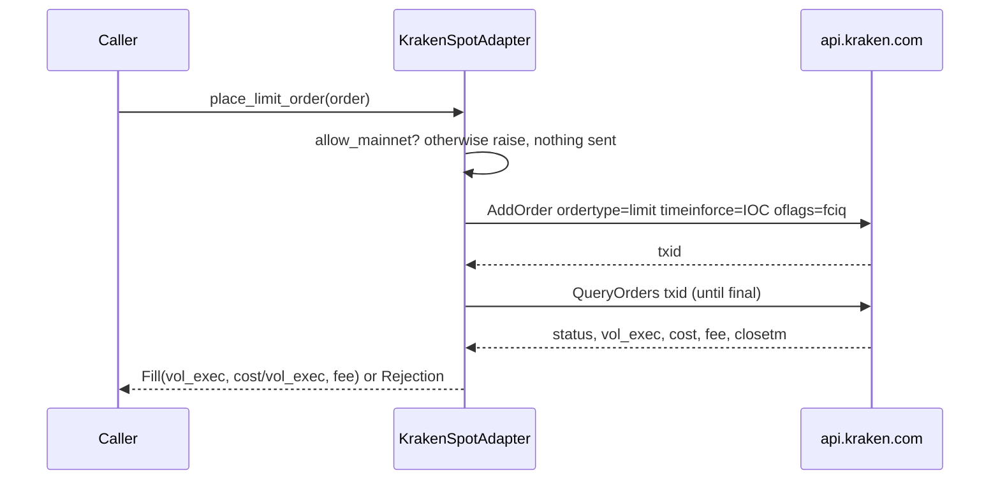

# Change: 32-kraken-spot-adapter

**SDD change**: `32-kraken-spot-adapter`
**Date**: 2026-10-04
**Status**: Proposed
**Tracking issue**: see sibling `issue.md` (#32)

## Summary

Adds the Kraken spot trading adapter behind the existing `ExchangePort` and
`StopLossPort`, the cold backup venue of ADR-004. It places market orders,
immediate-or-cancel limit orders and resting stop-loss-limit sells, cancels
orders, and reads free balances through Kraken's signed private API. The
order book and fee schedule come from the existing `KrakenPublicAdapter`.
Kraken has no spot testnet, so the adapter is read-only unless the
composition root passes `allow_mainnet`, which it does only after the
live-approval gate (#382, ADR-014). Nothing wires it into `hermes serve`,
which stays shadow.

## Scope

### In

- `adapters/exchanges/kraken_spot.py`: `KrakenSpotAdapter`,
  `KrakenSpotConfig`, `sign`.
- Unit tests on recorded replies in `tests/fixtures/kraken_spot/`, served by
  respx with no network calls.
- Decision journal entry with the order flow in Mermaid.

### Out

- Wiring into a live path, the order router or `hermes serve`: after
  certification (ADR-014).
- Per-pair price and volume precision from `AssetPairs`: before live use.
- The failover runbook and drill (`docs/runbook/failover-to-kraken.md`,
  ADR-004): follow-up under #32.
- A live contract test: Kraken has no spot testnet.

## Decisions

### D-1: A separate class that composes the public adapter

- **Decision**: `KrakenSpotAdapter` holds a `KrakenPublicAdapter` for
  `get_orderbook` (100 levels) and `get_fees` (volume tiers, cached a day).
- **Rationale**: the public adapter keeps needing no credentials; no wire
  code is duplicated.
- **Cost of reversal**: LOW.

### D-2: Read-only without `allow_mainnet`

- **Decision**: `place_market_order`, `place_limit_order`, `place_stop_loss`
  and `cancel_order` raise `ExchangeError` before building a request unless
  `allow_mainnet=True`. Only `https://api.kraken.com` is accepted.
  Credentials come from `HERMES_KRAKEN__API_KEY` and
  `HERMES_KRAKEN__API_SECRET`; the secret must be base64 and is kept out of
  `repr`.
- **Rationale**: AGENTS.md rule 7, ADR-003 §00 I-08, ADR-014. Binance's gate
  is the testnet host; Kraken has none, so the gate is on writing.
- **Cost of reversal**: LOW.

### D-3: Read the order back after `AddOrder`

- **Decision**: `AddOrder` returns only a txid, so the adapter polls
  `QueryOrders` up to `settle_checks` times (default 5, 0.5 s apart) until
  the order is closed, cancelled or expired. A still-live order raises an
  `ExchangeError` naming the txid. An IOC limit with nothing executed is a
  `Rejection`.
- **Cost of reversal**: LOW.

### D-4: Fees in the quote currency

- **Decision**: every order sends `oflags=fciq`, and the fill's fee is
  Kraken's `fee` field in the quote currency.
- **Rationale**: a buy is not reduced by a base-asset fee, which keeps the
  FIFO lot quantity equal to the executed volume (#405).
- **Cost of reversal**: LOW.

### D-5: Stop-loss is a GTC stop-loss-limit on the last trade

- **Decision**: `ordertype=stop-loss-limit`, `price` is the trigger,
  `price2` is 1% below (`stop_limit_buffer`), `trigger=last`. Kraken
  cancels by txid alone, so the returned id is the txid.
- **Cost of reversal**: LOW.

## Requirements

### R-1: Signed Kraken trading behind the ports, read-only by default

- **A-1.1**: `uv run pytest tests/unit/adapters/exchanges/test_kraken_spot.py`

## Design

Signing follows Kraken's documentation: `API-Sign` is
base64(HMAC-SHA512(base64decode(secret), path + SHA256(nonce + body))). The
nonce is epoch milliseconds, forced to increase within one millisecond. A
token bucket of 15 per 45 s sits below the starter-tier counter; a rate-limit
error is not retried. See the module docstring of `kraken_spot.py`.

## Test plan

1. The signature reproduces Kraken's documented example.
2. Without `allow_mainnet`, every write raises and no request is sent
   (SEV-1).
3. Another host, a non-base64 secret and missing credentials are refused; the
   secret is not in `repr`.
4. Market fills (including a pending read-back), partial and unfilled IOC
   limits, stop-loss parameters, cancels (including the idempotent unknown
   order), balances under Kraken asset codes, the book, fees, and every
   malformed or failed reply.
5. `bash scripts/dev/pr-preflight.sh` passes.

## Risks

- **Reply shapes differ from the documentation**: there is no testnet, so
  the first signed read on a real account (balance, read-only key) is the
  check before any order.
- **Too many decimals for a pair**: Kraken rejects the order; precision is a
  follow-up before live use.
- **An order that does not settle**: raises with the txid, so it is
  reconciled by hand rather than retried.
