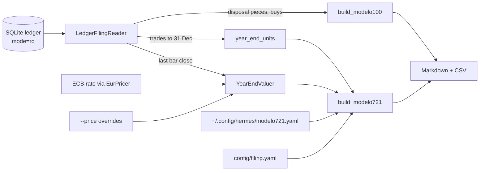

# Change: 36-modelo-100-721

**SDD change**: `36-modelo-100-721`
**Date**: 2026-10-04
**Status**: Proposed
**Tracking issue**: see sibling `issue.md`

Mirror of engram topic key `sdd/36-modelo-100-721/change` (see
[ADR-009 §6](../../../docs/architecture/adr-009-documentation-strategy.md#6-change-specs--sdd-artifacts-dual-source-convention)
dual-source rule).

## Summary

`hermes tax-filing --year YYYY` reads the ledger and prints the figures the
operator needs to file two Spanish declarations: the virtual-currency
transmissions section of Modelo 100 (IRPF) and Modelo 721 (virtual currencies
held abroad on 31 December). It writes a Markdown report and CSV files; it
never submits anything to the tax agency and never reads the taxpayer
profile. The main pick is a new pure `hermes.domain.filing` package that
reads the existing FIFO projection and trades rather than changing them. The
main risk is that several AEAT form details (contraprestación keys, the 721
valuation rule, the custodian's country) are working readings, flagged for
the gestor rather than settled.

## Scope

### In

- `hermes.domain.filing`: tax-year bounds (Europe/Madrid), the Modelo 100
  transmissions report (per sale and per coin, gains and losses netted,
  pending EUR values listed, two-month repurchase flags), and the Modelo 721
  report (year-end units and EUR value per coin, origin key A/M/C, the
  €50,000 first-time threshold and the €20,000 increase rule).
- `hermes.ports.filing`: the read port the service needs.
- `hermes.application.filing`: the service that builds both reports, values
  year-end holdings (last stored bar close × ECB rate, or an operator
  override), and renders Markdown and CSV.
- `hermes.adapters.ledger.filing_reader`: a read-only (`mode=ro`) SQLite
  reader over `trades`, `lots`, `lot_consumptions` and `live_bars`.
- `hermes.infrastructure.config.filing`: `config/filing.yaml` (thresholds,
  custodian) and the optional local, uncommitted 721 history file.
- `hermes.entrypoints.commands.tax_filing`: the CLI command.
- An import-linter contract: filing outputs are measurement only.
- Decisions-journal entry with the defaults and a Mermaid flow.

### Out

- Submitting to AEAT, or producing the BOE-format 721 file or a PDF. Renta
  Web takes the Modelo 100 figures by hand, and the 721 web form takes a
  handful of rows; a fixed-width export is a follow-up if the operator wants
  it.
- Tax estimates and the savings-base integration with other income: #395.
- USDT as its own FIFO asset: #405. Until it lands, USDT disposals and USDT
  holdings are absent from the ledger and therefore from both reports.
- Any change to `_reproject`, the FIFO core, the ledger schema or migrations.

## Decisions

### D-1: Read the stored projection, never recompute FIFO

- **Decision**: Modelo 100 reads `lot_consumptions` rows (proceeds, cost,
  fee, gain) joined to their SELL trade and lot; Modelo 721 replays
  quantities through the existing `replay_fifo_eur` only to find the oldest
  open lot.
- **Alternatives**: A second FIFO in the filing package (two sources of
  truth); editing `_reproject` (owned by #405).
- **Rationale**: ADR-002 neutral consequence: the projection is the audit
  trail. One calculator, one answer.
- **Cost of reversal**: LOW.

### D-2: Transmission and acquisition values follow ADR-016 item 3

- **Decision**: Transmission value = Σ(proceeds − sell fee share);
  acquisition value = Σ(cost share, buy fee included); gain = the difference.
- **Rationale**: Matches IRPF art. 35 and the stored consumptions exactly.
- **Cost of reversal**: LOW.

### D-3: One summary line per coin and consideration kind, detail per sale

- **Decision**: The report gives one line per (coin, consideration kind)
  for Renta Web plus the full per-sale detail as an annex and CSV.
- **Alternatives**: One line per sale only (dozens of manual entries).
- **Rationale**: Renta Web accepts aggregated lines per coin; the detail is
  kept for the gestor and for an audit. Flagged for the gestor.
- **Cost of reversal**: LOW (the detail is already there).

### D-4: Consideration kind is named, not keyed

- **Decision**: The report says "fiat currency" or "other virtual currency"
  from the SELL's quote; it prints no AEAT letter key.
- **Rationale**: The key letters change between campaigns; a wrong key in
  print is worse than a name the operator maps in the form.
- **Cost of reversal**: LOW.

### D-5: Pending EUR values make the year incomplete

- **Decision**: A sale in the year with any pending EUR value is listed and
  excluded from the totals; the command exits 4 ("incomplete") so it can
  never be mistaken for final figures.
- **Rationale**: ADR-016 item 5 and the fail-closed rule.
- **Cost of reversal**: LOW.

### D-6: Two-month repurchase rule is flagged, not applied

- **Decision**: A loss sale with a BUY of the same coin within two calendar
  months either side (excluding the lots that sale consumed) is flagged.
- **Rationale**: ADR-016 item 8.
- **Cost of reversal**: LOW.

### D-7: Modelo 721 obligation rules and origin keys

- **Decision**: With no prior 721 on file, the obligation holds when the
  31 December total exceeds €50,000. With a prior 721, it holds when the
  total rose more than €20,000 over the last declared total, or when a
  declared coin is no longer held. Origin: A (first declared), M (declared
  before and still held), C (declared before, now extinguished). Thresholds
  live in `config/filing.yaml`.
- **Rationale**: Orden HFP/887/2023 and RGAT art. 42 quater, applied to
  the aggregate as AEAT's 721 FAQ does. Flagged for the gestor (ADR-002
  Pending).
- **Cost of reversal**: LOW (config).

### D-8: Year-end valuation

- **Decision**: Value per coin = the last stored bar close at or before
  31 December 24:00 Madrid in USDT × the ECB rate for 31 December (USDT
  read as USD, prior business day on a holiday), or an operator override
  `--price COIN=EUR`, which wins. A coin with neither is "price missing"
  and the obligation is undetermined unless the known total already
  crosses the threshold.
- **Rationale**: Reuses `EurPricer` and ADR-016 item 5. AEAT asks for the
  31 December market value without naming a source; the override lets the
  gestor's figure win.
- **Cost of reversal**: LOW.

### D-9: Personal data stays local

- **Decision**: The command never reads `taxpayer.yaml`. The prior 721
  history is an optional local file outside the repo
  (`~/.config/hermes/modelo721.yaml`, override `HERMES_MODELO721_HISTORY`).
  The report leaves NIF and name blank for the operator.
- **Rationale**: ADR-016 item 12.
- **Cost of reversal**: LOW.

### D-10: Shadow label

- **Decision**: Every report carries "estimate, not a filing"; unless
  `--live` is passed it also says "shadow (simulated fills, no real tax
  due)".
- **Rationale**: ADR-016 item 10. Mainnet is off; shadow is the safe default.
- **Cost of reversal**: LOW.

## Requirements

### R-1: Modelo 100 figures

- **A-1.1**: Unit tests in `tests/unit/domain/filing/test_modelo100.py`
  pin per-sale and per-coin values, netting, the Madrid year boundary,
  pending exclusion and the repurchase flag.
- **A-1.2**: A hypothesis test proves transmission − acquisition = gain for
  every line and net = gains − losses.

### R-2: Modelo 721 figures

- **A-2.1**: Unit tests in `tests/unit/domain/filing/test_modelo721.py`
  cover the threshold, the increase rule, origin keys, extinction and
  missing prices.

### R-3: Ledger reader and CLI

- **A-3.1**: `tests/unit/adapters/ledger/test_filing_reader.py` reads a
  ledger built through `SqliteLedger` and matches its consumptions.
- **A-3.2**: `tests/unit/entrypoints/commands/test_tax_filing.py` runs the
  command end to end on a synthetic ledger; exit codes 0/2/3/4.
- **A-3.3**: `uv run lint-imports` passes with the new contract.

## Design

Files:

- `src/hermes/domain/filing/{__init__,tax_year,modelo100,modelo721}.py`
- `src/hermes/ports/filing.py`
- `src/hermes/application/filing/{__init__,service,render}.py`
- `src/hermes/adapters/ledger/filing_reader.py`
- `src/hermes/infrastructure/config/filing.py`, `config/filing.yaml`,
  `config/modelo721.example.yaml`
- `docs/decisions/2026-10-04-tax-filing-defaults.md` (defaults + Mermaid flow)
- `src/hermes/entrypoints/tax_filing.py`,
  `src/hermes/entrypoints/commands/tax_filing.py`

CLI: `hermes tax-filing --year YYYY [--db PATH] [--config-dir DIR]
[--out DIR] [--price COIN=EUR ...] [--history PATH] [--live]`.
Exit codes: 0 complete, 1 ledger failure, 2 usage, 3 config, 4 incomplete
(pending EUR values or a missing year-end price).

## Test plan

1. Every acceptance criterion above passes.
2. `bash scripts/dev/pr-preflight.sh` → all checks green.
3. CI green.

Test tiers touched: unit, property

## Risks

- **AEAT form drift**: box numbers and keys change per campaign. Mitigation:
  the report names fields and prints no box numbers or letter keys.
- **Shadow data read as real**: mitigated by the default shadow label.
- **USDT missing until #405**: the report states it under "Known gaps".

## Dependencies on other changes

- #405 (USDT as its own FIFO asset): no code dependency; once merged, USDT
  sales and holdings appear in both reports with no change here.
- #395 (tax estimates): independent; this change computes no tax.
