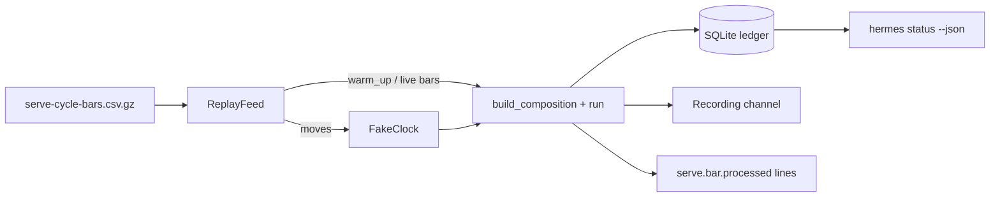

# Change: 408-e2e-serve-cycle

**SDD change**: `408-e2e-serve-cycle`
**Date**: 2026-10-03
**Status**: Applied
**Tracking issue**: see sibling `issue.md` (#408, parent #141)

Mirror of engram topic key `sdd/408-e2e-serve-cycle/change` (see
[ADR-009 §6](../../../docs/architecture/adr-009-documentation-strategy.md#6-change-specs--sdd-artifacts-dual-source-convention)
dual-source rule).

## Summary

ADR-007 Tier 3 promises end-to-end tests, but `tests/e2e/` held only an
`__init__.py`. This change adds four `e2e` tests that boot the real
`hermes serve` composition root (repository `config/`, three pairs, swing
strategy at its pre-registered parameters, SQLite ledger file) and replay
twenty days of recorded Binance spot bars through it. They run weekly and on
manual dispatch as a job in `scheduled.yml`. The main pick is to replay a
recording with a moving fake clock instead of running against testnet; the
main risk is that the pinned signal list must be re-pinned if the
pre-registered strategy ever changes, which only a v2 pre-registration may do.

## Scope

### In

- `tests/fixtures/e2e/serve-cycle-bars.csv.gz` + `README.txt`: 2,274 real
  4h and 1d klines for BTC, ETH and SOL (warm-up history plus 1-20 Jan 2025).
- `tests/support/recorded_bars.py`: fixture loader and `ReplayFeed`, which
  advances the clock to each bar's delivery time.
- `tests/e2e/test_serve_cycle.py`: the four flows below, plus a syrupy
  snapshot of `hermes status --json`.
- `.github/workflows/scheduled.yml`: an `e2e` job on the Sunday cron and on
  manual dispatch (no separate `e2e.yml`).
- `pyproject.toml` marker text and `docs/guides/test-tiers.md`.

### Out

- Simulated fills. `hermes serve` wires no exchange in MVP1, so the ledger
  holds signals, not trades; the test asserts zero `TradeExecuted` rows.
  When shadow P&L adds simulated fills to serve, the expected list gains
  them.
- Testnet runs (the marker text said "against testnet"; the simulated path
  needs no keys).

## Decisions

### D-1: Replay a recording, not testnet

- **Decision**: Feed recorded klines through a scripted feed and a fake
  clock that follows each bar's delivery time.
- **Alternatives**: Binance testnet (non-deterministic, needs keys, testnet
  klines are not mainnet prices); synthetic bars (would not exercise the
  real parameters on real volatility).
- **Rationale**: Deterministic, offline, and uses the exact production
  wiring apart from the bar source, clock and channels.
- **Cost of reversal**: LOW.

### D-2: Pin the expected signals

- **Decision**: The 14 signals of the recording are a literal list in the
  test, pinned from one run and checked against an independent strategy
  replay at authoring time.
- **Alternatives**: Recompute expectations with a reference replay at test
  time (shares code with the path under test).
- **Rationale**: Pre-registration §5 freezes the parameters and the
  recording never changes, so a literal list catches any behaviour change.
- **Cost of reversal**: LOW.

### D-3: Status snapshot via `hermes status --json`

- **Decision**: The report flow snapshots the JSON status over the ledger
  one full cycle wrote, with `now` and the systemd probe injected.
- **Rationale**: The console status view has landed; JSON is the stable,
  colour-free form.
- **Cost of reversal**: LOW.

## Requirements

### R-1: Serve on recorded bars

- **A-1.1**: ledger SignalEmitted rows, channel notifications and
  `serve.bar.processed` lines with a signal all equal the pinned list; one
  BarProcessed row per stream cursor plus one per live bar; no
  TradeExecuted row.

### R-2: Stop hit, then restart rebuild

- **A-2.1**: a run that records a chandelier stop and stops with two open
  positions, then restarts two 4h closes later, ends with the pinned list,
  notifies each signal once, and writes no duplicate BarProcessed row.

### R-3: Missed-bar recovery

- **A-3.1**: dropping a live bar exits 1 with a BarGapError sent to Sentry;
  the restart ends with the pinned list.

### R-4: Status snapshot

- **A-4.1**: `hermes status --json` after the cycle matches the snapshot.

### R-5: Scheduling

- **A-5.1**: `uv run pytest tests/e2e -m e2e` passes; the `e2e` job runs on
  the Sunday cron and on manual dispatch.

## Design

Each flow fails when its invariant is broken; the PR shows one
deliberately broken run per flow (journal line without its signal, restart
that forgets open positions, gap not detected, status ignoring the settle
delay).

## Test plan

1. `uv run pytest tests/e2e -m e2e` → 4 passed.
2. The four deliberate breaks each fail their flow.
3. `bash scripts/dev/pr-preflight.sh` → green.

## Risks

- Signals are pinned to the recording: a pre-registration v2 must re-pin.
- The run takes about 2 s per test; the 300 s tier budget is ample.
