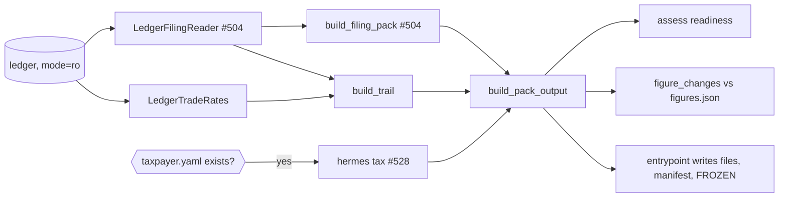

# Change: 568-tax-pack

**SDD change**: `568-tax-pack`
**Date**: 2026-10-04
**Status**: Applied
**Tracking issue**: see sibling `issue.md`

Mirror of engram topic key `sdd/568-tax-pack/change` (see
[ADR-009 §6](../../../docs/architecture/adr-009-documentation-strategy.md#6-change-specs--sdd-artifacts-dual-source-convention)
dual-source rule).

## Summary

`hermes tax-pack` keeps a filing pack per tax year up to date as hermes
trades, so the Modelo 100 and Modelo 721 material is ready when the Renta
campaign opens. It composes the `tax-filing` figures (#504, change
`36-modelo-100-721`) and, where a local taxpayer profile exists, the `tax`
estimate (#528, change `tax-estimates`). It adds three things neither has: a
trail from every sale to the lots, fees and ECB rates behind it, a readiness
checklist, and a record of what changed between refreshes. A daily timer
(shipped off) refreshes the open years, and a year whose pack is ready after
31 December is frozen. Hermes still submits nothing. The main risk is a
frozen pack that turns out wrong; reopening it is a deliberate, documented
manual step.

## Scope

### In

- `src/hermes/domain/filing/trail.py`: one trail line per stored FIFO
  consumption (sale → lot), with the EUR values and the ECB rates of both
  trades.
- `src/hermes/domain/filing/readiness.py`: the checklist and the pack status
  (open, incomplete, ready).
- `src/hermes/domain/filing/pack_changes.py`: what changed between two
  refreshes.
- `src/hermes/domain/filing/renta_campaign.py`,
  `src/hermes/infrastructure/config/renta.py` and
  `config/renta_campaigns.yaml`: the Renta Web box per tax year.
- `src/hermes/application/filing/renta_sheet.py`: the printable Spanish
  Renta Web sheet (with the 721 fields when due) and the dossier.
- `src/hermes/ports/tax_pack.py` and
  `src/hermes/adapters/ledger/trade_rates_reader.py`: the read-only rate
  lookup.
- `src/hermes/application/filing/pack.py`: the pack's files, figures and
  manifest, with no I/O.
- `src/hermes/entrypoints/tax_pack.py` and `commands/tax_pack.py`: the
  `hermes tax-pack` command, which owns the disk writes.
- `deploy/systemd/hermes-tax-pack.{service,timer}`: a daily refresh at 07:30
  Europe/Madrid. Not enabled by `vps-bootstrap`.
- `docs/guides/tax-pack.md`: what the pack holds, how it refreshes, and how
  to reopen a frozen year.

### Out

- AEAT submission, PDF or BOE-format 721: never submitted; formats are
  follow-ups on request.
- Notifications on a status change: follow-up after the notification shapes
  (#520).
- Total IRPF (#396): added to the pack once that change lands.

## Decisions

### D-1: Compose, don't recompute

- **Decision**: the pack calls `build_filing_pack` (#504) for the figures and
  `hermes tax` (#528) for the estimate; it computes no tax figure of its own.
- **Alternatives**: a third tax calculation (drifts from the other two); copy
  the #504 output files (loses the typed figures the checklist needs).
- **Rationale**: one source per figure. The trail reads the same
  `disposal_pieces` the Modelo 100 report sums, so the two always agree
  (property test).
- **Cost of reversal**: LOW.

### D-2: The pack refreshes in place, and a ready closed year freezes

- **Decision**: each run rewrites `<out>/<year>/`. When the year has ended
  (Madrid calendar, ADR-016 item 2) and nothing blocks it (no pending EUR
  values, every year-end price known, 721 obligation determined), the run
  writes `FROZEN`. Later runs leave a frozen pack untouched and exit 5.
- **Alternatives**: never freeze (a late backfill or bug fix could silently
  change a filed year); freeze on 1 January whatever the state (would freeze
  pending figures).
- **Rationale**: after filing, the pack is the evidence of what was filed. A
  correction is a deliberate act: delete `FROZEN` and rerun, and the
  differences appear in `changes.md`.
- **Cost of reversal**: LOW.

### D-3: Without `--year`, refresh the open years

- **Decision**: `hermes tax-pack` with no `--year` refreshes the current Madrid
  tax year and the previous one unless that is frozen. The timer runs exactly
  this.
- **Alternatives**: a shell wrapper that loops over years (one more script to
  test).
- **Rationale**: in January to June the previous year still waits on late
  backfills and the Renta campaign; the current year is always open.
- **Cost of reversal**: LOW.

### D-4: The estimate goes in only where the profile lives

- **Decision**: `tax-estimate.txt` is written only when the taxpayer profile
  file exists (`HERMES_TAXPAYER_PROFILE` or the default path). Otherwise the
  checklist says where to run it.
- **Alternatives**: always run the estimate with the no-profile defaults
  (a misleading figure on the server).
- **Rationale**: tax figures stay on Rick's machine (project decision); the
  server has no profile, so its pack holds filing figures only.
- **Cost of reversal**: LOW.

### D-5: Default output folder outside the repo

- **Decision**: `--out` defaults to `$HERMES_TAX_PACK_DIR`, else
  `~/.local/share/hermes/tax-packs`. The server unit passes its systemd
  `StateDirectory`, `/var/lib/hermes-tax-pack`.
- **Rationale**: packs hold personal financial figures and must never land
  in a checkout.
- **Cost of reversal**: LOW.

### D-6: A Spanish sheet to copy into Renta Web, with box numbers from config

- **Decision**: `renta-web.html` lists one entry per coin and kind of
  consideration for the campaign's virtual-currency box (1804 in the 2025
  campaign), with Renta Web's labels and keys (F legal tender, N another
  virtual currency), amounts in the Spanish format. Box numbers come from
  `config/renta_campaigns.yaml`, one entry per tax year; a year without its
  own entry borrows the latest earlier one, is marked provisional, and its
  pack cannot freeze.
- **Alternatives**: an import file (Renta Web has no import for this
  section, checked 2026-10-04); hard-coded boxes (AEAT can renumber them).
- **Rationale**: it is what Spanish crypto-tax tools hand their users (a
  box-by-box report plus a dossier), and Rick asked for the boxes filled.
- **Cost of reversal**: LOW.

### D-7: The 721 as fields in the web form's order, not a submission file

- **Decision**: when the 721 is due, the sheet lists its fields in the order
  of Orden HFP/886/2023 (as amended by Orden HAC/1504/2024): declarant
  condition, custodian, coin, units, unit value, value source, balance,
  origin key. Nothing is generated for the web service.
- **Alternatives**: an XML message for the AEAT web service (needs a signed
  client; too close to submitting, which hermes never does).
- **Rationale**: the 721 is filed through the AEAT web form or web service;
  there is no file upload. With 5,000 USDT it is unlikely to be due at all.
- **Cost of reversal**: LOW.

### D-8: PDF output (decided by Rick, 2026-10-04)

- **Decision**: the Renta Web sheet and the dossier are written as PDF files.
  Rick chose PDF over printable HTML on the thread's decision card.
- **Alternatives**: printable HTML printed to PDF from a browser (no new
  dependency; not chosen).
- **Rationale**: the gestor receives a PDF either way; writing it directly
  removes the manual print step.
- **Cost of reversal**: LOW.

## Requirements

### R-1: One folder per year with every file

- **A-1.1**: `tests/unit/entrypoints/test_tax_pack.py` writes a pack for the
  standard ledger and finds `README.md`, `report.md`, the three #504 CSV files,
  `trail.csv`, `figures.json`, `changes.md` and `manifest.json`.
- **A-1.2**: every manifest checksum matches the file it names.

### R-2: The trail adds up to the Modelo 100 figures

- **A-2.1**: hypothesis property in `tests/unit/domain/filing/test_trail.py`:
  the trail gains of fully priced sales sum to `Modelo100Report.net_eur`.

### R-3: Readiness

- **A-3.1**: an open year is `open`; a closed year with a pending sale, a
  missing price or an undetermined 721 is `incomplete`; otherwise `ready`.

### R-4: Changes and freezing

- **A-4.1**: a second refresh with no new trades appends nothing to
  `changes.md`; a new sale appends the changed figures.
- **A-4.2**: a ready closed year writes `FROZEN`, and the next run exits 5
  and leaves every file unchanged.

### R-5: Read-only and measurement only

- **A-5.1**: the rate reader opens the ledger `mode=ro`.
- **A-5.2**: import-linter `filing-is-measurement-only` still passes (the new
  modules live under `hermes.domain.filing` and `hermes.application.filing`).

### R-7: Renta Web sheet

- **A-7.1**: `tests/unit/application/filing/test_renta_sheet.py` finds the
  box 1804 entry with key N and Spanish amounts, the provisional note, and the
  721 fields only when the 721 is due.
- **A-7.2**: a closed year with only an earlier campaign's boxes does not
  freeze (`test_tax_pack.py`).

### R-6: Timer shipped off

- **A-6.1**: `tests/unit/deploy/test_systemd_units.py` pins the 07:30 Madrid
  schedule and that the service runs `tax-pack` from the release with
  `StateDirectory=hermes-tax-pack`.

## Design

Files in `<out>/<year>/`:

| File | Content |
| --- | --- |
| `README.md` | status, headline figures, checklist, latest changes, file index |
| `renta-web.html` | the Renta Web entries (Spanish) and the 721 fields when due |
| `dossier.html` | every sale and the lots behind it, with fees and ECB rates |
| `report.md` + 3 CSV | the #504 report, unchanged |
| `trail.csv` | sale, lot, quantities, EUR values, ECB rates, gain |
| `tax-estimate.txt` | the #528 estimate, only where the profile exists |
| `figures.json` | the headline figures the next refresh compares against |
| `changes.md` | one dated entry per refresh that changed a figure |
| `manifest.json` | sha256 of every other file |
| `FROZEN` | present once the year is closed and ready |

Exit codes: 0 written, 1 ledger failure, 2 usage, 3 config error, 5 the
requested year is frozen (nothing written).

## Test plan

1. Every acceptance criterion above passes.
2. `bash scripts/dev/pr-preflight.sh --render-body 568-tax-pack` → all checks
   green.

## Risks

- **A frozen pack is wrong**: reopening is documented (delete `FROZEN`), and
  the changes log keeps the difference visible.
- **Personal figures on disk**: the estimate is written only on the machine
  that has the profile, under a folder outside any checkout.
- **Base changes**: built on #504 and #528; the PR opens after both merge.
