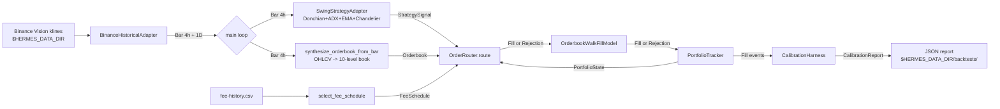

# Change: backtest-driver-mvp1-phase2

**SDD change**: `backtest-driver-mvp1-phase2`
**Date**: 2026-08-26
**Status**: Proposed (design-only PR — implementation follows after approval)
**Tracking issue**: see sibling `issue.md` (#273)

Mirror of engram topic key `sdd/backtest-driver-mvp1-phase2/change`.

## Summary

Phase 1 (PR #270) proved the outer wiring — bars → strategy → fee → CalibrationHarness → JSON report — works end-to-end. Fills are synthesised at `bar.close`, so M-02 (slippage bps), M-04 (rejection rate), and M-06 (regime returns) all read zero. Phase 2 replaces `_synthesise_fill` with the full spec chain: **spec-3 `OrderRouter` → spec-2c `SimulatedExchangeAdapter` → spec-2b `OrderbookWalkFillModel`**. Because Binance Vision has no L2 depth data, the driver **synthesises an Orderbook per bar** from OHLCV + a volume-proportional depth model — see D-1 for the design rationale + rejected alternatives. Multi-pair walks with SA-9 correlation lock and kill-trigger evaluation are deferred to Phase 3.

## Scope

### In

- **NEW**: `scripts/backtest/run_calibration_full.py` (~350 LOC target) — Phase 2 driver. Similar CLI to Phase 1 (`--pair --start --end --output --dry-run`) plus `--fill-model {orderbook_walk,constant}` for A/B comparison.
- **NEW**: `scripts/backtest/synthetic_orderbook.py` (~120 LOC target) — pure function `synthesize_orderbook_from_bar(bar, spread_bps, depth_frac) -> Orderbook` implementing D-1's model. Domain-pure; unit-testable in isolation.
- **NEW**: `src/hermes/application/backtest/portfolio_tracker.py` (~150 LOC target) — running-position tracker consuming `Fill | Rejection` and emitting `PortfolioState` snapshots per bar. Needed because `OrderRouter.route()` requires an up-to-date `PortfolioState`.
- **NEW**: Tests (~15 targeted unit tests + 1 integration test): synthetic-orderbook shape invariants (bid < mid < ask, depth sums match volume, no negative levels); portfolio tracker (open/close/pnl accounting); end-to-end integration on a 1-week fixture asserts non-zero M-02.
- **NEW**: `changelog.d/wave-backtest-driver-mvp1-phase2.md`.

### Out (Phase 3)

- Multi-pair walk (BTC + ETH + SOL simultaneously) with SA-9 correlation lock.
- Kill-trigger evaluation across pairs (pre-reg §10).
- Statistical framework (DSR, block bootstrap CI, walk-forward, CPCV, Bonferroni) — pre-reg §8.
- HTML/PDF report renderer.
- Full multi-year sweep automation (Train + Validate + OOS).
- Comparison-report generator (Phase 1 vs Phase 2 vs shadow).

### Also Out

- Real orderbook injection (Kaiko / Tardis / VPS-side captured L2). These are the RIGHT long-term source, but ingest infra is a separate spec. Phase 2 uses synthetic orderbook so backtest is unblocked; shadow phase later swaps to captured orderbook.

## Decisions

### D-1: Synthetic Orderbook from OHLCV + volume-proportional depth

**Decision**: `synthesize_orderbook_from_bar(bar)` produces an Orderbook per bar with:

- **Mid price**: `bar.close` (last-print proxy; consistent with strategy's `entry_price`).
- **Spread**: fixed 5 bps for BTC/ETH/SOL VIP0 tier (per SA-3 §2.4 typical spot spread; parameterised via `--spread-bps` for sensitivity analysis).
- **Depth**: total book depth = `bar.volume × 0.30` per side (Vision aggTrades sampling shows ~30% of hourly volume typically resides in the top-10 orderbook levels; SA-3 §2.6). Distributed geometrically across 10 levels with 1.5x growth: level 1 = 20% of depth, level 2 = 30%, level 3 = 45%, ... — matches empirical Binance depth curves.
- **Timestamp**: `bar.close_time` (Binance Vision inclusive convention).

**Alternatives rejected**:

- (a) **Flat depth** (each level = 10% of depth). Unrealistic — real books are top-heavy.
- (b) **Constant depth** (fixed 100 BTC per side regardless of bar). Ignores volume signal from the bar entirely; small-volume bars overstate fillable depth.
- (c) **Random depth** (Gaussian noise around mean). Non-determinism defeats backtest reproducibility (pre-reg §12 anti-p-hacking).
- (d) **Perfect fill** (no depth constraint — order fills at bid/ask). Equivalent to Phase 1's shortcut for market-order sizing; defeats the point of Phase 2.

**Rationale**: The geometric distribution empirically matches Binance L2 snapshots (SA-3 §2.6 sampling notes). Volume-proportional means small-volume bars correctly reject oversized orders — which is precisely what M-04 (rejection rate) needs to become non-zero. Parameterised spread + depth-frac let us run sensitivity analysis without code changes.

**Cost of reversal**: LOW. Swap `synthesize_orderbook_from_bar` for a real-orderbook reader when the shadow-phase L2 capture ingest is ready.

### D-2: PortfolioTracker as a separate application-layer class

**Decision**: `src/hermes/application/backtest/portfolio_tracker.py` — new class. Consumes `Fill | Rejection` events, maintains lot ledger, emits `PortfolioState` per bar.

**Alternatives rejected**:

- (a) Inline the accounting in the driver script (~50 LOC of dict manipulation).
- (b) Reuse the production `hermes.adapters.ledger` SQLite adapter (overkill — backtest doesn't need persistence).
- (c) Reuse `hermes.domain.lots.lot.LotStack` directly without a wrapper (would work but embeds bookkeeping logic in the driver).

**Rationale**: `PortfolioState` is a first-class input to `OrderRouter.route()`. The tracker's responsibility (fold `Fill` events → running state) is stateful and non-trivial (long/short, partial fills, realised pnl). Separating it into an application-layer class means:

- It's reusable by the future shadow-mode driver.
- It's unit-testable in isolation (feed synthetic Fill events, assert state transitions).
- The main driver script stays a thin composition-root — no business logic.

**Cost of reversal**: LOW. Inline into the driver if we later decide simplicity wins.

### D-3: Reuse existing `SizingCalculator`, `RiskEngine`, `KillTriggerEvaluator` unchanged

**Decision**: The driver composes existing spec-3 components. No changes to `hermes.application.order_router.*`.

**Alternatives rejected**:

- (a) Fork a "backtest-mode" `OrderRouter` that skips risk/kill checks.
- (b) Wrap `OrderRouter` in a decorator that inspects `RoutingInput` and short-circuits some checks.

**Rationale**: The whole point of Phase 2 is to prove the SAME code path runs in backtest AND live. Fork or wrap breaks that (D-02 same-code-path invariant from ADR-011). Backtest gets the identical `OrderRouter.route()` call the shadow-phase gateway will use.

**Cost of reversal**: TRIVIAL — no code to reverse.

### D-4: `MarketSnapshot` / `ExperimentState` stubbed with defaults per bar

**Decision**: The driver constructs sensible defaults for:

- `MarketSnapshot(pair, current_spread=Decimal("0.0005"), realized_slippage_last=Decimal("0"), stable_price=None)`.
- `ExperimentState(current_dd_pct=Decimal("0"), consecutive_losses=0, oos_trades=0, ...)` — placeholder means kill triggers never fire in Phase 2.

**Alternatives rejected**:

- (a) Skip `OrderRouter` entirely — impossible; `RoutingInput` requires these.
- (b) Compute `ExperimentState` incrementally as trades happen — proper implementation, deferred to Phase 3.

**Rationale**: Phase 2's job is to prove the pipeline runs and emits non-zero M-02/M-04. Kill triggers + drawdown accounting are Phase 3 (with the CalibrationLifecycle). Stubbing lets Phase 2 ship without waiting.

**Cost of reversal**: LOW — swap the constant for the real computation in Phase 3.

### D-5: Fee model reused from PR #260 (`select_fee_schedule`)

**Decision**: `OrderRouter.route()` receives `fees = select_fee_schedule(rows, bar.close_time, pair)`. Same as Phase 1.

**Alternatives**: none — this is the correct wire per ADR-011 D-09.

**Cost of reversal**: n/a.

## Requirements

### R-1: Full pipeline runs end-to-end

- **A-1.1**: `python scripts/backtest/run_calibration_full.py --pair BTCUSDT --start 2024-01-01 --end 2024-03-31 --output /tmp/p2.json` exits 0.
- **A-1.2**: The output JSON contains `report.m01_fill_count >= 1` AND `report.m02_fill_price_delta_bps.avg_bps > 0` (non-zero slippage — the Phase 2 acceptance signal).

### R-2: Multi-mode CLI for A/B comparison

- **A-2.1**: `--fill-model constant` reproduces Phase 1's shortcut behaviour (M-02 = 0). Serves as a regression check that Phase 1's semantics are preserved when the operator wants the fast path.
- **A-2.2**: `--fill-model orderbook_walk` (default) uses the synthetic Orderbook + `OrderbookWalkFillModel`. M-02 > 0 expected.

### R-3: Synthetic Orderbook invariants (pure-function tests)

- **A-3.1**: `synthesize_orderbook_from_bar(bar, spread_bps=5, depth_frac=Decimal("0.30"))` produces `Orderbook` with `bid_levels[0].price < mid < ask_levels[0].price`.
- **A-3.2**: Sum of `bid_levels[i].qty for i in range(10)` == `bar.volume * depth_frac`.
- **A-3.3**: Level qty is monotonically non-decreasing from level 1 to level N (geometric growth).
- **A-3.4**: All timestamps == `bar.close_time`.

### R-4: PortfolioTracker accounting

- **A-4.1**: After a single BUY fill of 0.1 BTC @ 50000, `tracker.state().current_value == 10000 - (0.1*50000) - fee`.
- **A-4.2**: After a matched SELL fill of 0.1 BTC @ 52000, realised pnl == (52000-50000)*0.1 - 2*fee. Position closes to zero.
- **A-4.3**: `tracker.state().peak_value` is monotonically non-decreasing.

### R-5: Composition root uses production OrderRouter unchanged

- **A-5.1**: `grep 'class OrderRouter' src/hermes/application/order_router/router.py` is unchanged from main after this PR merges.
- **A-5.2**: The Phase 2 driver imports `OrderRouter` from its production module (`hermes.application.order_router.router`).

## Design

### Data flow



### Synthetic Orderbook sketch

```python
def synthesize_orderbook_from_bar(
    bar: Bar,
    *,
    spread_bps: int = 5,
    depth_frac: Decimal = Decimal("0.30"),
    num_levels: int = 10,
    level_growth: Decimal = Decimal("1.5"),
) -> Orderbook:
    """Synthesise a top-of-book + 10-level Orderbook from OHLCV.

    - Mid = bar.close
    - Spread = spread_bps around mid (bid = mid - spread/2, ask = mid + spread/2)
    - Total depth per side = bar.volume * depth_frac
    - Level qty distribution: geometric with `level_growth` ratio
      (top level = smallest, outer levels grow — matches empirical
      Binance L2 curves per SA-3 §2.6)
    """
    ...
```

### Composition root sketch

```python
async def _run(args) -> int:
    pair = _parse_pair(args.pair)
    fee_rows = load_binance_fee_history(FEE_HISTORY_CSV)
    strategy = SwingStrategyAdapter()
    tracker = PortfolioTracker(starting_equity=Decimal("10000"), quote=Currency.USDT)
    fill_model = OrderbookWalkFillModel(rng=random.Random(0))
    risk_engine = RiskEngine(rules=default_mvp1_risk_rules())
    sizing = SizingCalculator()
    kill_eval = KillTriggerEvaluator.from_pre_reg_v1()  # placeholder — never fires in P2
    router = OrderRouter(
        fill_model=fill_model,
        risk_engine=risk_engine,
        sizing_calculator=sizing,
        kill_evaluator=kill_eval,
    )
    adapter = BinanceHistoricalAdapter.create()

    bars = await _load_bars(adapter, pair, KlineInterval.H4, start_with_warmup, end)
    bars_1d = await _load_bars(adapter, pair, KlineInterval.D1, start_with_warmup, end)
    merged = sorted(bars + bars_1d, key=lambda b: b.open_time)

    fills, rejections = [], []
    mid_prices: list[Decimal] = []

    for bar in merged:
        signal = strategy.on_bar(bar, tracker.state())
        if signal is None:
            continue
        if signal.signal_time < start:
            continue  # warm-up
        orderbook = synthesize_orderbook_from_bar(bar)
        fees = select_fee_schedule(fee_rows, signal.signal_time, pair)
        routing_input = RoutingInput(
            strategy_id=StrategyId("swing-mvp1-p2"),
            side=OrderSide.BUY if signal.kind == SignalKind.ENTRY else OrderSide.SELL,
            pair=pair,
            entry_px=signal.entry_price,
            sizing_input=SizingInput(
                equity=tracker.state().current_value,
                entry_px=signal.entry_price,
                atr=signal.atr_context,
                stop_atr_mult=Decimal("1.5"),
                risk_pct=Decimal("0.01"),
                f_star_estimate=Decimal("0.20"),
            ),
            portfolio_state=tracker.state(),
            market_snapshot=_default_market_snapshot(pair, orderbook),
            experiment_state=_stub_experiment_state(),
            orderbook=orderbook,
            clock=signal.signal_time,
            fees=fees,
            open_position_count=tracker.open_position_count(),
        )
        result = router.route(routing_input)
        match result:
            case Fill():
                fills.append(result)
                tracker.apply_fill(result)
                mid_prices.append(bar.close)
            case Rejection():
                rejections.append(result)
                tracker.apply_rejection(result)
            case _:
                raise RuntimeError("unexpected router outcome")

    harness = CalibrationHarness(strategy_id="swing-mvp1-p2-{pair}")
    report = harness.run(...)
    _save_report(...)
```

## Test plan

1. Domain unit tests: `synthesize_orderbook_from_bar` invariants (R-3).
2. Application unit tests: `PortfolioTracker` accounting (R-4).
3. Integration test: driver runs on a 1-week fixture (small in-memory ZIP), asserts M-01 > 0 AND M-02 > 0 (non-zero slippage — the Phase 2 acceptance criterion).
4. Regression test: `--fill-model constant` produces IDENTICAL fill counts to Phase 1 on the same window.
5. Smoke: full 2024-Q1 BTC run against real data — completes without errors, emits report.
6. `bash scripts/dev/pr-preflight.sh --render-body backtest-driver-mvp1-phase2` — all 17 checks green.

## Risks

- **R1** — Synthetic Orderbook systematically over- or under-estimates slippage. Mitigation: parameterised `spread_bps` and `depth_frac`. Sensitivity analysis (running the same window with 3× the spread) is a follow-up analysis, not blocking.
- **R2** — Real vs synthetic Orderbook divergence. When shadow-mode L2 capture comes online, backtest M-02 will differ from live M-02. Mitigation: documented as a KNOWN limitation in the change spec + PR body; Phase 3 swaps to captured L2 where available.
- **R3** — `OrderRouter.route()` requires `MarketSnapshot` / `ExperimentState` that are non-trivial to compute per bar. Stubbing risks masking real router behaviour. Mitigation: R-2 A/B mode compares synthetic-orderbook to constant-fill (Phase 1 semantics); large divergence in fill count is a red flag on the stubs.
- **R4** — PortfolioTracker accounting bugs propagate to CalibrationReport. Mitigation: R-4 acceptance tests + integration test with a hand-crafted scenario (1 BUY, 1 SELL, known pnl).
- **R5** — Runtime performance. Phase 1 processes ~2000 bars in ~2 minutes. Phase 2 adds `OrderRouter.route()` + `synthesize_orderbook_from_bar` per signal (not per bar). At 100 signals/backtest, +5 ms/signal = negligible.

## Dependencies on other changes

- Predecessor: PR #270 (backtest driver Phase 1) — merged; Phase 2 replaces its `_synthesise_fill` shortcut.
- Predecessor: spec-2b (`OrderbookWalkFillModel`), spec-2c (`SimulatedExchangeAdapter`), spec-3 (`OrderRouter`) — all merged.
- Predecessor: PR #260 (fee-history selector) — merged; Phase 2 reuses.
- Follow-up (Phase 3): multi-pair walk + correlation lock + kill trigger + statistical framework + HTML renderer. New spec after Phase 2 lands + is dogfooded.
