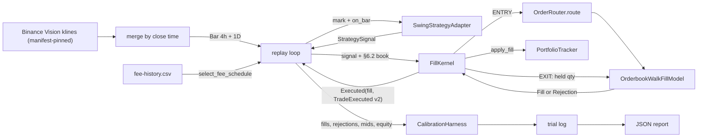

# Change: backtest-driver-mvp1-phase2

**SDD change**: `backtest-driver-mvp1-phase2`
**Date**: 2026-08-26 (approved), refreshed 2026-10-03
**Status**: Approved 2026-08-26; refreshed for the current tree 2026-10-03 and implemented under #313
**Tracking issue**: see sibling `issue.md` (#313; the original #273 was closed by the spec-only PR #274)

Mirror of engram topic key `sdd/backtest-driver-mvp1-phase2/change`.

## Summary

Phase 1 (PR #270) proved the outer wiring (bars → strategy → fee → CalibrationHarness → JSON report). Its fills are synthesised at `bar.close`, so M-02 (slippage bps), M-04 (rejection rate) and M-06 (regime returns) all read zero, and the trial it logs has no Sharpe.

Phase 2 runs every signal through the real fill path: **`OrderRouter` (spec-3) → `FillModelPort` = `OrderbookWalkFillModel` (spec-2b)**, with fills folded into the **`PortfolioTracker` from #308** and recorded as **`TradeExecuted` v2** events. Because Binance Vision has no L2 depth, the backtest builds a **synthetic order book per signal** from the bar (D-1). The routing, exit and accounting logic lives in one application-layer **fill kernel** (D-2) that `hermes serve` reuses in #353 with live books, so there is one implementation for backtest and shadow (ADR-011 D-01).

## Changes since approval (2026-08-26 → 2026-10-03)

- **Portfolio tracker**: the approved spec sketched a new `application/backtest/portfolio_tracker.py`. #308 shipped `hermes.application.portfolio.tracker.PortfolioTracker` (snapshot accounting, long-only, average cost) and #392 added `PortfolioTracker.rebuilt` (replay of `TradeExecuted` v2). Phase 2 reuses it; no second tracker (D-3).
- **Strategy id**: `StrategyId("swing-donchian-4h")`, read from the enabled roster entry in `config/strategies.yaml` (the same id `hermes serve` writes), replacing `swing-mvp1-p2`.
- **Bar order**: bars are merged by close time with the 1D bar first on ties (#311), reusing phase 1's `_merge_by_close_time`; the approved sketch sorted by `open_time`, which leaks each daily bar 20 h early.
- **Data access**: bars load through the data manifest (#356) with `CertificationState.UNTRUSTED`, so OOS is refused, and every run that evaluates the strategy appends a trial (#357/#419) before writing its report. Phase 2 reuses phase 1's loaders and trial helpers.
- **Capital**: seeded from the roster's `capital_budget` (5000 USDT, pre-registration §2) instead of 10000.
- **Slippage model**: the approved D-1 used a 5 bps spread around `bar.close` with the fill model's slippage off, giving ~2.5 bps entry cost. Pre-registration §6.2 fixes the backtest model at 5 bps over bar close for entries and 15 bps over the stop trigger for stop exits, and §11 makes any change a deviation. The refreshed D-1 makes the synthetic book reproduce §6.2 exactly (see below).
- **Dropped `--fill-model constant`** (old R-2): a second `FillModelPort` implementation would be a second fill kernel (ADR-011 D-01). Phase 1's driver stays in the tree as the zero-slippage baseline.
- **Sharpe**: phase 1 logged `sharpe=None` ("#313 adds the Sharpe"). Phase 2 records the per-period Sharpe of the daily equity curve in the trial.
- **Kernel shared with serve**: #353 (filed after approval) wires the same path into `hermes serve`. The approved design kept routing logic in the driver; the refresh moves it into `hermes.application.execution` so serve imports it instead of copying it.

## Scope

### In

- **NEW** `src/hermes/domain/market_data/synthetic_orderbook.py`: pure `synthesize_orderbook(...)` (D-1).
- **NEW** `src/hermes/application/execution/kernel.py`: `FillKernel` + outcome types, the shared fill path (D-2).
- **NEW** `src/hermes/application/backtest/replay.py`: `replay(...)`, the bar loop and the §6.2 execution book per signal (D-4).
- **EDIT** `src/hermes/application/portfolio/tracker.py`: additive `snapshot()` accessor (the kernel needs held quantity and starting cash).
- **NEW** `scripts/backtest/run_calibration_full.py`: the Phase 2 composition root (`--pair --start --end --output --dry-run --trial-log --manifest --depth-frac --config-dir`).
- **NEW** tests: synthetic-book invariants (hypothesis), kernel unit tests, replay unit tests, script helper tests, integration test (real router + real fill model + real swing strategy) asserting non-zero slippage, and a ledger round-trip asserting `PortfolioTracker.rebuilt` reproduces the kernel's portfolio.
- **NEW** `changelog.d/313-added.md`.

### Out (Phase 3 or other issues)

- Multi-pair walk with SA-9 correlation lock; kill-trigger and drawdown accounting across pairs (pre-reg §10).
- Risk-overlay rules in the backtest (the rules need per-bar spread medians, book age, peg and BTC-return data the backtest does not have yet; see D-5).
- Statistical framework, HTML report, multi-year sweep automation, comparison report.
- Real L2 injection for backtests.
- Wiring the kernel into `hermes serve` (#353).
- Any change to sizing math (see Risk R6).

## Decisions

### D-1: Synthetic order book reproduces pre-registration §6.2

**Decision**: `synthesize_orderbook(pair, reference_price, half_spread_bps, depth_per_side, snapshot_time, *, levels=10, level_growth=1.5, level_step_bps=1)` returns a symmetric book: best ask at `reference × (1 + half_spread)`, best bid at `reference × (1 − half_spread)`, each further level `level_step_bps` deeper, and `depth_per_side` split geometrically (each level `level_growth` × the previous, summing exactly to `depth_per_side`).

The backtest picks the reference and the half-spread from §6.2 per signal (D-4):

| Signal | Side | Reference price | Half-spread |
| --- | --- | --- | --- |
| ENTRY | BUY | signal bar close (§5.3) | 5 bps |
| EXIT, `chandelier` | SELL | `signal.stop_price` (stop trigger, §5.3/§6.2) | 15 bps |
| EXIT, `time_stop` / `regime_break` | SELL | signal bar close | 5 bps |

`depth_per_side = bar.volume × depth_frac` (default 0.30). The fill model runs with `apply_slippage=False`, the same setting shadow uses: the cost lives in the book, the kernel is configured identically in both modes, and only the book source differs. A small order fills on the touch at exactly the §6.2 price; an order larger than the touch walks deeper; an order larger than the whole side is rejected (§6.3: fill fully or reject). A zero-volume bar has no book and the order is declined.

**Alternatives rejected**:

- (a) Approved D-1 as written (5 bps spread around close, fill-model slippage off): entry cost 2.5 bps, a §6.2 deviation.
- (b) 5 bps spread plus `apply_slippage=True`: entry cost 7.5 bps; and the fill model applies `entry_slippage_bps` to every order (its `stop_slippage_bps` is never read), so stop exits would get 5 bps instead of 15.
- (c) Next-bar-open reference (ADR-011 D-10): pre-registration §5.3 fixes entry at the signal bar close, and ADR-011's own consistency section says the signed pre-registration wins.
- (d) Flat, constant or random depth: unchanged from the approved spec (unrealistic, ignores volume, or non-deterministic).

**Cost of reversal**: LOW. Swap the book source for captured L2 when it exists.

### D-2: One fill kernel for backtest and serve

**Decision**: `hermes.application.execution.kernel.FillKernel` owns the path from a strategy signal to a recorded fill:

- ENTRY → `OrderRouter.route` (kill breaker, orphan-position guard, risk engine, sizing, fill model), unchanged.
- EXIT → a market SELL of the full held quantity, sent to the same `FillModelPort` instance. Exits do not go through the router: its sizing would size the exit from equity, and its orphan-position guard would refuse to close a position when three are open.
- A fill is folded into the `PortfolioTracker` and returned with its `TradeExecuted` v2 event (`strategy_id` set), so persisting the event lets #392's startup rebuild replay it. A fill the portfolio refuses (e.g. a BUY above cash) is declined, not recorded.
- Outcomes: `Executed(fill, trade)`, `Declined(reason, rule, rejection)` (`rejection` set only when the fill model refused, the M-04 numerator), `Halted(breaker)`.

The kernel takes per-call market inputs (`MarketContext`: book or `None`, fees, time, `MarketSnapshot`, `ExperimentState`) so backtest passes a synthetic book and serve passes a live one. It never reads a clock, a config or a venue.

**Alternatives rejected**: routing logic in the driver script (serve would need a copy); routing through `SimulatedExchangeAdapter` (the router's dispatch contract is `FillModelPort`; putting the adapter in the path would mean changing the router, which R-5 forbids, or a shim that duplicates order construction; the adapter's balance and EUR-lot ledger would be a second accounting next to the tracker).

**Cost of reversal**: LOW.

### D-3: Reuse `PortfolioTracker` (#308/#392)

**Decision**: The kernel folds fills into the existing tracker. One additive accessor, `PortfolioTracker.snapshot()`, exposes the current `PortfolioSnapshot` (held quantity per pair for exits, starting cash for sizing). Nothing else in the tracker changes.

### D-4: Backtest loop in the application layer; script is a thin composition root

**Decision**: `hermes.application.backtest.replay.replay(bars, ...)` marks the tracker, calls `strategy.on_bar(bar, tracker.state())`, skips signals before the window (warm-up), builds the §6.2 book (D-1), calls the kernel, and records the daily equity curve at each in-window 1D close. It does no I/O. The script loads config, manifest-pinned bars, fee history, writes the trial and the report.

**Sizing inputs** (unchanged from the approved sketch): `stop_atr_mult=1.5`, `risk_pct=0.01`, `f_star_estimate=0.20`, `atr=signal.atr_context`. The sizing equity is the snapshot's starting cash: pre-registration §2 states that the risk percentage refers to the full 5000 USDT regardless of the deployed balance.

### D-5: Stubs for market snapshot, experiment state and risk rules

**Decision**: per signal, `MarketSnapshot(current_spread = median_spread_1h = book spread, orderbook_age_seconds=0, realized_slippage_last=0, stable_price=None, btc_log_return_1d=None)`; `ExperimentState(max_drawdown=0, days_since_equity_high=0, sa9_halt=False)` so kill triggers never fire; `RiskEngine(rules=[])`. Same rationale as the approved D-4: the backtest lacks the data these need, and wiring rules against invented inputs would change trading without evidence. The kernel takes all three from the caller, so serve wires real ones.

### D-6: Fees unchanged (`select_fee_schedule`, PR #260)

Per signal: `select_fee_schedule(rows, signal.signal_time, pair)`. A signal outside the fee history aborts the run (exit 1) instead of being skipped silently.

## Requirements

### R-1: Full pipeline runs end-to-end

- **A-1.1**: `HERMES_DATA_DIR=<data> uv run python scripts/backtest/run_calibration_full.py --pair BTCUSDT --start 2024-01-01 --end 2024-03-31 --output <tmp>/p2.json` exits 0 and appends one trial.
- **A-1.2**: when the window has fills, the report has `report.m01_fill_count >= 1` and `report.m02_fill_price_delta_bps.avg_bps > 0`.

### R-2: Execution model matches pre-registration §6.2

- **A-2.1**: an entry that fits the touch fills at `close × 1.0005`; a chandelier exit at `stop × 0.9985`; a time-stop or regime-break exit at `close × 0.9995`.
- **A-2.2**: an order larger than one side of the book is rejected, counted in M-04, and changes no portfolio state.

### R-3: Synthetic order book invariants (pure, hypothesis)

- **A-3.1**: best bid < reference < best ask, and the touch sits exactly `half_spread_bps` from the reference.
- **A-3.2**: each side's quantities sum exactly to `depth_per_side`.
- **A-3.3**: level quantities are non-decreasing away from the touch; bids strictly descend and asks strictly ascend.
- **A-3.4**: `snapshot_time` is the given time.

### R-4: Kernel accounting and replay parity

- **A-4.1**: an ENTRY fill reaches the tracker and its `TradeExecuted` carries the kernel's `strategy_id`, the fill's price, quantity and fee.
- **A-4.2**: an EXIT sells exactly the held quantity and leaves the pair flat.
- **A-4.3**: an EXIT with no position is declined (`rule="no-position"`), not filled.
- **A-4.4**: `PortfolioTracker.rebuilt(seed, trades)` over the kernel's recorded trades (including a SQLite ledger round-trip) equals the live tracker's snapshot.

### R-5: Production router unchanged

- **A-5.1**: `src/hermes/application/order_router/router.py` has no diff against `origin/main`.
- **A-5.2**: the kernel builds `OrderRouter` from `hermes.application.order_router.router`.

### R-6: Pre-registration integrity

- **A-6.1**: bars load through the data manifest with `CertificationState.UNTRUSTED`; an OOS window is refused before any strategy call.
- **A-6.2**: strategy parameters are the `SwingStrategyAdapter` defaults (recorded in the trial); no strategy or sizing math changes.

## Design

### Data flow



### Kernel entry point (what #353 calls)

```python
kernel = FillKernel(
    fill_model=OrderbookWalkFillModel(apply_slippage=False),
    risk_engine=RiskEngine(rules=[...]),
    kill_evaluator=KillTriggerEvaluator(pre_reg=PreRegistration()),
    tracker=tracker,                      # PortfolioTracker.rebuilt(...) in serve
    strategy_id=StrategyId("swing-donchian-4h"),
)
outcome = kernel.execute(
    signal,
    pair,
    MarketContext(orderbook=book, fees=fees, at=now,
                  market_snapshot=snapshot, experiment_state=state),
    correlation_id=correlation_id,
)
match outcome:
    case Executed(fill=fill): trade_recorder.record(fill, correlation_id=correlation_id)
    case Declined() | Halted(): ...
```

`TradeRecorder.record` (merged from main with the EUR trade values) writes the trade row with the same `TradeExecuted` v2 event the kernel returns in `Executed.trade`; the backtest keeps the event in memory instead.

## Test plan

1. Domain: `synthesize_orderbook` invariants with hypothesis (R-3).
2. Application: `FillKernel` entry, exit, no-position, fill-model rejection, portfolio refusal, kill halt (R-2, R-4) with the real `OrderbookWalkFillModel` where the fill price matters.
3. Application: `replay` warm-up skip, §6.2 references per signal kind, daily equity curve.
4. Integration: real `SwingStrategyAdapter` + router + fill model on generated trending bars: at least one entry and one exit, `m02.avg_bps > 0` (R-1.2, the phase-2 acceptance signal); ledger round-trip rebuild parity (A-4.4).
5. Script helpers: execution-parameter recording, report payload.
6. Smoke (manual, real data): A-1.1 on 2024-Q1 BTC (Train).
7. `uv run pytest tests/unit tests/integration -q`, `uv run ruff check`, `uv run mypy src`, `uv run lint-imports`, `bash scripts/dev/pr-preflight.sh`.

### Commands run against the tree at refresh time (2026-10-03, base `0e046ac`)

```text
$ ls src/hermes/application/backtest
ls: cannot access 'src/hermes/application/backtest': No such file or directory

$ HERMES_DATA_DIR=D:/hermes-data uv run python scripts/backtest/run_calibration.py --dry-run
Backtest window: 2024-01-01 -> 2024-03-31 (pair=BTCUSDT)
Loading fee history...
  loaded 9 Binance rows
Loading historical bars from Binance Vision, verified against docs\experiments\swing-mvp1\data-manifest.json...
  bars_4h=2040 bars_1d=340 datasets=2
--dry-run set; skipping strategy execution.
```

The same loader feeds Phase 2, so the default window has 2040 4h and 340 1D bars including warm-up, all inside Train.

### A-1.1 smoke after implementation (2026-10-04)

The trial went to a scratch trial log, not `docs/experiments/swing-mvp1/trial-log.jsonl`, because it was a development smoke; whether it belongs in the official log is the Code Owner's call.

```text
$ HERMES_DATA_DIR=D:/hermes-data uv run python scripts/backtest/run_calibration_full.py \
    --output <scratch>/p2.json --trial-log <scratch>/trial-log.jsonl
Backtest window: 2024-01-01 -> 2024-03-31 (pair=BTCUSDT, swing-donchian-4h)
  bars_4h=2040 bars_1d=340 datasets=2
Replay: 12 signals, 12 fills, 0 rejections, declined={}
Trial logged: <scratch>/trial-log.jsonl (split=train, daily_sharpe=0.016592551126277364)
```

Report: `m01_fill_count=12`, `m02 avg_bps=10.00000000` (p50 10, p95 15), `m04_rejection_rate=0`, final equity 5000.6676 USDT, no open position.

## Risks

- **R1**: the synthetic book's depth model over- or under-states depth. At the pre-registered sizes the touch level of a BTC/ETH/SOL 4h bar is orders of magnitude larger than the order, so depth binds only on near-zero-volume bars. Mitigation: `--depth-frac` is recorded in the trial; shadow replaces the book with live L2.
- **R2**: a chandelier exit fills at the stop even when the bar gapped through it (open below the stop). This is the literal §6.2 rule ("15 bps over stop trigger price"); changing it is a §11 deviation. Recorded as a known optimism.
- **R3**: stubbed snapshot, experiment state and empty risk rules mask risk behaviour (D-5). Phase 3 replaces them.
- **R4**: strategy and portfolio can disagree. A warm-up entry leaves the strategy "in position" while the portfolio is flat; its exit is declined as `no-position`. A rejected exit leaves the portfolio holding while the strategy is flat. Both are counted in the report's declined totals.
- **R5**: runtime. The kernel runs per signal, not per bar; the book is built per signal.
- **R6 (found during refresh, not changed)**: `SizingCalculator` computes `atr_notional = equity × risk_pct / stop_atr_mult`, which does not use the ATR or the stop distance. Pre-registration §5.4 sizes at `$50 / (entry − stop) × entry`, capped at $250. With the pre-registered inputs the router sizes every entry at 33.33 USDT. Phase 2 reuses the router unchanged (R-5) and reports this to the Code Owner instead of editing sizing math.

## Dependencies on other changes

- Predecessors (merged): PR #270 (phase 1), spec-2b, spec-2c, spec-3, PR #260 (fee selector), #308 (tracker), #311 (bar order), #356 (data manifest), #357/#419 (trial log), #392 (tracker rebuild).
- Follow-up: #353 wires `FillKernel` into `hermes serve` with live books; Phase 3 adds multi-pair, risk rules and kill accounting.
