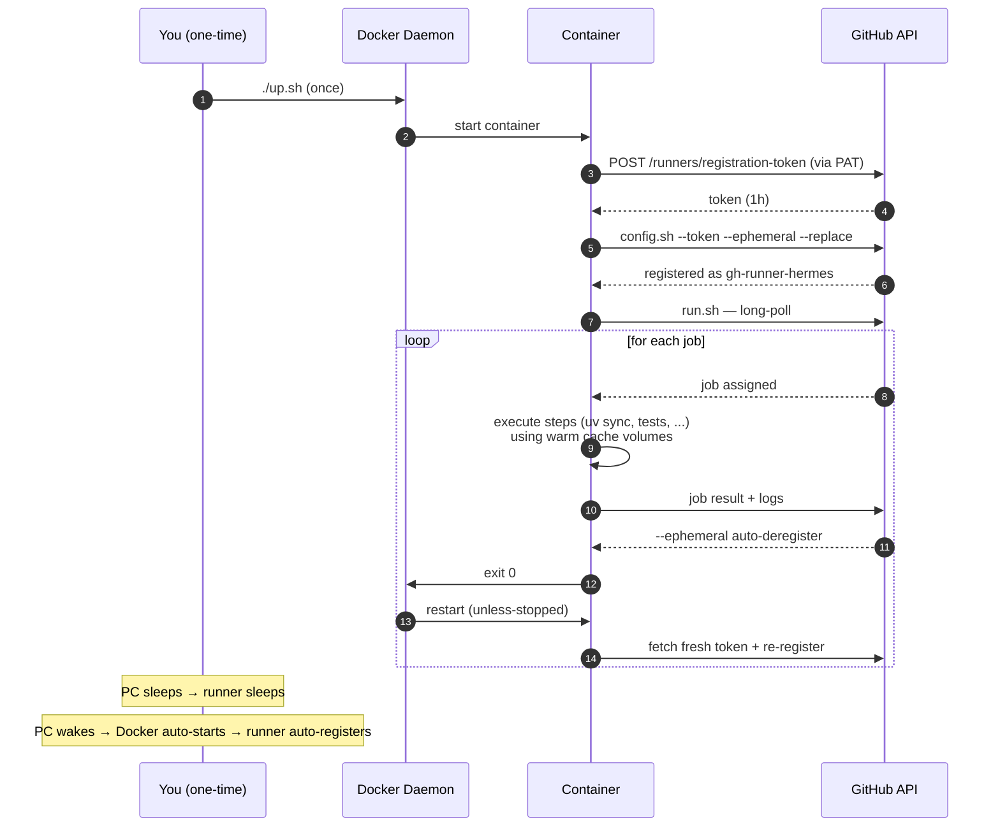

# GitHub Actions self-hosted runner (Docker, 24/7)

Docker-based self-hosted GH Actions runner for hermes CI. Install once,
forget it exists. The runner is 24/7 with `restart: unless-stopped` —
auto-recovers across Docker Desktop restarts, PC reboots, and each
`--ephemeral` job exit.

Generic naming (`gh-runner:latest` image, `gh-runner-hermes` container)
so the same setup is reusable for any repo by pointing
`RUNNER_REPOSITORY` at it.

## Prerequisites

- Docker Desktop (Windows / macOS) or Docker Engine (Linux), configured
  to start with the OS
- A fine-grained GitHub Personal Access Token — see [Setup](#setup-one-time)

## Setup (one-time)

### 1. Create the PAT

<https://github.com/settings/personal-access-tokens/new>

- Repository access: **Only select repositories** → `ricardoafo/hermes`
- Repository permissions:
  - **Administration**: Read and write
  - Metadata: Read (auto-selected)
- Expiration: 90 days recommended (calendar-reminder yourself to renew)

### 2. Create `.env`

```bash
cd scripts/dev/gh-runner
cp .env.example .env
# edit .env — paste the PAT into HERMES_RUNNER_REGISTRATION_PAT
```

`.env` is gitignored (repo root `.gitignore`, `.env` pattern). Never
commit it.

### 3. Set the workflow routing variable

```bash
gh variable set RUNNER_LABEL --repo ricardoafo/hermes \
    --body '["self-hosted","linux","x64","hermes"]'
```

The value MUST be a JSON array string — the workflow parses it with
`fromJSON()`. A plain comma-separated string will fail silently (jobs
skipped with no runner assignment).

When you want to fall back to GH-hosted `ubuntu-latest` (minutes reset,
plan upgrade, etc.):

```bash
gh variable delete RUNNER_LABEL --repo ricardoafo/hermes
```

### 4. Start the runner

```bash
./up.sh
```

First run builds the image (~3-5 min). Subsequent runs use the cached
image. The runner starts detached and stays up until you explicitly
stop it or Docker Desktop shuts down.

## Daily operation

Nothing to do. The runner is 24/7. PRs land, CI runs, done.

Occasional commands:

```bash
docker compose logs -f runner    # tail runner output
docker compose ps                # is it up?
./down.sh                        # stop cleanly (e.g. troubleshooting)
./down.sh --prune                # also wipe cache volumes (cold-start reset)
./up.sh                          # restart after ./down.sh
```

## Lifecycle



## What runs where

- **`runs-on: ${{ vars.RUNNER_LABEL && fromJSON(...) || 'ubuntu-latest' }}`** —
  every job in `.github/workflows/ci.yml` and `merge-queue.yml` uses this
  pattern. `RUNNER_LABEL` set → this runner; unset → `ubuntu-latest`.

- **Runner services in `compose.yml`**:
  - `runner` (label `hermes`): the CI pool.
  - `ops-runner` (`hermes-ops`): merge queue and CD.
  - `review-runner` (`hermes-review`): AI review.
  - `dependabot-runner` (`dependabot`): Dependabot, with its own DinD sidecar.
  - `backtest-runner` (`hermes-backtest`): `backtest.yml` only, on server-01 only
    ([ADR-023](../../../docs/architecture/adr-023-backtest-runs-on-server-01.md)). It sits behind the
    `backtest` profile, so `./up.sh` never starts it. On server-01, with `/srv/hermes-data` on the
    P310 owned by the container's `runner` user:

    ```bash
    docker compose build runner        # builds gh-runner:latest
    docker compose --profile backtest up -d backtest-runner
    ```

- **Image (`gh-runner:latest`) pre-baked for speed**:
  - Ubuntu 24.04 base
  - Python 3.14 (via `uv python install`)
  - uv 0.12.5 (pinned)
  - Node 24 (nodesource) + markdownlint-cli2 0.23.2 (pinned, npm -g)
  - gitleaks 8.30.1 (pinned binary — avoids Docker pull on every scan)
  - git, curl, jq, Docker CLI (socket-mounted for container-based actions)

- **Warm cache volumes persist across container restarts**:
  - `uv-cache`, `npm-cache`, `pip-cache` — dependency downloads
  - `pytest-cache`, `mypy-cache`, `ruff-cache` — incremental test/lint caches
  - `hypothesis-db` — shrinking database (also correctness)
  - `actions-cache` — downloaded actions (checkout, setup-uv, etc.)

- **Rebuild triggers**: bump ARG values in `Dockerfile` → `./up.sh`
  detects and rebuilds automatically.

## Replica count

**Default: 4 replicas.** Set once in `compose.yml` (`scale: 4`) and
mirrored by `up.sh`'s default arg. CI's 15 jobs finish in ~30s wall
time with 4 parallel replicas vs ~3 min sequential on 1.

Change temporarily:

```bash
./up.sh 8                             # bump to 8 (heavy day)
./up.sh 1                             # drop to 1 (troubleshoot a flaky job)
```

The scale reverts to `compose.yml`'s default after `./up.sh` without
args, so troubleshooting scale changes don't persist by accident.

If you need to override the compose default itself, edit `scale:` in
`compose.yml` and re-run `./up.sh`.

### Fully isolated second stack (rare)

```bash
COMPOSE_PROJECT_NAME=gh-runner-hermes-2 docker compose up -d
```

Runs a separate stack with its own volumes, own containers, own runner
identities in GitHub. Useful for per-runner cache isolation during
comparative testing — not needed for normal operation.

## Auth flows

### 24/7 flow (default, requires PAT)

The container's entrypoint uses `HERMES_RUNNER_REGISTRATION_PAT` to mint fresh
registration tokens for each registration cycle (once per job with
`--ephemeral`) and remove-tokens for clean deregistration on shutdown.

### Ad-hoc / troubleshooting flow (no PAT needed)

If you want a one-off runner without storing a PAT:

```bash
# Fetch a fresh token via gh (needs gh auth as an admin of the repo)
export RUNNER_TOKEN=$(gh api -X POST \
    /repos/ricardoafo/hermes/actions/runners/registration-token --jq .token)
docker compose up   # attached; ONE job then exits
unset RUNNER_TOKEN
```

`RUNNER_TOKEN` beats `HERMES_RUNNER_REGISTRATION_PAT` if both are set. Token
is 1h TTL, so this doesn't work for 24/7.

## Security notes

- **Docker socket mounted from host** — the runner effectively has
  root-equivalent on your machine via `docker`. Acceptable for solo-dev
  on a private repo with trusted PRs only. Do NOT open the repo to
  public contribution while using this runner.
- **PAT lives in `.env` only** — `.env` is gitignored by the repo root
  `.gitignore` (`.env` pattern excludes at every path). Never commit.
- **`--ephemeral` runner** — each container processes exactly one job
  then exits. No state accumulation beyond the cache volumes.
- **`--replace` on registration** — duplicate names self-clean if a
  previous run didn't deregister (crash, force-kill).
- **PAT rotation** — set a calendar reminder for the PAT expiry.
  Generate a new one before expiry, update `.env`, `./down.sh && ./up.sh`.

## Checking runner health

`hermes runners` (add `--json` for scripts) reads the runner list from the
GitHub API and prints online/total, busy and a status per label (`hermes`,
`hermes-ops`, `hermes-review`, `dependabot`; all but `hermes` appear once
such runners exist).

- Needs `HERMES_GITHUB_TOKEN` in `.env.local` or the environment: a token
  with `Administration: Read` on the repository. The bot token gets 403.
  `HERMES_GITHUB_REPO` overrides the default `ricardoafo/hermes`.
- **OK**: at least half the runners of every label are online. Busy counts
  as online. One runner offline between jobs is normal: runners are
  ephemeral and re-register after every job.
- **DEGRADED**: fewer than half of a label's runners are online. Exit 0.
- **FAIL**: a label has runners and none online, or no `hermes` runner is
  registered. Exit 1. Start with `docker compose ps` and `docker compose logs`.
- Exit 3 means the token is not set.

It is not part of `hermes health`, which runs on the VPS where no GitHub
token exists.

## Troubleshooting

- **`docker compose up` errors on missing `HERMES_RUNNER_REGISTRATION_PAT`** →
  `.env` doesn't exist or PAT var is unset. See [Setup](#setup-one-time).
- **Registration fails with 401 / 403** → PAT expired or has wrong
  scopes. Recreate with `Administration: Read and write` on
  `ricardoafo/hermes`.
- **Runner shows offline in GH** → container exited unexpectedly. Check
  `docker compose logs runner`. Common causes: PAT expired, disk full,
  Docker Desktop paused.
- **`Cannot connect to Docker daemon`** → Docker Desktop not running.
- **Job hangs on socket operations** → `/var/run/docker.sock` group
  permissions differ from image assumption (GID 999). Adjust
  `groupadd -g` in `Dockerfile` to match host
  `stat -c '%g' /var/run/docker.sock`.
- **Manual cleanup** if a runner is stuck offline in GH:

    ```bash
    gh api /repos/ricardoafo/hermes/actions/runners \
        --jq '.runners[] | select(.status == "offline") | .id' \
        | xargs -I{} gh api -X DELETE \
            /repos/ricardoafo/hermes/actions/runners/{}
    ```

## Related

- `.github/workflows/ci.yml` — the workflows this runner serves
- `.github/workflows/merge-queue.yml` — same, for the merge queue
- [`docs/guides/ai-development-lifecycle.md`](../../../docs/guides/ai-development-lifecycle.md)
  — where this runner fits in the end-to-end flow
